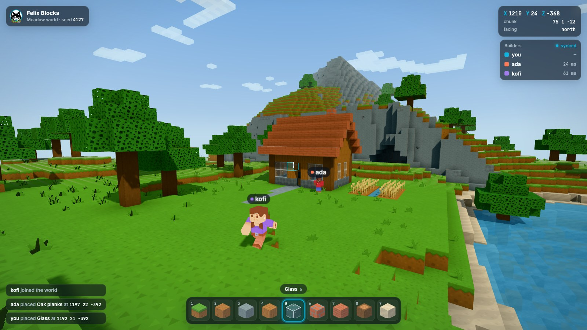
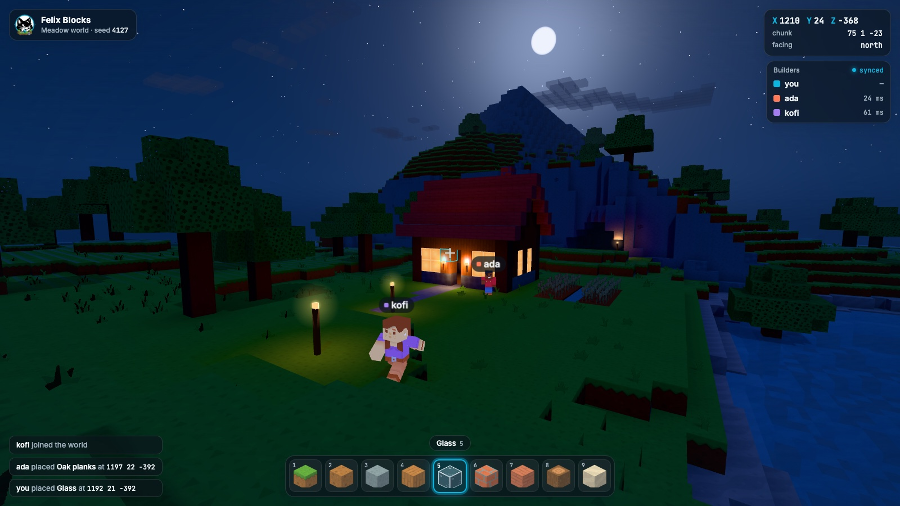
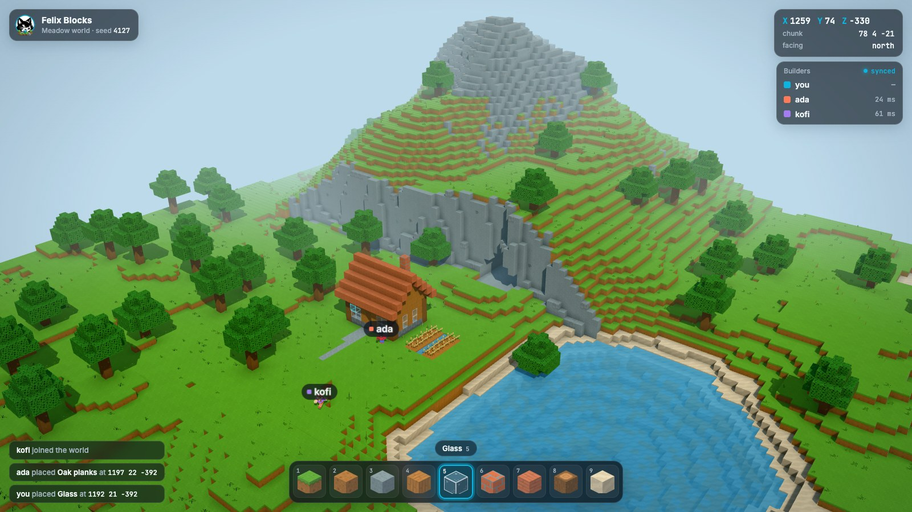
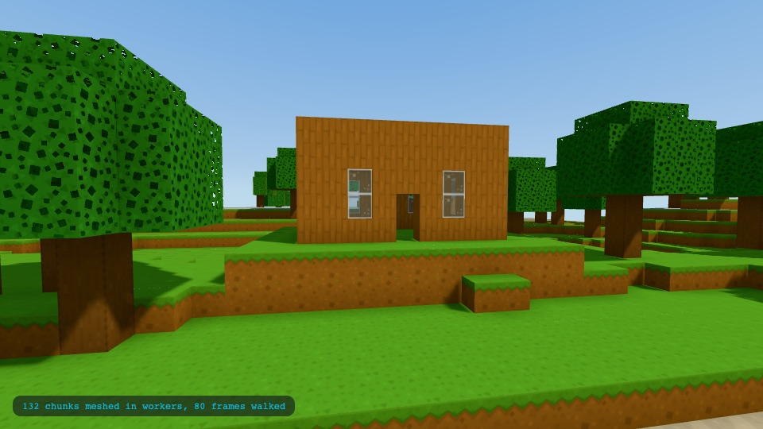
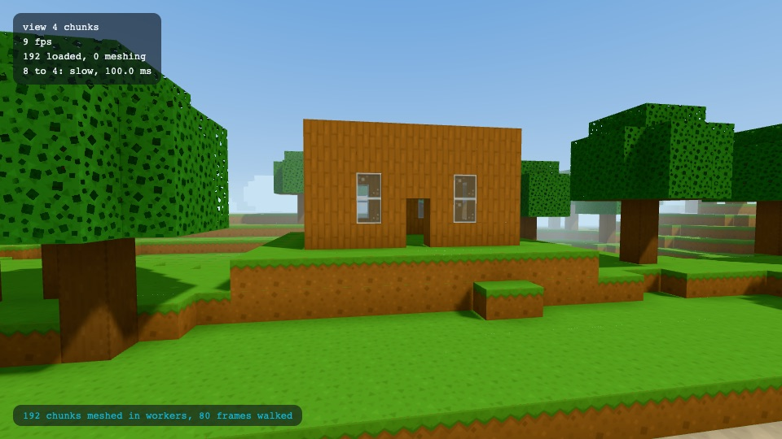

# Art direction

Felix Blocks should look like a sunny afternoon in a world you made: bright, clean
and friendly, with enough shading that the blocks read as solid things and not
flat tiles. The reference is [prototype/style-frame.html](../prototype/style-frame.html).

| First person                                              | Night                                       | Overview                                          |
| --------------------------------------------------------- | ------------------------------------------- | ------------------------------------------------- |
|  |  |  |

## Assets

| Pack              | Used for               | Notes                                                                                     |
| ----------------- | ---------------------- | ----------------------------------------------------------------------------------------- |
| Voxel Pack        | Block textures, plants | 128 px tiles, flat cartoon shading, one family                                            |
| Blocky Characters | Other players          | Rigged GLB with `idle`, `walk`, `interact-right` and more; faces +z; scaled to 1.8 blocks |

The files are in `web/assets/`, with `CREDITS.md` listing each pack's source and
licence. The block table in `core/src/blocks.rs` says which tile each face of
each block uses, and the colours below are in `web/src/palette.ts`.

Considered and left out for now: the Block Pack (3D blocks, useful later for store
art) and the Survival Kit (held items and props). Voxel Pack tiles that are sprites
on a transparent background, such as `rock_moss`, cannot be cube faces.

## Palette

| Role                   | Colour                             | Why                                                                                                        |
| ---------------------- | ---------------------------------- | ---------------------------------------------------------------------------------------------------------- |
| Grass                  | `rgb(102, 174, 62)`                | Kenney's grass is a cool mint; this is warmed toward the green in the logo                                 |
| Leaves                 | `rgb(66, 146, 58)`                 | Darker than grass so trees separate from the ground behind them                                            |
| Sky, zenith to horizon | `#3f93dc` to `#cfe8f6`             | Clear midday; the horizon colour is also the fog colour, so the world fades into the sky instead of ending |
| Selection and accents  | `hsl(192, 90%, 46%)`               | Felix cyan. It is the only saturated blue-green in the scene, so the outline is always the thing you see   |
| UI panels              | `rgba(12, 20, 28, 0.62)` with blur | Dark glass reads on both sky and grass                                                                     |
| Player colours         | coral `#ff7a59`, violet `#a37cf0`  | Warm and cool, both far from green and from the cyan                                                       |

Grass, leaves and plants are recoloured by brightness, the way a biome tint
works, so the tile's texture stays and only the hue changes. Stone is slightly
desaturated so it sits behind the grass. Everything else keeps Kenney's colours.
`TILE_STYLES` in `web/src/palette.ts` lists the restyle for each tile and
`web/src/tiles.ts` applies it when the atlas is built.

## Rules

- **Light comes from three places.** A warm sun with soft shadows, a sky/ground
  hemisphere light, and per-vertex shading baked into the mesh: ambient occlusion
  from the three neighbours of each corner, and sky light that falls down each
  column and spreads a few blocks sideways. That last one is what makes the cave
  mouth, the eaves and the inside of the house go dark without any extra lights.
- **Fog to the horizon colour.** Distance fades to the sky, so the edge of the
  loaded world never shows as an edge.
- **Textures are crisp up close.** Nearest-neighbour magnification, mipmaps for
  distance, and 16 px of padding around each tile in the atlas so mipmaps never
  bleed a neighbour in. The padding repeats the tile's edge pixels and is enough
  for mip levels 0 to 4, down to a tile 8 pixels wide on screen.
  `/atlas.html` draws every tile at several sizes, and CI compares each with the
  same tile on its own.
- **Three passes.** Opaque blocks, cut-out blocks (leaves, plants) with an alpha
  test so they cast proper shadows, and blended water and glass last. Water sits
  0.12 below the block top so shorelines read.
- **Players carry their name.** A dark pill with the player's colour, fixed in
  screen size so names stay readable at any distance.
- **UI**: Inter for words, JetBrains Mono for anything numeric (coordinates,
  chunk, latency, slot numbers), cyan for the selected slot and Felix state.
  Hotbar icons are drawn from the same restyled tiles as the world.

## Meshed chunks

`/chunks.html` draws a made-up world (hills, a lake, trees and a house) the way
the game will: chunks meshed in workers, the atlas on every quad, the sun and
hemisphere light of the style frame, soft shadows and fog. The camera walks across
chunk boundaries while new chunks stream in, then stops and the page keeps drawing.

Run `npm run dev` in `web/` and open it, or `npm run chunks -- <url of chunks.html>`
to check it headless. The check fails if:

- the page meshes any chunk itself. The page counts the meshing it does on its own
  thread, which has to be zero while workers do the work. The same walk with
  `?inline=1` meshes on the page and has to count every chunk, so the count is known to
  see it.
- the page spends more than 5 ms (95th percentile) turning a chunk's mesh into scene
  objects.
- a chunk in range at the end of the walk is not drawn.
- a merged quad does not match the same blocks drawn separately. It checks a floor and a
  wall whose quads are not square, with the anisotropic filtering the game uses. It also
  draws both with the wrong shader and fails if it does not see seams, so it is known to
  notice them.

Not done yet: the sky light that darkens caves and eaves, and plants.

### View distance and the debug panel

The view distance, 4 to 12 chunks, follows the frame time (see
[design.md](design.md#rendering)). The chunks page takes these options:

- `?adapt=1` starts at 8 chunks and lets the frame time move it. It shows the panel.
- `?tier=8` holds the distance at 8 chunks (any whole number from 4 to 12) and never moves it.
- `?debug=1` shows the panel, with the distance, the frame rate, the chunks loaded and the last changes. F3 toggles it.
- `?slow=40` adds 40 ms of work to each frame, which makes the distance step down, as in the picture: the fog closes
  in with it.

The panel keeps updating after the scripted walk ends, so you can leave the page open and watch it.

CI loads the `?adapt=1&slow=40` case and fails if the distance does not come down or the panel does not say so. That
shows a step down happens under 40 ms frames. It does not show that the controller follows the frame time in both
directions; the unit tests in `web/src/view-distance.test.ts` cover that. Whether a laptop iGPU holds 60 fps at 8
chunks is not something headless Chromium can answer, because it renders in software. It has to be measured on the
hardware:

1. On a laptop with an integrated GPU, serve the site (`npm run dev` in `web/`) and open
   `/chunks.html?tier=8&debug=1`.
2. Let the walk finish and read `fps` in the panel. It should stay at 60.
3. Open `/chunks.html?adapt=1` to see where the distance settles. It starts at 8, steps down if the frames are late,
   and climbs back one tier at a time if they are not.

## Night

Night is the same world under a moon: dark but never black, so you can still
see what you are building.

- **Cool and dim, not dark.** A blue hemisphere light and a weak moonlight from
  behind the camera, with a blue-grey tint on the blocks so the greens lose their
  daytime saturation. The sky runs from `#0a1430` to `#2b3f68`, with stars and a
  moon, and the fog is `#1f2d4f`.
- **Warm light is where people are.** Glass in a lit house glows amber, a warm
  light inside spills out of the door, and torches and lanterns are short-range
  orange point lights with a soft halo. Warm against cool is what makes a night
  frame read.
- **The overlay does not change.** Its dark glass panels already sit on a dark
  scene, and the cyan selection stays the brightest cool colour on screen.

## Using the style frame

Serve the repository root (`python3 -m http.server`) and open
`/prototype/style-frame.html`. Drag to look around.

| Parameter        | Effect                             |
| ---------------- | ---------------------------------- |
| `?view=overview` | The wide shot, with orbit controls |
| `?time=night`    | The night version of either view   |
| `?ui=0`          | Hide the overlay                   |

The screenshots above are the default view, `?time=night` and `?view=overview`
at 1600 × 900.
