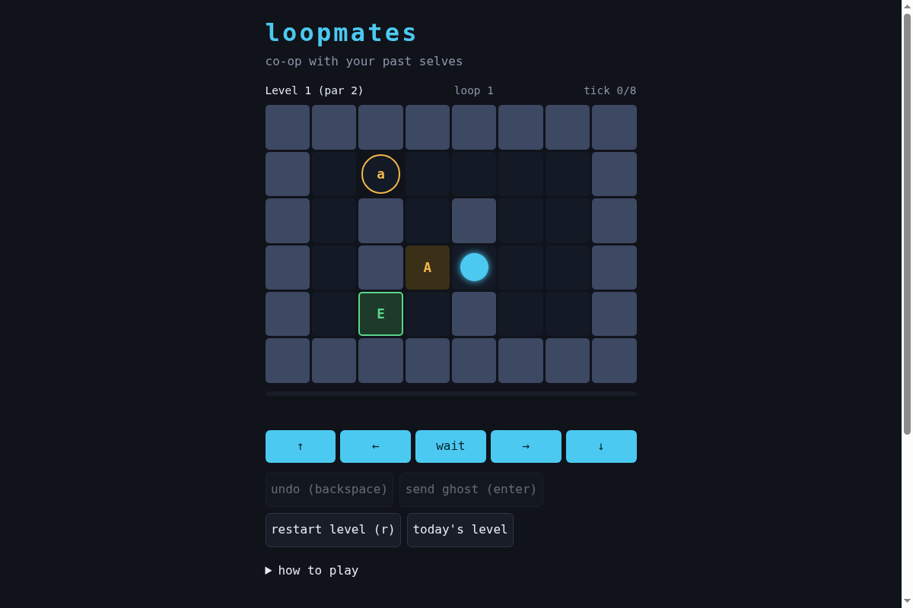

# loopmates

A turn-based puzzle where you cooperate with your own past loops.

**Play:** https://therealalexxx.github.io/loopmates/


You get a fixed number of ticks per loop. When a loop ends it replays as a
ghost, at the same time as your next loop. Lowercase tiles are buttons, the
matching capital tiles are doors. A door is open on a tick when a ghost stands
on its button on that tick. You can't hold a door for yourself.

Reach `E` in as few loops as you can. Par is the true minimum.

Open https://therealalexxx.github.io/loopmates/#daily for the level of the day. It is the same level for everyone on a given UTC date, and finishing it offers a copy-able result line.

Build your own at https://therealalexxx.github.io/loopmates/editor.html. It solves the level as you paint and gives you a link (`#c=...`) anyone can play. Custom levels are encoded in the URL, nothing is stored on a server.

Keys: arrows or WASD to move, space to wait, enter to send the current loop as
a ghost, backspace to undo a tick, r to restart.

## How par is computed

`sim.js` has an exhaustive solver. For the current set of open doors it lists
every distinct way a ghost can hold buttons (the "options"), drops options that
are dominated by another (holding more is never worse), and recurses. Within a
level's loop budget this finds the minimum number of loops, and `solve()`
returns a concrete plan.

Two details keep it small:

- A ghost only matters through which button it holds on which tick, so the
  search merges ghost paths with the same hold pattern.
- Adding a ghost can only open more doors, so a recorded loop stays legal when
  later ghosts are added.

## Tests

```
node --test test.js test-daily.js test-share.js
```

The suite cross-checks the solver against a brute force over every move string
on tiny levels, replays the stored plan for every shipped level, and re-solves
each level to confirm its par is minimal.

## Levels

`levels.json` is produced by `gen-levels.js`: random rooms, doors placed on the
shortest path from start to exit, kept only if the solver says par is at least 2
and one tick less changes the answer.

```
node gen-levels.js <seed> <count>
```

## License

MIT

## Development

Tests need Node 18+ and one install (jsdom, used to drive the real UI in a DOM):

```sh
npm ci
node --test
```
