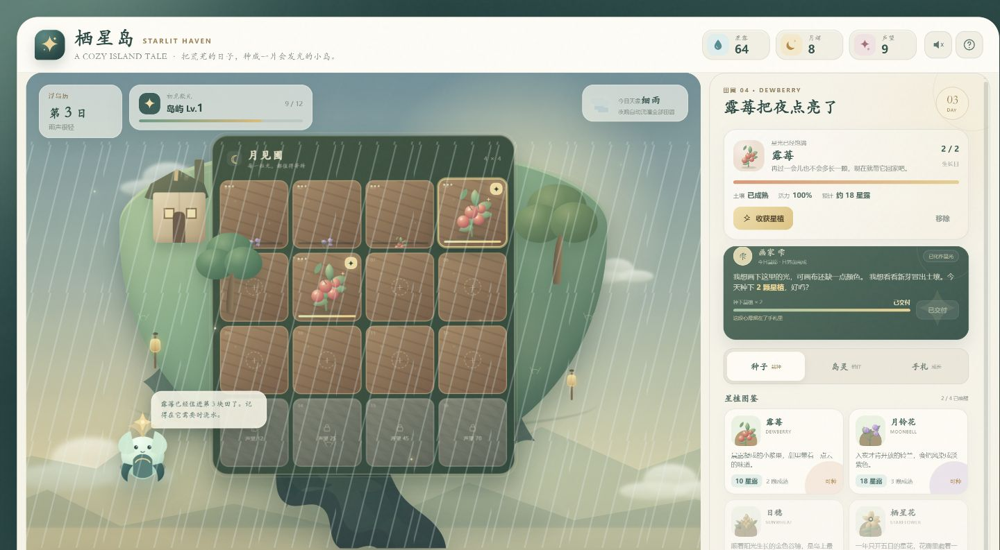
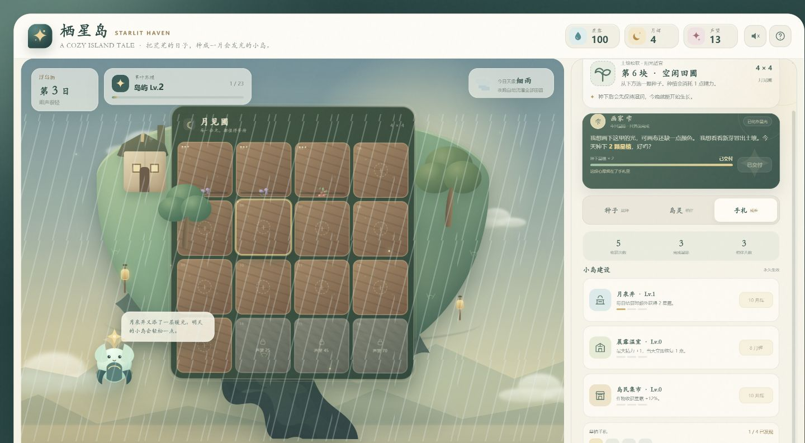
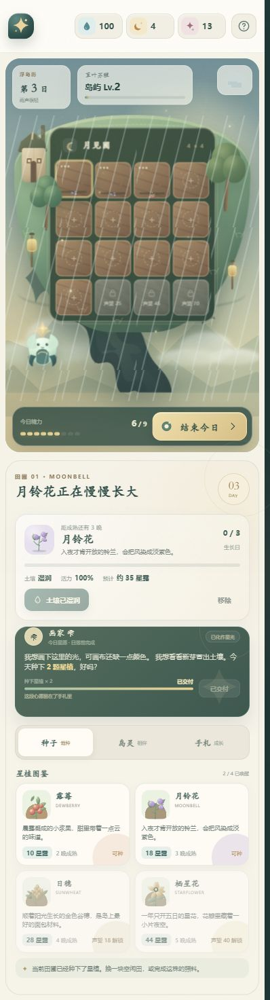

# Starlit Haven

> 栖星岛 · A cozy island farming and management game.

[](LICENSE)
[](https://github.com/ZhuangHT-1201/starlit-haven/actions/workflows/pages.yml)
[](game.js)

**Starlit Haven** is a small, single-player game about restoring a floating island one season at a time. Plant luminous crops, read the weather, spend your daily energy wisely, fulfill travelers' wishes, and invite gentle spirits to share the island with you.

No account, backend, or build step is required. The entire game runs in the browser and saves progress locally.

<p align="center">
  <a href="https://github.com/ZhuangHT-1201/starlit-haven"><strong>★ Explore Starlit Haven on GitHub</strong></a>
</p>


## Play

### Locally

Open `index.html` directly, or launch:

```powershell
.\启动游戏.bat
```

For a local web server:

```bash
python -m http.server 8080
```

Then visit `http://localhost:8080`.

GitHub Pages deployment is automated by `.github/workflows/pages.yml`. Once the first hosted deployment completes, the browser build is available at [zhuanght-1201.github.io/starlit-haven](https://zhuanght-1201.github.io/starlit-haven/).

## Features

- A 4 × 4 garden with four distinct luminous crops.
- Turn-based days driven by limited energy and meaningful choices.
- Four weather types that change growth and rewards.
- Daily traveler wishes, island fame, and unlockable plots.
- Three recruitable island spirits, each with a different passive blessing.
- Permanent island upgrades with their own economic tradeoffs.
- A detailed day-settlement screen and automatic local saves.
- Procedural ambient audio and responsive desktop/mobile layouts.
- Zero external assets: every illustration is drawn with SVG and CSS.

## Screenshots

### A living floating island



### Grow, build, and make the island your own



<p align="center">
  
</p>

## How to Play

1. Select an empty plot, then choose a seed.
2. Planted crops begin with moist soil. Water them again on later days to keep growing.
3. End the day to resolve crop growth, weather, income, and energy recovery.
4. Harvest mature crops before sunset and deliver traveler wishes for dew and moon shards.
5. Raise your island's fame to awaken new crops and sleeping plots.
6. Spend moon shards on spirits and permanent island upgrades.

Rain waters every plot automatically. Wind gives watered crops an extra day of growth. Clear skies increase harvest income, while mist makes traveler wishes more generous.

## Technology

- HTML5
- CSS3
- Vanilla JavaScript
- Inline SVG art
- Web Audio API
- LocalStorage persistence

There are no runtime dependencies and no build pipeline.

## 中文说明

《栖星岛》是一款适合碎片时间游玩的单机休闲养成策略小游戏。你需要在有限的每日精力中种植、浇水、收获，并根据天气安排经营节奏。通过完成旅人的星愿积累声望与月辉，解锁新的星植、田圃、岛灵和小岛建筑。

游戏无需联网，进度会自动保存在当前浏览器中。

## Project Structure

```text
.
├── index.html
├── styles.css
├── game.js
├── screenshots/
├── README.md
├── LICENSE
└── 启动游戏.bat
```

## Contributing

Bug reports, accessibility improvements, new balancing ideas, and small visual refinements are welcome. Please keep the game lightweight, dependency-free, and playable without a build step.

## License

Released under the [MIT License](LICENSE).
