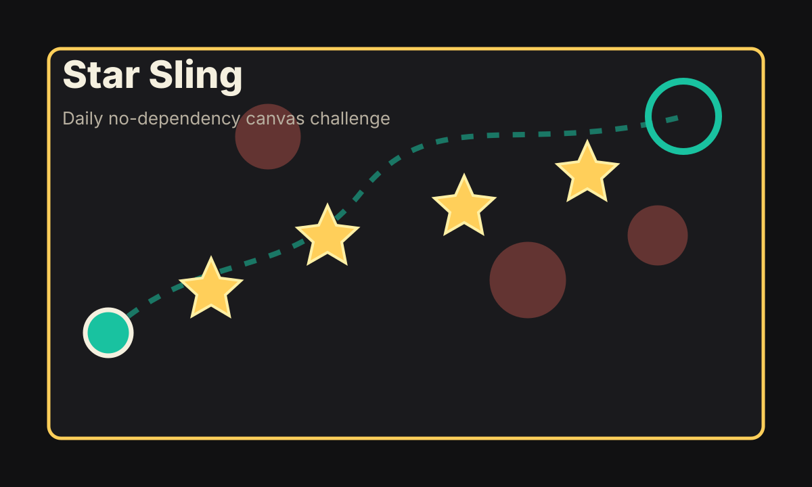

# Star Sling

Star Sling is a tiny daily canvas game: start the round, drag from the star core, release to sling through all seven stars, then dock before eight shots run out.



Live demo: https://bte808.github.io/fun-20260604-a-star-sling/

## What it can do

- Generates a deterministic daily field from the date, so a shared link gives everyone the same challenge.
- Runs fully in the browser with static HTML, CSS, and JavaScript. No build step, account, server, or asset download.
- Tracks score, heat, stars, shots, grade, local daily best, and a copyable result line.
- Works with pointer input on desktop and mobile, including a narrow `390x844` layout check.

## Why it is useful

It is a low-friction browser toy for a quick break, a daily challenge, or a shareable score post. The whole project is small enough to read, fork, and remix without installing a framework.

## Why it is fun

The field is immediately readable: gold stars are rewards, red fields are danger, the teal ring is the dock. Every sling leaves a trail, so a missed shot gives useful feedback instead of feeling random.

## Why it may be worth starring

- One URL, one minute, one complete loop.
- Original zero-dependency implementation with deterministic daily seeds.
- Clear extension hooks for new field generators, hazards, scoring modes, and social challenge links.
- Public GitHub Pages friendly, with a README preview and repeatable smoke checks.

## How to run

```bash
npm test
npm run serve
```

Then open:

```text
http://localhost:5224/index.html?date=2026-06-04
```

For a browser smoke check with local Chrome:

```bash
npm run verify:browser
```

The browser smoke script starts a local static server automatically unless `STAR_SLING_URL` is provided.

## Core play loop

1. Press `Start Round`.
2. Drag from the core toward the next star or dock.
3. Release to sling.
4. Collect all seven stars, avoid red fields, and dock before the shot limit.
5. Copy the score line or date link.

## Inspiration sources

This was inspired by public, recent browsing of [Show HN](https://news.ycombinator.com/show), where small visual web toys and game writeups remain easy to try, plus high-star browser game repositories such as [Hextris](https://github.com/Hextris/hextris). The project borrows only the shape of an instantly playable browser challenge, not source code, copy, art, or protected assets.

## Verification

Local checks cover:

- Required files and README sections.
- Deterministic daily field generation.
- A planned solver that completes the daily field with all stars and zero heat.
- Bad-shot behavior that cannot outscore a clean run.
- Desktop and mobile browser smoke via Chrome DevTools Protocol.

## Possible extensions

- Add a hard mode that hides the faint constellation route.
- Add moving red fields after each shot.
- Add weekly leaderboards through user-owned static JSON.
- Add more field names and procedural visual themes.

## License

MIT
