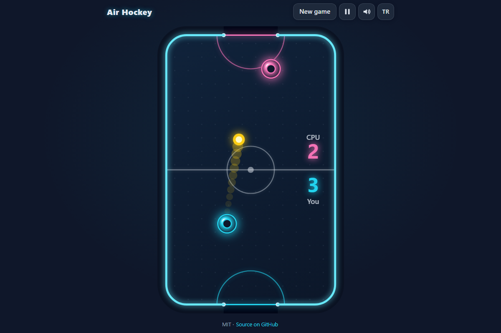

# Air Hockey - neon table hockey in your browser, against the computer or a friend

[](#tests)
[](LICENSE)

**▶ Play now: https://celaldrg.github.io/air-hockey/**



## Features

- Real table physics with a fixed 1/120 s time step: rounded corners, goal posts, wall restitution, light friction and a speed cap.
- Swept mallet-puck collisions, so even a very fast swipe never passes through the puck.
- Computer opponent on three levels (easy, medium, hard) that predicts the puck's path off the side walls and attacks when the puck is slow in its half.
- Two players on one device: each half of the screen is its own touch area (multi-touch), and the top player's score and banners face them.
- Matches to 5, 7 or 10 goals, win/loss record per level, Rematch.
- Neon look: glowing rim, puck trail, goal flash and banner. Sharp on high-DPI screens.
- Sounds made with Web Audio (hit, wall, post, goal) with a mute button.
- English and Turkish, pause button, settings saved in your browser. No libraries, no build step.

## How to play

Push the puck into the goal at the far end and guard your own goal. The first player to reach the goal target wins.

- **Touch:** drag anywhere in your half. The mallet sits a little above your finger so you can see it. With two players, each person drags in their own half.
- **Mouse:** move the mouse over the table; your mallet (bottom) follows it.
- **Keyboard:** arrow keys or WASD move your mallet. With two players, the arrows move the bottom mallet and WASD the top one.
- **P** or **Esc** pauses and resumes. The game also pauses when you switch tabs.

## Run locally

Any static server works, for example:

```sh
npx serve .
```

Then open the address it prints. ES modules need `http://`; opening `index.html` as a `file://` page does not work.

## Tests

```sh
node --test
```

The tests use Node's built-in runner, need no dependencies and finish in a few seconds. They cover:

- reflection off every straight wall and corner arc (same angle, speed times 0.9) and the speed cap;
- goal detection: a puck fully past the line between the posts scores, a puck hitting a post bounces off it (a glancing hit on the inside of a post can still go in);
- a still mallet reflects the puck along the contact normal, a moving mallet speeds it up;
- no tunnelling: 1,000 seeded fast swipes through the puck always hit it;
- mallets never leave their half; 1,000 seeded 20-second simulations never lose the puck except through a goal;
- the computer's defence prediction matches the simulated crossing within 0.01 for 200 shots with up to two wall bounces;
- the hard computer beats the easy one in at least 8 of 10 seeded matches to 7, and every hard-vs-medium match finishes with hard winning most;
- against a scripted human-like player the levels are distinct: it usually beats easy, sometimes beats medium and rarely scores against hard;
- match flow (goals, serve, pause, rematch, frame-rate independence), stats, settings, controls, translations and storage.

## Project structure

```
index.html          page shell
style.css           dark theme and layout
src/
  table.js          table geometry
  physics.js        puck, walls, goals, mallets, swept collisions
  ai.js             computer opponent and path prediction
  game.js           match state, fixed-step update, demo frame
  rng.js            seeded random numbers
  stats.js          win/loss record
  settings.js       setup choices
  controls.js       pointer and keyboard helpers
  view.js           table units <-> canvas pixels
  render.js         canvas drawing
  audio.js          Web Audio sound effects
  i18n.js           English and Turkish strings
  storage.js        safe localStorage wrapper
  main.js           page wiring
test/               node:test suites
test-utils/         shared test checks (kept outside test/ so the runner skips it)
```

## License

[MIT](LICENSE) © 2026 Celalettin Durgaç

---

## Türkçe

Hava Hokeyi - tarayıcında neon masa hokeyi, bilgisayara ya da bir arkadaşına karşı.

**▶ Hemen oyna: https://celaldrg.github.io/air-hockey/**

### Özellikler

- 1/120 sn sabit adımlı gerçek masa fiziği: yuvarlak köşeler, kale direkleri, duvardan sekme, hafif sürtünme ve hız sınırı.
- Taranan (sürekli) tokaç-pak çarpışmaları: çok hızlı bir vuruş bile pakın içinden geçmez.
- Üç seviyeli bilgisayar rakip (kolay, orta, zor): pakın yan duvarlardan sekerek izleyeceği yolu tahmin eder, pak kendi yarısında yavaşlayınca hücum eder.
- Tek cihazda iki oyuncu: ekranın her yarısı ayrı dokunma alanıdır (çoklu dokunma), üstteki oyuncunun skoru ve yazıları ona dönüktür.
- 5, 7 ya da 10 gole kadar maçlar, seviye başına galibiyet/mağlubiyet kaydı, rövanş.
- Neon görünüm: parlayan kenar, pak izi, gol parlaması ve yazısı. Yüksek çözünürlüklü ekranlarda keskin.
- Web Audio ile üretilen sesler (vuruş, duvar, direk, gol) ve sessiz düğmesi.
- İngilizce ve Türkçe, duraklat düğmesi, ayarlar tarayıcında saklanır. Kütüphane yok, derleme adımı yok.

### Nasıl oynanır

Pakı karşıdaki kaleye sok, kendi kaleni koru. Hedef gol sayısına ilk ulaşan kazanır.

- **Dokunma:** kendi yarında herhangi bir yerde sürükle. Tokaç parmağının biraz üstünde durur, böylece onu görürsün. İki oyunculu modda herkes kendi yarısında sürükler.
- **Fare:** fareyi masanın üzerinde gezdir; tokacın (altta) onu izler.
- **Klavye:** ok tuşları ya da WASD tokacını hareket ettirir. İki oyunculu modda oklar alttaki, WASD üstteki tokacı yönetir.
- **P** ya da **Esc** duraklatır ve devam ettirir. Başka sekmeye geçince oyun kendiliğinden durur.

### Yerelde çalıştırma

Herhangi bir statik sunucu yeterli, örneğin:

```sh
npx serve .
```

Sonra yazdığı adresi aç. ES modülleri `http://` ister; `index.html` dosyasını `file://` olarak açmak çalışmaz.

### Testler

```sh
node --test
```

Testler Node'un yerleşik test aracıyla çalışır, bağımlılık gerektirmez ve birkaç saniyede biter. Kapsam: her düz duvar ve köşe yayından sekme (aynı açı, hız × 0,9) ve hız sınırı; direkler arasından çizgiyi tamamen geçen pakın gol sayılması, direğe çarpanın sekmesi (direğin iç tarafına sürtünerek çarpan pak yine de gole girebilir); duran tokacın pakı temas normali boyunca yansıtması, hareket edenin hızlandırması; 1.000 hızlı vuruşta pakın içinden geçilmemesi; tokaçların kendi yarısında kalması; 1.000 adet 20 saniyelik simülasyonda pakın masadan yalnızca kaleden çıkması; savunma tahmininin 200 atışta 0,01 içinde tutması; zor bilgisayarın 10 maçın en az 8'inde kolayı yenmesi, zor-orta maçlarının hep bitmesi ve çoğunu zorun alması; insan gibi oynayan betikli bir oyuncunun kolayı çoğunlukla, ortayı arada bir yenmesi, zora ise nadiren gol atması; ayrıca maç akışı, istatistik, ayarlar, kontroller, çeviriler ve depolama.

### Lisans

[MIT](LICENSE) © 2026 Celalettin Durgaç
