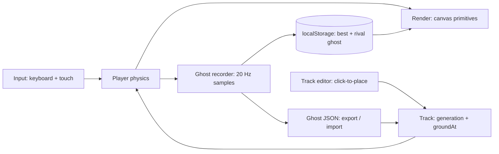

# Dirt Bike Ghost Racer

<!-- HERO SCREENSHOT — see "Visual assets" in REVIEW.md for what to capture.
     When you have a real capture, replace this comment with:
     
     Do not link a placeholder image that does not exist. -->

## Description

Dirt Bike Ghost Racer is a motocross time-trial game built with vanilla
JavaScript and the HTML5 `<canvas>` API — no game engine, no build step,
no dependencies.

You race a 12,000 px dirt track in one of four lanes, managing engine
heat, jumping ramps, avoiding mud slowdowns, and landing cleanly or
crashing. On top of that core loop, the game adds a click-to-place
custom track editor and shareable ghost races: every finished race is
recorded, your fastest run becomes a translucent ghost you can race
again, and ghosts can be exported as JSON and sent to a friend to race.

It was inspired by classic NES motocross games. It is not affiliated
with, or a copy of, any commercial game, and it uses no commercial
assets, sprites, or names.

## Prerequisites

To play, you only need:

- A modern browser with HTML5 Canvas support (any current Chrome,
  Firefox, Safari, or Edge). No install, no account, no server.

To develop or run the checks, you also need, optionally:

- **Git** — only if you want to clone the repo instead of downloading it.
- **Python 3** — only for the recommended local server in Local
  Development. Any static file server works instead.
- **Node.js 20+** — only to run the syntax check locally (`node --check
  game.js`). It is not needed to play the game, and CI runs the same
  check on every push.

No npm install, no build tools, and no API keys are required.

## Installation

Clone the repo, or download it as a zip and extract it:

```bash
git clone https://github.com/enonymous1/dirt-bike-ghost-racer.git
cd dirt-bike-ghost-racer
```

That is the whole install. There are no dependencies to install and
nothing to compile.

## Local Development

### Run it locally

The game is a static site, so the most faithful way to run it is with
a local server (opening `index.html` directly from disk also works,
because the game uses no modules or fetches, but a server matches how
it will run on Pages):

```bash
python3 -m http.server 8000
# then open http://localhost:8000/
```

### Edit it

All game logic lives in `game.js`, organised in sections — constants,
input, track generation, player physics, track editor, ghosts,
drawing, HUD, and the main loop. Styling is in `style.css`, and the
page, HUD, editor panel, ghost panel, and touch controls are in
`index.html`.

To change gameplay tuning, start with the named constants at the top
of `game.js` (gravity, acceleration, heat rates, landing tolerance,
camera offset, crash walk/mash values). Ramp geometry lives in one
place, `OBSTACLE_GEOMETRY`, so changing a ramp size does not require
editing physics, launch, and drawing separately.

To swap in real sprites later, replace one drawing function —
`drawBike`, `drawRiderRunning`, or `drawObstacle` — with a
`drawImage()` call using the same position, angle, and scale. Nothing
else needs to change.

### Check it locally

```bash
node --check game.js
```

That is the same check CI runs. There is no shipped unit-test suite
yet — see REVIEW.md for why that is the next test investment, and
for the seeded-track helper (`Track.generate(seed)`) that makes
deterministic track tests possible.

### Manual test checklist

Before calling a change done, check these in a real browser:

1. Start a race, switch lanes, wheelie, jump a small and a large ramp,
   and land cleanly and badly (bad landing should crash you).
2. Mash `Z` / `X` after a crash and confirm you get back on the bike.
3. Overheat on turbo, confirm the 3-second stop, and cool down on a
   blue chevron Cool Zone.
4. Open the track editor (`E`), place and delete an obstacle by
   clicking, export and re-import a track, and race it.
5. Finish a race, race your best ghost, export it, import a friend's
   ghost, and race that ghost on its original track.
6. Type in the track JSON textarea, ghost JSON textarea, and author
   name field — typing spaces, arrows, `Z`, and `X` must edit text,
   not drive the bike.

## Deployment

This is a static site, so deployment needs no build step.

### GitHub Pages (recommended)

This repo ships a Pages workflow (`.github/workflows/pages.yml`)
that deploys the site with GitHub Actions — no build step, it
uploads the repo root as-is, so `index.html` at the root is what
Pages serves.

1. Push this repo to GitHub.
2. Settings → Pages → Build and deployment → Source:
   **GitHub Actions** (one-time setup).
3. Push to `main` again, or run the workflow manually from
   Actions → Pages → Run workflow.

The game will then be live at
`https://enonymous1.github.io/dirt-bike-ghost-racer/`, and every
later push to `main` redeploys it automatically. Do not set Pages
Source back to "Deploy from a branch" while this workflow runs —
that would replace the Actions deployment with a branch deployment.

### Any other static host

Upload or drag-and-drop `index.html`, `style.css`, `game.js`,
`README.md`, and `LICENSE` (plus `.github/` if you want CI) to
Netlify, Vercel, Cloudflare Pages, or any static file host. No
server-side code, environment variables, or database is involved.
Your saved tracks and ghosts live in the browser's localStorage on
the player's own device and are not sent anywhere.

## Features

- **Four lanes** — switch with Arrow Up / Down. Nearer lanes draw
  slightly larger for a pseudo-3D feel.
- **Wheelies and air pitch** — Arrow Left / Right wheelie on the
  ground and pitch the bike in the air. Left is nose-up and shorter,
  right is nose-down and longer.
- **Engine heat (TEMP)** — `Z` accelerates steadily and heats slowly,
  `X` is turbo and heats fast. Coasting cools, blue chevron Cool
  Zones cool fast, and a full gauge forces a 3-second overheat stop.
- **Ramps, mud, and cool zones** — small ramps and large plateau
  ramps launch the bike. Land with your angle matching the ground
  (within about 22°) or you crash and must mash `Z` / `X` to run
  back to your bike. Mud slows you drastically but never crashes you.
- **Custom track editor** — press `E` from the title or finish
  screen, click the canvas to place obstacles, right-click to delete
  them, and scroll with Arrow Left / Right or the mouse wheel.
  Tracks save in the browser and export/import as JSON.
- **Ghost races** — every finished race is recorded at 20 samples
  per second. Your fastest run is kept as your best ghost. **Race
  Ghost** races a translucent ghost on its original track, so ramps
  and mud line up exactly. Export a ghost as JSON, send it to a
  friend, and they can import it and race you.
- **HUD** — lap time, speed, TEMP bar (green to yellow to red),
  lane, and a live ghost delta in seconds (ahead / behind).

<!-- GAMEPLAY SCREENSHOT — place here, at the end of Features.
     Replace this comment with:
      -->

## Controls

| Key | Action |
| --- | ------ |
| Arrow Up / Down | Change lane |
| Arrow Left / Right (ground) | Wheelie |
| Arrow Left / Right (air) | Pitch: Left = nose up, shorter jump; Right = nose down, longer jump |
| Z | Standard acceleration |
| X | Turbo acceleration |
| Z / X after a crash | Mash to run back to your bike faster |
| Enter / R | Start / restart |
| E | Open the custom track editor (from the title or finish screen) |
| Esc | Leave the track editor |

Touch buttons for lane, pitch/wheelie, `Z`, and `X` are shown below
the game on touch devices.

<!-- ANIMATED DEMO GIF — place here, at the end of Controls.
     Replace this comment with:
      -->

## Custom Tracks

A track is a JSON list of obstacles:

```json
[
  { "x": 1000, "lane": 3, "type": "SMALL_RAMP" },
  { "x": 1500, "lane": 3, "type": "MUD" },
  { "x": 2100, "lane": 2, "type": "LARGE_RAMP" },
  { "x": 2800, "lane": 1, "type": "COOL" }
]
```

- `x` is the position along the 12,000 px track, `lane` is 0–3
  (0 is the back lane, 3 is the front lane).
- `type` is `SMALL_RAMP`, `LARGE_RAMP`, `MUD`, or `COOL`.
- Imported tracks are validated: bad types, lanes, or positions are
  dropped, and same-lane overlaps are refused in the editor, because
  two obstacles at the same spot would break ground detection.

<!-- EDITOR SCREENSHOT — place here, at the end of Custom Tracks.
     Replace this comment with:
      -->

## Ghosts

A ghost is a JSON object with the run's name, finish time, the exact
track it ran on, and its samples:

```json
{
  "version": 1,
  "name": "Player",
  "trackId": "abc123",
  "track": [{ "x": 1000, "lane": 3, "type": "SMALL_RAMP" }],
  "finishTime": 58.42,
  "samples": [{ "t": 0, "x": 40, "y": 515, "lane": 3, "angle": 0, "crashed": false, "riderX": null }]
}
```

A ghost only races on its stored track. That is deliberate: a ghost
from a random track would not line up on a different random track.
Storing the track in the ghost makes it self-contained and shareable
as a single file. A 60-second ghost is about 1,200 samples, roughly
100 KB of JSON.

<!-- GHOST SCREENSHOT — place here, at the end of Ghosts.
     Replace this comment with:
      -->

## Architecture



Project layout:

```text
index.html                  Page, HUD, track-editor panel, ghost panel, touch controls
style.css                   Layout, HUD, and editor styling; the canvas scales responsively
game.js                     Game loop, physics, track generation, editor, ghosts, drawing, HUD
.github/workflows/ci.yml    Syntax check run on every push / pull request
.github/workflows/pages.yml Deploy to GitHub Pages on push to main (plus manual dispatch)
docs/assets/                Screenshots, demo GIF, and architecture diagram (captured, not faked)
```

`game.js` is a single file by design, so the game runs by opening
`index.html` or serving the folder — no modules, no build step, and
no `file://` CORS problem. That single-file choice is also the main
architectural trade-off: it keeps deployment trivial, but it makes
unit testing harder (tests currently need DOM stubs) and means new
features touch a shared global state. The modularisation path that
preserves the no-build deploy is: split into ES modules behind a dev
server, or keep the single file and enforce section boundaries and
the obstacle-geometry registry.

<!-- ARCHITECTURE DIAGRAM — place here, at the end of Architecture.
     Replace this comment with:
     
     The Mermaid diagram above is the same diagram in text form, so the
     section is useful even before the SVG is captured. -->

## License

MIT — see [LICENSE](LICENSE).
