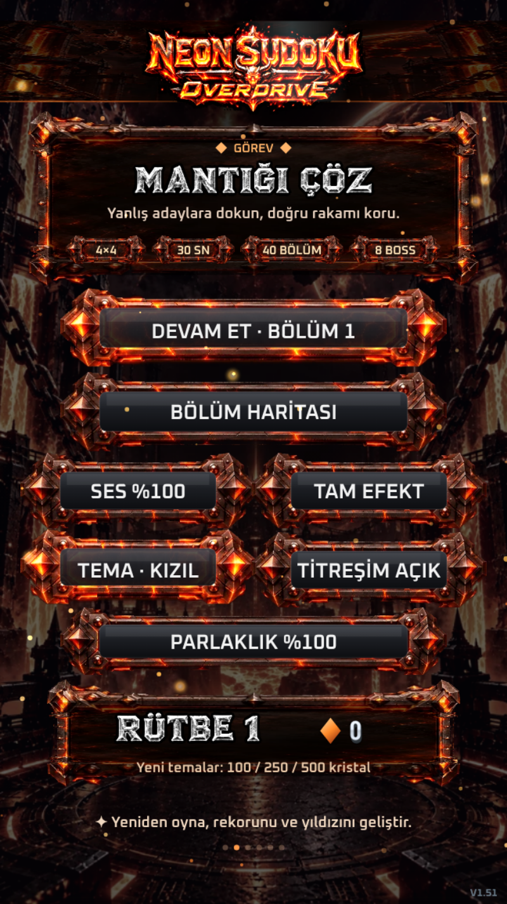
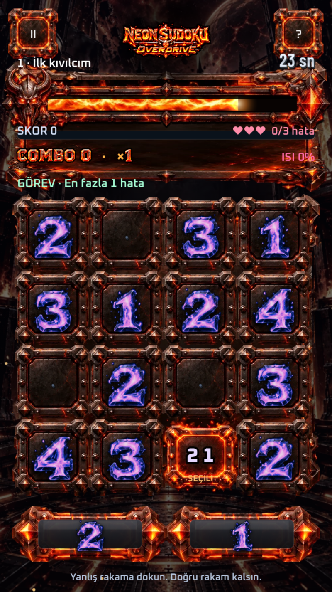

# Neon Sudoku: Overdrive

A fast, arcade-style 4×4 Sudoku for mobile browsers. Instead of writing digits, you eliminate wrong candidates under a 30-second timer while bosses attack your time bar.

**Status:** in active development. The current build is V1.52 (see [`VERSION`](VERSION) and the [changelog](CHANGELOG.md)).

**Play:** https://fatalityss.github.io/neon-sudoku-overdrive/ (works best on a phone, in portrait)

| Main menu | Gameplay |
|---|---|
|  |  |

## How it plays

Each cell shows a set of candidate digits. Tap the wrong candidates to remove them; when only the correct digit is left, it locks in. The usual Sudoku rule applies: no digit may repeat in a row, column or 2×2 box.

- **40 levels** with a 30-second timer that scales with puzzle size.
- **8 boss fights.** Each boss attacks the time bar with its own weapon (flame breath, crystal rain, sniper shot, laser arm and more). Breaking the attack in time saves your seconds.
- **Combo and heat system:** fast, clean eliminations raise your combo multiplier and the "heat" meter.
- **Per-level bonus missions**, such as finishing with at most one mistake.
- **Progression:** stars, rank, crystals and unlockable colour themes.
- **A taunting gremlin** that reacts to your mistakes.
- **Mobile-first:** touch input, haptic feedback, brightness and effect settings.

The interface is currently in Turkish. An English translation is on the roadmap.

## How it is built

The game is plain JavaScript on an HTML canvas, with no framework and no dependencies.

```
src/
  base-game.html      core game: puzzle logic, levels, scoring, rendering
  v1-entegrasyon.js   asset loading and integration layer
  v1-tema.js          visual theme and frame rendering
  v1-sinema.js        clear and impact animations
  v1-trol.js          the gremlin
  v1-boss.js          boss weapons and time-bar attacks
  v1-cehennem.js      background effects
  v1-yazi.js          title and text rendering
  v1-menu.js          menu layout
  v1-perf.js          performance tuning for phones
  v1-dokunus.js       touch and haptics
  v1-denge.js         timer balancing
build/
  build.py            embeds all assets and builds a single offline HTML file
VERSION               current build number (read by build.py)
CHANGELOG.md          release notes
index.html            the built game (V1.52)
```

Each `v1-*.js` file extends the base game's prototype, and they load in the order listed above. `build/build.py` base64-embeds every image, sound and font into one self-contained `index.html`, so the game runs offline and can be opened directly on a phone. The build number is read from `VERSION` and stamped into the page title and `globalThis.NEON_VERSION`; bump that file before rebuilding a release. If `media/` and `media-compressed/` are not present, the script reuses the assets already embedded in the current `index.html`, so code-only changes can be rebuilt from a plain checkout with `python3 build/build.py`.

Timer formula (V1.50): starting time is `30 + max(0, moves − 12) × 0.9` seconds, which gives 30–52 seconds per level.

## Roadmap

- [ ] Reduce repetition across the 40 levels with new mechanics in later chapters
- [ ] English localization
- [ ] Per-file asset source list and replacement of non-commercial assets
- [ ] Load music on demand to lower memory use on older phones
- [ ] Split `base-game.html` into readable modules

## License

Source code: [MIT](LICENSE). Embedded media: see [ASSETS.md](ASSETS.md).
