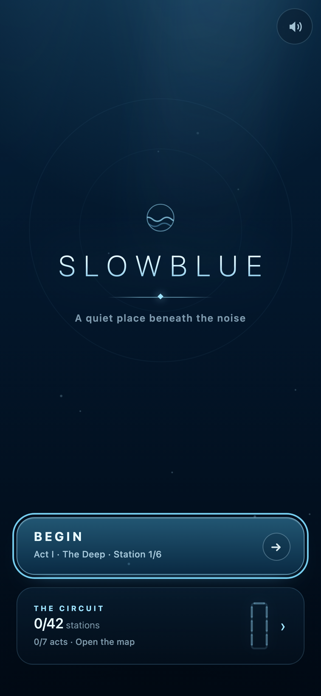
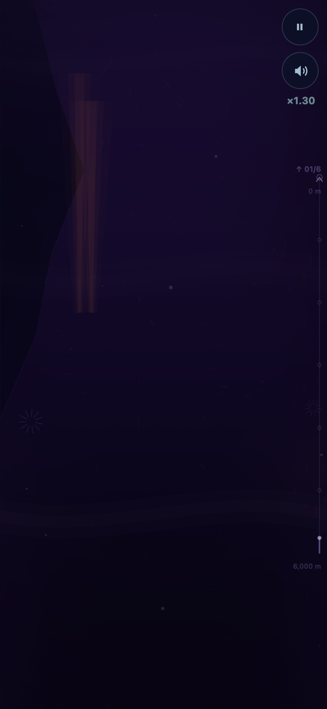
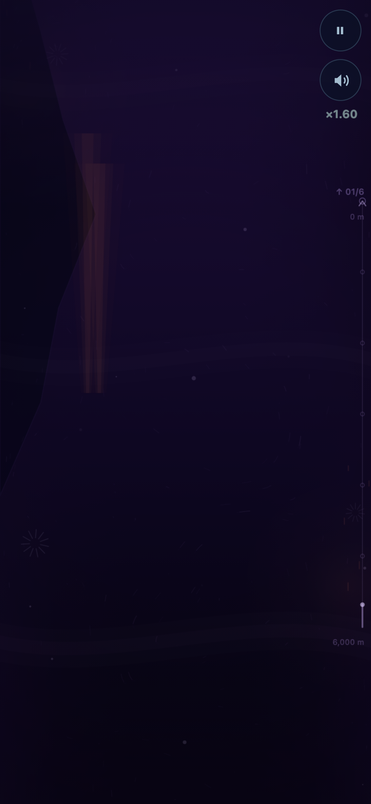
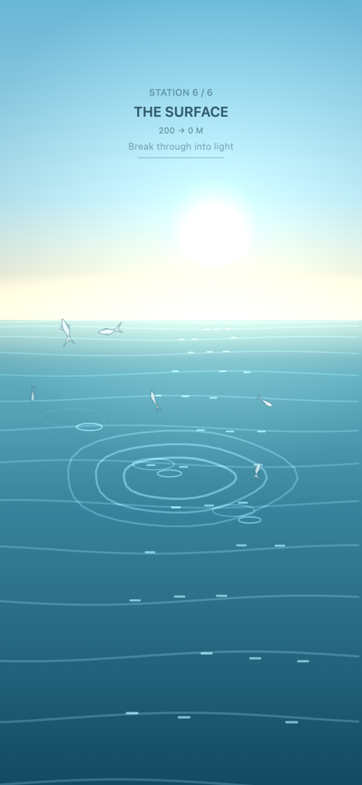
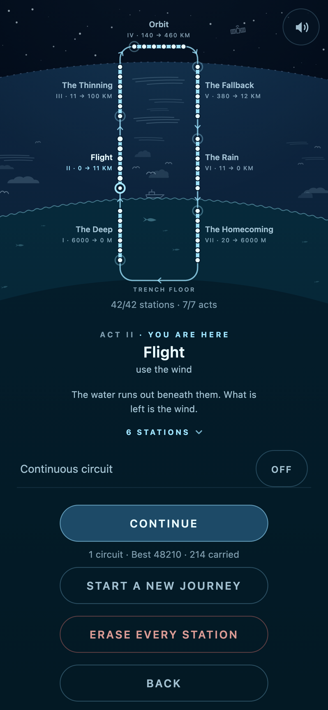

# Slowblue

**You do not control the fish. You control the ocean.**

A complete, mobile-first game that runs in a browser. You drag the medium; the medium drags
the life in it. Seven acts, forty-two hand-built stations, no menus in the way of them — and
it is built to be watched as much as played: nothing clicks, nothing flashes, and the
loudest thing on screen is a ring asking to be filled.

It is not a climb. It is a **circuit**: sea, sky, upper air, orbit, re-entry, rain, sea
again, and the last frame is the trench floor the first one was shot on. The player is told
none of that. They find out when the water starts looking familiar.

[](https://horakdani.github.io/Slowblue/)
[](LICENSE)


<p align="center">
  
  
  
  
</p>

## Play it

**[horakdani.github.io/Slowblue](https://horakdani.github.io/Slowblue/)** — open it on a
phone, in portrait, ideally with headphones. One button, then you are in the water.

There is no app store, no download and no account. It installs, too: "Add to Home Screen"
gives a full-screen game that runs with no signal. **Nothing is ever uploaded — there is no
network code in this project at all**, which is also why there is nothing to agree to
before playing.

### How it plays

* **Drag** to lay a current. A slow drag is wide and weak, a fast flick is narrow and
  strong, a circle is a vortex, and dragging against the shoal brakes it. One rule for all
  of them.
* **The ocean already moves.** The line you set up three seconds ago is not the line you
  are on any more — read the water, ride it or fight it.
* **Rings are the only reward.** A dashed ring is mandatory: hold enough of the shoal
  inside it for half a second and those fish join you. A thin unbroken ring is optional,
  and pays in more fish. Every ring holds a different kind of fish.
* **Keep them together.** Clear a section without letting the shoal come apart and the
  score multiplier climbs. Hitting rock costs individuals and panics the fish around it.
* You lose a dive when a mandatory ring is left behind or the swarm falls below 40 % of what
  you started with. From act III on, that costs only the *station*, and the journey
  survives.

Keyboard: `Esc` or `P` pauses, `R` restarts the same water, `Space` or `Enter` dives in.

## The circuit

What changes between acts is not the gesture but what the medium *answers* — and the medium
is a single number, its density, which is also the difficulty curve, the palette and the
sound.

| # | Act | Carrier | Medium | Your verb |
| --- | --- | --- | --- | --- |
| I | **The Deep** | a shoal | water | herd them |
| II | **Flight** | a flock | air | use the wind |
| III | **The Thinning** | spores and ice | thin, layered air | wait, and choose a layer |
| IV | **Orbit** | golden motes | none — gravity | aim ahead of them |
| V | **The Fallback** | meteor dust | vacuum → plasma → air | brake, and accept the medium |
| VI | **The Rain** | crystals, then drops | cloud, rain, river | gather them |
| VII | **The Homecoming** | plankton and marine snow | water again | let them settle |

The campaign is 432 authored sections and about 144 authored minutes (roughly 108 as
played). Nothing in it is procedural, and nothing in it can be impossible: every section is
checked by a corridor sweep that carries the swarm's real reach down the whole course, and
every mandatory ring has to lie on a line one body can fly through, in order.

Everything else — each act in turn, the map, the seven rhythms, the eight beds of sound — is
in [docs/GAME.md](docs/GAME.md).

<p align="center">
  
</p>

## What it is made of

* **TypeScript and Vite, with zero runtime dependencies.** No framework, no engine.
* **Canvas 2D for every pixel** — hard flat vector, discrete depth planes, no
  post-processing.
* **Procedural Web Audio for every sound.** Nothing is a sample: a bubble is a Minnaert
  resonator, a raindrop is the same equation at another radius.
* **A fixed 1/60 s simulation step**, a hot path that allocates nothing, and a picture
  budget that adapts to the device instead of asking the player to.
* **An installable PWA** with an offline service worker, served from GitHub Pages.
* **788 unit tests, a browser suite, and balance sweeps** that play the whole campaign with
  scripted hands. Every tuning number in the repo came out of a measurement, and the
  documents say which.

## Run it yourself

```bash
npm install
npm run dev        # dev server on all interfaces — open it on a phone on the LAN
npm run verify     # the gate: lint + typecheck + unit + build + e2e
```

Everything else — the full command list, URL parameters, the admin and debug surfaces,
deploying — is in [docs/DEVELOPING.md](docs/DEVELOPING.md).

## Documentation

| | |
| --- | --- |
| [docs/GAME.md](docs/GAME.md) | The game in full: every act, the map, the rhythms, the sound |
| [docs/DEVELOPING.md](docs/DEVELOPING.md) | Run, test, measure, tune, deploy; how the code is laid out |
| [docs/DESIGN-LENGTH.md](docs/DESIGN-LENGTH.md) | How the campaign was rebuilt to 144 minutes, and what the instruments measured |
| [docs/DESIGN-ASCENT.md](docs/DESIGN-ASCENT.md) | The design of the whole circuit, act by act, and its implementation status |
| [docs/EDITORIAL.md](docs/EDITORIAL.md) | A self-audit against the App Store and Google Play editorial criteria, where every verdict is a number or a file |
| [IMPLEMENTATION_NOTES.md](IMPLEMENTATION_NOTES.md) | Architecture, file inventory, measurements and the deliberate compromises |
| [CLAUDE.md](CLAUDE.md) | Working notes for whoever is in the repo next: traps, and the decisions that are settled |

## Contributing

Bug reports, device reports and balance arguments are all welcome; see
[CONTRIBUTING.md](CONTRIBUTING.md) for the gate a pull request has to pass and the
decisions that are already settled. Taking part means agreeing to the
[Code of Conduct](CODE_OF_CONDUCT.md). To report a security problem, see
[SECURITY.md](SECURITY.md).

## License

[MIT](LICENSE). © 2026 Daniel Horak.
