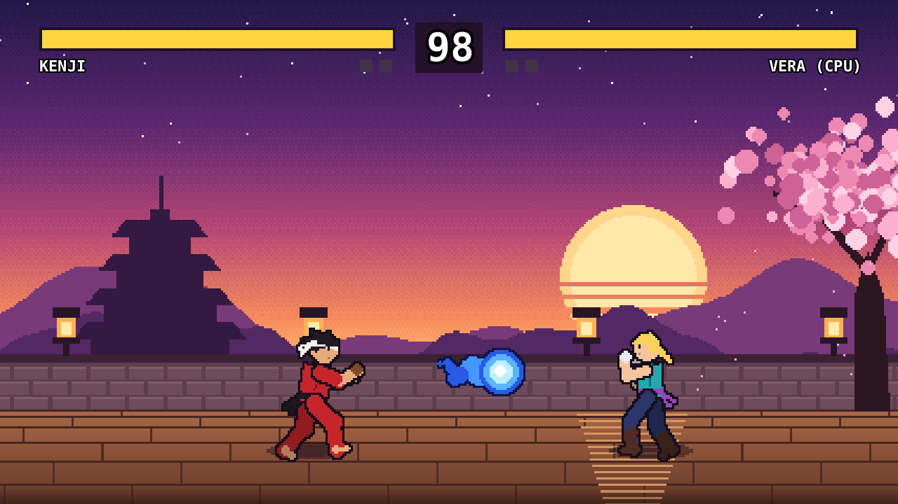
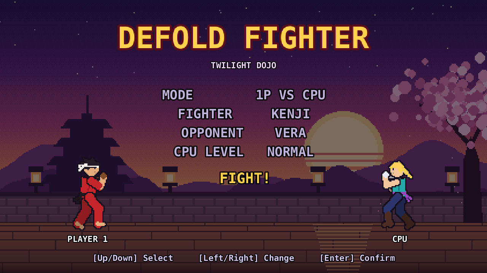
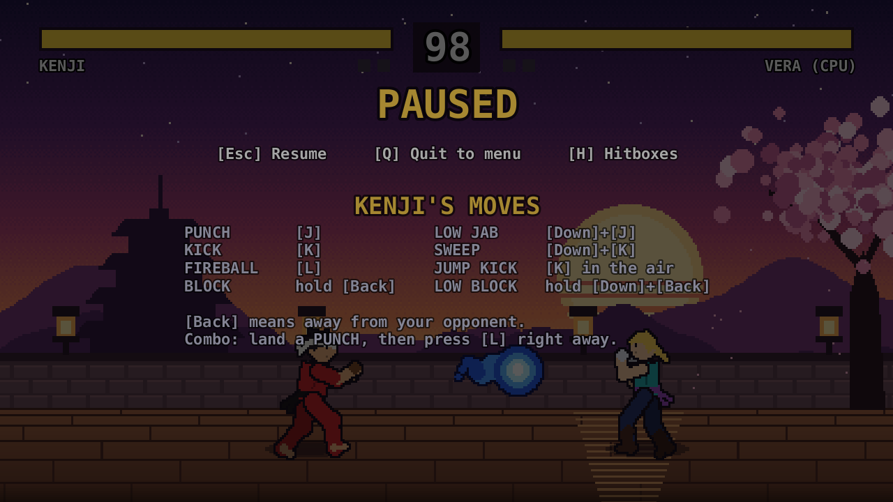
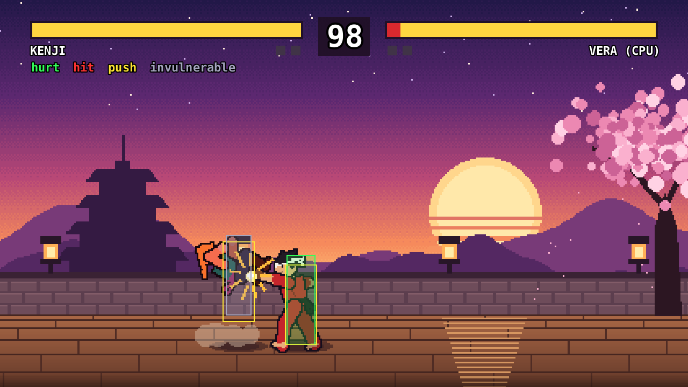

# Defold Fighter

A small 2D fighting game in the style of Street Fighter and Mortal Kombat. It's built with [Defold](https://defold.com) 1.14,
with pixel art edited in [LibreSprite](https://libresprite.github.io), and it runs in the browser (HTML5 / WebAssembly).

**[▶ Play it in your browser](https://wrcooper.github.io/defold-fighter/)** (keyboard; click the game once to give it focus)



The game was built by an AI coding agent (Claude Code) as part of AI annotation work. Every place where the AI's work
was wrong, incomplete, or needed correcting is recorded in the [AI Failure Log](Docs/AI-Failure-Log.md). See
[About the AI Failure Log](#about-the-ai-failure-log) below.

## Features

- **Two fighters with their own move sets.** Kenji fights from a distance with a Fireball. Vera rushes in with the Comet Knee.
- **One stage** (Twilight Dojo), best-of-3 rounds, 99-second timer.
- **Real fighting-game rules:** blocking high and low, overheads, sweeps that knock down, cancel combos, hitstop,
  input buffering, and push-back at the walls.
- **CPU opponent at three levels** (Easy, Normal, Hard). It reacts with a delay like a human, blocks, anti-airs,
  punishes mistakes, and plays to each character's style.
- **Main menu:** 1P vs CPU or CPU vs CPU, fighter and opponent select (including Random), CPU level.
- **Pause screen** with the move list for your fighter.
- **Hitbox viewer** for training: press **H** to see hurt, hit and push boxes.
- **Volume control** in the main menu and on the pause screen. It's saved between sessions, in the browser too.

| Main menu | Pause screen | Hitbox viewer |
|---|---|---|
|  |  |  |

## Play it

### Online

The latest version is at **https://wrcooper.github.io/defold-fighter/**. Every push to `main` rebuilds it:
[`.github/workflows/pages.yml`](.github/workflows/pages.yml) downloads Defold 1.14.0's command-line builder (Bob),
bundles the HTML5 build, and publishes it to GitHub Pages. When upgrading Defold, update `DEFOLD_SHA1` in that file
to the new release's `sha1` from https://d.defold.com/stable/info.json.

### Build the browser version yourself

You need [Defold](https://defold.com/download/) 1.14 installed, plus Python 3 to serve the page locally.

1. Build the web version (Windows):
   ```
   tools\build_web.bat
   ```
   This writes `dist/web/Defold Fighter/` (about 3.6 MB). If Defold isn't installed in `%USERPROFILE%\Tools\Defold`,
   set `DEFOLD_DIR` to its folder first. On other systems, use the editor: **Project → Bundle → HTML5 Application**.
2. Serve it:
   ```
   python -m http.server 8080 --directory "dist/web/Defold Fighter"
   ```
3. Open http://localhost:8080 and click the game once so it has keyboard focus.

The page has to be served over HTTP; opening `index.html` straight from disk won't load. To publish it, upload the
whole `dist/web/Defold Fighter/` folder to any static host (itch.io, GitHub Pages, Netlify...).

### On the desktop

Open `game.project` in the Defold editor and press **Ctrl+B** (Project → Build).

**Demo mode** goes straight to a CPU vs CPU fight: set `autoplay = 1` under `[fighter]` in `game.project`, or
launch the engine with `--config=fighter.autoplay=1`.

## Controls

| Action | Keyboard | Gamepad |
|---|---|---|
| Move / crouch / jump | A D S W or arrow keys | D-pad / left stick |
| Punch | J or Z | X (west) |
| Kick | K or X | A (south) |
| Special | L or C | B (east) |
| Block | hold **Back** (away from the opponent); **Down + Back** for low attacks | |
| Pause / resume | Esc | Start |
| Quit to menu (when paused) | Q | Back |
| Hitbox viewer on/off | H | |
| Volume (when paused) | Left / Right | D-pad left / right |

Volume can also be set from the VOLUME row of the main menu. It goes from OFF to 100% in 10% steps and is
remembered between sessions (in a save file on desktop, in browser storage on the web).

The default is **80%**, used on first launch or when no saved setting exists. To change it, edit `M.volume = 8` in
`main/settings.lua` (a 0–10 scale, so `10` = 100%). Volume sets the gain of Defold's `master` sound group, which is on
a decibel scale: 100% is full volume and 80% is about 12 dB quieter.

### Moves

| Move | Input | Notes |
|---|---|---|
| Punch | J | Fast. Cancel a punch that hits into the special for a combo. |
| Kick | K | Slower, more damage and reach. |
| Low jab | Down + J | Hits low: block it crouching. |
| Sweep | Down + K | Hits low and knocks down. |
| Jump kick | K in the air | Overhead: block it standing. |
| **Fireball** (Kenji) | L | A projectile. Only one on screen at a time. |
| **Comet Knee** (Vera) | L | A dashing knee that knocks down. Briefly invulnerable at the start; easy to punish if blocked. |

## Hitbox viewer

Press **H** during a fight to show the boxes the game uses for collisions. It also works while paused, so you can
freeze a frame and inspect it.

- **Green:** hurtbox, where the fighter can be hit. It turns **grey** while the fighter is invulnerable.
- **Red:** the active hitbox of an attack or a fireball. It disappears once the attack has connected.
- **Yellow outline:** pushbox. Fighters can't overlap these.

To start every fight with the viewer on, set `hitboxes = 1` under `[fighter]` in `game.project`, or launch the engine
with `--config=fighter.hitboxes=1`. The boxes are drawn with sprites rather than Defold's `draw_line` debug lines,
because the release engine (which the HTML5 build uses) doesn't draw debug lines.

## How it works

The game logic in `modules/` is plain Lua with no Defold API calls, so it can run without the engine. It steps at a
fixed 60 Hz. `fight/fight.script` feeds it input (keyboard, gamepad or CPU), then turns its state and events into
sprites, effects, sounds and HUD updates.

Each move's frame list in `modules/characters.lua` defines both its animation and its timing (startup, active and
recovery frames), so art and gameplay stay in sync.

```
main/        bootstrap collection + loader.script (switches menu/fight via collection proxies),
             settings.lua (saved volume)
menu/        main menu GUI
fight/       fight collection, fight.script (Defold glue), hud.gui, hitbox sprite
modules/     pure-Lua game logic
  config.lua       global tuning (stage size, round time, hitstop...)
  characters.lua   move sets: frame data, hitboxes, damage   <- balance lives here
  fighter.lua      per-fighter state machine
  match.lua        hit resolution, projectiles, pushboxes, rounds
  ai.lua           CPU opponent + difficulty levels
art/         LibreSprite sources (.ase), one file per animation
assets/      exported PNG frames, game.atlas, fonts, sounds
tools/       build script, art pipeline and asset generators (Python 3 + Pillow)
tests/       headless CPU-vs-CPU simulation
Docs/        AI Failure Log and README screenshots
.github/     GitHub Pages deploy workflow
```

## Testing the game logic

`tests/sim.lua` plays CPU-vs-CPU matches for several matchups and difficulty levels without the engine. It checks
that every match finishes without errors, and prints win rates, match length, and hit, block and fireball counts.
Run it from the project root with any Lua 5.1 or LuaJIT:

```
luajit tests/sim.lua 20
```

If you don't have Lua installed, the Defold editor ships one: extract `libexec/x86_64-win32/luajit-64.exe` from the
editor's `packages/defold-*.jar` (it's a zip file) and run it the same way. Use a few hundred matches before drawing
conclusions about balance; small samples swing a lot.

## Editing the art

1. Open an animation from `art/` in LibreSprite, for example `art/kenji/kenji_kick.ase`, and edit it.
2. Export everything back to the game: `python tools/art.py export`. This writes the PNG frames and rebuilds
   `assets/game.atlas`. Set `LIBRESPRITE` if LibreSprite isn't in `~/Tools/LibreSprite`.
3. Rebuild in Defold.

Keep an animation's frame count matched to its frame list in `modules/characters.lua`. Frame names follow
`<character>_<anim>_<n>`.

`tools/gen_sprites.py` draws the original placeholder art procedurally. Don't re-run it once you've hand-edited
sprites, because it overwrites the PNGs. `python tools/art.py import` rebuilds `art/*.ase` from the PNGs.
`tools/gen_sounds.py` synthesizes the sound effects.

## About the AI Failure Log

[`Docs/AI-Failure-Log.md`](Docs/AI-Failure-Log.md) is an honest record of every place where the AI agent's work on
this project was wrong, incomplete, or needed correcting. That covers build and runtime errors, wrong behavior,
outdated APIs, and near misses that only worked by accident. It's meant as source material for writing evaluation
tasks for AI models, so each entry includes:

- the request, the expected behavior, and what the AI actually did (with the key code)
- how the problem was detected, its root cause (marked "uncertain" where it's a guess), and the fix that worked
- a severity, and a one-line idea for turning it into an eval task

A summary table at the top counts entries by area, failure type and severity. Entries are append-only; later
findings are added as dated follow-ups rather than edits. [`CLAUDE.md`](CLAUDE.md) holds the instructions the agent
follows for maintaining the log.

## Credits

- Engine: [Defold](https://defold.com). The HUD font is Bitstream Vera Sans Mono, which ships with Defold's builtins.
- Sprites, stage art and sound effects were generated by the scripts in `tools/` and edited in LibreSprite.

## License

[MIT](LICENSE)
