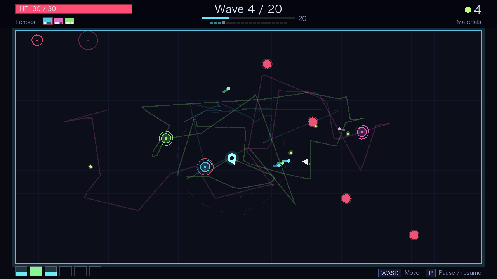
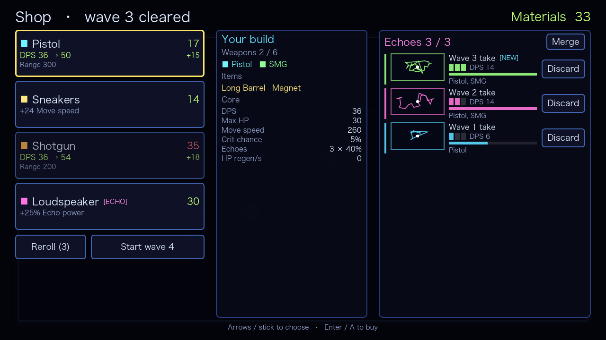
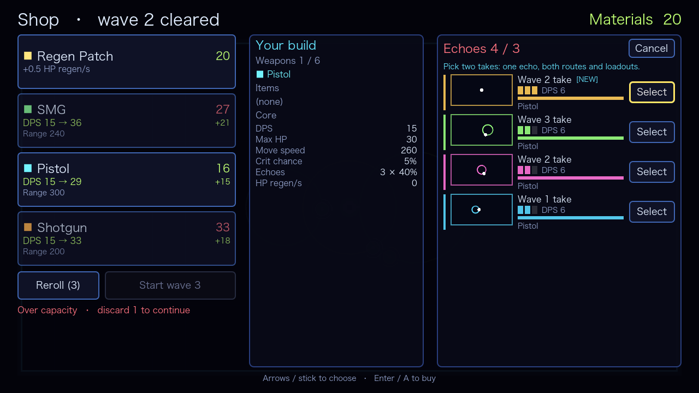
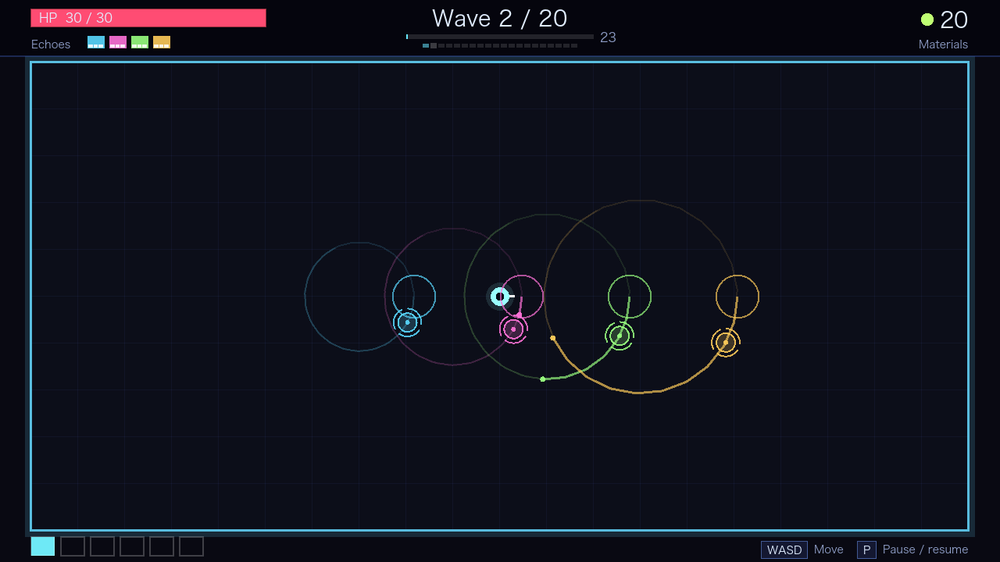
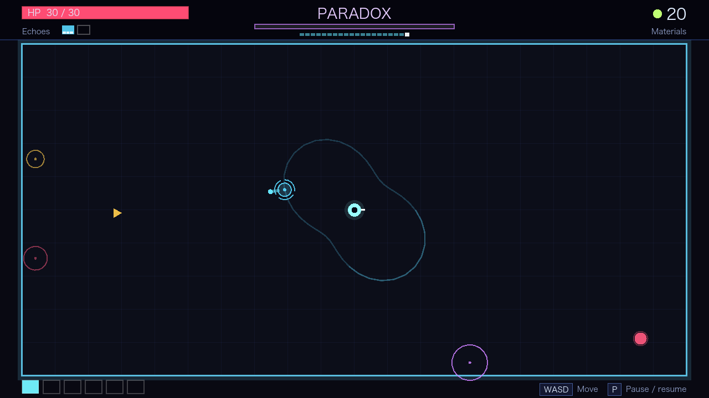
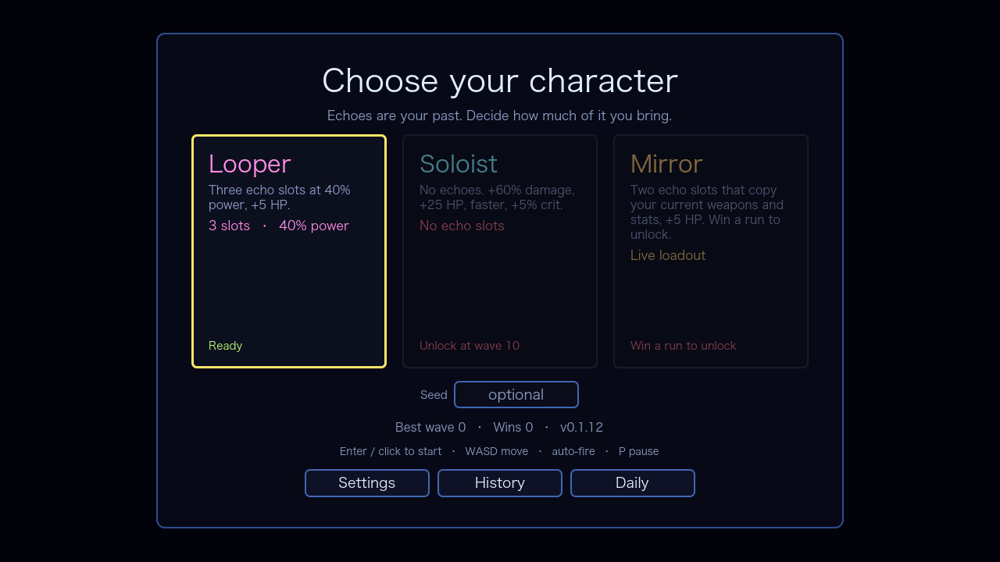

# 回响 / Take Stack


Brotato 式单屏竞技场 roguelite。核心机制：每波把你的走位和武器配置录成一张「回响」，下一波让过去的自己以角色对应的威力替你打——但槽位有限，你必须决定留下哪个过去的自己。

完整的设计支柱、四层循环、机制规则、平衡数据与风险见 [DESIGN.md](DESIGN.md)；商店页文案、标签、预告片节奏与 press kit 清单见 [STORE.md](STORE.md)；英文工作名与更名检查清单见 [NAMING.md](NAMING.md)。

当前是**垂直切片**：20 波完整可玩，有商店、构筑、终局 Boss、3 个角色、叠录、本地解锁记录和占位音效，并提供 macOS/Windows/Linux 构建；没有更多角色或元进度树。








波开始时，上一波的路线会先快进画一遍，再切成淡色轨迹——回响从哪里来、为什么会经过那里，不需要文字解释。

## 怎么玩

- 开局先选角色：复读机（3 个回响槽、40% 威力、+5 生命）、独行者（没有回响，伤害 +60%，第 10 波解锁）、镜像（2 个回响槽，实时复制当前装备，+5 生命，通关一次解锁）。
- 一局 20 波，每波 20–60 秒；第 20 波是 Boss「悖论」：它会周期性让回响静默 3 秒，并召唤跑者。击杀它才通关。
- 第 8 波起出现「静音者」：碰到你会让回响静默 2 秒，优先点掉它。
- 只控制移动，武器自动锁定射程内最近的敌人开火。
- 击杀掉素材，波末自动拾取并进入商店：4 个报价，可买武器/道具，可花素材刷新。
- 最多 6 把武器，可重复购买。满 6 格后，点武器卡进入替换模式：选一个槽换掉，旧武器按基础价半价抵扣，Esc 取消。
- 每波结束会录下你这波的走位与武器/属性快照，成为一张回响。
- 下一波回响会以「倒带循环」方式重放走位，并用快照武器开火。
- 回响寿命默认 3 波；槽位与威力由角色决定：复读机 3 个槽、40% 威力，独行者没有回响，镜像 2 个槽、40% 威力但实时复制当前装备。
- 回响无敌、不挡敌人。槽满时必须先丢一张才能开下一波——留哪张是核心决策。
- 商店里可把两张录像合成「叠录」：两条走位接成一条，武器合并（最多 8 件），只占一个槽；寿命按较老的那张算。
- 三件粉色道具专门强化回响：备用卡座（+1 槽）、长播放（+1 波寿命）、大声公（+25% 威力）。

新手建议：前几波先把 6 个武器槽填满；回响槽通常比回响威力更值；霰弹/法球清群，步枪打远处。

## 操作

| 操作 | 键位 |
|---|---|
| 移动 | WASD / 方向键 / 左摇杆 / 十字键 |
| 开火 | 自动 |
| 暂停 | P / Esc / Start |
| 设置（音量/全屏/震动/语言） | O |
| 对局记录（选角/结算界面） | H |
| 退出到选角（暂停时） | Q |
| 静音 | M |
| 调试信息（FPS/敌人数/弹幕） | F3 / 手柄 View |
| 重开（仅结算界面） | R |
| 重试本局种子（仅结算界面） | S |
| 换角色（仅结算界面） | C |
| 商店 | 鼠标点击卡片与按钮 |

## 下载玩

[Releases](https://github.com/BrickerP/reverb/releases) 提供 v0.1.33 的 macOS / Windows / Linux 构建，不用装 Godot。

- **macOS**：`TakeStack-macos.zip` → 解压 → 右键 `Take Stack.app` → 打开。构建未签名，若提示“已损坏”，执行 `xattr -dr com.apple.quarantine "Take Stack.app"`。
- **Windows**：`TakeStack-windows.zip` → 解压 → 运行 `TakeStack.exe`。SmartScreen 选“更多信息 → 仍要运行”。
- **Linux**：`TakeStack-linux.zip` → 解压 → `chmod +x TakeStack.x86_64` → 运行。
- **校验**：同页 `SHA256SUMS.txt`，可用 `sha256sum -c SHA256SUMS.txt`（macOS 用 `shasum -a 256 -c`）。

## 试玩反馈

构建会把每局结果追加到本机的 `user://runs.jsonl`，不上传任何东西。文件位置：

- macOS：`~/Library/Application Support/Godot/app_userdata/Take Stack/runs.jsonl`
- Windows：`%APPDATA%\Godot\app_userdata\Take Stack\runs.jsonl`
- Linux：`~/.local/share/godot/app_userdata/Take Stack/runs.jsonl`

v0.1.14 起目录名从 `Reverb` 改为 `Take Stack`；首次启动会自动复制旧的 `reverb_save.json`、`settings.json`、`runs.jsonl`，不会覆盖新目录已有文件。

把文件发我，或者只报：角色、到达波数、死因、最爽和最烦的一刻。结算页有 `Open log folder` 直接打开记录目录；显示本局种子，想复现别人的局，在选角页的 `Seed` 里填同一个数字即可。

收到一个或多个 `runs.jsonl` 后：

```bash
python3 tools/runs_report.py runs.jsonl --out report.md
```

会按角色、死亡波数、武器胜率、最近几局生成 Markdown 报告；日志里的 `version` 会标出构建版本。

## 从源码运行

需要本机装 Godot 4.7.x（开发与测试用的是 4.7.2）。

```bash
git clone https://github.com/BrickerP/reverb.git
cd reverb
make run          # 英文
make run-zh       # 中文
```

也可以直接用 Godot 打开 `project.godot` 后按 F5。语言默认跟随系统（`zh*` 显示中文），可用环境变量 `REVERB_LANG=zh` 或 `REVERB_LANG=en` 覆盖。

macOS 已验证（Apple Silicon / OpenGL Compatibility）。Windows 和 Linux 未实测。

## 内容

- 武器 5：手枪、冲锋枪、霰弹枪、步枪、法球
- 道具 11：生命、移速、伤害、攻速、射程、暴击、拾取、回复、回响槽/寿命/威力
- 敌人 5：杂兵、跑者（第 3 波）、重装（第 5 波）、自爆者（第 6 波，死亡爆炸）、静音者（第 8 波，碰触沉默回响 2 秒）
- Boss 1：悖论（第 20 波，会沉默回响并召唤跑者）
- 角色 3：复读机、独行者（无回响，第 10 波解锁）、镜像（实时复制当前装备，通关一次解锁）
- 系统：叠录（两张录像合成一个回响，走位与武器合并）
- 设置面板：音量、屏幕震动、全屏、语言（自动/English/中文），保存到本地设置文件；切语言会重载回选角。
- 对局记录：选角页 `History` 或 H，显示最近 8 局的角色、种子、胜负、波数与击杀；点 `Replay` 用原角色、原种子重开。
- 每日挑战：选角页 `Daily`，固定复读机、用当天日期做种子，记录当日最佳波数；大家玩同一局。
- 本地存档：最佳波数、通关次数、角色解锁
- 20 波，波次预算与血量随波数增长
- 内置 Noto Sans CJK SC，Windows/Linux/Steam Deck 不依赖系统中文字体
- 标准手柄 UI 导航：A 确认、B 取消、十字键移动焦点
- 暂停菜单可直接继续、打开设置/历史、静音或退出本局
- F3 调试叠层：FPS、帧耗时、敌人数、弹幕、回响、种子与版本
- 武器家族（副武器 / 散射 / 精准 / 奥术），商店与 Build 面板显示家族与 DPS
- 角色身上显示已装备武器，按槽位环绕
- 武器升级：Build 面板用材料升级已装备武器，每级 +15% 伤害，影响 DPS 与回响快照
- 武器家族 combo：2 件 +3% 伤害、4 件 +3% 攻速、6 件再 +3% 伤害，Build 面板显示当前家族
- 武器进化：满级 + 同家族 3 件 + 材料，在 Build 面板进化成同族强化形态
- 材料利息：波末按未花材料 +2%（上限 5），商店显示本波收入、利息和下次利息预览
- Build 面板悬浮/聚焦武器卡时显示等级、家族、伤害/射程/穿透和进化目标
- 新增 3 把基础武器：飞镖弹、长弓、咒矢，每个家族至少 2 把
- 武器稀有度与加权掉落：Common / Uncommon / Rare，进化形态不掉落
- 进化武器特殊效果：破片王冠命中爆炸，新星核心追踪弹
- 选角页武器图鉴：全部武器、家族、稀有度、掉落概率、属性与进化链
- 新敌人自爆者（第 6 波起）：死亡时在半径内爆炸，警告圈提示
- 高弹量时自动关闭弹道拖尾、限制火花密度，优先保帧率

## 开发

```bash
make test     # 无头测试（当前 2216 项）
make smoke    # 真实场景端到端烟测
# CI: Ubuntu + macOS + Windows 上自动跑 import / tests / smoke；Linux/Windows 导出包真实启动冒烟
make perf     # 模拟步耗时与压力测试
make frames   # 窗口帧耗时（需要显示器）
make ui-shots # 截取开波/暂停/商店/结算等 UI 状态
make export   # 导出 macOS/Windows/Linux（需要 Godot export templates）
python3 tools/gen_audio.py  # 重新生成程序合成音效
python3 tools/runs_report.py <runs.jsonl>  # 汇总试玩日志
```

代码结构：

```
scripts/sim/    纯逻辑模拟（无节点，确定性，可无头跑）
scripts/echo/   回响录制、回放、库存
scripts/data/   武器/道具/敌人定义
scripts/view/   竞技场绘制与 HUD
scripts/ui/     商店、结算、主题
scripts/game/   主流程、输入、音频
scripts/dev/    bot、压测场景
audio/          程序合成的音效与环境音
tests/          无头测试
tools/          烟测、平衡、性能探针、音效生成
```

## 已知限制

- 音效与环境音是程序合成的占位，未做混音、动态范围与音乐设计。
- 角色只有 3 个；解锁看最佳波数（第 10 波）与通关次数（1 次），元进度只有最佳波数/通关数。
- 难度和 Boss 只用 bot 验证过（静音者加入后 30 种子 balanced：复读机 15、独行者 22、镜像 16；防御流仍偏弱）。真人手感未调。
- 4–5 个回响同屏的可读性未验证；叠录目前只有单元测试和截图，未做 bot/真人平衡。
- Steam Deck / 低端机帧率未验证。本机 M3 窗口压力测试（720p、100 敌人、约 390 发弹幕）约 7ms/帧，200 敌人约 10ms；高弹量会自动降特效。
- 手柄 UI 映射与暂停菜单尚未在 Steam Deck 实机验证。
- 武器家族/进化/材料利息是首版规则；v0.1.33 50 seed bot（会升级/进化、不主动存钱）：复读机 28/50、独行者 34/50、镜像 30/50。真人未测。
- 名称《回响》/ Take Stack 为工作名；Steam 已有多款 Reverb，英文名已更换；正式商标检索未做。

## 许可

- 游戏代码与文档：MIT，见 [`LICENSE`](LICENSE)。
- `.agents/skills/`：来自 gamedev 技能包，Apache-2.0，详见 [`THIRD_PARTY.md`](THIRD_PARTY.md)。属于开发工具，不参与游戏运行。
- 内置 Noto Sans CJK SC（SIL OFL 1.1，见 `assets/fonts/OFL.txt`），系统字体仅作兜底。
