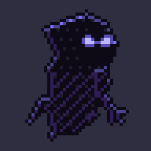

# Isla Espejo

> Título provisional. Roguelike de exploración en pixel art, vista superior, hecho con **Godot 4.7**.

Nico queda atrapado en una isla que lo refleja y aprende de él. Para volver a casa debe cruzar tres escenarios, derrotar a sus guardianes y reunir los fragmentos de su brújula.

**Tres ideas centrales**
- Cada partida es distinta: mapas procedurales armados con salas diseñadas a mano.
- Una habilidad por jefe: cada fragmento de la brújula otorga un poder.
- La isla aprende: una IA adaptativa observa cómo juegas (agresivo o sigiloso) y reacciona.



*La Sombra errante, un enemigo del bosque (reposo, caminar, correr, ataque, daño y muerte).*

## Documentación
- [`docs/EMPEZAR.md`](docs/EMPEZAR.md): **guía de arranque** (instalación, flujo de trabajo y por dónde empezar).
- [`docs/JUEGO.md`](docs/JUEGO.md): de qué trata el juego, alcance, personajes, historia y diálogos.
- [`docs/TAREAS.md`](docs/TAREAS.md): lista de tareas con checklist.
- [`CLAUDE.md`](CLAUDE.md): reglas de trabajo del proyecto (para el equipo y para Claude Code).
- [`CREDITS.md`](CREDITS.md): créditos de recursos de terceros.

## Cómo ejecutarlo
1. Instala [Godot 4.7.2](https://godotengine.org/download) (versión estándar, no .NET).
2. Abre el proyecto con `project.godot`.
3. Pulsa **F5**.

Controles provisionales: `WASD` mover, `Espacio` esquivar, `J` atacar, `1 2 3` habilidades, `E` interactuar.

## Verificación local
```
./tools/run_tests.sh
```
Ejecuta la comprobación general y todas las pruebas de juego (`tests/test_*.gd`). Es lo mismo que ejecuta CI en cada push. En Windows, desde Git Bash, con `GODOT` apuntando a la versión `_console.exe` de Godot.

## Descargar una versión jugable
Las versiones publicadas están en la pestaña **Releases** del repositorio (zip para Windows, sin instalar nada).

### Publicar una versión (CD)
Al subir una etiqueta `v*`, GitHub Actions ejecuta las pruebas, exporta el juego para Windows y crea la Release automáticamente:
```
git tag v0.1.0
git push origin v0.1.0
```
También se puede lanzar a mano desde **Actions → Build and release → Run workflow**; en ese caso solo deja el zip como artefacto descargable, sin publicar una Release.

## Equipo
Proyecto de portafolio desarrollado por dos personas en unos 2 meses.

## Licencia
Código bajo licencia MIT (ver [`LICENSE`](LICENSE)). Los recursos de terceros conservan su propia licencia (ver [`CREDITS.md`](CREDITS.md)).
