# File Colony / Файловая колония

**English** · [Русский](#русский)

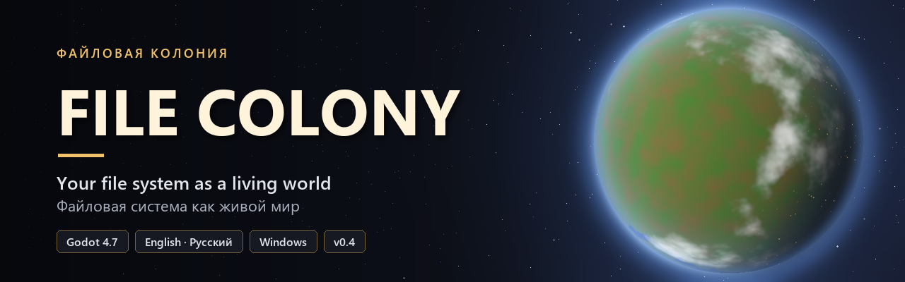

---

## English

File Colony is a top-down simulation game built with Godot 4 that presents a file system as a world. Drives are planets, top-level folders are cities, subfolders are districts and houses, and files are residents with their own daily routines.

- **Status:** test release (0.4). Features and data formats may change.
- **Languages:** English and Russian. The language can be changed in Settings.
- **Platform:** Windows, 64-bit.
- **License:** [MIT](LICENSE).

> **Since 0.4 the game reads your disks.** In "My disks" mode it shows the real folders and files on your computer, but only their names and sizes: file contents are never read. Copying, moving, renaming and deleting take place inside the game world only, so real files are never changed or deleted. A file is opened (in its default program) or shown in Explorer only when you choose that yourself; programs and scripts are never launched from the game. The Sandbox mode uses a generated file system.

### Features

- **Your real disks (new in 0.4).** Every drive on your computer becomes a planet. Desktop, Downloads, Documents, Pictures, Music and Videos are cities of their own, followed by the other top-level folders. Large disks are trimmed so cities stay playable.
- **Space.** Each drive is a 3D planet with an atmosphere, clouds and a moon. The camera orbits freely, and switching drives moves the camera from one planet to another.
- **City selection.** City boundaries, names and populations are shown on the globe. Selecting a city moves the camera down to it.
- **Cities.** Large procedurally generated maps with districts, streets and furnished houses. Once generated, a city stays the same for the rest of the session.
- **Terrain.** The terrain depends on the city's location on the planet. Coastal cities border an ocean, and inland cities have lakes and rivers. Cobblestone streets, squares, yards and fields blend into grass and paths with soft, uneven edges, and bridges line up with the streets.
- **Residents.** Every file is a resident whose clothing colour shows its file type. Residents work at the market, shop, bakery, smithy, carpentry workshop, fields and fishing piers, visit each other, and sleep at night.
- **File operations.** Residents can be copied, moved to another house, renamed or deleted. Deleting a resident starts a short chase scene.
- **Right-click menu (new in 0.4).** Open a file in its default program, show it in Explorer, follow a resident with the camera, copy its path, or view its properties (type, size, location on disk, date modified).
- **Recycle Bin (new in 0.4).** Deleted residents go to the Recycle Bin, where they can be sent back home or removed for good.
- **Family tree.** The folder hierarchy is shown as a top-down pedigree, with collapsible branches, search and a details panel.
- **Weather.** Rain falls on roughly every third day. During rain the sky darkens, splashes appear on the ground and water, and residents stay indoors.
- **City statistics.** A disk-analyzer view of the city: space used by each file type, the largest files and the most crowded houses. Rows open the item on the map.
- **Minimap.** An overview of the whole city in the corner; clicking it moves the camera.
- **Sound.** Rain ambience and sound effects for copying, pasting and deleting, generated procedurally. Music and sound volumes are set separately.
- **Tools.** Search by name, type, size and city; a day–night cycle; time acceleration and pause; a controls reference (F1); screenshots (F12).
- **Sandbox.** Generates a random world from a seed, which can be a number or a word.

| Space | City selection | City map |
|---|---|---|
| 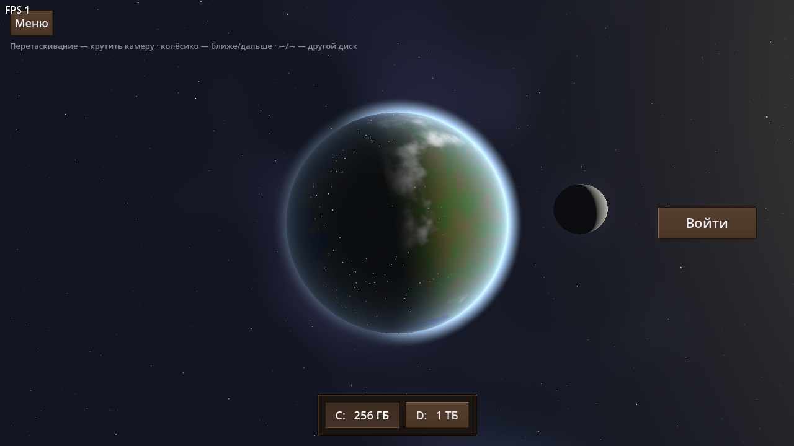 | 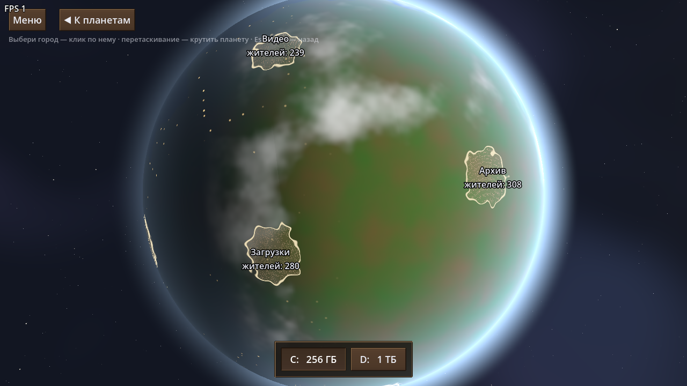 | 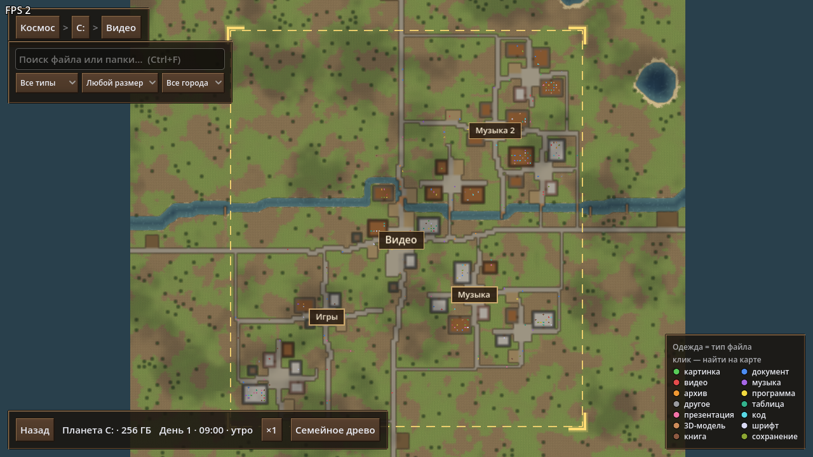 |

| Workplaces | Streets and yards | Family tree |
|---|---|---|
| 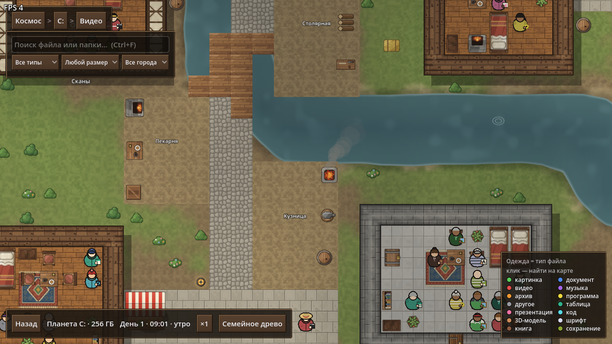 | 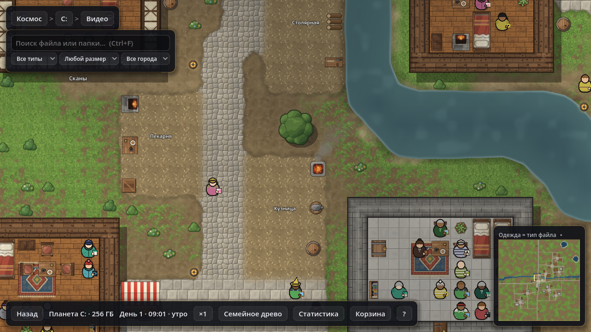 | 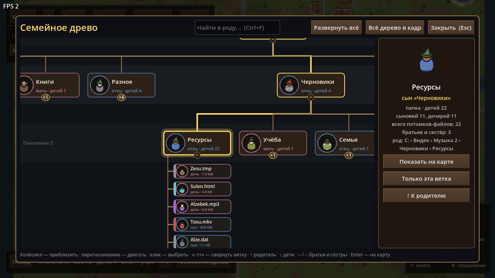 |

| Right-click menu | Recycle Bin | Properties |
|---|---|---|
| 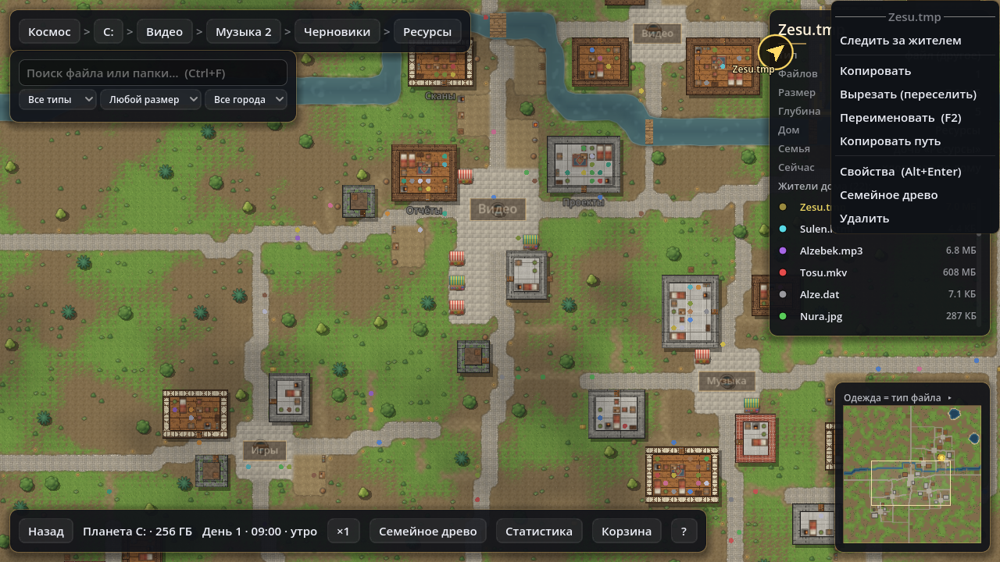 | 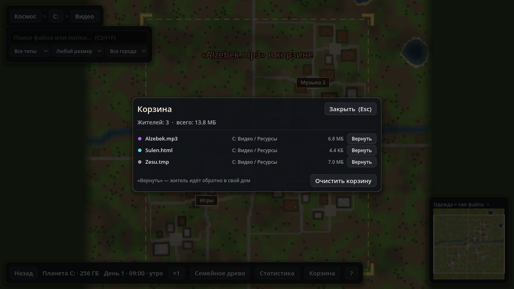 | 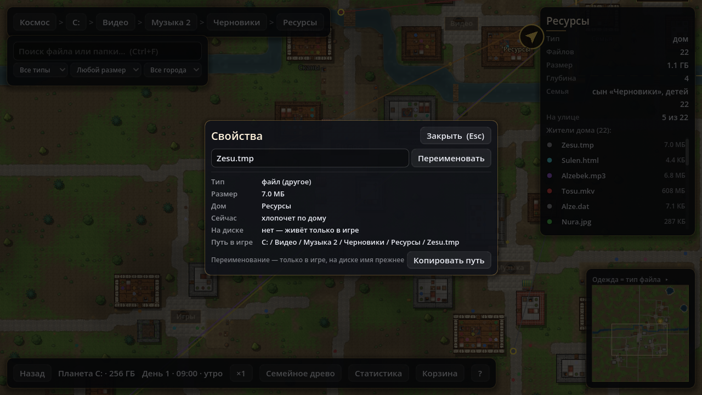 |

| Main menu | City statistics | Rain |
|---|---|---|
| 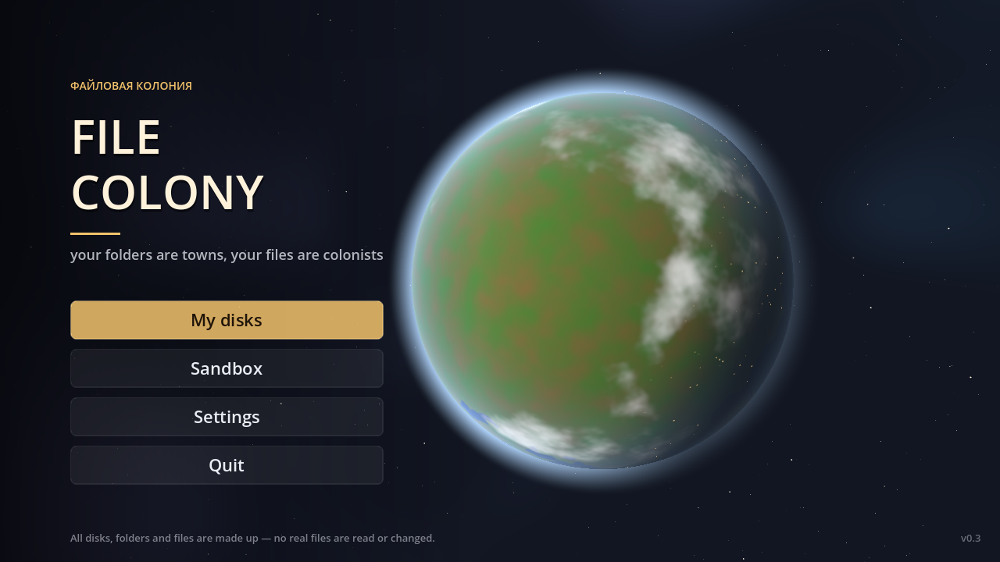 | 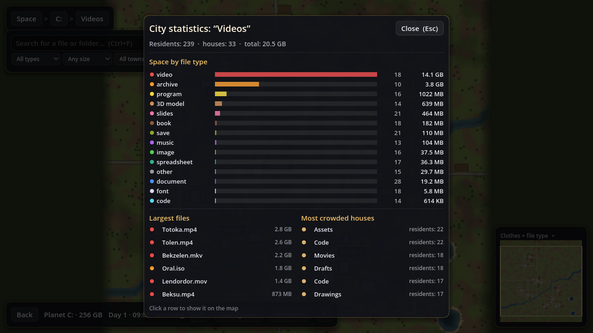 | 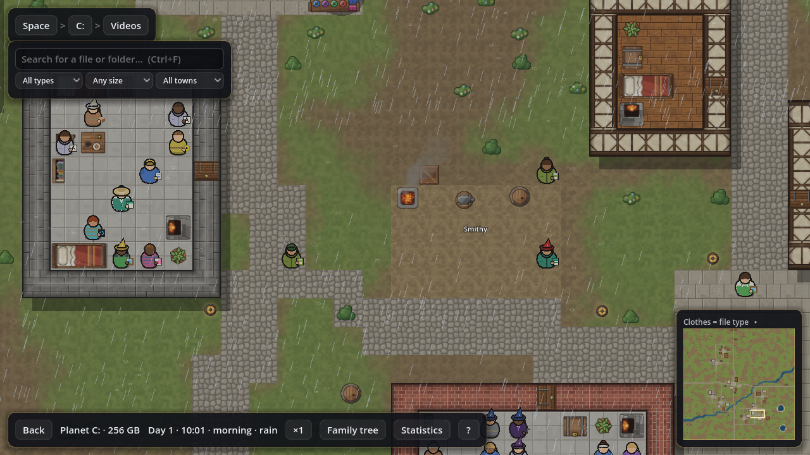 |

### Installation

**Windows build:** download `FileColony.exe` from [Releases](../../releases) and run it. No installation is required. If Windows SmartScreen blocks the file, select **More info → Run anyway**. The executable is not code-signed.

**From source:** install [Godot 4.7](https://godotengine.org/download), then run:

```bash
godot --path .
```

Alternatively, open the project folder in the Godot editor and press F5.

### Controls

| Context | Action |
|---|---|
| Space | Drag to rotate the camera, mouse wheel to zoom, ←/→ to switch drives |
| General | WASD or arrow keys to move the camera, middle mouse button to drag the map, mouse wheel to zoom at the cursor, Esc to go back |
| Map | Left click to select or open, right click for the context menu (open, show in Explorer, follow, copy, paste, properties, delete, family tree) |
| Map | Ctrl+F to search, Ctrl+C / Ctrl+V / Delete for the selected item, F2 to rename, Alt+Enter for properties, T to open the family tree |
| Map | I for city statistics, L to collapse the legend, P or Space to pause time, click the minimap to move the camera |
| Anywhere | F1 for the controls reference (in a city), F12 to save a screenshot |
| Family tree | ←/→ for siblings, ↑ for the parent, ↓ for children, Backspace to go back, Enter to show on the map |

### Development

- `scripts/` contains the GDScript code, `scenes/` the scenes, and `shaders/` the planet, terrain and sky shaders.
- `assets/textures/` contains textures generated by `tools/make_textures.py` (Python + Pillow).
- `tests/` contains [GUT](https://github.com/bitwes/Gut) tests; GUT is in `addons/gut` under the MIT license. Run the tests headless with `run_tests.bat`.
- `screenshot.bat --view=city --out=city.png` saves a screenshot of a given view to `screenshots/`.
- To build the `.exe`, use **Project → Export → Windows Desktop**. The settings are in `export_presets.cfg`.

### Acknowledgements

The visual style was inspired by [RimWorld](https://rimworldgame.com/). This is an independent project and is not affiliated with RimWorld or its developers. All graphics are original.

---

## Русский

«Файловая колония» — симуляция с видом сверху на Godot 4, в которой файловая система показана как мир. Диски — планеты, папки верхнего уровня — города, вложенные папки — районы и дома, файлы — жители со своим распорядком дня.

- **Статус:** тестовая версия (0.4). Возможности и форматы данных могут меняться.
- **Языки:** русский и английский. Язык меняется в настройках.
- **Платформа:** Windows, 64 бита.
- **Лицензия:** [MIT](LICENSE).

> **С версии 0.4 игра читает твои диски.** В режиме «Мои диски» она показывает настоящие папки и файлы компьютера, но только их имена и размеры: содержимое файлов не читается. Копирование, переселение, переименование и удаление происходят только в мире игры — настоящие файлы не меняются и не удаляются. Файл открывается (в своей программе) или показывается в проводнике только по твоему выбору; программы и скрипты из игры не запускаются. В «Песочнице» файловая система выдуманная.

### Возможности

- **Твои настоящие диски (новое в 0.4).** Каждый диск компьютера — планета. Рабочий стол, Загрузки, Документы, Изображения, Музыка и Видео — отдельные города, за ними остальные папки верхнего уровня. Большие диски обрезаются, чтобы города оставались играбельными.
- **Космос.** Каждый диск — 3D-планета с атмосферой, облаками и луной. Камера свободно вращается вокруг планеты, при смене диска она перелетает от одной планеты к другой.
- **Выбор города.** На глобусе видны границы городов, их названия и число жителей. При выборе города камера спускается к нему.
- **Города.** Большие процедурно генерируемые карты с районами, улицами и обставленными домами. После генерации город не меняется до конца сессии.
- **Местность.** Местность зависит от расположения города на планете. Прибрежные города стоят у океана, во внутренних есть озёра и реки. Булыжные улицы, площади, дворы и поля плавно переходят в траву и тропы по неровной кромке, мосты стоят ровно по улицам.
- **Жители.** Каждый файл — житель, цвет одежды показывает тип файла. Жители работают на рынке, в магазине, пекарне, кузнице, столярной мастерской, на полях и мостках для рыбалки, ходят в гости и ночью спят.
- **Операции с файлами.** Жителя можно скопировать, переселить в другой дом, переименовать или удалить. Удаление жителя запускает короткую сцену погони.
- **Меню правой кнопки (новое в 0.4).** Открыть файл в его программе, показать в проводнике, следить за жителем камерой, скопировать путь, посмотреть свойства (тип, размер, где лежит на диске, дата изменения).
- **Корзина (новое в 0.4).** Удалённые жители попадают в корзину: их можно вернуть домой или удалить насовсем.
- **Семейное древо.** Иерархия папок показана как родословная сверху вниз: ветки сворачиваются, есть поиск и панель с подробностями.
- **Погода.** Примерно каждый третий день идёт дождь: небо темнеет, по земле и воде расходятся брызги, жители сидят по домам.
- **Статистика города.** Обзор в духе анализатора диска: место по типам файлов, самые большие файлы и самые людные дома. Строки открывают объект на карте.
- **Мини-карта.** Весь город в углу экрана; клик по ней переносит камеру.
- **Звук.** Шум дождя и звуки копирования, вставки и удаления, сгенерированные процедурно. Громкость музыки и звуков настраивается отдельно.
- **Инструменты.** Поиск по имени, типу, размеру и городу; смена дня и ночи; ускорение и пауза времени; справка по управлению (F1); снимки экрана (F12).
- **Песочница.** Генерирует случайный мир по зерну — числу или слову.

### Установка

**Сборка для Windows:** скачайте `FileColony.exe` на странице [Releases](../../releases) и запустите его, установка не требуется. Если Windows SmartScreen заблокирует запуск, выберите **Подробнее → Выполнить в любом случае**. Исполняемый файл не подписан.

**Из исходников:** установите [Godot 4.7](https://godotengine.org/download) и выполните:

```bash
godot --path .
```

Также можно открыть папку проекта в редакторе Godot и нажать F5.

### Управление

| Где | Действие |
|---|---|
| Космос | Перетаскивание — вращение камеры, колесо мыши — приближение, ←/→ — другой диск |
| Везде | WASD или стрелки — движение камеры, средняя кнопка мыши — перетаскивание карты, колесо мыши — приближение к курсору, Esc — назад |
| Карта | ЛКМ — выбрать или открыть, ПКМ — контекстное меню (открыть, в проводнике, следить, копировать, вставить, свойства, удалить, древо) |
| Карта | Ctrl+F — поиск, Ctrl+C / Ctrl+V / Delete — для выбранного, F2 — переименовать, Alt+Enter — свойства, T — семейное древо |
| Карта | I — статистика города, L — свернуть легенду, P или пробел — пауза, клик по мини-карте — переместить камеру |
| Везде | F1 — справка по управлению (в городе), F12 — снимок экрана |
| Древо | ←/→ — братья и сёстры, ↑ — родитель, ↓ — дети, Backspace — назад, Enter — показать на карте |

### Разработка

- `scripts/` — код на GDScript, `scenes/` — сцены, `shaders/` — шейдеры планеты, местности и неба.
- `assets/textures/` — текстуры, их генерирует `tools/make_textures.py` (Python + Pillow).
- `tests/` — тесты на [GUT](https://github.com/bitwes/Gut); GUT лежит в `addons/gut` под лицензией MIT. Запуск без окна: `run_tests.bat`.
- `screenshot.bat --view=city --out=city.png` сохраняет скриншот нужного вида в `screenshots/`.
- Сборка `.exe`: **Проект → Экспорт → Windows Desktop**, настройки лежат в `export_presets.cfg`.

### Благодарности

Визуальный стиль вдохновлён [RimWorld](https://rimworldgame.com/). Проект независимый и не связан с RimWorld и её разработчиками. Вся графика оригинальная.
