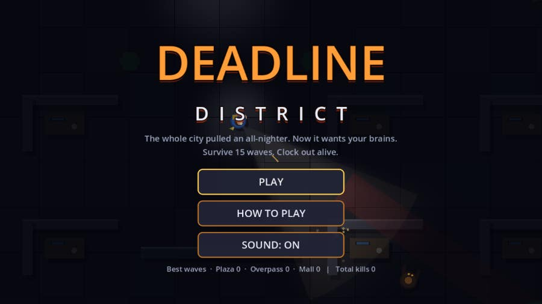
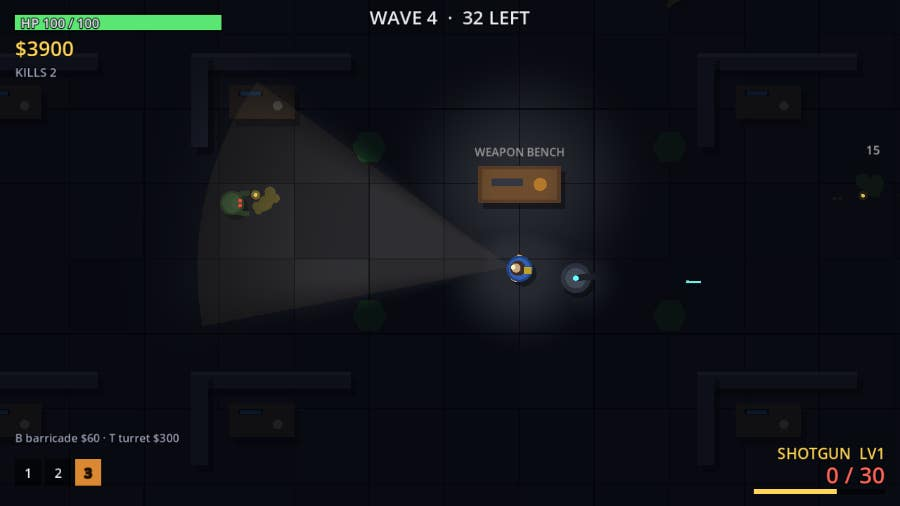
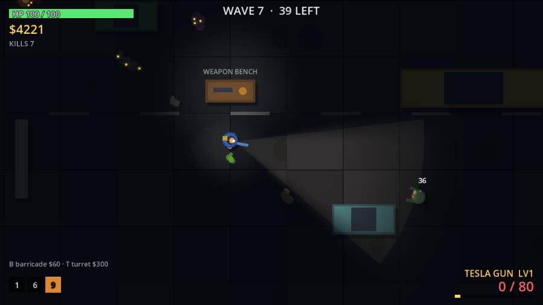
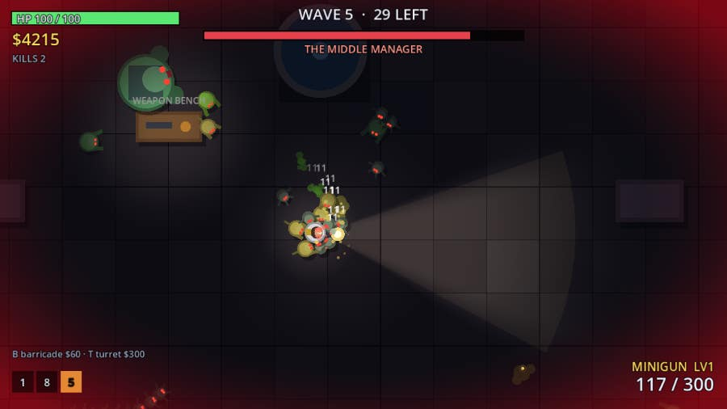
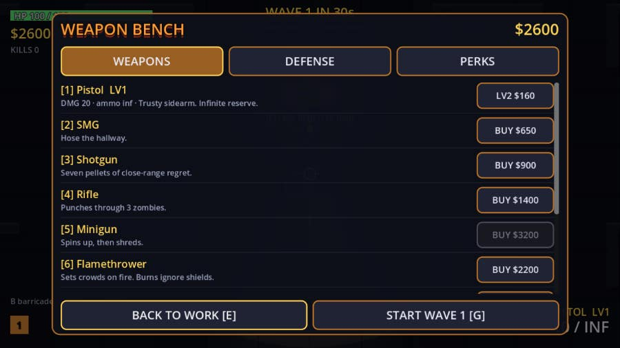
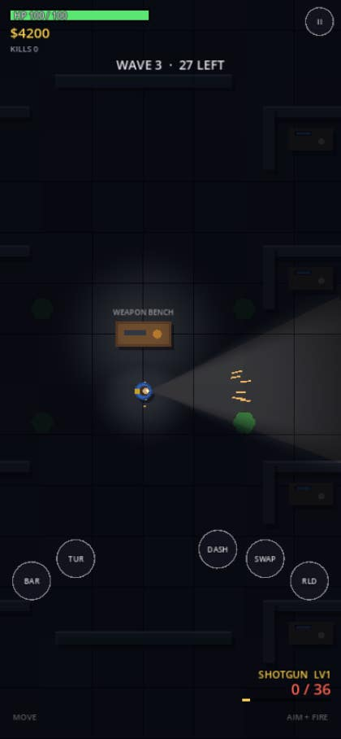

<div align="center">

# 🧟 DEADLINE DISTRICT 🔦

**The whole city pulled an all-nighter, and now it wants your brains.**
An original top-down zombie wave-survival shooter made in **Godot 4**.

[](https://jaigod.github.io/deadline-district/play/)

[](https://jaigod.github.io/deadline-district/)
[](https://godotengine.org)
[](https://github.com/JaiGod/deadline-district/actions)
[](LICENSE)
[](https://github.com/JaiGod)

</div>

---

## 📸 Screenshots

| Title screen | Cubicle Plaza |
|:---:|:---:|
|  |  |
| **Rush Hour Overpass (tesla gun)** | **Boss wave: The Middle Manager** |
|  |  |
| **Weapon bench** | **Phone (twin-stick touch)** |
|  |  |

## ✨ Features

- 🔫 **10 weapons**: pistol, SMG, shotgun, rifle, minigun (spin-up), flamethrower (burning), crossbow (piercing bolts), rocket launcher (splash), tesla gun (chain lightning) and katana (wide slash that also cuts spit out of the air).
- 🧰 **Weapon bench**: between waves, walk to the bench to buy guns, **3 upgrade levels** per weapon (damage, magazine, reload), ammo refills, medkits and defense repairs.
- 🧱 **Defenses**: drop **barricades** (B) to funnel the horde and **auto-turrets** (T) to cover your back. Zombies chew through both.
- 🎖️ **9 perks**: Thick Skin, Quick Hands, Fleet Feet, Deep Pockets, Bounty Hunter, Steady Aim, Overclock, Big Battery and Second Wind.
- 🧟 **8 zombie types**: Shambler, Runner, Crawler packs, Spitter (acid), Brute (tank), Exploder (chain reactions), **Screamer** (buffs the horde) and Riot Guard (front shield, so flank it).
- 👔 **Boss every 5 waves**: The Middle Manager (charge + summon), The Auditor (acid volleys) and Crunch Titan (shockwave slams). Survive **wave 15** to clear the district, then keep going in endless mode.
- 🗺️ **3 maps**: Cubicle Plaza (Normal), Rush Hour Overpass (Hard) and Midnight Mall (Nightmare).
- 🔦 **Flashlight lighting**: a custom **Compatibility-safe canvas shader** cuts your flashlight cone out of the dark and adds muzzle flashes, fire, explosions and the bench lamp as point lights. Zombie eyes glow above the darkness.
- 💥 **Juice**: stylized, non-gory goo splats that stay on the floor, particles, screen shake, hit flashes, damage numbers, dash and a hurt vignette.
- 🔊 **Procedural audio**: every sound effect and music loop is synthesized in code. Nothing is downloaded.
- 💾 Best wave per map and total kills are saved automatically.

## 🎮 Controls

| Action | Keyboard + mouse | Touch (twin-stick) |
|---|---|---|
| Move | WASD / arrows | Left thumb stick |
| Aim + fire | Mouse + hold left click | Right thumb stick |
| Reload | R | RLD |
| Switch weapon | 1–0, Q, mouse wheel | SWAP |
| Dash | Space / Shift / right click | DASH |
| Barricade / turret | B / T | BAR / TUR |
| Weapon bench | E (near bench, between waves) | BENCH |
| Start next wave | G / Enter | READY |
| Pause / mute | Esc or P / M | II |

## 🛠️ Tech stack

- **Godot 4.3**, GDScript, **GL Compatibility** renderer, so it runs in any WebGL2 browser
- Web export with **threads off**, so it runs on GitHub Pages without COOP/COEP headers
- Everything is drawn in code with `_draw()`: no image assets
- **Flow-field pathfinding** (BFS over a 40 px grid, rebuilt as you move) so hundreds of zombies route around walls cheaply
- **GitHub Actions** (`barichello/godot-ci:4.3`): a headless smoke test, the Web export, screenshots under Xvfb, and a deploy to **GitHub Pages**

## 📁 Project structure

```
deadline-district/
├── project.godot            # Compatibility renderer, 960x540 base, expands for portrait
├── export_presets.cfg       # Web preset (threads off)
├── scenes/Main.tscn
├── scripts/
│   ├── Main.gd              # screens, weapon bench, HUD, keyboard/mouse + touch input
│   ├── World.gd             # player, weapons, zombies, bosses, waves, defenses, lighting, rendering
│   ├── Data.gd              # weapons, zombies, bosses, perks, maps, save file
│   └── Sfx.gd               # procedural sound + music
├── tests/                   # headless smoke test + screenshot capture scenes
├── web/index.html           # landing page (deployed at /, game at /play/)
├── docs/screenshots/        # README images
└── .github/workflows/pages.yml
```

Source folders: [`scripts/`](scripts) · [`scenes/`](scenes) · [`tests/`](tests) · [`web/`](web) · [`.github/workflows/`](.github/workflows)

## 🚀 Run locally

1. Install [Godot 4.3](https://godotengine.org/download) (standard build).
2. Clone the repo: `git clone https://github.com/JaiGod/deadline-district.git`
3. Open `project.godot` in Godot and press **F5**.
4. Smoke test: `godot --headless --fixed-fps 60 res://tests/SmokeTest.tscn`
5. Web build: **Project → Export → Web**, then serve the folder (`python3 -m http.server`).

## 📓 Development log

- **Concept.** I wanted a horde shooter with a twist of humor: the "deadline" is literal. Office workers zombify on crunch night, the bosses are a Middle Manager, an Auditor and a Crunch Titan, and the maps are an office, a jammed highway and a mall.
- **Lighting without 2D lights.** `PointLight2D` behaves differently across renderers, so I wrote one full-screen `ColorRect` shader. The world is converted to screen space with the canvas transform, and the shader computes the darkness from the flashlight cone (angle and distance falloff), a small halo around the player and up to 16 dynamic lights (muzzle flashes, flames, explosions, turrets, the bench lamp). A second `CanvasLayer` with `follow_viewport_enabled` draws zombie eyes, tracers and effects *above* the darkness, so you see red eyes before you see the zombie.
- **Pathfinding.** Steering straight at the player left zombies stuck on cubicle walls. A BFS flow field over a 40 px grid (8-way, no corner cutting) is recomputed whenever the player changes cell. Each zombie just looks at its neighbors' distances. Barricades are deliberately left out of the field, so zombies walk into them and have to chew through.
- **Bullet tunneling.** Fast rifle rounds skipped small crawlers, so hits use a segment-vs-circle test from last frame's position to this one.
- **Riot Guard shield.** This compares the zombie's facing with the bullet direction. Frontal hits do 30% damage and spark, which pushes players toward flanking, flames, explosives and tesla chains.
- **Touch.** The left half of the screen spawns a floating move stick and the right half an aim/fire stick. On-screen buttons are hit-tested first. Mouse events emulated from touch are ignored for gameplay (`device == -1`) so the two schemes never fight. On a portrait screen the base resolution switches to 540x960 so the UI stays readable at 390 px wide.
- **Testing bug I hit.** My first headless test showed almost no kills. It turned out the test was fighting the game's own input layer (mouse aim and held-fire were overwriting the scripted values). I fixed the test, then added a real fix it surfaced: zombies could overlap the player's body, so they are now pushed to the edge. Boss summons are also capped so the horde can't grow without limit.
- **CI.** Every push runs a headless smoke test that plays all 3 maps through a boss wave with all 10 weapons and all perks, then exports Web, captures screenshots under Xvfb and deploys to Pages.
- **Beta tested on the live site ✅ (2026-11-05).**

## 🎮 More JaiGod games

- [Bulwark TDS](https://github.com/JaiGod/bulwark-tds) · [Stellar Barrage](https://github.com/JaiGod/stellar-barrage) · [Circuit Siege](https://github.com/JaiGod/circuit-siege) · [Runebound Saga](https://github.com/JaiGod/runebound-saga) · [all games on JaiGod](https://github.com/JaiGod)

## 📜 License

[MIT](LICENSE). Copyright (c) 2026 Jaineil Rana. All code, art and audio are original and generated in code.

---

<div align="center">Made by Jaineil Rana (JaKing) · part of <a href="https://github.com/JaiGod">JaiGod</a></div>
