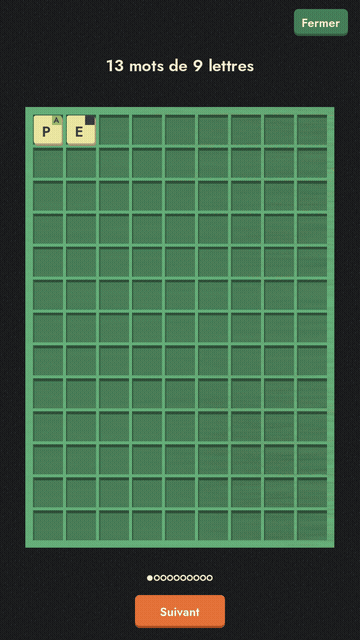

# trampoline

"Un jeu pour faire rebondir les mots", par Michel Cheenne et
Maximilien Naveau.

Built with [Godot](https://godotengine.org/) (an earlier Unity version,
no longer released, lives on in `trampoline-unity/` for reference).

## Installation

### :robot: Android

Install it from F-Droid (below) to get updates on their own, or download
the latest `trampoline-vX.Y.Z-android.apk` from the
[GitHub releases](https://github.com/MaximilienNaveau/trampoline/releases)
and install it. Both are the same APK, signed with the same key as the
older Unity versions, so they install over those.

Installing via F-Droid

- Download the latest version of [F-droid here](https://f-droid.org/fr/) and install it on your phone if not done already.
- Add my repository to the F-Droid repos.
    - Open F-Droid,
    - go to settings,
    - Select Repositories
    - Add a repository
        - enter this url: https://raw.githubusercontent.com/MaximilienNaveau/magamajo/master/fdroid/repo?fingerprint=D04F9C306C0CA32CC89C5D4EA871916330BE95C91FB08F2AD101A11CBFAAC31A
        - or flash this QR code:
          
- Then look for "trampoline" and install it.

### Web

Play directly in the browser: https://maximiliennaveau.github.io/trampoline/

Each release also attaches a `trampoline-vX.Y.Z-web.zip` if you'd rather
host it yourself.

### Linux

Download `trampoline-vX.Y.Z-linux.zip` from the
[releases](https://github.com/MaximilienNaveau/trampoline/releases), unzip
it, and run the executable inside.

### macOS

Download `trampoline-vX.Y.Z-macos.zip` from the
[releases](https://github.com/MaximilienNaveau/trampoline/releases) and
unzip it. The app is unsigned (no Apple Developer account behind this
build yet), so Gatekeeper will refuse to open it on first launch —
right-click the app and choose "Open" once to get past that, or run
`xattr -cr Trampoline.app` from a terminal first.

### Windows

Download `trampoline-vX.Y.Z-windows.zip` from the
[releases](https://github.com/MaximilienNaveau/trampoline/releases), unzip
it, and run `trampoline.exe`. It's unsigned, so Windows SmartScreen may warn
on first launch ("More info" → "Run anyway").

### iOS

Not built for now: Godot won't export even an unsigned Xcode project without
an App Store Team ID, and there's no Apple Developer account behind this
game yet.

## License

Copyright (C) 2020-2026 Michel Cheenne and Maximilien Naveau.

[GPL-3.0-only](LICENSE): free to use, study, change, share and sell, as
long as every copy keeps this licence and comes with its source code. The
fonts and the dictionary keep their own terms: see [NOTICE](NOTICE).
