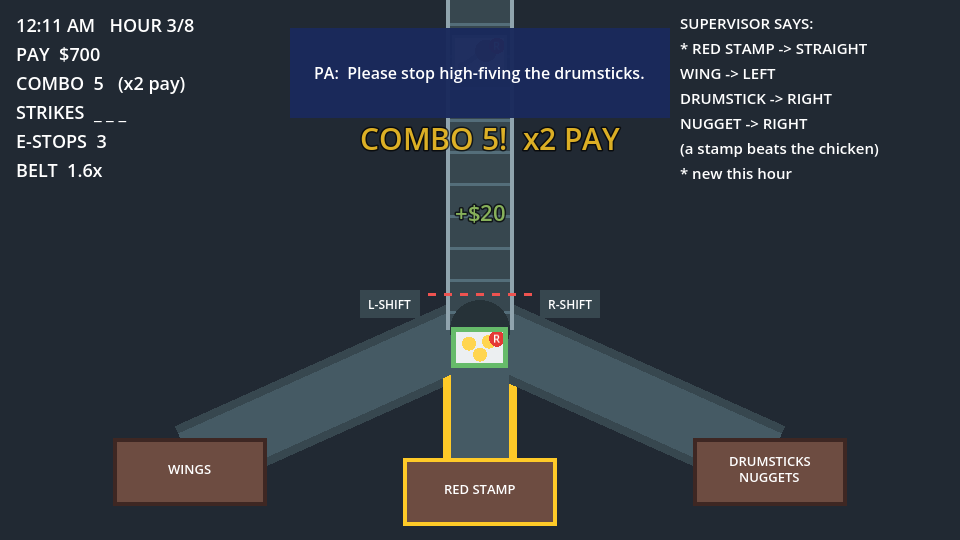
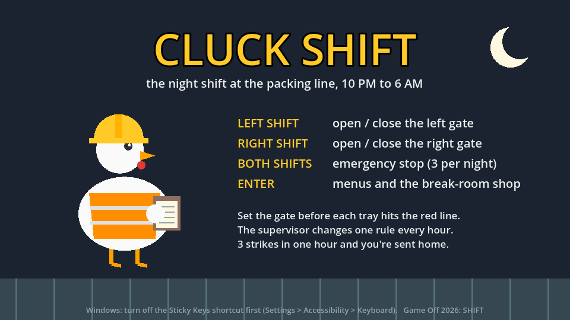
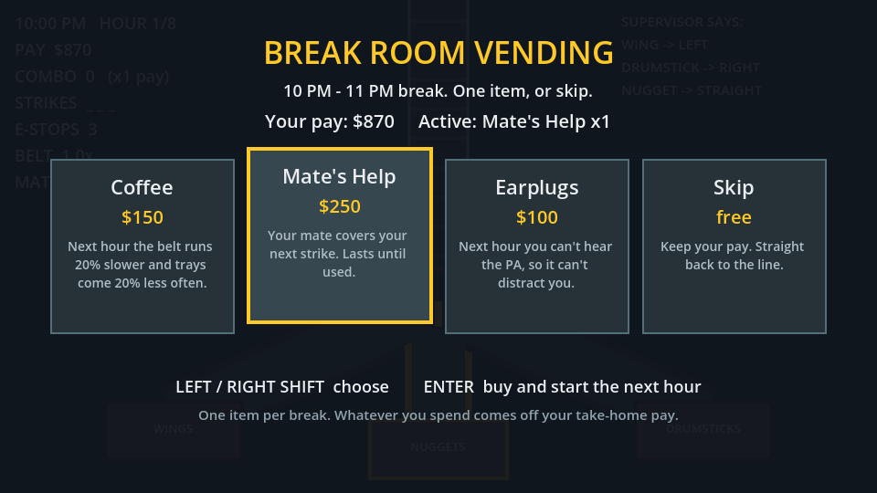

# Cluck Shift

You work the night shift on the packing line of a cartoon chicken factory, 10 PM to 6 AM. Trays of wings, drumsticks
and nuggets roll down to a fork, and the **only controls are the Shift keys**. Set the gate before each tray hits the
red line. Every hour the supervisor changes one rule, and from midnight the PA won't shut up. Sort right for pay
and combos, spend it in the break room on coffee, a mate's help or earplugs, and make it to 6 AM. Three strikes in
one hour and you're sent home.

A [GitHub Game Off 2026](https://itch.io/jam/game-off-2026) entry for the theme **SHIFT**. Made with Godot 4.7
(GDScript), playable in the browser.



| | |
|---|---|
|  |  |

> **Status: Phase 3 of 4.** The full game is playable: a title screen, eight hours with a rule change each hour,
> stamps, PA distractions, a break-room shop between hours, popups, particles, screen shake and synthesized sounds,
> and a 6 AM win. The optional strange night (Phase 4) is the only part left. See the [roadmap](#roadmap).

## Controls

| Key | Effect |
|---|---|
| **Left Shift** | Open / close the left gate |
| **Right Shift** | Open / close the right gate |
| **Both Shifts together** | Emergency stop: the belt and the clock halt for 2.5 s (3 per night) |
| Left / Right Shift in the break room | Choose an item |
| Enter / Space | Menus; buy in the break room |

With both gates closed, trays go straight on. Opening one gate closes the other. No mouse, no other keys.

**How a night goes:** at 10 PM wings go LEFT, drumsticks RIGHT, nuggets STRAIGHT. At the start of every hour the
supervisor's sticky note changes one rule: nuggets move, red-stamped trays go to the bin, tenders appear, the chutes
swap. The board in the top right always shows the current rules, with the new one marked `*`. A stamp beats what's on
the tray. Each correct tray pays $10 times your combo (x2 from 5 in a row, up to x5), and a clean hour earns a $100
bonus. A wrong exit is a strike, and so is a tray that arrives while the gate is still swinging: press early.

**Between hours** the break room sells Coffee ($150, slower belt next hour), Mate's Help ($250, covers your next
strike) and Earplugs ($100, no PA next hour). Whatever you spend comes off your take-home pay.

> **Windows players:** pressing Shift five times opens the Sticky Keys prompt. Turn it off in
> Settings > Accessibility > Keyboard > Sticky keys > "Keyboard shortcut for Sticky keys".
>
> **Remote desktop or an odd browser?** If your setup can't tell left Shift from right Shift, the game notices the
> first time you press Shift and switches the gates to **Z** (left) and **/** (right), the keys beside each Shift.
> The title screen and the HUD say so.

## Run it

1. Install [Godot 4.7](https://godotengine.org/download) (the standard build, not .NET).
2. Clone this repo and open `project.godot` in Godot (Import, select the folder).
3. Press **F5**.

From a terminal: `godot --path .`

## Test it

```bash
godot --headless --path . --import                                # once, after cloning
godot --headless --path . -s tests/test_logic.gd                  # 161 rule checks
godot --headless --path . --fixed-fps 60 -s tests/test_play.gd    # plays a whole night, shop included (137 checks)
```

Both exit with code 0 when everything passes. CI runs them on every push. Details: [docs/testing.md](docs/testing.md).

## Export for the web (itch.io)

```bash
godot --headless --path . --export-release "Web" build/web/index.html
```

Needs the Godot 4.7.2 web export templates. The preset has thread support off, so the build runs on itch.io with no
special headers. Upload steps: [docs/releasing.md](docs/releasing.md).

## Add or change a rule

Rules live in [`data/rules.json`](data/rules.json), not in code. The starting rules:

```json
"routes": { "wing": "left", "drumstick": "right", "nugget": "center" }
```

and one supervisor note per hour, each changing one rule:

```json
{ "speed": [130, 180], "interval": [2.2, 1.7],
  "note": { "text": "Nuggets now go RIGHT. Don't ask.", "route": { "nugget": "right" } } }
```

- **Change a starting rule:** edit `routes`.
- **Change an hour's rule change:** edit that hour's `note`: `route` moves a kind, `stamp` adds a stamp rule (or
  cancels one with `null`), `swap` swaps two exits. The board and bin labels update themselves.
- **Add a tray kind or stamp colour:** use it in a note, then give it art in `Tray.FOOD` / `Tray.STAMPS` and
  `Tray._draw()` (`scripts/tray.gd`). The tests fail until it has art.
- **Retune difficulty:** each hour's belt `speed` and `interval`, pay, strikes, emergency stops, shop prices and the
  PA's timing and lines are in the same file.

Then run the tests: they check every note changes exactly one rule to a real exit, trays can't overlap, and a
perfect player can still sort the whole night. Field reference: [docs/data-format.md](docs/data-format.md).

## Documentation

| Doc | What's in it |
|---|---|
| [docs/design.md](docs/design.md) | Game design: core loop, gate and game state machines, emergency stop logic, scoring formulas, difficulty curve, and the plan for Phases 2 to 4, with diagrams |
| [docs/architecture.md](docs/architecture.md) | Scene tree, which script owns what, the frame and input flow, how to extend it |
| [docs/data-format.md](docs/data-format.md) | Every field in `rules.json` |
| [docs/testing.md](docs/testing.md) | What the tests prove, and the manual playtest checklist |
| [docs/releasing.md](docs/releasing.md) | Exporting and uploading to itch.io |

## Project layout

```
data/rules.json        rules and tuning
scenes/                main.tscn (the game), tray.tscn
scripts/shift_state.gd every rule of the night, no nodes: what the tests drive
scripts/main.gd        game states, input, spawning, HUD
scripts/belt.gd        draws the belt, fork, gates and bins
scripts/tray.gd        a tray: movement and drawing
scripts/juice.gd       popups, particle puffs, screen shake
scripts/title.gd       the title screen
scripts/shop_view.gd   the break-room vending machine
scripts/sfx.gd         every sound, synthesized at start-up
tests/                 headless test scripts
```

## Roadmap

| Phase | Scope | Status |
|---|---|---|
| 1 | Belt, fork, 3 tray types, Shift gates, emergency stop, scoring, combo, strikes, game over | Done |
| 2 | 10 PM to 6 AM night clock, per-hour speed ramp, supervisor rule changes, stamps, missed trays, pay tally, 6 AM win | Done |
| 3 | Break-room shop (Coffee, Mate's Help, Earplugs), PA distractions, screen shake, particles, popups, synthesized sounds, title screen | Done |
| 4 | Strange trays from 2 AM, flickering lights, radio glitches, normal and secret endings | Optional |

Each item is a [GitHub issue](../../issues). Changes are listed in [CHANGELOG.md](CHANGELOG.md).

## Contributing

See [CONTRIBUTING.md](CONTRIBUTING.md). Keep it cartoony: no gore.

## Licence

[MIT](LICENSE).
