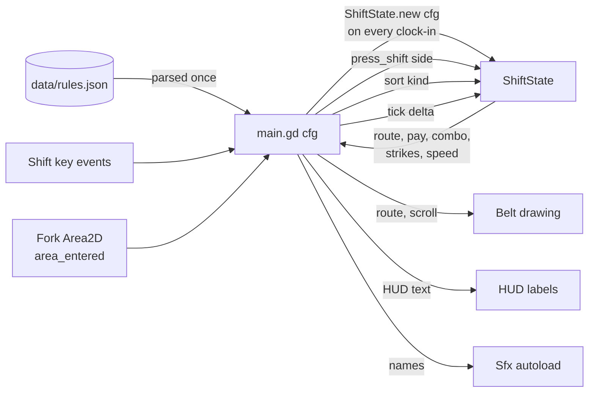

# Architecture

How the Godot project is put together, which script owns what, and where to make common changes.
For the game rules themselves, see [design.md](design.md).

## Files

```
cluck_shift/
├── project.godot          # 960x540, GL Compatibility renderer, Sfx autoload, main scene
├── export_presets.cfg     # "Web" preset: no threads, so it runs on itch.io without special headers
├── data/
│   └── rules.json         # starting routes, the 8 hours (belt + supervisor note), pay, strikes (docs/data-format.md)
├── scenes/
│   ├── main.tscn          # the whole game screen
│   └── tray.tscn          # one tray (Area2D)
├── scripts/
│   ├── shift_state.gd     # ShiftState: every rule of the night, no nodes (the part the tests drive)
│   ├── main.gd            # scene glue: state machine, input, spawning, moving trays, HUD, shop, PA
│   ├── belt.gd            # Belt: draws belt, fork, gates, bins; owns the layout points
│   ├── tray.gd            # Tray: path following and drawing
│   ├── juice.gd           # Juice: popups, particle puffs, screen shake (show only, no rules)
│   ├── title.gd           # the title screen, drawn with shapes
│   ├── shop_view.gd       # the break-room vending machine, drawn with shapes
│   └── sfx.gd             # Sfx autoload: every sound synthesized at start-up
├── tests/
│   ├── test_logic.gd      # 161 checks on ShiftState, Tray.advance and rules.json
│   └── test_play.gd       # plays a whole night of main.tscn headless with real key events (137 checks)
└── docs/                  # this folder
```

## Scene tree

```
Main (Node2D)                 main.gd     state machine, input, spawning, HUD text
├── Belt (Node2D)             belt.gd     draws everything static; reads route + scroll
├── Trays (Node2D)                        parent of all live Tray instances (draw order: above Belt)
│   └── Tray (Area2D) ...     tray.gd     one per tray, from tray.tscn
│       └── Shape (CollisionShape2D)      52 x 36 rectangle
├── Camera (Camera2D)                     centred on (480, 270); Juice shakes its offset
├── Juice (Node2D)            juice.gd    popups (Labels) and puffs (CPUParticles2D) live here, above trays
├── Fork (Area2D)                         the commit zone; area_entered -> main._on_tray_at_fork
│   └── Shape (CollisionShape2D)          80 x 20 rectangle, placed at Belt.FORK + (0, -25) in _ready
├── SpawnTimer (Timer)                    one-shot; first start after note_seconds, then logic.interval
├── HourTimer (Timer)                     one-shot, hour_seconds; timeout -> HOUR_END; paused during e-stops
└── HUD (CanvasLayer)
    ├── Stats (Label)                     pay, combo, strikes, e-stops, belt speed
    ├── Rules (Label)                     "SUPERVISOR SAYS" board, rebuilt from the current rules each hour
    ├── NoteCard (ColorRect)              yellow sticky note, shown for the first note_seconds of an hour
    │   └── Text (Label)
    ├── PABanner (ColorRect)              blue PA announcement over the top of the belt
    │   └── Text (Label)
    ├── Hazard (ColorRect)                full-screen red tint, pulses during an emergency stop
    ├── Dim (ColorRect)                   overlay for the hour tally / game over / win
    │   └── Message (Label)
    ├── Shop (Control)        shop_view.gd  the break room, visible only in SHOP
    └── Title (Control)       title.gd      the title screen, visible only in MENU
```

Autoload: `Sfx` (`scripts/sfx.gd`), one `AudioStreamPlayer` per named sound, each stream synthesized at start-up.

## Who owns what

| Script | Owns | Does not do |
|---|---|---|
| `shift_state.gd` (`ShiftState`, RefCounted) | Current hour and clock, applying supervisor notes, the live rules (routes and stamps), route and gate swing, belt speed and interval, pay, wallet and spending, items and their effects, PA timing, combo, strikes, e-stops, the hour tally, picking the next tray (seeded RNG) | Nodes, drawing, sound, input events |
| `main.gd` | Which state the game is in, the two Timers, turning key events into `press_shift` or shop moves, spawning and moving trays, reacting to the Fork, the note card, PA banner, hazard tint, rules board, bin labels, HUD text, and which juice and sound each event gets | Any rule arithmetic, or second-guessing a verdict from `ShiftState` |
| `belt.gd` (`Belt`) | Layout constants (`SPAWN`, `FORK`, `EXITS`, `FLOOR`, `DECISION_Y`) and drawing the line, the swing flash and bin labels | Game logic |
| `tray.gd` (`Tray`) | Its kind and stamp, art for every kind (`FOOD`) and stamp (`STAMPS`), its remaining path, whether it has been routed or is falling, its result outline | Deciding where it goes |
| `juice.gd` (`Juice`) | Popups, puffs, camera shake (trauma) | Anything that affects the score |
| `title.gd`, `shop_view.gd` | Drawing the title and the vending machine from the values main.gd sets | Input or buying |
| `sfx.gd` (`Sfx`) | Synthesizing and playing named sounds, the hum loop | Knowing when to play |

The split exists for one reason: **every rule is in a class with no nodes, so it can be tested directly** and the
scene can be rebuilt (Phase 3 art and juice) without touching a rule.

## Data flow



## The physics frame

`main._physics_process` runs only in PLAYING:

1. `step = logic.tick(delta)`: advances the clock, gate swing, hour and ramp; returns the belt distance (0 during
   an e-stop, when the hour does not advance either).
2. `spawn_timer.paused` and `hour_timer.paused` follow `logic.is_stopped()`; the note card hides after `note_seconds`.
3. Every tray `advance(step)`s along its path. A tray that has been routed and has used up its path has reached its
   bin: play `tray_thunk`, `queue_free()`. Trays already queued for deletion are skipped, because several physics
   frames can run before the idle frame that frees them.
4. HUD and Belt redraw from `logic`.

The physics server then checks overlaps. When a tray's shape first overlaps the Fork's shape, `area_entered` calls
`_on_tray_at_fork(tray)`, which:

1. ignores it unless PLAYING and the tray is not already routed,
2. sets `tray.routed` and calls `logic.sort(tray.kind, tray.stamp)`, which returns `ok`, `wrong` or `missed`,
3. sends the tray to `Belt.EXITS[logic.route]`, or to `Belt.FLOOR` (tumbling) if `logic.last_missed`, outlines it
   green or red, and picks the sound, popup, shake and puff for `ok`, `wrong`, `missed` or `covered`,
4. enters GAME_OVER if `logic.sent_home()`.

When the `HourTimer` times out, `_on_hour_over` enters HOUR_END, which clears the belt and calls `logic.end_hour()`.

Collision setup: trays have `monitoring = false` (they never look for anything) and stay `monitorable`. The Fork has
`monitorable = false` and stays `monitoring`. Both are on the default layer and mask 1.

## Input path

`main._unhandled_input` receives key events:

- Released keys and echo (auto-repeat) events are ignored.
- In SHOP, Left / Right Shift move `shop.selected` (wrapping).
- Outside PLAYING, Enter, keypad Enter and Space continue: MENU to PLAYING, HOUR_END to SHOP (or WIN after 5 AM),
  SHOP to `_checkout()` (buy or skip, then PLAYING; refused if too expensive), GAME_OVER and WIN to MENU.
  Everything else is ignored.
- In PLAYING and SHOP, `_side(event)` names the gate: Shift with `KEY_LOCATION_LEFT` / `KEY_LOCATION_RIGHT`. A Shift
  with no location (some remote desktops and browsers) moves nothing and sets `backup_keys`; from then on Z is left
  and / is right, and the title and HUD say so (#22).
  `logic.press_shift(side)` returns `toggle`, `estop` or `denied`, which picks the sound.

Using `_unhandled_input` (not `_input`) means a future pause menu or UI control can consume keys first.

## How to change things

### Change where a tray kind goes

At 10 PM: edit `routes` in `data/rules.json`. Later in the night: edit that hour's `note` (see
[data-format.md](data-format.md)). The rules board and bin labels follow the rules. Run the tests.

### Add a supervisor note type

1. Handle the new field in `ShiftState.apply_note()` and return the keys it changed.
2. Count it in the "changes exactly one rule" data test in `tests/test_logic.gd` and add a check for its effect.
3. Document it in `docs/data-format.md`.

### Add a new tray kind

1. Add it to `routes` in `data/rules.json`, or have a note add it: `"route": {"tender": "left"}`. It spawns from then.
2. Add its colour to `Tray.FOOD` and a `match` branch in `Tray._draw()` in `scripts/tray.gd`.
3. Run `tests/test_logic.gd`. It fails with "tray art exists for tender" if you skip step 2.

### Retune difficulty

Change an hour's `speed` and `interval` pairs in `data/rules.json`. The data tests fail if trays could overlap or come
less than 0.6 s apart. Re-run `tests/test_play.gd` to check a perfect player can still keep up all night.

### Add a sound

Add an `_add("name", seconds, func(t): return ...)` line in `Sfx._ready()` (a function of time in seconds returning
-1..1; the helpers `_decay`, `_fade`, `_sweep`, `_saw`, `_square` and `_noise` cover most needs), then call
`Sfx.play("name")` where it should play. Unknown names are ignored, so a missing sound never crashes the game.

### Add a shop item

1. Add it to `shop` in `data/rules.json` (`id`, `name`, `price`, `text`).
2. Give it an effect in `ShiftState.buy()` and wherever that effect applies (`_update_belt`, `sort`, `start_hour`).
3. Update the "exactly the items the rules know" data test, and add a check for the effect.

### Add a game state (Phase 2)

1. Add it to `enum State` in `main.gd`.
2. Add a branch to `_enter()` for what happens on entry.
3. Decide in `_unhandled_input` which keys it accepts.
4. Add a check to `tests/test_play.gd` that drives into and out of it.

## Phase 4 hooks

For the optional strange night: a strange tray is a `stamp`-like marker with no rule, which `ShiftState.sort()` scores
as neither ok nor strike and counts per exit; the flicker is a `Juice` effect; the radio hints are extra `pa.lines`
that Earplugs already block; the ending is chosen in `_enter(State.WIN)` from those counts.
