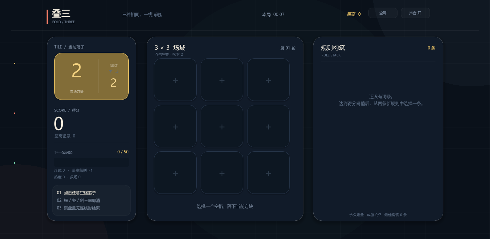

# 叠三 · FOLD THREE

[](https://github.com/Sunset1014/fold-three/releases/latest)
[](https://godotengine.org/)
[](#自动化测试)
[](LICENSE)

> 3×3 个小格子，点一下，三连就合。
> 每局五到十分钟，但“再来一把”的按钮总比上一把更顺手。



## 先玩，再研究

别急着研究源码，先下载 [最新 Windows 版本](https://github.com/Sunset1014/fold-three/releases/latest)，双击打开，随便点两下。

你只需要记住两件事：

1. **点空格落子。**
2. **横、竖、斜三同就消。**

然后，游戏会慢慢把剩下的事情交给你：凑多线、留空位、吃中心、赌级联、选择词条，最后变成一个只有你自己才拼得出来的小 build。

> Windows 64 位单文件版无需安装 Godot。程序没有购买商业代码签名证书，部分电脑首次运行会遇到 SmartScreen 提示，选择“更多信息 → 仍要运行”即可。

## 这游戏到底怎么玩

每一轮系统会给你一个低数值方块，同时提前告诉你下一块是什么。

点击任意空格落子后，系统自动检查全部 8 条线：

- 横着三个一样，消！
- 竖着三个一样，消！
- 斜着三个一样，也消！
- 连线中心会出现一个“原数值 + 1”的新方块。
- 多条线共用一个中心时，升级会叠在一起。
- 新产物如果又凑成三连，就继续级联。

当棋盘全满、又没有任何可消线时，本局结束。

“✦”是万能块，可以替代任意数字。<br>
金色描边并标着“1 线 / 2 线”的空格，表示当前方块落下去马上就能消。

分数会累计。第一次到 50 分时，会弹出两条永久词条让你二选一。之后再达到更高的阈值，就继续选。词条可以反复叠层，也会互相打架或互相抬轿。

19 种词条大致覆盖：

- 得分倍率：奇数、大数、单线、多线；
- 连线路线：斜线、中心线、级联；
- 方块生成：低速流、高值流、万能块；
- 消除产物：额外升级、余烬复生；
- 场域规则：留白加分、连续热度、阈值折扣、满盘救场。

一局里拿到什么，不只看脸，还要看你怎么把前面拿到的东西串起来。

## 我为什么这样设计

我一直觉得，小游戏最怕两件事：第一眼看不懂，第二局不想开。

所以《叠三》定了一个很朴素的原则：

> **基础规则零学习成本，深度藏在规则修饰里。**

具体落到体验上，是这样几件事：

- **先让手会动。** 只点击空格，没有拖拽、计时、连招表，也没有“看完这十页再开始”。
- **给随机性留一个扶手。** 下一块提前可见，可消位置直接发光。玩家仍然要做选择，但不是闭着眼睛猜。
- **让每次反馈都看得见。** 消除线闪一下、棋盘抖一下、分数飘出来、音效响一下。操作很小，反馈要够明确。
- **不要只奖励“消掉了”。** 中心、多线、级联、留白都能参与计分，所以同一条线也有不同吃法。
- **失败以后立刻知道下一局想试什么。** 结算会给出 D–S 评级、距离纪录的差值、本局构筑摘要和成就进度。
- **给玩家两条回访理由。** 一条是刷新高分，一条是解锁 7 项跨局成就。

它不是“数值越大越爽”的暴力游戏，更像是把一副只有 9 个格子的牌，反复洗出不同组合。

## 我是怎么做出来的

先说结论：**这不是一条 prompt 就让 AI 吐出一个完整游戏的故事。**

真实过程更像这样：

> 我把想法讲清楚 → AI 在 Godot 里动手 → 运行起来看 → 找出逻辑问题 → 改 → 再运行 → 再调手感 → 最后打包。

### 使用的工具

| 工具 | 我在项目里拿它做什么 |
| --- | --- |
| **Godot 4.7.2** | 真正的游戏引擎、场景、UI、运行和 Windows 导出 |
| **Godot AI（MCP 插件）4.3.0** | 把 Godot 编辑器里的场景、脚本、运行状态、截图和测试能力接到 AI 客户端 |
| **Codex** | 我的编程工作台：读项目、规划改动、调用工具、检查结果 |
| **DeepSeek V4.1 Flash** | 在 Codex 中执行这一轮开发工作的模型 |

Godot AI 插件是开源的，本项目保留了它的 MIT 许可证。想自己复刻这套流程，可以先看它的仓库：

<https://github.com/hi-godot/godot-ai>

### 第 1 步：先把“好玩”写成人话

我没有一上来就写“给我做一个游戏”。而是把想做的体验拆成可验证的句子：

- 棋盘只能是 3×3；
- 玩家只用鼠标点击；
- 三同必须自动消；
- 中心产物比原数字大 1；
- 多线、级联、满盘要说得清楚；
- 分数到阈值就二选一词条；
- 每局最好 5–10 分钟；
- 第一局不需要教程也能开始。

这一步看起来像废话，实际上很值。规则写得越像“玩家最终会遇到什么”，后面的代码就越不容易跑偏。

### 第 2 步：把 Godot 和 AI 接起来

在 Godot 里装好 Godot AI 插件，让它作为 MCP 服务连接 Codex。连接成功后，AI 能看到当前编辑器会话，也能直接操作项目。

我实际用到的高频能力有这些：

- 查看当前 Godot 会话和场景；
- 新建、打开、保存场景；
- 创建和修改 GDScript；
- 运行项目、读取游戏日志；
- 调用游戏内脚本检查棋盘状态；
- 截图检查布局；
- 运行测试套件；
- 设置主场景、项目尺寸和导出参数。

这类工具最关键的价值，不是“帮你补一段代码”，而是把**改代码 → 启动 → 看截图 → 测逻辑**放进同一个闭环里。少一次复制粘贴，就少一次“我本地跑得起来但你那边不一定”的意外。

### 第 3 步：先做规则，不先堆美术

第一版里最重要的事情不是好看，而是“点下去到底发生什么”。

我把项目拆成了两块：

- [`scripts/run_engine.gd`](scripts/run_engine.gd)：纯规则引擎；
- [`scripts/main.gd`](scripts/main.gd)：界面、鼠标交互、动画、音效和本地记录。

规则引擎负责棋盘、八条线、多线共享中心、级联、得分和词条。界面只负责把状态画出来，再把点击转成 `place()` 或 `choose_rule()`。

这个分离后来救了不少时间：改颜色不会碰坏规则，测词条也不需要先把整个 UI 点一遍。

### 第 4 步：让 AI 真的运行、截图、测试

这一步才是 Godot AI + Codex 最舒服的地方。

比如我让它做出首版后，会直接通过 MCP 启动游戏，然后看截图。第一轮检查的不是“代码有没有红字”，而是：

- 1280×720 下三栏会不会挤；
- 方块数字能不能一眼认出；
- 下一块预览是不是太弱；
- 得分、阈值和救场数量有没有处在正确层级；
- 词条弹窗里两行说明能不能读完。

然后我会让它用固定棋盘模拟一条横线、共享中心的十字线、两级级联、万能块和满盘结束。只有这些状态都能达到，才算“真的能玩”。

### 第 5 步：把游戏做成能让人再开一局的样子

机制跑通只是及格线。后面我又补了几层：

- 下一块预览，降低纯随机的无力感；
- 可消空格提前标出，帮助玩家建立“哦，原来可以这样摆”的掌控感；
- 词条界面显示与已有构筑的联动；
- 结算显示评级、距离最高分的差值；
- 7 项跨局成就和累计局数；
- 一键复制战绩，方便发给朋友；
- 原生程序化音效、消除光束、震动和分数浮字；
- 自适应窗口、全屏按钮和声音开关。

这些不是“功能越多越好”。它们都在服务同一件事：**让玩家每按一次，都觉得刚才的选择被听懂了。**

### 第 6 步：踩坑，改，再踩坑

AI 写代码很快，但它也会一本正经地犯错。这个项目里比较典型的几个坑：

1. **中心产物只加了 1。**<br>
   规则写的是“原数值 + 1”，代码却把所有线都升级成 1。自动化测试把这个问题抓了出来。

2. **空格和万能块共用了 `0`。**<br>
   结果一个万能块既像空位又像方块，判断逻辑开始精神分裂。后来空位使用 `0`，万能块使用 `-1`，世界清净了。

3. **奖励洗牌调用了错误 API。**<br>
   看起来像随机，实际一进词条选择就报错。测试直接把这个分支打回重写。

4. **窗口缩放不等于 UI 自适应。**<br>
   固定坐标能做出好看的 16:9，但不代表 4:3、超宽屏和全屏都正常。最后增加了逻辑画布缩放，并实际截了多种尺寸检查。

所以我一直不觉得“让 AI 写完”就算完成。真正的完成条件是：运行过、看过、测过，还要知道它为什么坏过。

### 第 7 步：导出给别人玩

最终 Release 里的 Windows 版本是单文件内嵌资源，不需要 Godot 编辑器。导出时还处理了几个细节：

- 嵌入游戏资源，避免 exe 旁边散落 pck；
- 补全 Windows 图标尺寸；
- 写入产品名、版本号和文件描述；
- 导出前移除编辑器专用的 MCP 运行桥接；
- 从独立临时目录启动成品，确认脱离项目目录也能运行；
- 实测 4:3、16:10、16:9、21:9 和全屏布局。

## 如果你也想复刻一遍

### 环境

- Godot **4.7.2**
- Godot AI MCP 插件 **4.3.0**
- Codex、DeepSeek V4.1 Flash 或你自己惯用的模型
- Windows 导出模板（Godot 会自动提示安装）

### 一段好用的起手 prompt

```text
调用 Godot AI MCP，基于 Godot 引擎开发一款极简策略 roguelike 小游戏。

核心玩法：
- 3×3 棋盘；
- 玩家只用鼠标点击空格；
- 每回合随机生成一个低数值方块；
- 横、竖、斜三同自动消除；
- 在连线中心生成原数值 +1 的方块；
- 棋盘满且无消线时结束；
- 分数到阈值时二选一词条，词条永久叠加。

设计要求：
- 基础规则零学习成本；
- 规则修饰创造策略深度；
- 单局 5–10 分钟；
- 先做规则引擎，再做界面；
- 所有核心状态都要有自动化测试；
- 用实际运行截图检查布局；
- 最后导出 Windows 单文件版本。
```

然后别只问“写完了吗”，继续追问：

```text
帮我把鼠标落子、单线、双线共享中心、级联、万能块、
满盘结束、救场和奖励选择逐项跑一遍。
再检查 4:3、16:9、超宽屏和全屏。
```

AI 最擅长的是快速试错，但目标、边界和验收标准最好由你来定。这样它是在帮你做游戏，而不是替你决定什么游戏好玩。

## 项目结构

```text
.
├── main.tscn                    # 主场景
├── icon.svg                     # 窗口与项目图标源文件
├── scripts/
│   ├── run_engine.gd            # 规则引擎
│   └── main.gd                  # UI、动效、音效、存档
├── tests/
│   └── test_run_engine.gd       # 11 项规则测试
├── assets/
│   ├── icon.ico                 # Windows 应用图标
│   └── icon_256.png
├── docs/
│   └── preview.png              # README 截图
├── export_presets.cfg           # Windows x86_64 单文件预设
├── addons/godot_ai/             # 开发用 Godot AI MCP 插件
└── README.md
```

## 自己运行与修改

用 Godot 4.7 打开 `project.godot`，按 `F5` 即可。

自动化测试套件名为 `run_engine`，可以用 Godot AI 的 `test_run` 直接运行；也可以自己接入 GUT 或把测试方法迁移到现有流水线。

重新导出：

```powershell
New-Item -ItemType Directory build -Force
& "C:\path\to\godot.console.exe" --headless --editor --path . --export-release "Windows Desktop" "build\FoldThree.exe"
```

如果第一次导出提示缺少模板，在 Godot 编辑器里安装对应版本的 Export Templates 即可。

## 操作一览

- 左键点击空格：落子；
- 左键点击词条卡：选择词条；
- 右上角“全屏”：切换全屏 / 窗口；
- 右上角“声音”：开 / 关音效；
- 结算页“再来一局”：开新局；
- 结算页“复制战绩”：把本局结果复制到剪贴板。

最高分、局数、最佳构筑、最高级联和成就保存在：

```text
%APPDATA%\FoldThree\fold_three_record.cfg
```

不联网也能玩，不需要账号。

## 自动化测试

当前规则引擎有 11 项测试，覆盖：

- 初始状态与下一块预览；
- 单线中心升级；
- 双线共享中心叠加；
- 两级级联；
- 万能块三连；
- 奖励触发与选择持久化；
- 跨奖励的下一块预览；
- 满盘结束；
- 一线生机救场；
- 阈值折扣；
- 额外中心升级。

## 许可证与致谢

本项目源码采用 [MIT License](LICENSE)。

仓库内含的 Godot AI 插件沿用其自己的 [MIT License](addons/godot_ai/LICENSE)，版权归 Godot AI contributors 所有。更多说明见 [THIRD_PARTY_NOTICES.md](THIRD_PARTY_NOTICES.md)。

最后，感谢每一位真的点开玩了一局的人。<br>
如果你也做出过那种“规则只有一句，但脑子已经转了三圈”的小游戏，欢迎来仓库开 Issue 或 PR。
