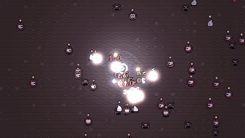
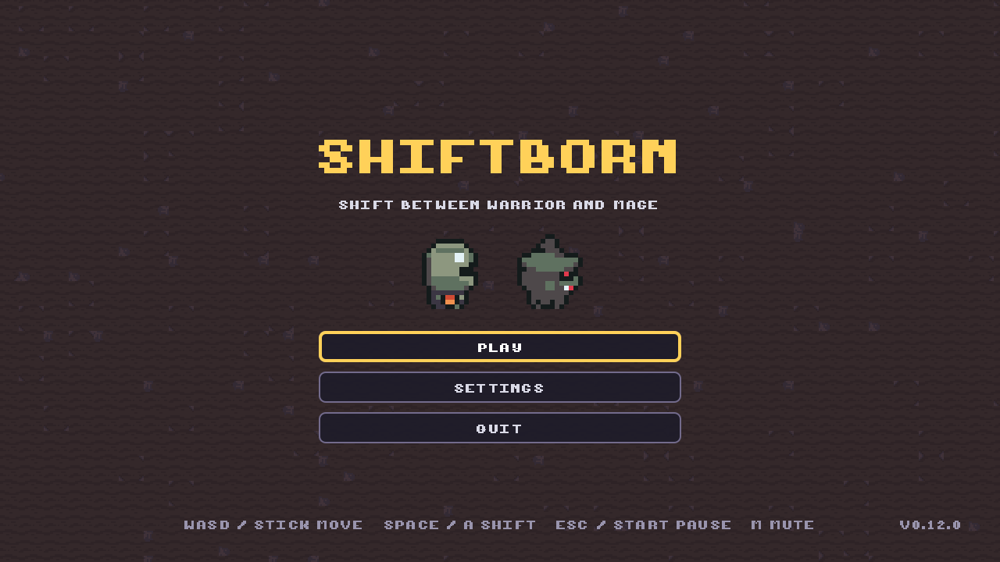
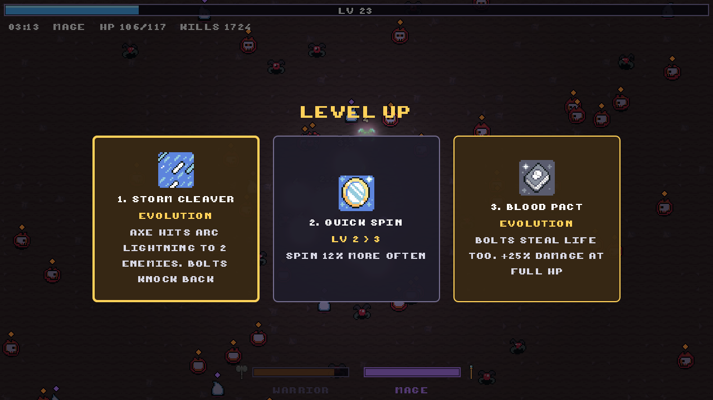
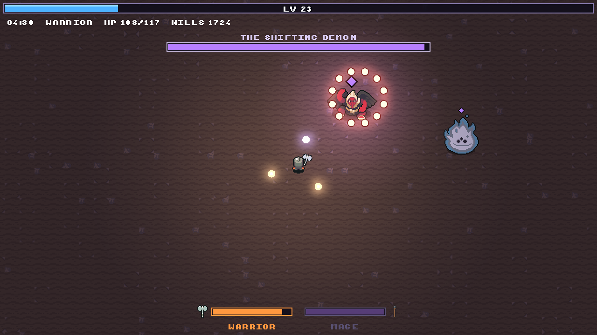
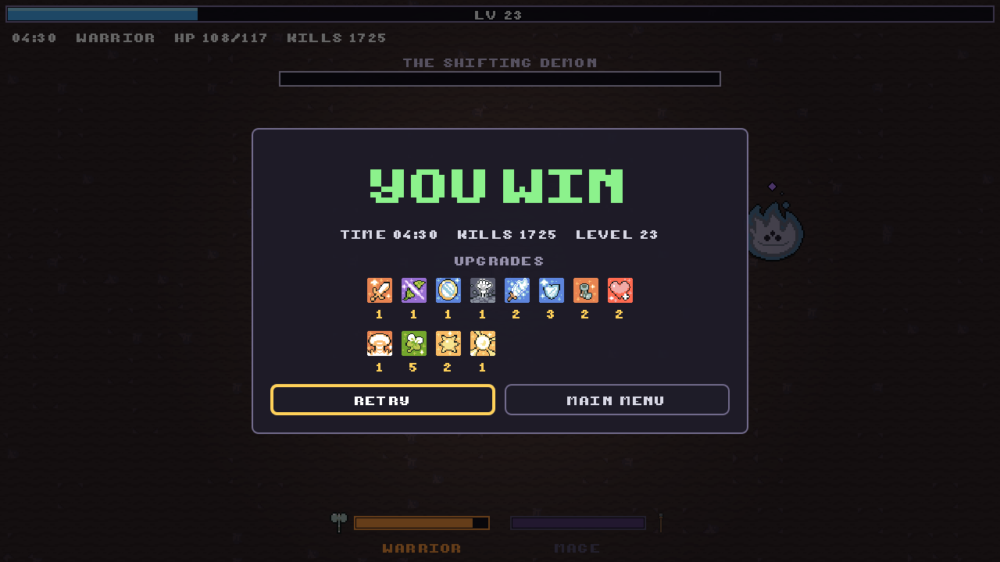

# Shiftborn

A survivors-like where you **shift** between two forms mid-fight: a slow armored warrior who spins his axe around himself, and a fast mage who snipes the nearest enemy. Made with Godot 4.7 for [GitHub Game Off 2026](https://itch.io/jam/game-off-2026) (theme: **SHIFT**).

**[Play in your browser](https://unwin41.github.io/shiftborn/)** · **[Download for Windows, macOS and Linux](https://github.com/Unwin41/shiftborn/releases)** · itch.io page coming soon



> Art: [Ninja Adventure Asset Pack](https://pixel-boy.itch.io/ninja-adventure-asset-pack) by Pixel-boy and AAA (CC0).

| | |
|---|---|
|  |  |
|  |  |

## Download

Grab the zip for your system from [Releases](https://github.com/Unwin41/shiftborn/releases), unzip it and run the game. The builds are not code-signed, so your OS may warn you the first time:

- **Windows:** SmartScreen says "Windows protected your PC". Click **More info**, then **Run anyway**.
- **macOS:** open `Shiftborn.app`. If macOS blocks it, go to **System Settings > Privacy & Security** and click **Open Anyway**. Or run `xattr -dr com.apple.quarantine Shiftborn.app` in Terminal.
- **Linux:** run `./shiftborn.x86_64`. If it does not start, run `chmod +x shiftborn.x86_64` first.

Desktop builds run with extra effects: HDR glow and a light on every bolt. The browser version turns these off to stay smooth. To try the browser settings on desktop, start the game with `-- --low-quality`.

## Controls

| Action | Keyboard | Gamepad |
|---|---|---|
| Move | WASD / arrow keys | Left stick / D-pad |
| Shift form | Space / Shift | A / RB |
| Pause | Esc / P | Start |
| Retry after a run | R | Retry button |
| Mute | M | |

Every run ends with a score (kills, time, perfect shifts and a big bonus for beating the boss); the title screen shows your best. Ten achievements, from First Blood to Untouchable, are listed under **Achievements** on the title screen.

The first run starts with a short guided tutorial (move, shift, resistance, perfect shift). Skip it from the pause menu, or turn it back on in Settings.

Attacks are automatic. Mini-bosses arrive at 1:45 (a cyclops demon) and 3:15 (a giant spirit); at 4:30 the waves stop and **The Shifting Demon** appears. It swaps the form it resists every 8 seconds, dashes and fires bolt rings. Kill it to win.

Why shift:
- **Immunities.** Skulls are immune to magic and spirits to the axe: the wrong form deals no damage at all (IMMUNE). The diamond above an enemy shows the color of the only form that hurts it: orange for the warrior, purple for the mage. Shift Burst and evolutions hit everything.
- **Energy.** The active form tires and its damage drops to half; the resting form recovers twice as fast. The bars at the bottom show both.
- **The horde.** Spiders swarm, slimes split in two, eyes keep their distance and shoot (they resist the axe), and beasts stop, draw a red line and charge along it (they resist magic).
- **Perfect shift.** Shift just as an enemy or a bolt is about to hit you: time slows, you are briefly invulnerable and the new form gets a burst of energy. Once every 2 seconds.
- **Momentum.** A shared upgrade: +20% damage per level for 2 seconds after each shift.
- **Evolutions.** Max out one warrior and one mage upgrade (or Shift Burst and Momentum) and a gold evolution card appears. Evolutions work in both forms and ignore resistances:
  - **Arcane Orbit** (Twin Axe + Split Bolt): three orbs circle you.
  - **Storm Cleaver** (Heavy Swing + Chain Spark): axe hits arc lightning to two enemies; bolts knock back.
  - **Blood Pact** (Vampiric Edge + Arcane Power): bolts steal life; +25% damage at full HP.
  - **Twin Soul** (Shift Burst + Momentum): a burst twice as big that also unleashes the new form's attack.

## Horde Kit addon

The spawner and upgrade systems live in [`addons/horde_kit`](addons/horde_kit) and have no dependency on the game. They will be split into their own repository after the jam.

- **`HordeSpawner`**: a Node2D that spawns enemies on a ring around a target. You set up the waves as `SpawnWave` resources in the inspector, each with start/end time, interval, batch size and an alive cap.
- **`UpgradePool`**: weighted level-up offers with no duplicates. Handles max levels, prerequisites and tag filters, so each form only sees its own upgrades plus the shared ones.

```gdscript
var pool := UpgradePool.new(upgrades)
var choices := pool.offer(3, rng, ["knight"])  # knight + shared upgrades
pool.apply(choices[0].id)
```

## Development

Requires Godot 4.7.2.

```bash
godot --headless --import                                     # first run / CI
godot --headless -s res://tests/run_tests.gd                  # unit tests
godot --headless --fixed-fps 60 -s res://tests/smoke_test.gd  # gameplay smoke test
godot --path . -- --boss  # start a run with the boss already there
godot --headless -s res://tools/build_sprite_frames.gd        # rebuild SpriteFrames from assets/ninja
```

Every push to `main` runs the tests, exports Web/Linux/Windows builds and deploys the web build to GitHub Pages. Pushing a `v*` tag also uploads the builds to itch.io, once the `BUTLER_API_KEY` secret and the `ITCH_GAME` variable are set.

## License

Code: [MIT](LICENSE). Third-party assets are listed in [CREDITS.md](CREDITS.md).
