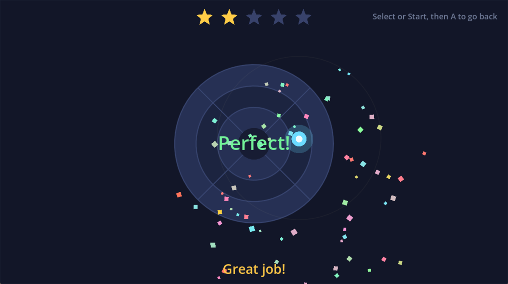

# Controller Dojo

A small Godot 4 game for learning to use a gamepad. It is aimed at kids who are
still figuring out that the stick has directions and that pushing it further
means going further, so every mode is built around one skill at a time, with
stars, cheers, and rumble for getting it right.



Play it at https://stumpy-dog-studios.itch.io/controller-dojo

## Modes

| Mode | Skill |
| --- | --- |
| Stick Training | Push the left stick to a prompted direction and distance, one target at a time |
| Movement Training | Steer freely toward targets while a mini stick indicator mirrors your input |
| Maze | Navigate a generated maze to the goal; hard mode adds three strikes for touching walls |
| Test | A plain input readout: both sticks, buttons, and the detected device |

Navigation is D-pad plus A throughout. Select or Start opens the back button
from inside a mode, so the whole game is playable without touching a keyboard.

## Running from source

Requires Godot 4.7. Open `project.godot` in the editor, or:

```bash
godot --path .
```

## Building

`HOW-TO-RELEASE.md` covers the export presets, the itch.io push, and the
Android quirks. The short version: `tools/setup.ps1` creates the export
directories and installs the Android build template, then each preset exports
into `.export/<platform>/`.

Android needs a custom gradle build because Godot's Android port has no backend
for `Input.start_joy_vibration`. `tools/android/ControllerRumblePlugin.kt`
drives the pad's own vibrator instead, and `scripts/haptics.gd` picks between
the plugin and the engine at runtime.

## License

MIT, see [LICENSE](LICENSE).
