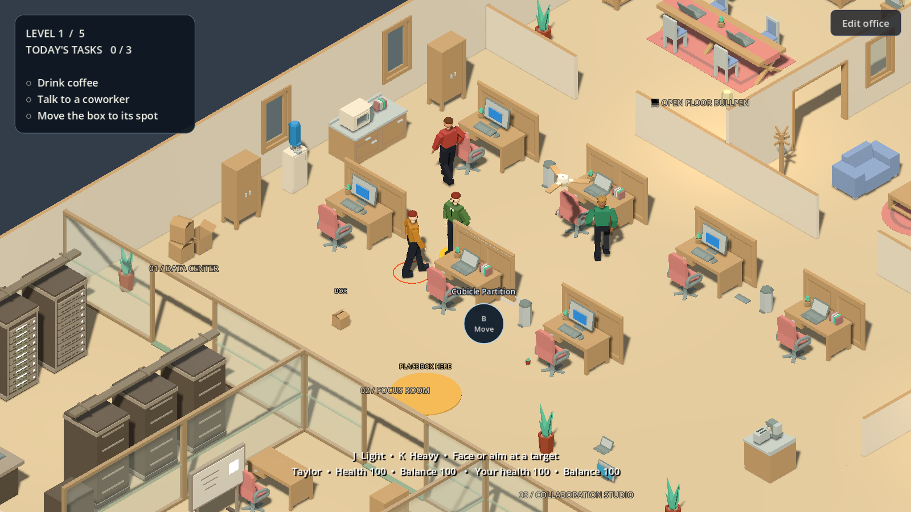
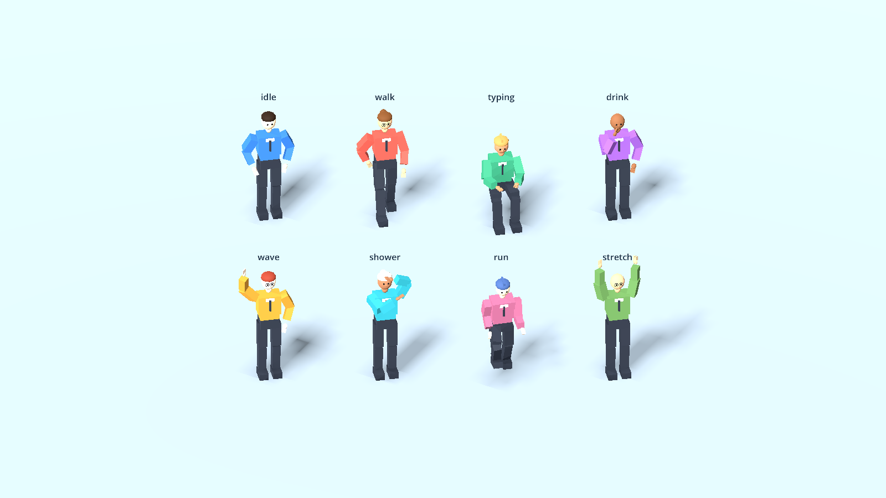

# Cubicle Chaos

Clock in. Rearrange the office. Cause a little chaos.

A playable 3D office sandbox made with Godot 4.7 (tested with 4.7.2), developed for the [Meta Global AI Developer Hackathon](https://dev.meta.ai/events/global-hackathon), October 26–November 4, 2026. Meta **Muse Code** helped write and refine the game during development.



## Meta hackathon project

Cubicle Chaos explores AI-assisted game development through an interactive office: coworkers follow daily routines, objects can be picked up and thrown, furniture can be rearranged, and everyday tasks share the same space as physics-driven chaos.

### Built with Meta Muse Code

Meta Muse Code was used as a coding assistant to help write and refine the Godot/GDScript implementation. Its role in this project is development assistance. Coworker behavior and conversations use the game's scripted routines and authored dialogue. Playing the game requires no Meta API credentials.

The implementation includes:

- An isometric office with coworker routines, conversations, and equipment activities.
- A furniture editor with placement checks, rotation, and room customization.
- Physical props, charged throws, combat, and material-specific destruction.
- Procedural character geometry, animations, visual effects, and synthesized sound.
- Two playable levels, an optional introduction, and keyboard-and-mouse controls.

### Prototype status

This is a hackathon prototype. Levels 3–5 are placeholders, and mobile touch controls are not implemented. The November 2, 2026 review successfully built a fresh Web export; 25 of 33 regression suites passed, eight failed, and one failing suite also reported a shutdown object leak. See [known issues](docs/KNOWN_ISSUES.md) for the affected areas.

## Quick start

1. Install Godot 4.7.2.
2. Open `project.godot` and run the main scene.
3. Choose **Start level 1**. Move with **WASD**, interact with **F**, pick up or throw with **T**, and place objects with **G**.

For a browser build, follow [Run in a web browser](#run-in-a-web-browser) below.

## Open-source resources

The original game code, project icon, procedural character model, skeleton, animations, and sound synthesis are licensed under [MIT](LICENSE). Furniture comes from Kenney's CC0 Furniture Kit; the bundled Noto Emoji font uses SIL OFL 1.1. See [THIRD_PARTY_NOTICES.md](THIRD_PARTY_NOTICES.md) for sources, copyrights, and the separate licenses.

Characters and animation keyframes are generated directly in Godot by `OfficeCharacter`, `OfficeAnimations`, and `PlayerAnimations`. No external character downloads, FBX files, motion-capture clips, or Adobe account are required. The character design is intentionally simple and stylized. The generated rig supports the existing walking, sitting, typing, social, equipment, grip, combat, knockdown, and recovery systems.



Choose **Credits & licenses** on the level menu to read the project, asset, engine, and built-in-library notices. The Web export also includes the notice files.

To render the character and animation contact sheet, run:

```sh
godot --path . --script res://tools/preview_characters.gd
```

The image is saved to `build/previews/original-characters.png`.

## Run in a web browser

Install the Web export templates matching your Godot version from **Editor > Manage Export Templates**, then build:

```sh
bash tools/export_web.sh
python3 -m http.server 8060 --bind 127.0.0.1 --directory build/web
```

Open <http://localhost:8060> in a browser with WebGL 2 support. Click the game to focus it, then use the keyboard and mouse controls below. If Godot is installed elsewhere, set `GODOT_BIN` to its executable when running the build script.

To host the game, upload **all files inside `build/web/`** to a static web host, keeping their names and paths intact. Serve `.wasm` files as `application/wasm`. Open the game over HTTP or HTTPS rather than opening `index.html` directly. The Web preset uses the Compatibility renderer and disables threads, so it does not require cross-origin isolation headers. It exports all project resources because furniture and animation assets are loaded dynamically.

This is a keyboard-and-mouse web build. Phone touch controls are not implemented.

## Menus and settings

The game opens on a level menu with a frozen office behind it. **Start level 1** begins the shift. The short, optional introduction asks you to move and talk to a coworker; choose **Skip** to dismiss it, or **Replay introduction** on the level menu to see it again. It remembers completion or skipping on this device in `user://office_intro.cfg`.

**Esc / P** returns to the level menu and pauses the simulation. Choose **Continue level** to resume the current shift. Esc first cancels an active furniture placement or releases grabbed furniture. Leaving the game window also pauses the simulation.

Level 1 asks you to drink coffee, talk to a coworker, and move a box to its marked spot. Finishing unlocks level 2, with a server repair and coffee delivery. Levels 3–5 are placeholders. Selecting a level starts its checklist over.

Open **Settings** from the level menu or editor toolbar. Lighting, worker labels, nearby action hints, shadows, simulation speed, camera distance, simultaneous breaks, and stand-up spacing apply immediately and save to `user://office_settings.cfg`. Settings keep the office paused. **Restore defaults** resets these preferences.

Under **Accessibility** in Settings you can also set the **interface size** (80–150%), turn on **high-contrast highlights** (yellow, thicker outlines instead of white), and **remap the gameplay keys**: interact, second action, pick up/throw, place gently, grab furniture, light attack, heavy attack, and camera rotate. Select a key, then press the new one; Esc cancels and duplicate keys swap. Nearby action circles and the title screen always show the current keys. Movement (WASD/arrows), Run (Shift), and Pause (Esc/P) stay fixed. Scrolling the mouse wheel zooms the camera in and out at any time during play.

## Player controls

- **Left mouse:** click the floor to walk there; hold and move the cursor to steer continuously. Paths go around furniture. Click a reachable loose prop to pick it up, or a nearby coworker/equipment item for its primary action. Keyboard movement cancels a mouse destination.
- **Right mouse:** hold to aim and face the cursor, including while moving with WASD. Aim picks the visible person or object under the cursor, including seated coworkers. When carrying a prop, holding right mouse charges the throw and releasing throws toward the cursor. Esc cancels; releasing over a menu or button cancels safely.
- **Middle mouse drag:** pan the camera. **Shift + middle drag:** rotate. **Mouse wheel:** zoom. Panning keeps an offset while the camera follows the player; **Edit office > Reset view** clears it.
- **WASD / arrows:** walk.
- **Hold Shift + WASD / arrows:** run, with a faster stride, lifted knees, and swinging arms. The run animation stops when a wall blocks movement. Carrying a cup or prop keeps you walking; furniture keeps its push/pull pace.
- **Esc / P:** return to the level menu and pause. Choose **Continue level** to resume. Esc first cancels charged throwing, furniture placement, or a furniture grab.
- **F:** use the primary nearby action, talk, sit/stand, or cancel an equipment activity.
- **H:** use the second available equipment action.
- **Conversations:** automatic emoji exchanges appear above whoever is speaking. There are no topic menus or reply choices. **F** ends the chat early; **Esc** returns to the level menu.
- **G:** gently place a carried prop or cup on a reachable clear table or desk, with a floor fallback. Props are placed without throw velocity or spin. **F** also places the cup when the table is highlighted, and picks it back up afterward.
- **J:** light attack. Tap to chain quick punches and palms, or hold to repeat. **K:** heavy attack, choosing a longer-reaching kick with a longer windup. Face a coworker or hold right mouse to aim at one; the orange ring marks your target. The first strike locks that person for the fight, including while they are down or beyond striking reach. Use movement keys to circle or backpedal while facing them; cursor aim and nearby bystanders cannot steal the lock. Retreat beyond seven meters to disengage. Late taps of either attack are buffered. Free your hands and stand up first.
- **T:** pick up a nearby loose prop (book, box, plant, laptop, radio, speaker, keyboard, bear, or monitor). Tap T again for a quick throw; hold T to charge, aim with the mouse, and release T to throw. A gold trajectory, contact marker, and charge percentage appear while charging. The throw automatically locks onto the nearest coworker in the aimed direction, marked by a gold ring and name; if nobody is in front, it follows your aim. Walls and furniture can block the throw, and distant targets may be beyond the object’s range. Esc cancels aim; pausing cancels charge without dropping the prop. Props are real rigid bodies: they roll, stack, topple, and smash things. Heavier props slow carrying and have shorter throws. Both hands reach toward the object during pickup, carry, windup, and release.
- **B:** grab nearby furniture with both hands. Walk toward the object to push, or away from it to pull. Press **B**, **F**, or **Esc** to release.
- **F5 / F9:** save / load the current shift during play. Furniture, props, worker positions, player state, and work stats are restored. The current level, checklist and unlocks are not included in shift saves.
- **Q / E:** rotate the camera. Scroll to zoom.

Nearby objects and people have a **white outline and floor border**. **Circular action buttons** show the available shortcuts; click a circle or press its key. Options respect reach, walls, occupied chairs, busy animations, and free hands.

Stand close to an object's edge to grab it. Put down the cup first, and wait for coworkers to leave an occupied workstation. Larger furniture moves more slowly. Furniture and the player stop at obstructions; pushing and pulling use forward/backward steps with hands reaching toward the object.

Karate forward stances and open-palm kung fu guards flow into each strike and linger briefly afterward. Each move has its own windup, limb path, reach, damage, and balance impact. Release J to stop after the current strike and walk away to dodge. A short break resets the move sequence. The combat display shows the target’s health and balance and warns of incoming attacks during their windup.

Coworkers fight back using the same varied move set after being hit. After the **first knockdown you cause**, they remember you, get up with brief protection, close the distance, and counterattack. After the **second**, they get up and flee through staff security and the east entrance, then leave the shift and release their desk. Departing coworkers cannot be targeted in melee combat or damaged again. An obstructed escape route makes them wait and replan. Save/load preserves knockdown counts and departure. Move away during a strike's windup to dodge, or retreat to end the fight. Hits reduce health and balance and can knock either character down; health and balance recover when the fight quiets down.

Guards breathe, striking shoulders and hips follow through, and the spare hand protects the jaw. High hits recoil the head and body; body hits fold the guard toward the stomach. Circling/backpedalling uses planted combat steps. Punches leave short gold hand ribbons and kicks leave blue foot ribbons, following the actual skeleton. Contact bursts use `scenes/combat_impact.tscn`; ribbons use `scripts/combat_trail.gd`. Fleeing uses a separate forward-leaning run with a nervous glance behind. All these assets are generated locally, with no downloads.

Knockdowns blend from the interrupted pose into a bent-knee landing and a still floor pose. Recovery takes 1.8 seconds: brace with the hands, sit up, move through a half kneel, and rise into idle before movement resumes.

Missed swings and thrown props can smash every furniture and loose prop type, including desks, chairs, tables, workstations, partitions, rugs, appliances and bathroom fixtures. Occupied and grabbed furniture can break too: workers release lost seats and assignments, player activities cancel, furniture grips release and cups on destroyed tables return to the floor. All sound is synthesized in code with a Sound toggle in Settings; no audio files are downloaded. Coworkers vary by hair style and color, glasses, and outfit shade. Coworkers have their own interests and use short, lighthearted lines with emojis.

## Physics and material destruction

Pickup checks distance, line of sight, and room for the entire lift. Held props use swept volume checks, including turns, against furniture and walls. A throw starts at the checked held position. Props cannot be carried together with a cup or a furniture grab. G checks the whole prop footprint on tables, including clutter and round edges; an obstructed placement keeps the object in hand. Knockdowns safely release carried objects, and temporary owner collision exceptions prevent immediate self-hits.

Every active furniture and loose prop type has an explicit debris family: 56 types across 17 families, with a mixed-material fallback for future objects. Plants produce curved pot shards, tables produce panels and legs, storage produces shelves, electronics produce casing and circuitry, seating produces cushions and frames, cardboard produces panels and flaps, and books produce covers and pages. Additional families cover workstations, metal fixtures, soft toys, glass, ceramic fixtures, appliances, partitions, textiles, office chairs and masonry. Every type can take damage and break into its family parts; monitors also have cracked, flickering displays. See [DEBRIS_FAMILIES.md](DEBRIS_FAMILIES.md) for all assignments and the visual preview.

Incoming contact speed, relative motion, mass, and material resistance determine impact damage. Slow settling is harmless, and per-pair cooldowns prevent a multi-point collision from applying damage repeatedly. Props also take damage when hitting walls or floors. Thrown objects can stagger or knock down coworkers through the existing combat and recovery system; soft toys have reduced effects. Ceramic, wood, electronics, metal, fabric, cardboard, paper, glass, plastic and masonry each have distinct synthesized impact and break sounds. Individual components use their own material physics and finish, including soft cushions, metal frames and translucent glass.

Small material effects have no physical collisions. At most 80 physical fragments and 24 material emitters are active at once. Fragments collide with the environment, not workers or one another, sleep when settled, and disappear after 3.5–6 seconds depending on material. Pausing freezes effects and lifetimes.

Shift saves preserve damaged appearances, prop rotation, velocity, spin, and player throw attribution. A prop carried at save time restores released with settling protection. Transient debris is cleared on load. An intentionally empty prop collection stays empty instead of respawning destroyed objects.

The implementation separates responsibilities: `MouseControls` owns mouse navigation/steering, cursor facing, and mouse gesture ownership; `PropHandling` owns carrying/aiming/gestures, `PhysicsProp` owns its body, `PropImpact` resolves contacts, `DestructibleState` owns health and damage visuals, and `DestructionProfile` holds material data. `FurnitureGrip` and `PropGrip` share the `HandReach` arm solver. `DebrisChunk` and `MaterialBurst` own their lifetimes.


## Office equipment activities

Walk close enough to see an equipment object's white outline, then use its circular actions or **F / H**. Nearby action circles show which equipment you can use. **F / Esc** cancels unfinished work without consuming resources or granting results. Returning to the level menu cancels unfinished work and releases the equipment reservation. Active equipment cannot be edited or used by a coworker. Put down the water cup before starting activities.

- **Spare workstation or computer:** write reports. Personal NPC desks remain theirs.
- **Printer:** print a finished report, then collect the pages. A visible paper stack and label mark pending output in that particular printer.
- **Filing cabinets and archive shelves:** file collected reports or retrieve archived reports.
- **Conference/collaboration tables:** review a printed report to prepare notes; then present it at a table or TV. A presentation consumes one report and its notes and increments the presentation count.
- **Coffee stations:** brew coffee, then drink it to restore focus and balance.
- **Fridge:** collect snacks and eat them, or bring them to a kitchen counter/bar to prepare a meal. Food restores health, balance, and focus.
- **Lounge seats:** sit and relax to recover, then press F to stand at the original reachable approach position.
- **Toilets:** approach the front and press **F / Use toilet**. Your character sits, takes a bathroom break, and stands up afterward, with an emoji bubble and a finishing flush sound.
- **Showers:** approach the front and press **F / Take shower**. Your character steps into the enclosure and scrubs their hair under animated water spray, steam, and floor ripples, then steps back out refreshed.
- **Bathroom sinks:** press **F / Wash hands** for a hand-washing animation with running water and basin ripples.

Bathroom activities require empty hands and reserve the fixture until finished. **F / Esc** cancels and returns you outside; returning to the level menu also cancels the activity. Only the fixture's collision is bypassed during use, and blocked entrances prevent entry. Saving during bathroom use stores your entrance position so loading places you outside the fixture.

Replenishment cooldowns prevent repeated instant breaks. Equipment progress is included in shift saves; dialogue visits and level progress last for the current running session. **F5** saves the shift and **F9** reloads it.

## Arrival and data center

The floor is **34 × 30 meters (1,020 m²)**, expanded from 26 × 30 meters to give arrival its own east wing. A recessed east entrance has an exterior landing, a 2.4-meter opening, and a sage runner leading straight to the staff security checkpoint. Reception has one front desk, a staff chair, waiting seats, a directory, and plants. Glass separates the public lobby from the staff lounge; visitors can reach the new meeting room without crossing security. A separate IT support room provides a workstation, repair bench, storage, and planning board.

The checkpoint has a card-reader detail and a status light. It is an open architectural walkthrough, not an access-control simulation. Furniture placement protects the complete entrance-to-security lane and both new room entrances.

The south-wing data center contains two facing three-rack banks, including compute and network racks, with a central aisle and rear service clearance. Network patch leads, rear vents, rack labels, and overhead cable trays distinguish the equipment. Cooling, backup power, and a maintenance workbench sit clear of the entrance. The room retains the office’s warm palette and framed glass architecture.

## Bright, spacious office theme

The whole office uses **one consistent theme in every room**: a uniform floor colour by default across the entire 34 × 30 m floor, warm-white walls, light-oak wood, and balanced daylight lighting in every room. The data center uses the same warm palette as the rest of the office. Floor colors, patterns, and textures can be customized in the editor.

Pick a theme in **Settings > Office theme** — the default floor color changes live across all rooms. A custom floor color stays selected until you choose **Match theme**:

| Option | Floor (single colour) | Walls / accents |
|---|---|---|
| **Nordic Light Oak** (default) | Pale oak | Warm white, sage + clay |
| **Scandinavian White** | White-washed | Pure white, pale blue-grey |
| **Warm Sand Minimal** | Warm sand | Cream, terracotta + olive |

Lighting uses balanced exposure in every preset (**Daylight / Soft daylight / Golden afternoon** in Settings). Reduced ambient, fill, and room-light energy preserves the pale walls and oak surfaces, while linear tone mapping avoids washed-out highlights in the Compatibility/Web renderer. Theme changes recolor the shared floor, frames, and architecture without changing the layout.

## South wing — focus & collaboration

The office spans **34 × 30 meters**, with a south wing past the original floor; each of the five rooms has its own entrance from the connecting corridor, in the same theme as the rest of the office.

- **Data center:** six server/network racks, cooling, backup power, cable trays, and a maintenance bench around a clear service aisle.
- **Focus room:** quiet desks with a laptop, chair, filing cabinet, whiteboard, and plants. The centre stays open.
- **Collaboration studio:** framed glass walls, a glass collaboration table for report review/presentations, lounge seating, and a rolling whiteboard for presentations.
- **Two bathrooms:** toilets, vanity mirrors and sinks, hand-dryer stands, waste bins, privacy partitions, and a shower in the second bathroom (rethemed in warm whites, no cyan). The workbench, meeting table, and whiteboards use the existing equipment activities.

**14 assets** are available in **Edit office**, including server racks, network racks, cooling, backup power, glass partitions, workbenches, and bathroom items. Glass and installed bathroom fixtures can be rearranged in the editor; they cannot be pushed by hand. Doors are open portals, and placement checks keep all five entrances clear. Transparent glass blocks walking and navigation.

Camera tracking, walking limits, furniture movement, loose-prop recovery, and floor placement all use the expanded floor bounds. Zoom out up to 56 meters for a full-office view; camera panning includes the new east wing. New furniture is included in normal shift saves. Existing saved layouts still load as saved; start a fresh session to see the fully furnished default wing.

## Furniture editor

Normal play keeps the editor hidden. Click **Edit office** in the top-right corner to open the catalog and furniture inspector; **Done** hides them again, cancelling any unfinished placement or move. Under **Floor** in the right panel, pick any **Color**, a **Pattern** (Solid, Square tiles, Staggered planks, or Checkerboard), and a **Texture** (Smooth, Wood grain, Carpet, or Stone). Choices combine, update every room live, and save automatically on this device. **Match theme** restores the theme's floor color while keeping the chosen pattern and texture. The inspector scrolls on smaller windows. Nearby action circles remain available during normal play.

With the editor open, select a catalog item to build, or click existing furniture to select it. **M** moves, **R** rotates, **Delete** removes, and **Esc** cancels. Hold **Shift** when placing to build multiple copies.

Green previews indicate a valid position; red previews explain the obstruction in the inspector. Placement, movement, and rotation check the object's rotated footprint against furniture, walls, room doorways, people, and office boundaries. Rugs may go beneath furniture. Cancelling a move restores the original position and rotation.

Workers spend longer, staggered periods at their personal desks. Thirst, fatigue, pending errands, and concentration drive water, coffee, printer, conference, and lounge visits. Separate first-in-first-out queues control outings and stand-up animations. **Two coworkers can be on outings by default**, while **one NPC stands up at a time**, including recovery after a knockdown. Settings allow 1–4 simultaneous outings and a 0.5–3 second gap between stand-ups. Waiting coworkers keep typing. Lowering the limit lets current outings finish before admitting more; paired conversations need two places. Deskless hires wait between useful errands rather than wandering randomly. Interrupted or unreachable tasks release their reservations and wait before retrying.

Coworkers also choose social breaks. Two consenting participants reserve fixed, reachable meeting positions, leave their desks in turn, exchange visible speech, then return to their own work. They do not chase each other. Combat, blocked meeting positions, deleted participants, and timeouts cancel both sides safely.

Talking to a coworker starts a short automatic exchange in speech bubbles. Alex loves lists, Maya tends plants, Jordan makes art, Sam thinks about coffee and snacks, Taylor enjoys books, and Morgan tackles technical problems. Repeated visits cycle through different lines and matched replies; other hires have their own rotating greetings. Coworkers also meet and chat with each other automatically, trading jokes about office life. There are no dialogue choices: each speaker takes a turn, then the bubbles disappear. Press **F** to end a player conversation early; **Esc** returns to the level menu and closes it.

Seated coworkers remain seated; standing coworkers pause their route. Approach from a reachable side and press **F** or choose **Talk**. The bundled Noto Emoji font keeps symbols available in the web export (license in `assets/fonts/OFL.txt`).

Occupied furniture cannot be moved, rotated, or deleted through the editor. Desk assignment preserves ownership when chairs move, and excludes furniture being edited.

Workers use collision avoidance, reserve interaction spots, and retry blocked routes with short waits. Chairs block movement and walking routes whether empty or occupied. People approach from the front or a clear side and stand up smoothly into that space; blocked exits keep them seated. Unreachable destinations are abandoned temporarily instead of teleporting workers. Navigation updates as furniture moves and when a move finishes.

## Regression checks

Run every suite at once (this is also what CI runs on each push and pull request):

```sh
bash tools/run_tests.sh
```

The runner uses a temporary profile so save/load tests cannot overwrite your shift or preferences. It fails a suite if it reports leaked ObjectDB instances at shutdown. When running a suite by hand, first use a separate profile in your terminal: some suites write to the shift save. On macOS or Linux:

```sh
test_profile="$(mktemp -d)"
export HOME="$test_profile" XDG_DATA_HOME="$test_profile/data" XDG_CONFIG_HOME="$test_profile/config"
```

Then use the Godot executable available on your system:

```sh
godot --headless --path . --script res://tests/office_regression.gd
godot --headless --path . --script res://tests/chair_regression.gd
godot --headless --path . --script res://tests/combat_regression.gd
godot --headless --path . --script res://tests/combat_controls_regression.gd
godot --headless --path . --script res://tests/fight_flow_regression.gd
godot --headless --path . --script res://tests/martial_arts_regression.gd
godot --headless --path . --script res://tests/recovery_animation_regression.gd
godot --headless --path . --script res://tests/npc_routines_regression.gd
godot --headless --path . --script res://tests/interaction_regression.gd
godot --headless --path . --script res://tests/seated_cup_regression.gd
godot --headless --path . --script res://tests/menu_regression.gd
godot --headless --path . --script res://tests/social_regression.gd
godot --headless --path . --script res://tests/natural_social_regression.gd
godot --headless --path . --script res://tests/dialogue_regression.gd
godot --headless --path . --script res://tests/intro_conversation_regression.gd
godot --headless --path . --script res://tests/equipment_regression.gd
godot --headless --path . --script res://tests/player_actions_regression.gd
godot --headless --path . --script res://tests/context_integration_regression.gd
godot --headless --path . --script res://tests/modularization_regression.gd
godot --headless --path . --script res://tests/new_systems_regression.gd
godot --headless --path . --script res://tests/prop_handling_regression.gd
godot --headless --path . --script res://tests/throw_target_regression.gd
godot --headless --path . --script res://tests/mouse_controls_regression.gd
godot --headless --path . --script res://tests/material_destruction_regression.gd
godot --headless --path . --script res://tests/prop_impact_regression.gd
godot --headless --path . --script res://tests/prop_save_regression.gd
godot --headless --path . --script res://tests/expansion_regression.gd
godot --headless --path . --script res://tests/theme_regression.gd
godot --headless --path . --script res://tests/floor_regression.gd
godot --headless --path . --script res://tests/accessibility_regression.gd
```

The checks exercise placement and rotation restrictions, move cancellation, push/pull movement and collision, interaction reservations, and complete worker routines without teleporting.
Chair checks cover real player and coworker movement against empty and occupied chairs, routes around rotated chairs, and complete sitting and standing cycles with clear exits.
Martial arts checks cover real J tap/hold input, buffered chains, move variety, range-aware selection, stance expiry, and every variant’s timing and dodge behavior.
Combat checks cover strike timing, reach, dodging, obstruction, retaliation, player/NPC knockdowns and recovery, interrupted interactions, and contact-effect cleanup. Combat controls checks cover directional and mouse targeting, attack choice and buffering, remapping, visible feedback, and blocked environment impacts.
Recovery animation checks sample both player and NPC poses frame by frame to verify floor contact, smooth transitions, a still body while down, hand support, kneeling, and return to idle.

Routine checks exercise queue fairness, interrupted reservations, serialized stand-ups, need-based destination selection, and a 140-second simulated shift. Seated/cup checks cover talking across an occupied workstation, keyboard and circle actions, tabletop placement and pickup, rotated and moved furniture, obstructed/cluttered surfaces, support deletion, and safe floor fallback.
Interaction checks cover actionable circles, target reach, obstructions, reservations, white focus borders, and stale clicks. Menu checks cover startup, pause, settings persistence, and return paths. Existing scenes can set `start_in_menu = false` before entering the tree for automated simulation tests.

Social checks cover paired conversations, fixed meeting spots, cancellations, shared stand-up/recovery ordering, and a normal shift with untouched NPC needs. Equipment checks verify actual report/print/archive/presentation resources, food/coffee recovery, reservations, cooldowns, interruptions, visible printer output, and safe lounge seating. Dialogue checks cover automatic turns, one visible speaker at a time, repeated greetings, holds, pause, and cleanup. Context checks exercise real keyboard priority across dialogue, equipment, editing, pause, settings, and title transitions.

Player action checks cover real Shift running input, walk/run/idle transitions, alternating running legs, shower and toilet poses, bathroom context buttons and F input, water movement, pause, reservations, cooldowns, cancellation, rotation, combat interruption, deletion, free hands, default furnished bathrooms, and saving/loading during a shower. Add `-- --capture` without `--headless` to save the action previews in `build/previews/`.

Expansion checks cover every new catalog asset and its physical footprint, routes into the south-wing rooms and both east-wing rooms, glass collision, open doorways, protected entrances, clearance around all new furniture, and a single reception desk. They exercise real player movement from the exterior landing through entrance and security, plus movement across the original southern boundary, camera tracking, and transparency after previewing. Theme checks cover the single-colour floor on every tile, balanced exposure and light levels across all presets, the three theme options applying live, and that server equipment stays in the dedicated data center. Run `godot --path . --script res://tests/expansion_regression.gd -- --capture` to save overview, lobby, visitor meeting, IT support, south wing, data center, and bathroom previews in `build/previews/`.

Physics checks cover real T press/hold/release input, hand reach, mass-dependent throws, wall blocking, gentle placement, pause/cancel, impact energy, actual furniture/worker collisions, stagger/knockdown, duplicate contacts, material parts, debris limits and expiry, and in-flight/held/empty save restoration. Run `godot --path . --script res://tests/physics_preview.gd` to capture the intact/carry, damaged/aim, and fractured examples in `build/previews/physics-*.png`.

Mouse checks dispatch viewport mouse events and verify click navigation, continuous steering, routing around furniture, cursor facing while moving, prop selection/throwing, independent T/right-button charge ownership, pause/Esc/UI/editor protections, and camera gestures.
