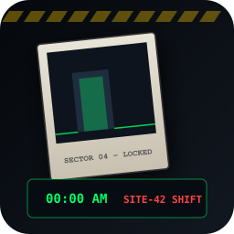

# Night Shift at Site-42

> **A 3D PSX Retro First-Person Atmospheric / Horror Immersive Sim built with Godot 4**  
> *Submitted to GitHub Game Off 2026 — Theme: **SHIFT***



---

## 🔦 Overview & The "SHIFT" Theme

Welcome to your graveyard shift at **Subterranean Research Site-42**.
- **Shift Duration**: 00:00 AM (12:00 AM) to 06:00 AM.
- **Your Job**: Maintenance Technician. Address pending facility tickets before morning extraction.

However, Site-42 experiences anomalous non-Euclidean spatial drift:
1. **The Architecture Shifts**: Whenever you leave a room or close a doorway behind you, unobserved corridors silently **SHIFT** their connections, leading to looping corridors or anomalous dead zones.
2. **The Polaroid Quantum Anchor**: You carry an instant Polaroid camera. Taking a photograph of a doorway or corridor **spatially anchors** that threshold in reality! As long as that doorway is documented on your active photo, the facility *cannot* shift that connection away.
3. **Survive the Graveyard Shift**: Balance your limited anchor slots to navigate between the Central Hub, Coolant Sector, Power Grid, and Containment Wing 04, resolve all maintenance tickets, and punch out at the 06:00 AM time clock!

---

## 🕹️ Controls

| Action | Primary Key | Secondary / Mouse |
| :--- | :--- | :--- |
| **Move** | `W` `A` `S` `D` | Arrow Keys |
| **Interact / Pickup / Use** | `E` | `Left Mouse Button` |
| **Raise Polaroid Camera** | `F` | `Right Mouse Button` |
| **Snap Photo / Anchor Door** | `Space` / `Q` | `Left Click` (while aiming) |
| **Toggle Flashlight** | `T` / `G` | - |
| **Inspect Held Photo** | `C` / `Tab` | - |
| **Toggle Manual / Help** | `H` / `F1` | - |
| **Release Mouse** | `Esc` | - |

---

## ⚙️ Maintenance Tickets & Gameplay Loop

1. **Ticket 01: Coolant Subsystem Alpha Pressure Leak**
   - Head down the northern corridor into the Coolant Sector.
   - Manually turn the high-pressure valve wheel 4 times to vent built-up coolant steam into safe operating limits.
2. **Ticket 02: Sector B Auxiliary Power Failure**
   - The Power Grid generators are offline.
   - Navigate through the shifting corridors to Storage Wing, retrieve an intact Power Cell, and slot it into the Power Grid receptacle.
3. **Ticket 03: Containment Latch 04 Structural Drift**
   - The blast door to Containment Wing 04 shifts into an altered infinite corridor if left unobserved.
   - Snap a Polaroid photograph of the doorway to anchor it, enter the room, and reset the emergency override console.
4. **06:00 AM — Emergency Extraction**
   - With all three critical subsystems secured, the facility stabilizes at 06:00 AM.
   - Return to the Central Security Hub, punch out at the Time Clock, and step into the elevator to conclude your shift!

---

## 📺 PSX Retro Visual Pipeline & Shader Architecture

- **Post-Processing Shader (`psx_postprocess.gdshader`)**:
  - Downsamples screen resolution to authentic 480x360.
  - 4x4 Bayer matrix dithering.
  - 15-bit color palette quantization (color depth reduction).
  - CRT curvature, scanlines, and vignette.
- **Material Shader (`psx_material.gdshader`)**:
  - Emulates classic PlayStation 1 floating-point precision jitter (vertex snapping in clip space).
- **Procedural Sound Design**:
  - Low fluorescent 60Hz hum, metallic grate footsteps, analog shutter clunk + motor rewind, ratchet screeches, and subterranean structural shifting groans.

---

## 🚀 Running the Project

### In the Godot 4 Editor:
1. Open Godot 4.
2. Click **Import** and select `C:\Users\alekhyo\.gemini\antigravity\scratch\night-shift-site42\project.godot`.
3. Press **F5** to run `res://scenes/main.tscn`.

### Headless Verification / Tests:
```powershell
godot --headless --path . -s res://tests/test_facility_shift.gd
```

---

## 📄 License

MIT License. See [LICENSE](LICENSE) for full details.
