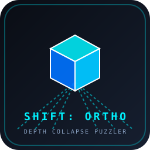

# Shift: Ortho

> **A 3D First-Person Spatial Puzzle Platformer built with Godot 4**  
> *Submitted to GitHub Game Off 2026 — Theme: **SHIFT***



---

## 🌌 Overview & The "SHIFT" Theme

In Euclidean 3D space, distance dictates perception: distant platforms appear smaller, chasms look impassable, and depth prevents disconnected surfaces from touching.

**Shift: Ortho** breaks this rule by giving the player the ability to **SHIFT camera projection dynamically between Perspective and Orthographic modes**:
- **In Perspective Mode**: Standard 3D spatial geometry rules apply.
- **In Orthographic Mode**: Ray parallelization eliminates depth entirely. Disjointed, distant platforms that visually align in screen-space become **physically bridged and walkable**!
- **Forced Perspective Scaling**: Objects held in Orthographic mode retain their screen size regardless of distance. Placing or dropping an object against a far wall magnifies its physical scale and cubic mass, turning tiny pocket cubes into climbable monolithic blocks or 200 kg counterweights!

---

## 🕹️ Controls

| Action | Primary Key | Secondary / Mouse |
| :--- | :--- | :--- |
| **Move** | `W` `A` `S` `D` | Arrow Keys |
| **Jump** | `Space` | - |
| **Shift Projection** | `Shift` / `Q` | `Right Mouse Button` |
| **Interact / Grab / Place** | `E` | `Left Mouse Button` |
| **Snap Camera Angle** (45° steps) | `Tab` / `T` | - |
| **Reset Chamber** | `Backspace` / `R` | - |
| **Toggle Controls Help** | `H` / `F1` | - |
| **Release Mouse** | `Esc` | - |

---

## 🧩 Test Chambers & Mechanics

1. **Chamber 00: Spatial Flattening**
   - Introduces depth collapse. Cross an impossible 12-meter void chasm by shifting into Orthographic mode to solidify the screen-space bridge.
2. **Chamber 01: Forced Perspective Scaling**
   - A high ledge guards the exit. Grab the micro-cube (`E`), look at the distant wall in Ortho mode, and drop it to enlarge it into a climbable staircase.
3. **Chamber 02: Dimensional Alignment**
   - Three floating pillars at staggered depths and heights. Use camera snapping (`Tab`) and Ortho projection to align them into a continuous ascending path.
4. **Chamber 03: Mass Multiplier**
   - A heavy vault door requires 100 kg on the pressure plate. Scale up a 10 kg cube to 2.5x scale (which yields $10 \times 2.5^3 \approx 156 \text{ kg}$) to trigger the mechanism.
5. **Chamber 04: The Extraction Core**
   - Master trial combining void chasm bridging, cube scaling, and pressure switch puzzles to reach the extraction portal.

---

## 🛠️ Architecture & Technical Implementation

- **Engine**: Godot Engine 4.7+ (Forward+ / Mobile / Compatibility)
- **Language**: GDScript 2.0 (Strictly typed, clean event-driven architecture)
- **Audio**: Custom synthesized 16-bit PCM procedural audio (dimension warp whooshes, magnetic grabs, door hydraulics, resonance portals).
- **Collision & Physics**:
  - `CharacterBody3D` player with first-person kinematic movement and ground damping.
  - `OrthoCamera` managing runtime camera frustum / orthogonal projection switching and yaw snapping.
  - `OrthoBridge` dynamic collision surfaces reacting to camera projection mode and view angles.
  - `ShiftCube` forced-perspective scaling calculator (`new_scale = clamp(D / initial_hold_dist)`).
  - `PressurePlate` weight detection checking aggregate body mass ($m \propto s^3$).

---

## 🚀 Running the Project

### In the Godot 4 Editor:
1. Open Godot 4.
2. Click **Import** and select `C:\Users\alekhyo\.gemini\antigravity\scratch\shift-ortho\project.godot`.
3. Press **F5** (or click the Play button) to run `res://scenes/main.tscn`.

### Headless Verification / Tests:
```powershell
godot --headless --path . -s res://tests/test_mechanics.gd
```

---

## 📄 License

MIT License. See [LICENSE](LICENSE) for full details.
