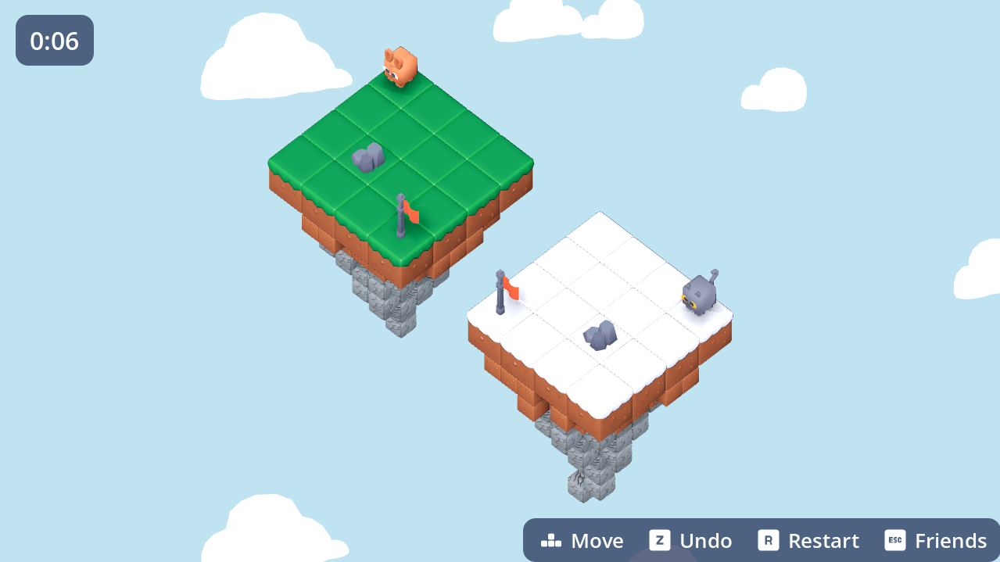

# Reflex

**One button press, two characters, a mirror between them.**

Reflex is a small 3D pixel-art puzzle game. Two islands float face to face with a mirror in between, and there is one character on each. Every move you make moves *both* of them, but the reflected one goes the opposite way. Get both characters onto their goals on the same turn to clear the level.



## Play

**Play in your browser:** _coming soon on itch.io_

### Controls

| Key | Action |
|---|---|
| `W` `A` `S` `D` / arrow keys | Move (the reflection moves mirrored) |
| `Z` | Undo the last move |
| `R` | Restart the level |
| `Enter` | Confirm (character select, tutorial) |
| `Esc` | Back to character select |

## How this videogame works

- Both characters move **at the same time**, one step per turn on a grid.
- The reflected character mirrors your input: press **right** and it goes **left**.
- **A character that walks into a wall stays where it is, but the other one still moves.** That is the whole trick: walls are how you shift the two out of sync and line them up.
- You win when **both** characters stand on their goal tiles on the same turn.

New tiles show up level by level: holes, ice, buttons that open doors on the *other* island, pushable crates, and finally a mirror that turns. The full design is in [`docs/DESIGN.md`](docs/DESIGN.md).

## Build from source

You need **[Godot 4](https://godotengine.org/download)**, the standard build (not .NET, which can't export to the web).

```bash
git clone https://github.com/brighinatommaso-eng/Reflex.git
```

1. Open Godot, click **Import**, and pick `project.godot` in the cloned folder.
2. Press **F5** to run.

To export for the web: **Project → Export → Add… → Web**, then export to `build/web/`. The `index.html` that comes out can be zipped and uploaded to itch.io as an HTML5 game.

## Project structure

```
Reflex/
├── project.godot
├── scenes/      # main menu, level, player
├── scripts/     # GDScript: grid, movement, undo, level loading
├── levels/      # level data
├── assets/      # models, textures, sounds, fonts
└── docs/        # design notes
```

## Built with

- [Godot 4](https://godotengine.org): engine
- Cozy, rounded low-poly style built from free CC0 asset packs (see Credits)
- Time tracked with [Hackatime](https://hackatime.hackclub.com)

## Credits

Code, level design, and game design by **Tommaso Brighina** ([@brighinatommaso-eng](https://github.com/brighinatommaso-eng)).

Third-party assets (models, sounds, music, fonts) are listed here along with their licences as they get added:

| Asset | Author | Licence |
|---|---|---|
| [Platformer Pack](https://kaylousberg.itch.io/kaykit-platformer) | Kay Lousberg (KayKit) | CC0 1.0 |
| [Block Bits](https://kaylousberg.itch.io/block-bits) | Kay Lousberg (KayKit) | CC0 1.0 |
| [Platformer Kit](https://kenney.nl/assets/platformer-kit) | Kenney | CC0 1.0 |
| [Cube Pets](https://kenney.nl/assets/cube-pets) | Kenney | CC0 1.0 |
| [Input Prompts](https://kenney.nl/assets/input-prompts) | Kenney | CC0 1.0 |
| [Game Icons](https://kenney.nl/assets/game-icons) (star) | Kenney | CC0 1.0 |
| [Ultimate Platformer Pack](https://quaternius.itch.io/ultimate-platformer-pack) (clouds) | Quaternius | CC0 1.0 |

## Licence

Code is released under the [MIT License](LICENSE). Third-party assets keep their own licences, listed above.
