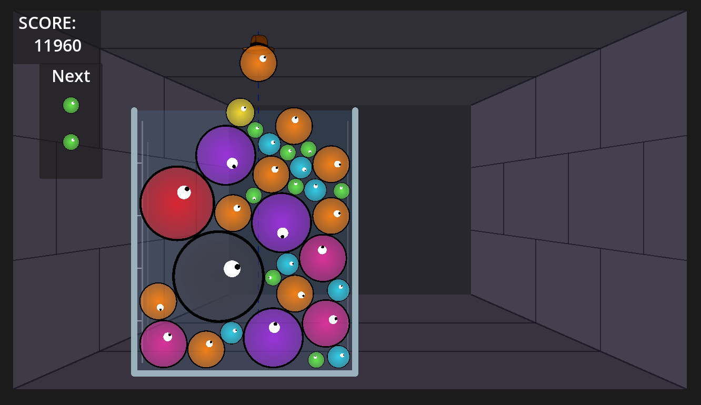

# Oozecrawler 🧪✨

> A 2D physics-merge puzzle game combining *Suika*-style mechanics with dungeon crawling roguelite concepts, built in **Godot 4**.

[](https://godotengine.org)
[](https://docs.godotengine.org/en/stable/tutorials/scripting/gdscript/)
[](LICENSE)

<p align="center">
  
</p>

> [!NOTE]
> **Learning by Doing Project:**  
> Oozecrawler is an open-source hands-on project exploring Godot 4, 2D physics, procedural rendering, canvas shaders, and decoupled event-driven architecture in GDScript.

---

## 🎮 Controls

| Action | Input |
| :--- | :--- |
| **Aim Dropper** | Move Mouse (clamped inside container walls) |
| **Drop Kerno** | Left Mouse Button (`LMB`) |
| **Restart / Menu** | UI Buttons on Game Over screen |

---

## 🚀 Running the Project

1. Download and install [Godot Engine 4.x](https://godotengine.org/download) (tested on Godot 4.3+).
2. Clone this repository:
   ```bash
   git clone https://github.com/your-username/oozecrawler.git
   ```
3. Open Godot, click **Import**, and select `project.godot`.
4. Press **F5** (or click the Play button in the top right) to run the main scene.

---

## 🕹️ Current Project Status

The foundational physics puzzle loop, procedural rendering, event bus architecture, and audio feedback are implemented:

### ✅ Implemented Features

- **11-Tier Kerno Hierarchy & Merge Physics:**
  - Progression across 11 tiers (from Tier 1 *Droplet* up to Tier 11 *Astral Singularity*).
  - Scaled physical properties per tier: radius, mass, and score value.
  - Collision merge logic (`_merge_with`) with pop impulses and instance cleanup.
- **Dynamic Tier-Scaled Audio (SFX):**
  - Integrated `AudioStreamPlayer` triggered on merge events via the global `Events` bus.
  - Dual-sample sound design (lighter pops for Tiers 1–5, heavier tones for Tiers 6–11).
  - Procedural pitch scaling (`pitch_scale`) ramping up pitch per tier.
- **Custom Kerno Canvas Shader:**
  - Procedural 2D fragment shader ([kerno.gdshader](file:///home/carlos/Projects/Godot/oozecrawler/Shaders/kerno.gdshader)) with radial depth shading, surface tension rim glow, fusion seam, and tier-based internal wisps.
- **Fair Bag Randomizer (`QueueManager`):**
  - Dual-buffer bag distribution system (`_primary` and `_secondary`) with randomized refills.
  - Multi-step queue lookahead (`peek()`) feeding the upcoming HUD preview.
- **Mouse-Aimed Dropper:**
  - Smooth mouse tracking clamped dynamically to container wall boundaries.
  - Auto-calibrated height above the flask opening.
  - Dashed trajectory aim guide and cooldown timer preventing drop spam.
- **Alchemical Flask Container:**
  - `StaticBody2D` boundary walls with custom procedural glass drawing (`_draw`).
  - Specular highlight streaks, volume tick marks, and liquid tint.
  - Dynamic boundary calculation methods (`get_drop_bounds()`, `get_opening_y()`).
- **Procedural Dungeon Corridor Background:**
  - Perspective-projected corridor rendered with stone floor, ceiling, and mortar block patterns.
- **Global Event Bus & HUD:**
  - Autoloaded `Events` singleton decoupling gameplay systems from UI.
  - Live HUD tracking accumulated score and upcoming queued kernoj.
  - Game Over detection via bottom kill plane, displaying animated stats with a Tween.

---

## 🗺️ Roadmap: Launch MVP (Phase 1)

Current development is focused on completing the core playable loop before adding meta-progression or extra classes:

- [ ] **Dual Loss Conditions:** Overflow danger line with 2–3s countdown timer + Player HP tracking.
- [ ] **Turn-Based Combat Bridge:** AP economy (drops/turn), Attack/Defense Stance toggle, and physics settling phase.
- [ ] **Modular Damage Engine:** `Damage = ((Base + Flat) * ChainMult) * CritMult`.
- [ ] **Scripted Enemy Encounters:** Deterministic action loop with telegraphed intent icons.
- [ ] **5-Node Linear Run:** `Enemy` ➔ `Event` ➔ `Shop` ➔ `Mid-Boss` ➔ `Boss` with post-combat board reset.
- [ ] **Endless Mode:** Classic physics puzzle high-score chase with local saving (`user://`).
- [ ] **Combat Juice & FX:** Damage numbers, particle bursts, and camera shake.

> [!TIP]
> For long-term ideas (Hero Classes, Relics, Flask Hazards, and Meta-progression), see [docs/IDEAS.md](file:///home/carlos/Projects/Godot/oozecrawler/docs/IDEAS.md) and the [Game Design Document (docs/GDD.md)](file:///home/carlos/Projects/Godot/oozecrawler/docs/GDD.md).

---

## 🛠️ Engine & Tech Stack

- **Engine:** [Godot Engine 4.x](https://godotengine.org) (GL Compatibility Renderer)
- **Language:** GDScript (gradually typed)
- **Architecture:** Node composition, custom `CanvasItem` shaders, Autoload Event Bus
- **Physics:** Godot 2D Physics (`RigidBody2D`, impulse resolution, custom damping)
- **Target Platforms:** PC (Linux / Windows / macOS)

---

## 📁 Repository Structure

```text
oozecrawler/
├── assets/                # Audio (.wav), textures, prototyping graphics
├── docs/                  # Architecture, GDD, and design roadmaps
│   ├── Screenshots/       # Gameplay screenshots
│   ├── GDD.md             # Game Design Document
│   ├── IDEAS.md           # Mechanics backlog & future design concepts
│   └── CURRICULUM.md      # Godot 4 & GDScript learning roadmap
├── scenes/                # Godot scene trees (.tscn)
│   ├── Core/              # Container, Dropper, Dungeon Background, Main loop
│   ├── kerno/             # Kerno physics scenes
│   ├── levels/            # Merge particles and effects
│   └── ui/                # Main menu, HUD, and splash screens
├── scripts/               # GDScript source code (.gd)
│   ├── autoload/          # Global Event bus singletons
│   ├── characters/        # Dropper controller
│   ├── core/              # Main loop, QueueManager, LevelStats
│   └── kerno/             # Kerno physics, tier table, and visual setup
├── Shaders/               # Custom canvas shaders (.gdshader)
├── project.godot          # Engine configuration & project settings
└── README.md
```

---

## 📄 License

Distributed under the [MIT License](LICENSE).
