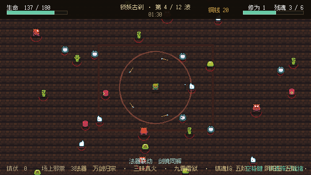
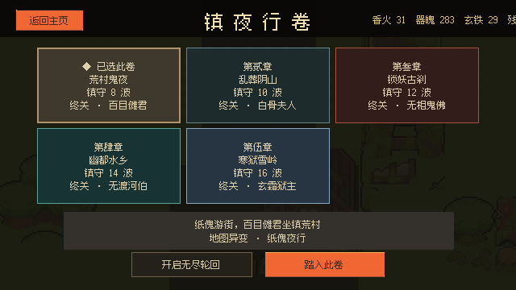
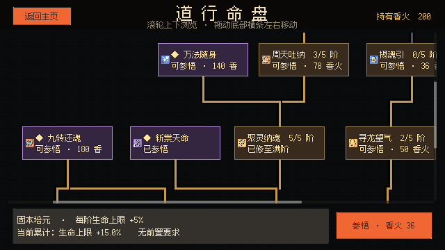
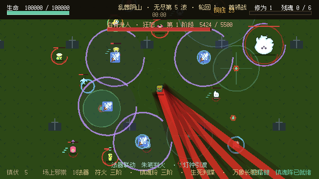
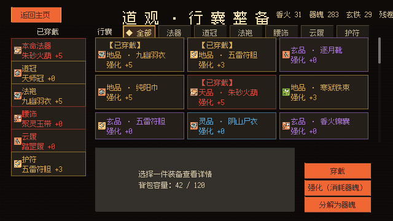

# 镇夜录

**使用 Godot 4 开发的 PC 单机东方志怪俯视角幸存者 Roguelite。**

[](https://github.com/cowcool-niushuai/zhenye/actions/workflows/tests.yml)

收集十八种法器，凑齐联动，搭配装备与道行命盘，在五大章节和无尽轮回中迎战邪祟与多阶段首领。

[**下载最新版本**](https://github.com/cowcool-niushuai/zhenye/releases/latest) · [玩法特色](#玩法特色) · [操作方式](#操作方式) · [从源码运行](#从源码运行)



## 下载

| 平台 | 文件 | 说明 |
| --- | --- | --- |
| Windows 10/11 x86_64 | `Zhenye-v0.1.0-alpha-windows-x86_64.zip` | 解压后运行 `Zhenye.exe`，无需安装 |
| macOS 11+（Intel / Apple Silicon） | `Zhenye-v0.1.0-alpha-macos-universal.zip` | 未签名，首次打开请参阅包内说明 |

当前为 **v0.1.0-alpha 试玩版**，内容与数值仍在调整。游戏完全离线，不含内购、广告、联网或数据收集。

如果 macOS 提示“应用已损坏”，在终端执行：

```sh
xattr -cr /Applications/Zhenye.app
```

## 玩法特色

- **五大章节**：荒村鬼夜、乱葬阴山、锁妖古刹、幽都水乡、寒狱雪岭，各自拥有独立地图、敌群、事件、音乐和首领。
- **十八种法器**：飞剑、符火、雷印、镇魂铃、铜钱镖、阴阳玉、缚妖索、招魂幡、纸人术、八卦镜、潮生葫、引渡桨、冥河莲灯、玄冰针、寒狱碑、六花伞、判官笔、照夜灯。每种法器均可升到五阶并进化为专属形态。
- **十三组联动**：两件法器同时达到三阶即可激活跨法器效果，升级与暂停界面提供可滚动图鉴。
- **八门心法**：围绕伤害、冷却、拾取、生存、精英猎杀和击杀回复构筑不同流派。
- **五十四件装备**：六个部位、玄品以上规则特性、强化与分解，灵品以上可出现稀有吸血词条。
- **十七节点道行命盘**：生命、减伤、持续回血、复生、经济与六个只能投入一点的强力神通。
- **多阶段首领**：五位首领在 66% 和 32% 生命时转换阶段，拥有眼阵、骨墙、阵眼、潮道、雪崩等独立机制。
- **无尽轮回**：`6000×4000` 大地图，每五波轮换地域并迎战带词缀的首领；敌人拥有迅疾、巨化、灵盾、复仇词缀，可随时从暂停界面主动结算。
- **完整局外循环**：铜钱、香火、器魄、装备、命盘与自动存档；失败也能带回已拾取战利品。
- **逐波战报**：记录等级、铜钱、击杀、输出、承伤和主要伤害来源，便于复盘构筑。

## 截图

| 章节选择 | 道行命盘 |
| --- | --- |
|  |  |

| 无尽轮回 | 行囊整备 |
| --- | --- |
|  |  |

## 操作方式

| 按键 | 功能 |
| --- | --- |
| `WASD` / 方向键 | 移动 |
| `空格` | 释放镇魂阵 |
| `Esc` | 暂停 / 返回 |
| 鼠标 | 选择升级、商店与界面操作 |

法器自动攻击。升级时从三项法器或心法中选择一项，波次间可进入鬼市购买、刷新和锁定商品。

## 从源码运行

需要 Godot **4.7.1** 或兼容的 Godot 4 版本。

```sh
git clone https://github.com/cowcool-niushuai/zhenye.git
cd zhenye
godot --path . 
```

也可以直接双击 `project.godot`，在编辑器中按 `F5` 运行。Linux 下可执行 `./start_game.sh`，脚本会读取 `GODOT_BIN`（默认 `~/.local/bin/godot-4.7.1`）。

内部分辨率为 `640×360`，默认 2 倍整数缩放，使用像素对齐与专业 PNG Sprite Sheet。详细规范见 [`PIXEL_STYLE.md`](PIXEL_STYLE.md)，系统与内容设计见 [`DESIGN.md`](DESIGN.md)。

## 测试

项目包含 11 组无头回归测试：

```sh
godot --headless --path . --script tests/smoke_test.gd
godot --headless --path . --script tests/stress_test.gd
godot --headless --path . --script tests/meta_test.gd
godot --headless --path . --script tests/flow_test.gd
godot --headless --path . --script tests/balance_test.gd
godot --headless --path . --script tests/full_run_test.gd
godot --headless --path . --script tests/boss_mechanics_test.gd
godot --headless --path . --script tests/expansion_test.gd
godot --headless --path . --script tests/talent_rules_test.gd
godot --headless --path . --script tests/healing_affix_test.gd
godot --headless --path . --script tests/endless_mode_test.gd
```

`tests/capture_ui.gd` 可用 `-- --hero`、`-- --stages`、`-- --talents-middle`、`-- --endless-battle` 等参数生成界面截图。

## 项目结构

```
scripts/game.gd              战斗、章节、法器、首领、命盘与全部 UI
scripts/meta_progression.gd  装备、货币、命盘节点与存档
scripts/pixel_art_factory.gd 程序化关卡、图标与音频资源注册
tests/                       无头回归、平衡、压力与截图测试
assets/                      像素素材、字体、音乐与音效
docs/screenshots/            README 截图
```

## 第三方资源

- **Ninja Adventure Asset Pack** — pixel-boy / AAA，CC0 1.0。
- **Fusion Pixel Font** — TakWolf 及上游作者，SIL Open Font License 1.1。

完整来源与许可证原文见 [`THIRD_PARTY.md`](THIRD_PARTY.md) 和 [`THIRD_PARTY_LICENSES/`](THIRD_PARTY_LICENSES/)。

## 许可证

代码以 [MIT License](LICENSE) 发布。游戏名称、剧情文本与原创设计归作者所有；第三方素材遵循各自许可证。

## 开发状态

v0.1.0-alpha 已完成五章、无尽模式与完整局外循环，正在收集试玩反馈并调整数值、界面与操作手感。问题与建议欢迎提交 [Issue](https://github.com/cowcool-niushuai/zhenye/issues)。
