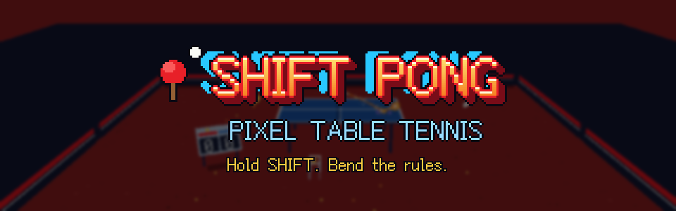
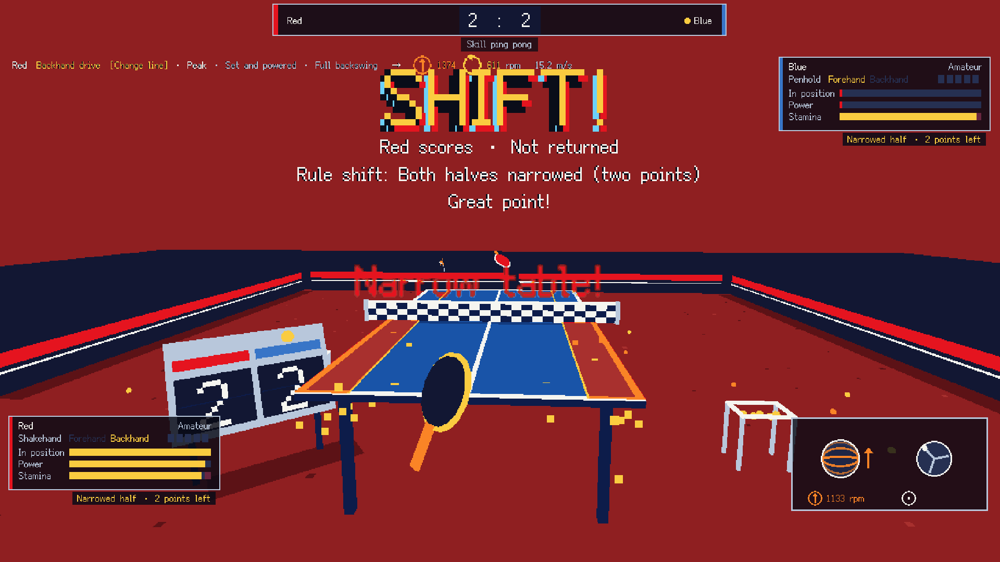

# SHIFT PONG · Game Off 2026



A pixel-art 3D table tennis game made in Godot 4.7 (GDScript) for
[GitHub Game Off 2026](https://itch.io/jam/game-off-2026) — theme: **SHIFT**.

Real spin physics and stroke feel, over-the-top skills (decoy balls, an
invisible ball, a giant racket, a net that shoots up…), knockout cups and four
legendary bosses. English, 简体中文 and 日本語.

像素风 3D 乒乓球（Godot 4.7，GDScript），GitHub Game Off 2026 参赛作品。

Needs a keyboard and mouse (it doesn't work on phones).



## Modes
- **SHIFT RUN** (the jam mode): six opponents in a row, one game to 7 each, a legend at the end. Every win offers three new skills to shift into your loadout; two hearts.
- **Rule shifts**: in a skill match, every 4th point the rules shift for both sides for two points (giant rackets, spoons, a narrowed table, heavy balls, scrambled views).
- **Cups**: singles or team knockouts (Swaythling-style ties: A-X, B-Y, C-Z, A-Y, B-X), plus the legend bosses.
- **Quick start**: one game to 7 with skills, straight from the title screen.
- **Training ground**: tutorial, drills (multi-ball, targets, receiving), free play, and skill duel (endless skills).
- **SHIFT skills** (on by default): take 4 of 12 skills into each match (the loadout), hold **Shift** for the skill wheel or press 1–4 — Lane Shift, Spin Shift, Gravity Shift, View Shift, Golden Cicada, Giant Racket…

## Run
Open this folder in Godot 4.7, or:

```
godot --path .
```

Debug flags (after `--`): `--autoplay`, `--level=0..4`, `--tie-auto`, `--boss-auto=ml|xx|zjk|fzd`,
`--drill-auto=multi|target|receive`, `--skill`, `--loadout=a,b,c,d`, `--run-auto`, `--lang=en|zh|ja`, `--nosave` (writes no settings).

## Audio
The match sounds are real recordings (see `sounds/CREDITS.md`); the music and
the skill sounds are synthesised from scratch by `tools/make_audio.py` (soft synths, rock drums and a power-chord guitar in the match track).

## Tests
`godot --headless --path . -s tools/menu_flow_test.gd -- --nosave` opens every
menu page and walks through a cup, a SHIFT RUN and the skill lesson.

## Code
- `scripts/main.gd` → `scripts/game/game_modes.gd` → `game_match.gd` → `game_arena.gd` → `game_base.gd` (one node script split in layers)
- `scripts/ball_sim.gd` ball physics and the stroke solver; `technique.gd` strokes; `club_ui.gd` menus;
  `tour.gd` / `people.gd` / `roster.gd` players and clubs; `cup_run.gd` cups; `i18n.gd` translations

## Licence
The code is MIT-licensed (see `LICENSE`). The sounds and the font keep their own
licences: see `sounds/CREDITS.md` and `fonts/CREDITS.md`.
