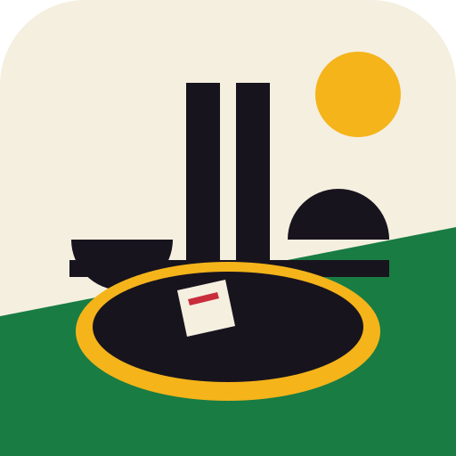
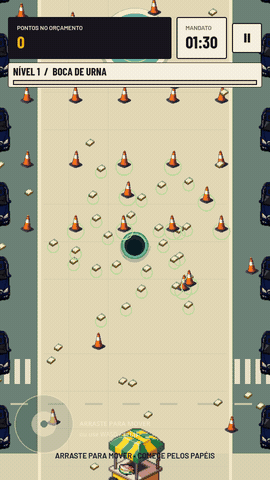
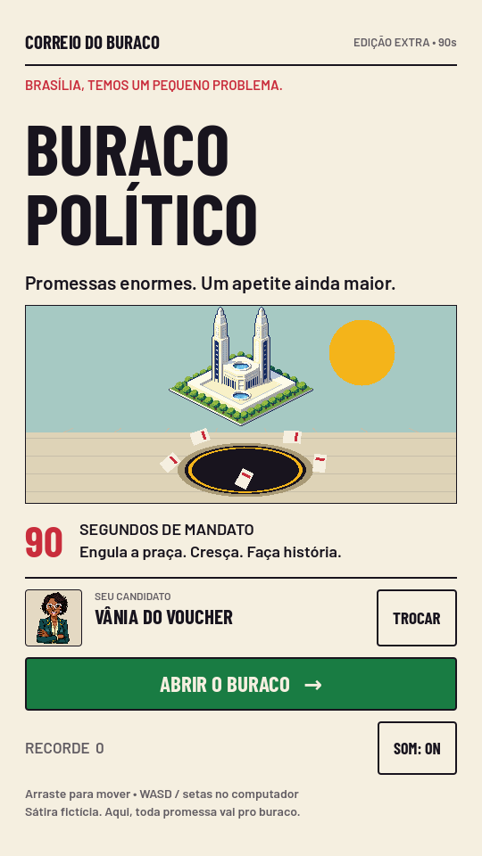
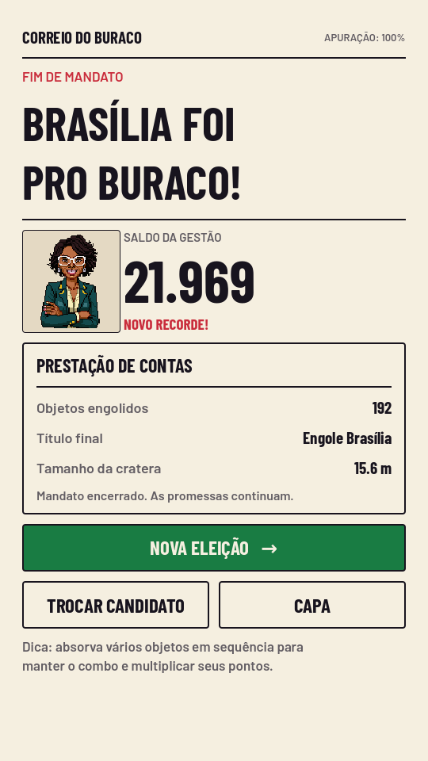
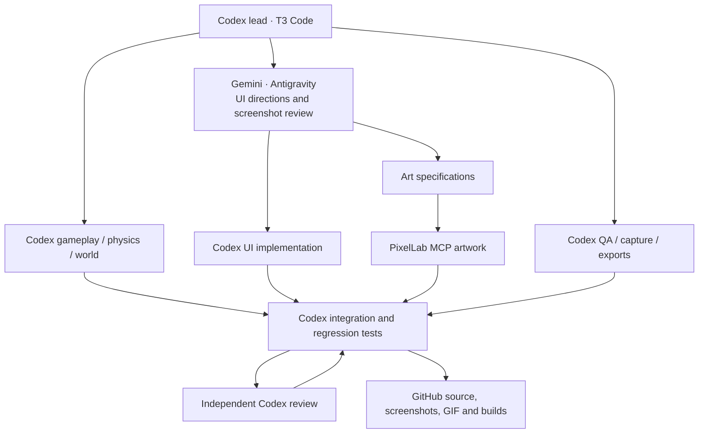

<div align="center">
  
  <h1>Buraco Político</h1>
  <p><strong>Promessas enormes. Um apetite ainda maior.</strong><br>Uma sátira brasileira de bolso, feita em Godot 4.</p>
  
  
  
  
</div>

<p align="center"></p>

**Você tem 90 segundos de mandato. Faça Brasília desaparecer.** Comece engolindo promessas espalhadas pela praça, cresça até alcançar carros oficiais e termine com um apetite digno do Congresso. A política é fictícia. A cratera, nem tanto.

[**Download v0.1.0**](https://github.com/henriquerochars/hole-brazil/releases/tag/v0.1.0) · [Testing](docs/TESTING.md) · [Architecture](docs/ARCHITECTURE.md) · [Mobile builds](docs/MOBILE.md)

## Play

- **Android:** download `buraco-politico-android-arm64-debug.apk` from the release and install it on an ARM64 device running Android 7.0 or later. This is a signed **debug sideload build**, not a Play Store release.
- **Linux:** extract `buraco-politico-linux-x86_64.zip`, make the binary executable if necessary (`chmod +x buraco-politico.x86_64`), and launch it.
- **Web:** extract `buraco-politico-web.zip`, serve the folder with `python3 -m http.server 8000`, and open `http://localhost:8000`. Web exports require HTTP; opening the HTML file directly is not supported.
- **Source:** install [Godot 4.5.1](https://godotengine.org/download/archive/4.5.1-stable/), import `project.godot`, and press **F6** on the main scene or **F5** to play. No addons, API keys or online services are needed.

```sh
git clone https://github.com/henriquerochars/hole-brazil.git
cd hole-brazil
godot --path .
```

This project is public and open source. Source code is available under the MIT license; bundled fonts retain their SIL OFL licenses. Anyone can clone the repository and download the release builds.

## A eleição mais absorvente do país

| Candidato fictício | Vantagem | Slogan |
| --- | --- | --- |
| Vânia do Voucher · MRJ 40 | Approximately 8% faster movement | “Privatiza o asfalto. Terceiriza a cratera.” |
| Waldemar da Emenda · PBN 99 | 12% more growth per object | “Se cabe no orçamento, cabe no buraco!” |
| Breno Bicicletinha · CCS 50 | Longer combo window: 3.6s instead of 2.6s | “Um buraco holístico, cicloviário e dialético.” |

- A seeded Brasília-inspired plaza with **192 objects**, seven prop categories and six growth levels.
- Hold a **touch drag** anywhere in the playfield to steer. On desktop, use **WASD**, **arrow keys**, or **left-click and drag**.
- Pale rings identify nearby edible objects. Larger props block movement until the hole grows.
- Chain absorptions for a score multiplier up to **3×**. Candidate perks change routes and combo opportunities.
- Pause from the top-right button or **Esc**. Focus loss pauses the round automatically.
- Local high scores, candidate preference and sound settings persist between sessions.
- Original PixelLab portraits and props, native Godot effects, synthesized sound, and an editorial newspaper interface.

No ads, telemetry, accounts, microtransactions or runtime network requests. All characters and parties are fictional satirical archetypes.

## Screens from the running game

<table>
<tr><td></td><td></td><td></td></tr>
<tr><td align="center">A capa do dia</td><td align="center">A ficha eleitoral</td><td align="center">A prestação de contas</td></tr>
</table>

Screenshots and the optimized 10fps GIF come from the **actual Godot viewport**. An autonomous target selector drives the regular movement and absorption simulation for reproducible capture; scores and result screens are not fabricated. Capture metadata is included in [docs/media/capture.json](docs/media/capture.json).

## Engineering and validation

The game separates pure balance rules, fixed-step simulation and screen/persistence logic. A spatial hash narrows collision queries; off-screen sprites are culled; effects expire; the world has a bounded object count. The Compatibility renderer keeps the rendering pipeline simple.

```sh
# Linux; requires Godot 4.5.1, xvfb-run and a software/OpenGL display stack
GODOT_BIN=godot bash tools/validate.sh
```

Validation covers pure rules, **22 simulation assertions**, **12 complete rounds** across all candidates and four seeds, rendered touch-button and layout checks, malformed saves, mute propagation, and a scene smoke test. Tests fail on Godot error logs even if the process returns exit code zero. GitHub Actions runs the same suite.

Independent Codex reviews found and drove fixes for touchscreen button activation, audio mute propagation, malformed settings, misleading combo labels, layout overflow, deferred GUI callbacks, sprite culling and export license inclusion. See [implementation review](docs/CODE-REVIEW.md) and [release review](docs/RELEASE-REVIEW.md).

CPU-only profiling is recorded in [docs/performance.json](docs/performance.json). These measurements exclude rendering and are **not mobile FPS claims**. Physical-device touch ergonomics, cutouts, thermal performance and iOS signing remain unverified. See the [device checklist](docs/MOBILE.md).

## AI Development Workflow

**OpenAI Codex** led architecture, orchestration, gameplay/physics/world engineering, Godot UI implementation, testing, independent code reviews, integration, documentation and publication. Specialized Codex agents worked concurrently with separate file ownership.

**Google Gemini**, invoked through T3's Antigravity provider, compared three interface directions and specified the chosen Brazilian editorial style, palette, typography and touch layout. Gemini also received actual game screenshots for a visual review; findings and implementation follow-up are documented in [VISUAL-REVIEW.md](docs/VISUAL-REVIEW.md).

**PixelLab MCP** generated the shipped character portraits and environmental artwork. Prompts, generation job IDs and provenance are recorded in [assets/art/PROVENANCE.md](assets/art/PROVENANCE.md). Native Godot drawing supplies terrain, rings, UI frames and effects; they are not miscredited as generated artwork.

**T3 Code** supplied the shared development environment, provider discovery and cross-provider Gemini tasks. Codex's native agent tooling handled its parallel workers. No custom orchestration layer was needed.



The [workflow record](docs/AI-WORKFLOW.md) distinguishes actual tool use from the original proposed agent topology.

## Project map

```text
project.godot            Engine and input configuration
scenes/main.tscn         Application entry point
scripts/main.gd         Screens, HUD, local settings, results
scripts/ui_kit.gd       Reusable editorial components
scripts/gameplay.gd     World, movement, absorption, rendering, audio
scripts/game_rules.gd   Pure growth, score and balance calculations
scripts/capture.gd      Reproducible real-viewport media capture
assets/art/             Original PixelLab PNGs and provenance
assets/fonts/           Barlow fonts and SIL OFL licenses
tests/                  Rule, integration, playthrough, UI and profiling checks
docs/                   Design direction, architecture, reviews and evidence
```

Code is MIT-licensed. Barlow fonts retain their bundled SIL OFL licenses; generated artwork provenance and applicable PixelLab service terms are documented separately. This is an independently produced fictional satire, with no political-party affiliation.
