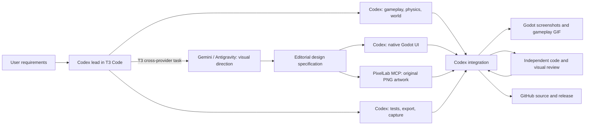

# Actual AI development workflow

## Provider inspection

T3's `orchestrator_capabilities` was queried before delegation. It reported native Codex child tasks and cross-provider delegation, including Gemini 4 Argon via Antigravity and Cursor. This project used Gemini 4 Argon High through **Antigravity**. No Gemini CLI fallback or custom agent router was built.

The available Codex shortlist included GPT-6.1 Sol, GPT-6 Astra, GPT-6.1 Terra and GPT-6 Luna. The parent and native Codex workers inherited GPT-6 Astra. PixelLab MCP authentication was verified using its balance endpoint; GitHub authentication was verified using `gh`. No API keys were written into project files.

## Responsibilities

- **OpenAI Codex:** technical architecture, gameplay/physics/world implementation, reusable Godot UI implementation, tests, capture tooling, integration, performance review, documentation and GitHub publication.
- **Google Gemini:** compared three visual directions and specified the chosen editorial newspaper style, palette, touch targets, screen layouts and PixelLab art direction. Its original design exploration is retained in [ui-direction.md](ui-direction.md); the shipped three-candidate roster and exact balance are defined in code.
- **PixelLab:** generated original transparent candidate portraits and environmental props using its authenticated MCP image-generation tool. Exact prompts and job IDs are retained in [asset provenance](../assets/art/PROVENANCE.md).
- **T3 Code:** provided the shared workspace, provider capability discovery and cross-provider Gemini delegation. Native Codex subagents performed parallel work with explicit file ownership.

Logical responsibilities were combined into useful parallel tasks rather than launching fourteen competing processes. Reviews focus on observable defects and regression tests, not artificial conversation or token consumption.

## Screenshot review and refinement

A second Gemini 4 Argon High task inspected the actual Godot screenshots and produced [VISUAL-REVIEW.md](VISUAL-REVIEW.md). Codex implemented its seven bounded polish recommendations: paper backing for the HUD, a slim framed progress bar, tighter page spacing, darker candidate labels, portrait frames, paired pause utility buttons, and a square pause control. The revised UI was regression-tested and recaptured before release.
