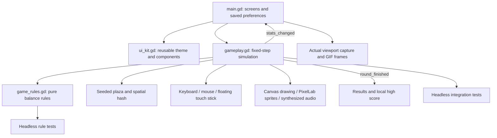

# Architecture

Buraco Político uses Godot 4.5.1, GDScript and the Compatibility renderer. It has no runtime service dependencies, account system, network requests or paid mechanics. All candidates are fictional satirical archetypes.

## Simulation boundaries

`game_rules.gd` contains constants and pure calculations: size eligibility, growth, scoring, combo windows, candidate modifiers and world boundaries. It can be tested independently of rendering or input.

`gameplay.gd` owns a 1,900 × 1,900 world and a fixed-step 90-second round. Static prop positions are indexed into 180-unit spatial-hash cells. Movement and absorption query nearby cells instead of comparing every object against the hole. Oversized objects reject overlap; eligible objects transition once from available to sinking to consumed. Scoring happens once when absorption begins. A finishing round disables simulation before emitting its result.

Rendering culls distant props. The world uses inexpensive 2D canvas primitives with bundled PixelLab PNGs. No rigid-body stacks or per-prop scene trees are required. A bounded number of short-lived effects supply growth and scoring feedback. Audio is synthesized locally.

`main.gd` owns menu, selection, HUD, pause and results. `CanvasLayer` keeps interface controls independent of camera movement. Pausing clears pointer capture and stops the game clock. Save data is a local Godot `ConfigFile`; no credentials or personal data are stored.

## Reproduction and capture

`start_round(candidate_index, seed_value)` accepts an explicit seed. The capture-only demo controller chooses targets and drives the ordinary movement/absorption simulation; it does not award points, teleport, or fabricate result screens. The standalone capture script records rendered Godot viewports. It is not an alternate game implementation.

## Mobile scope

The game uses touch input and a portrait-first scalable interface. Android export configuration is included. Native signing, store submission, iOS export and real-device thermal/touch validation are separate steps; see [MOBILE.md](MOBILE.md). Desktop software-rendered measurements do not establish a mobile frame-rate guarantee.
