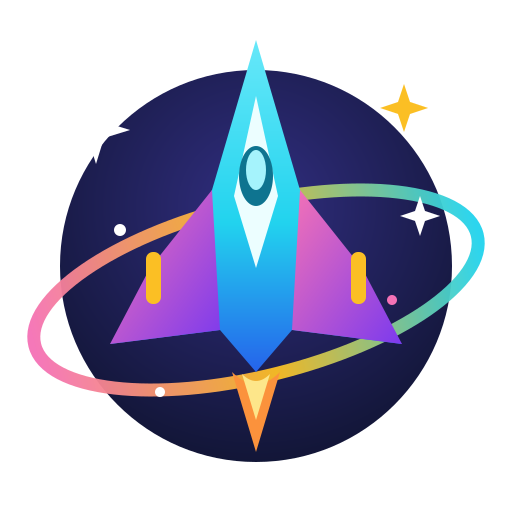
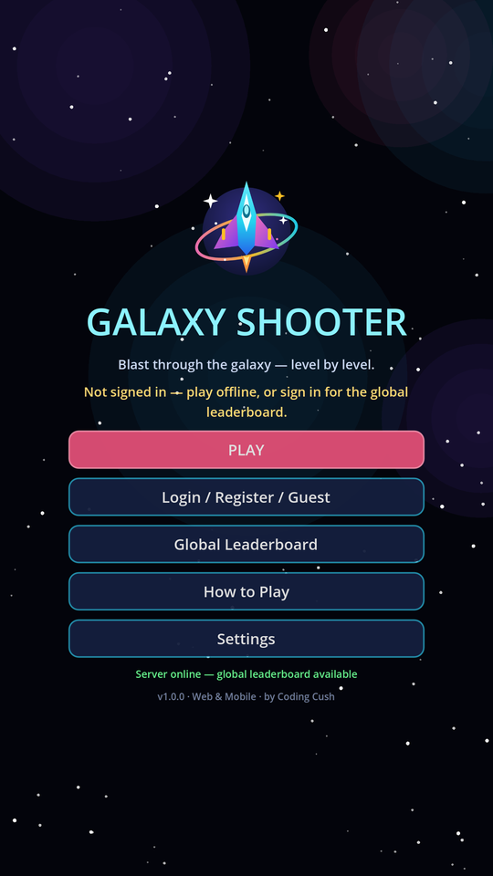
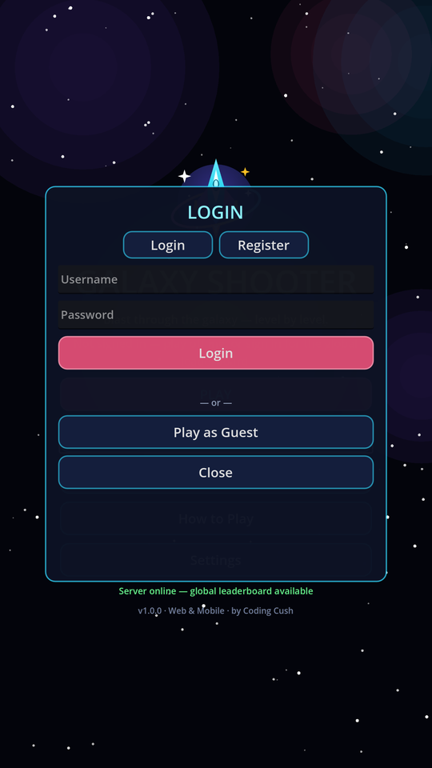
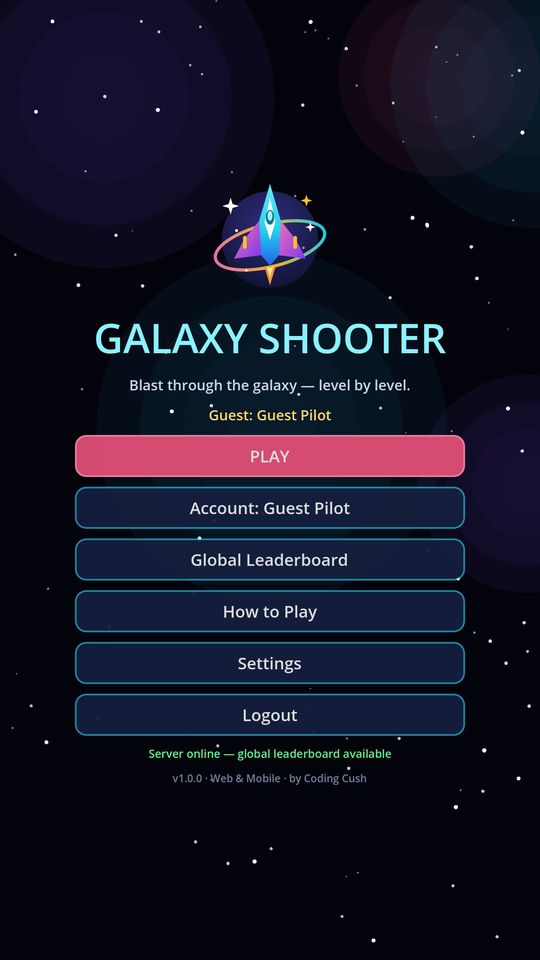
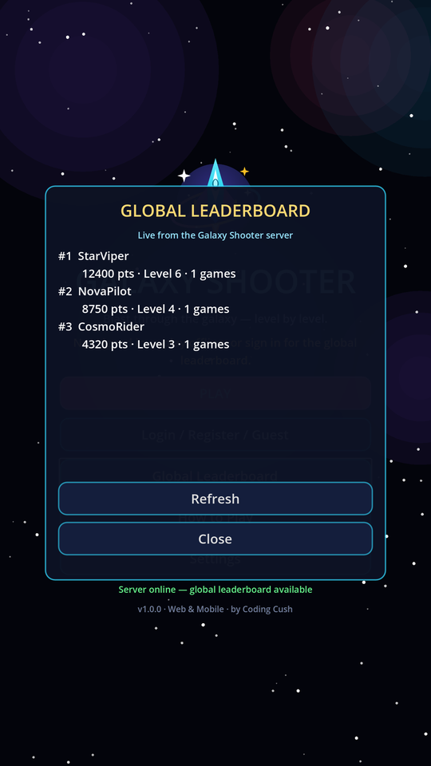
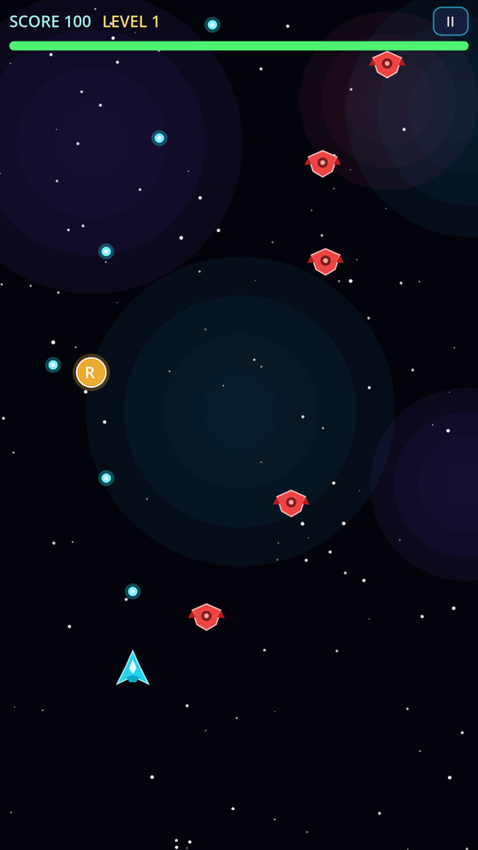

# 🚀 Galaxy Shooter

A fast, beautiful **space shooter** built with **Godot 4** — one codebase that runs on
**Web** (HTML5) and **Mobile** (Android), with **online accounts, guest play and a
global leaderboard**.



## 📸 Screenshots

Real captures from the Web build, connected to a live backend:

| Main menu | Login / Register / Guest |
| :---: | :---: |
|  |  |

| Signed in as guest | Global leaderboard |
| :---: | :---: |
|  |  |

| Gameplay — Level 1, with a Rapid-fire powerup dropping |
| :---: |
|  |

## ✨ Features

- 🎮 **Multiple levels** — endless level progression with rising difficulty:
  new enemy types unlock as you climb, and a **boss fight every 5th level**
  (aimed bursts, bullet spreads, side cannons, drone escorts)
- 👾 **4 enemy types** — Drone, Weaver (sine movement), Tank (aims and shoots back), Boss
- 🔥 **Combo multiplier** — chain kills to raise your score multiplier up to **x5**
- 🎁 **Powerups** — **R**apid fire, **T**riple shot, **S**hield, **+** Repair
- 👤 **Play your way** — create an **account**, **log in**, or **play as guest**;
  your session is remembered between launches
- 🏆 **Global leaderboard** — scores are submitted to the online backend and the
  worldwide top-pilots board is shown in the menu and after every run;
  offline? Scores are kept on-device and the local board takes over
- 📱 **Web + mobile controls** — touch drag / mouse drag / WASD + arrows / Space
- 🎨 **Polished UI** — animated starfield + nebula background, neon panels,
  procedural sound effects (no audio files needed), pause, HUD with live HP bar
- 🖥️ **Zero-dependency backend** — the online server is pure Python standard
  library (SQLite + HMAC tokens), ready to deploy anywhere

## 🕹️ How to play

| Action | Keyboard | Mouse | Touch |
| --- | --- | --- | --- |
| Move | WASD / Arrow keys | Drag | Drag |
| Shoot | Hold Space | Hold + drag | Drag (auto-fire) |
| Pause | Esc / P | On-screen **II** button | On-screen **II** button |

Destroy enemies to score. Getting hit lowers your weapon level — protect the
triple shot! Clear every wave to finish a level and heal a little.

## ▶️ Run the game

### In the Godot editor

1. Install [Godot 4.3](https://godotengine.org/download) (or newer 4.x).
2. Clone this repo and open `project.godot`.
3. Press **F5** — done. (First open imports the SVG art automatically.)

### Run the online backend (accounts + leaderboard)

```bash
cd backend
python server.py            # http://127.0.0.1:8900
```

No pip installs — Python 3.10+ standard library only.
Set a real secret in production: `GALAXY_SECRET=your-secret python server.py`
(and `PORT=` to change the port). Deploy it on any VPS, a home server, or behind
a tunnel; then in the game go to **Settings** and paste your server URL
(use `https://` in production — browsers require it for the Web build).

> The game is fully playable without the backend: guest/offline scores are
> stored on the device and submitted when a server is reachable and the
> player is signed in.

### Export for Web

1. In Godot: **Editor → Manage Export Templates → Install** (once).
2. **Project → Export → Web → Export Project** → produces `build/web/`.
3. Serve that folder over HTTP(S) (e.g. GitHub Pages, Netlify, any static host)
   and open `index.html`.

### Export for Android

1. Install the Android SDK + a JDK (Godot docs: *Exporting for Android*), and
   point Godot at them under **Editor Settings → Export → Android**.
2. **Project → Export → Android → Export Project** → `build/android/galaxy-shooter.apk`
   (arm64, package `com.codingcush.galaxyshooter`).

## 🧱 Project structure

```
├── project.godot / export_presets.cfg   Godot 4.3 project (Web + Android presets)
├── scenes/                              main_menu.tscn, game.tscn (thin shells)
├── scripts/
│   ├── session.gd        (autoload) identity, settings, on-device leaderboard
│   ├── api_client.gd     (autoload) backend HTTP client (auth, scores, board)
│   ├── sfx.gd            (autoload) procedural sound effects — no audio files
│   ├── main_menu.gd      menu, login/register/guest, leaderboard, settings UI
│   ├── game.gd           levels, waves, collisions, combo, HUD, game over
│   ├── player.gd / enemy.gd / bullet.gd / powerup.gd / explosion.gd / starfield.gd
├── assets/               logo + ship art (SVG — crisp at every resolution)
└── backend/
    ├── server.py         accounts, guest tokens, scores, global leaderboard
    └── test_backend.py   5 end-to-end API tests (python test_backend.py)
```

## 🔌 Backend API

| Method | Endpoint | What |
| --- | --- | --- |
| GET | `/api/health` | Server status |
| POST | `/api/auth/register` | `{username, password, display_name}` → token |
| POST | `/api/auth/login` | `{username, password}` → token |
| POST | `/api/auth/guest` | `{display_name}` → guest token |
| GET | `/api/me` | Current user (Bearer token) |
| POST | `/api/scores` | `{score, level}` (Bearer token) |
| GET | `/api/leaderboard?limit=50` | Global top pilots (best score per player) |

Passwords use PBKDF2-HMAC-SHA256 with per-user salts; tokens are HMAC-signed
and expire after 30 days; CORS is enabled so the Web export can play online.

## 📜 License

GPL-3.0 — see [LICENSE](LICENSE).

Made with ❤️ by [Coding Cush](https://codingcush.com)
