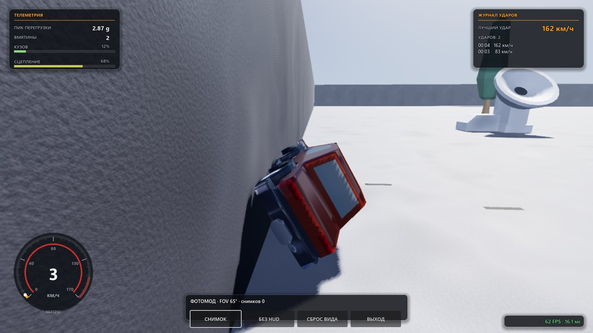
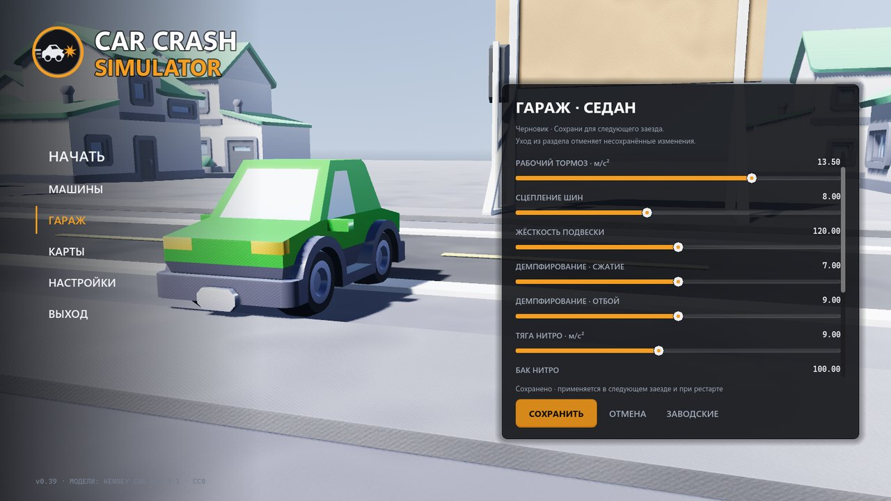
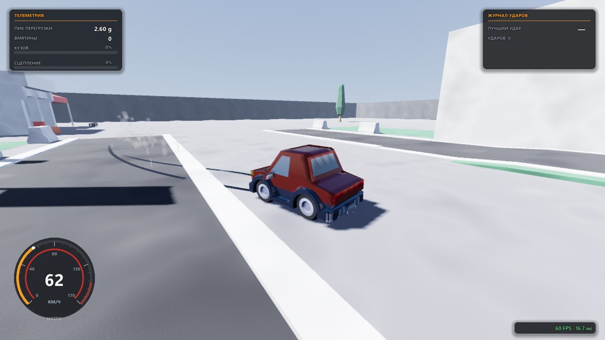

<p align="center">
  
</p>

<p align="center">
  <a href="#what-is-in-the-game"><b>Features</b></a> ·
  <a href="#controls"><b>Controls</b></a> ·
  <a href="#download"><b>Download</b></a> ·
  <a href="#building-from-source"><b>Building</b></a> ·
  <a href="#tests"><b>Tests</b></a> ·
  <a href="CONTRIBUTING.md"><b>Contributing</b></a>
</p>

<p align="center">
  <a href="https://github.com/lightcodegit/carcrashsimulator/actions/workflows/ci.yml"></a>
  
  <a href="https://godotengine.org/download/archive/"></a>
</p>

# Car Crash Simulator

**A 3D crash sandbox built on Godot 4.7.** Speed up, crash and watch the car body
crumple right at the point of impact: in-run telemetry, a replay of the last ten
seconds, photo mode with a free camera, a garage with tuning and paint. Free,
open source (MIT), CC0 assets.

## What is in the game

Everything listed below ships in the current release.

- **Deformation.** Body vertices shift along the velocity-loss vector: head-on,
  side and rear impacts crumple their own panel; dents accumulate and are
  cleared by a restart.
- **5 cars.** From a heavy pickup to the Endless car with no speed cap; each has
  its own top speed, mass, acceleration and nitro with a tank and exhaust flame.
- **6 maps.** A test arena, a town with parked cars, a drag strip with a finish
  wall, a kilometre race loop, an endless strip of tiles and a big city with
  districts.
- **Impact replay and photo mode.** Replay of the last 10 seconds with stepping
  and playback speed; a free camera with zoom and PNG screenshots.
- **Garage.** Suspension stiffness, dampers, thrust, brakes, grip, the nitro
  tank and body paint in any color; a profile is stored per car.
- **Sound and vibration.** Engine, tire squeal, impact and nitro are synthesized
  by a DSP mixer; the gamepad vibrates on impact and slides.
- **Settings and two languages.** Image presets, every graphics option
  individually, slow-mo and camera; the interface is English and Russian,
  switchable on the fly. Every action can be rebound to a key, button or axis —
  keyboard and gamepad are stored separately, modifiers are part of the binding.

<table>
  <tr>
    <td width="50%"></td>
    <td width="50%"></td>
  </tr>
</table>

## Performance

The simulation costs ≈1 ms per physics tick (6–7% of the 16.67 ms step budget) —
the frame is bounded by rendering, which is why the renderer is GL Compatibility
and the image presets are priced from measured frame costs. Measured by
`tools/project.mjs test` (`p_perf`, live rendering) on Intel HD 630 at 1600×900:

| Frame configuration (Compatibility) | Frame cost |
| --- | --- |
| geometry only, no shadows or post effects, 70% scale | **6.7 ms** |
| haze and glow, shadows 120 m (default) | **13.7 ms** |
| everything on: SSAO/SSIL, MSAA 4×, shadows 260 m | 29.4 ms |
| soft shadows 420 m, bloom, exposure 1.15 (film) | 29.2 ms |

The default fits a 60 Hz refresh on integrated graphics; the HIGH and FILM
presets are for discrete GPUs.

## Download

Ready builds are published on the
[releases page](https://github.com/lightcodegit/carcrashsimulator/releases):
the `Release` workflow assembles them automatically on a `v*` tag, and the tag
number is checked against the version in `project.godot` and the `CHANGELOG.md`
entry. Until the first tag, build from source (below) or grab CI artifacts from
the Actions tab.

| Platform | File | Needs |
| --- | --- | --- |
| Windows x86_64 | `Car Crash Simulator.exe` | Windows 10/11, a GPU with OpenGL 3.3 |
| Linux x86_64 | `Car Crash Simulator.x86_64` | a glibc distribution, X11 or Wayland |

Each build is a single file: the game data (.pck) is embedded into the
executable, so there is nothing to keep next to it.

## Controls

| Action | Keyboard | Gamepad |
| --- | --- | --- |
| Throttle / brake | W / S | RT / LT |
| Steering | A/D, ←/→ | left stick |
| Handbrake / parking brake | Space | A (cross) **or** L1 |
| Nitro (hold) | Shift | R1 |
| Slow-mo (hold) | Ctrl | B |
| Camera (chase → hood → orbit) | C | X |
| Restart | R | Y |
| Pause | Esc | Start |

The table is the default layout. Everything is rebound in
**SETTINGS → CONTROLS** (from the main menu and from pause): to a key, button or
gamepad axis; `Ctrl+F` and `F` are two different keys, and the settings file
stores them with their modifiers.

## Building from source

You need **Godot 4.7.2 stable** (not .NET) and **Node.js >=22** (no npm
dependencies). For exporting, install the **4.7.2.stable** templates via
**Editor → Manage Export Templates** or from the
[official release](https://github.com/godotengine/godot-builds/releases/tag/4.7.2-stable);
CI downloads the same editor and templates and verifies SHA-256.

```sh
git clone https://github.com/lightcodegit/carcrashsimulator.git
cd carcrashsimulator
node tools/project.mjs import          # import resources and classes
node tools/project.mjs run             # run the game from sources
node tools/project.mjs build windows   # release into artifacts/build/windows/
node tools/project.mjs build linux
```

Godot is looked up in PATH as `godot`; set the `GODOT` variable or pass
`--godot "C:/path with spaces/Godot.exe"` to any command. `help <command>` and
`<command> --help` describe the options; import, test and build open no windows.
Alternatively, open `project.godot` in the editor and press F5.

## Tests

```sh
node --test tools/project.test.mjs          # tests of the runner itself, no Godot needed
node tools/project.mjs import              # import resources and classes first
node tools/project.mjs test --list
node tools/project.mjs test --test d_assets --test h_crash --timeout 180
node tools/project.mjs test                # the whole set, in parallel (--jobs N)
node tools/project.mjs test --fail-on-skip # strict mode: partial/skip is an error too
```

The runner discovers `tests/**/d_*.gd` and `tests/**/h_*.tscn`; `--test` takes
exact names from `--list`. Every test gets isolated `APPDATA`/`HOME`/`XDG_*`
directories in the system temp — player settings and other tests' results never
leak into defaults. Success requires an `ALL PASS` line, exit code 0 and no
`SCRIPT ERROR`/`FAIL`; `PARTIAL`/`SKIP` are counted separately and do not count
as a pass. Tests that need a live GPU, window or gamepad honestly report partial
in headless or are marked skipped; their full coverage is a manual `p_live_probe`
run with a live window (audio, smoke, paint, replay and photo mode — measured in
pixels and with real audio output). CI runs both OSes and **always launches the
exported build** headless for a few frames: "it exported" without "it runs"
does not count as a build here.

## Contributing

The process and the queues are in [CONTRIBUTING.md](CONTRIBUTING.md). **English
is the language of the repository: new issues, commits and pull requests are
written in English.** If the work is done by an AI agent, that file also has an
"If you are an agent" section.

## License

The code, scenes and tests are **MIT** (`LICENSE`). The assets are not ours:
`assets/` holds the CC0 Kenney Car Kit and Racing Kit, their license texts sit
next to the files and ship inside the build, and the `d_assets` test keeps track
of them. "Godot" and "Kenney" are trademarks of their respective owners,
mentioned only to explain what this is built with.

If you take the project for yourself: MIT requires keeping the copyright
notice, CC0 requires nothing, but thanking the kit authors is good manners.

## Author

The project was written by **crystaldev** ([@lightcodegit](https://github.com/lightcodegit)).

## Contributors

As co-authors appear, GitHub keeps the full list in the
[contributors graph](https://github.com/lightcodegit/carcrashsimulator/graphs/contributors).
