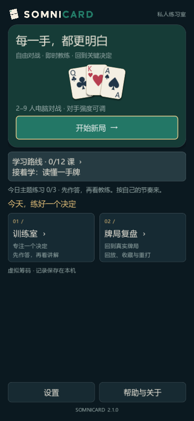
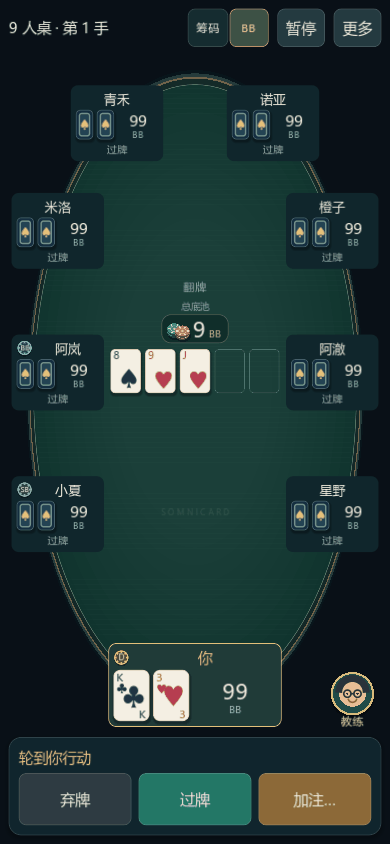
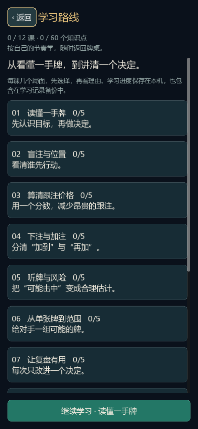

# Somnicard

An offline portrait Texas Hold’em practice game built with Godot.



面向安卓的竖屏德州扑克练习游戏：本地电脑对手、同桌教练、逐手复盘、主题训练与学习课程。使用虚拟筹码，不含现金下注、支付或真人网络桌。

## 截图

| 主界面 | 9 人桌 · 翻牌后 | 学习路线 |
|---|---|---|
|  |  |  |

截图来自游戏的实际渲染，分辨率为 390×844。

## 下载

- [GitHub Releases · 最新版本](../../releases/latest)
- [Somnicard 官网 · 下载与版本说明](https://somnicard.nightricecake.com/)

安装包附 SHA-256 校验文件。正式版包名为 `com.somnicard.game`，可与旧试用版 `com.somnicard.practice` 并存。迁移学习与牌局记录时，先在旧版“设置 → 数据与备份”导出备份，再到正式版相同位置导入；确认记录恢复后再决定是否卸载旧版。设备设置与当前普通牌桌不包含在学习备份里。

## 游戏内容

- 2–9 人完整无限注德州练习桌，逐个对手选择名字、三档难度与激进程度；50/100/200 BB 深度，固定 5/10 盲注，无前注和抽水。
- 四轮下注、合法加注、全押、边池与平分、摊牌、输赢提示、连续牌局、后台暂停及恢复；筹码 / BB 随时切换。主牌桌有发牌、筹码入池与分池动画（可在设置中关闭，省电模式自动关闭）。
- 牌桌内悬浮教练与决策分析，按当时已知信息估算权益与范围；结算后可直接复盘本手。
- 历史 ID、搜索、筛选、收藏、备注、逐步回放与关键决策跳转；复盘页顶部显示所选牌局的净变化、主动入池和翻前加注。
- 训练室一键开始，每组 5 题自动挑选：先复习之前偏离建议的局面，再按最弱的主题出新局面；每题先作答，再看三档评级、建议操作与完整理由，也可用自己的选择把这手打完。
- 12 课 60 个决策题与错题复习，记录课程进度并衔接主题训练；手动导入 / 导出牌局及学习备份。
- 音效、震动、减少动效、四色花色、高对比显示和省电模式；首页提供分类设置、隐私、帮助、许可及主动复制的诊断摘要。

CFR 分析仅覆盖双人河牌抽象范围和有限下注树，不是完整多人 GTO。本地对手档位不映射真人段位。详见 [策略说明](docs/strategy.md) 和 [对手评测](docs/opponents.md)。

## 本地开发

Godot 4.7.2，Windows PowerShell 5.1（`powershell`）与 PowerShell 7（`pwsh`）均可；以下命令也可将 `powershell` 替换为 `pwsh`。环境路径见 [开发环境](docs/environment.md)。

```powershell
# 运行游戏
powershell -ExecutionPolicy Bypass -File .\tools\run.ps1
# 全部规则、UI、存档、策略回归与启动检查
powershell -ExecutionPolicy Bypass -File .\tools\check.ps1
# 开发调试 APK；不是正式发行构建
powershell -ExecutionPolicy Bypass -File .\tools\export-android.ps1
```

开发日志、模拟器记录及候选工程存放在忽略的 `.local/`，输出包在 `builds/`。签名密钥不得进入项目目录。

## 发布流程

检查、构建签名、核验、服务器上传与 GitHub Release 的完整步骤见 [发布工程](docs/release-engineering.md)。

## 代码入口

| 位置 | 职责 |
|---|---|
| `scripts/main.gd` | 导航、牌桌流程、对手任务与存档协调 |
| `scripts/poker/` | 规则、牌型、策略、历史、复盘与训练数据 |
| `scripts/product/academy.gd` | 有限、可审核的课程与进度规则 |
| `scripts/ui/` | 竖屏牌桌、首页、课程、设置、教练与帮助 |
| `native/android/` | Android 渲染生命周期修复 |
| `tests/` | 规则 / UI 回归和隔离安卓测试入口 |
| `tools/` | 构建、资源生成、截屏、测试及发布核验 |
| `site/` | 保留的站点打包测试素材；线上官网在服务器管理工作区构建后上传 |

桌面数据位于 `%APPDATA%/Godot/app_userdata/Somnicard`；Android 数据属于各自安装包。完整备份包含隐藏底牌，请妥善保存。设备设置与当前普通牌桌不包含在学习备份里。游戏不联网，所有记录只保存在本机。

## 许可

代码与自制美术、音效素材按 [MIT 许可](LICENSE) 发布。Godot 引擎按其 MIT 许可发布，游戏内“帮助与关于”附带许可文本；内置第三方组件保留各自许可。来源见 [资源来源](docs/assets-provenance.md)。

另见 [产品路线](docs/roadmap.md) 与 [版本记录](docs/version-history.md)。
