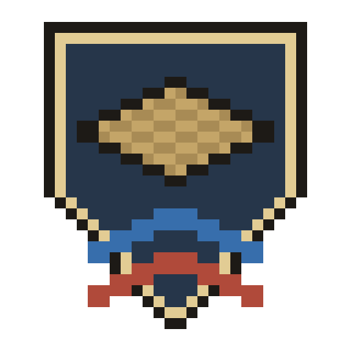
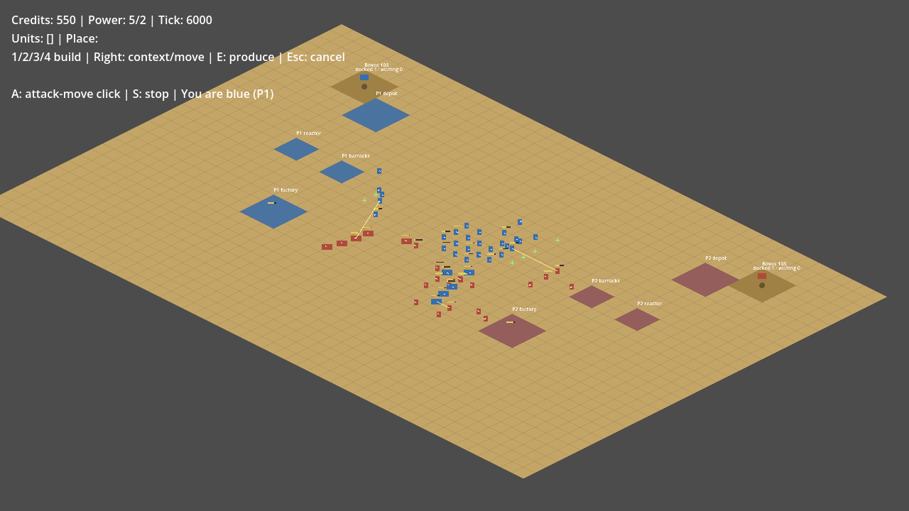

# Wargrid

Wargrid is an isometric real-time strategy game written in Godot 4 and typed GDScript. Its design follows Command & Conquer: Generals – Zero Hour (factions, base building, supply economy, combat feel and pacing); the code is Wargrid's own and leaves out the original's known bugs and slow paths. Graphics are placeholder shapes drawn in code for now; the planned look is geometric 2.5D: machines built from a few flat shapes with bright owner colours over muted terrain. Not affiliated with or endorsed by Electronic Arts, see [License](#license).

*Bot against bot on the skirmish map after 3:20 of game time (tick 6000).*

## Play

- **In the browser:** https://wargrid.pdstuber.dev (verified in Safari; Chrome and Firefox untested).
- **Desktop:** Linux, Windows and macOS zips on the [Releases](https://github.com/pdstuber/wargrid/releases) page. Builds are unsigned: on macOS 15 and later open System Settings > Privacy & Security > Open Anyway after the first blocked start (or run `xattr -dr com.apple.quarantine Wargrid.app` once); on Windows, SmartScreen needs More info, Run anyway.
- **Online with a friend:** one player clicks *Create match* and shares the match code; the other enters it and clicks *Join*. The host chooses the map; the other player's game checks it. Both need the same version.
- **From source:** Godot 4.7.2, see [setup and commands](docs/development.md#setup-and-commands).

## Status

Early development. Three factions (USA, China, FRC), skirmish against a bot and online 1v1 on Dry Wells, Broken Crown or Ashfall (map choice in the launcher, since 0.10.0). Latest release: see [Releases](https://github.com/pdstuber/wargrid/releases).

## How it's built

A deterministic, tick-based simulation kept apart from rendering, so builds on different platforms produce identical replay traces (Linux and Windows compared in CI, macOS locally). Online play is lockstep through a small Go relay that only forwards commands; every client runs the full simulation. Several hundred headless test cases cover simulation, replays and HUD layout; CI also runs the exported builds and netplay scenarios through a local relay.

- `game/`: the Godot project (simulation, presentation, scenes, tests, map data)
- `relay/`: the Go WebSocket relay
- `protocol/`: wire-protocol test vectors and the black-box conformance suite
- `tools/`: test, benchmark, release and map-conversion scripts
- `web/`: the static web server image for the browser build

Developed with AI coding agents (Claude Code); plans, decisions and evidence: [development notes](docs/development.md).

## License

Code and the Wargrid logo (`game/art/logo-32.png` and the sizes derived from it): GPL-3.0-or-later, see [LICENSE](LICENSE). The Ashfall, Dry Wells and Broken Crown maps (`game/data/maps/`) are converted from Electronic Arts' GPL-3.0 map sources and keep EA's copyright line and additional terms, see the [map notice](game/data/maps/NOTICE.md). Unit and weapon numbers were researched from EA's GPL source and the retail game's configuration; no EA files, art, audio or text are copied. Wargrid is not affiliated with or endorsed by Electronic Arts; Command & Conquer is a trademark of Electronic Arts Inc. and is named only to describe the inspiration.

Released zips and the web build carry `LICENSE`, the map notice, the audio credits (`game/audio/CREDITS.md`) and Godot's license notices (`GODOT_LICENSES.txt`); the launcher shows the license and the source link, and its Credits button lists the music, voice, map, Godot and Wargrid notices. Wargrid-made audio (generated effects, vocoded announcer lines): GPL-3.0-or-later. Music: CC BY 3.0 / 4.0, credited in [game/audio/CREDITS.md](game/audio/CREDITS.md). Wargrid's own art (the art-direction sheets in `docs/art-direction/` and any later Wargrid-made art): GPL-3.0-or-later.
