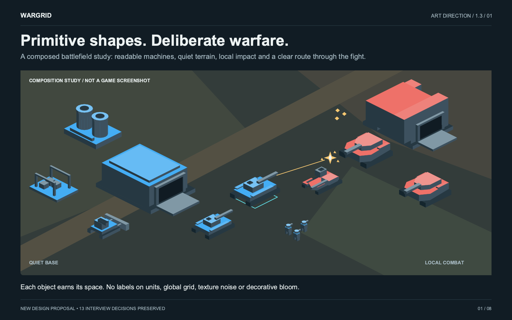
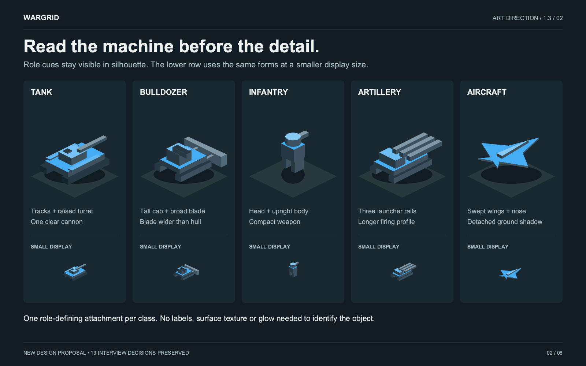
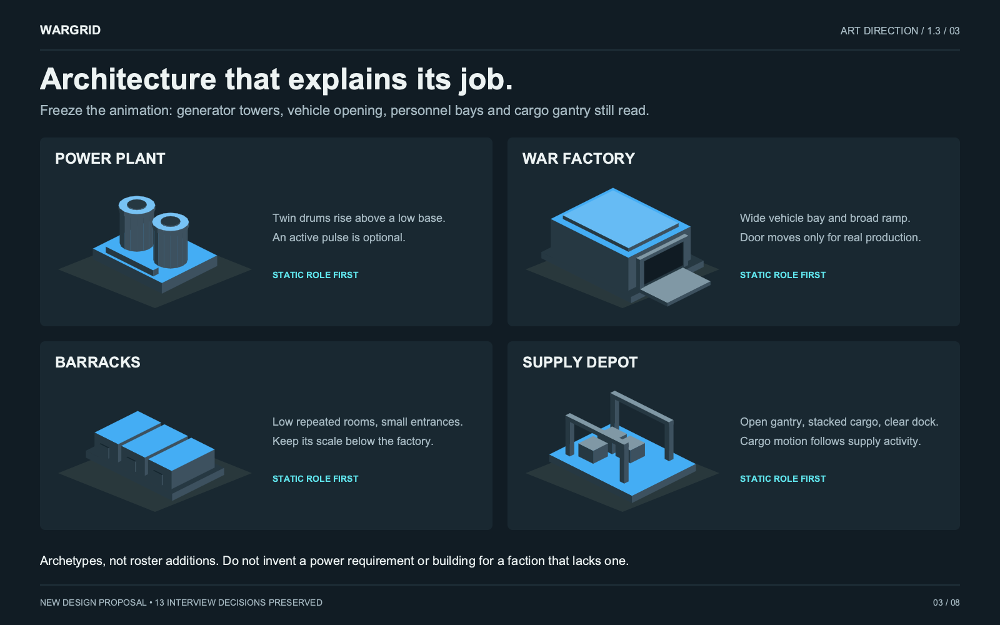
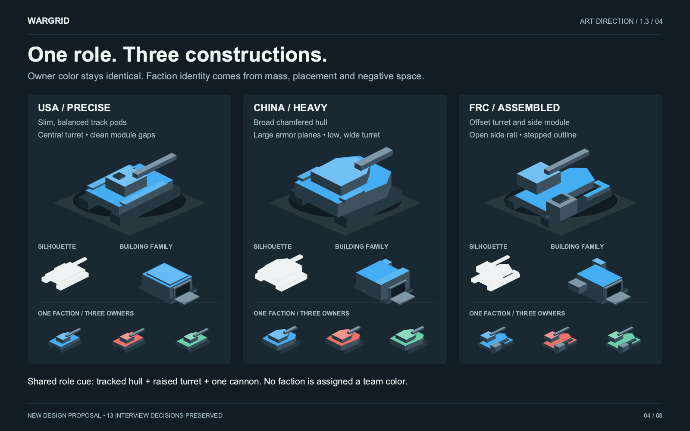
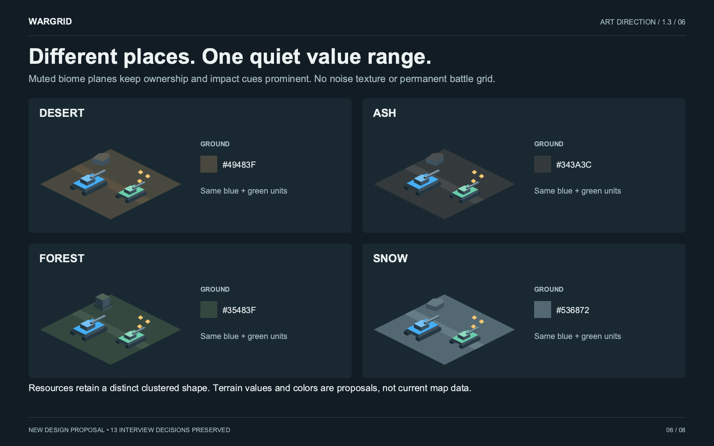
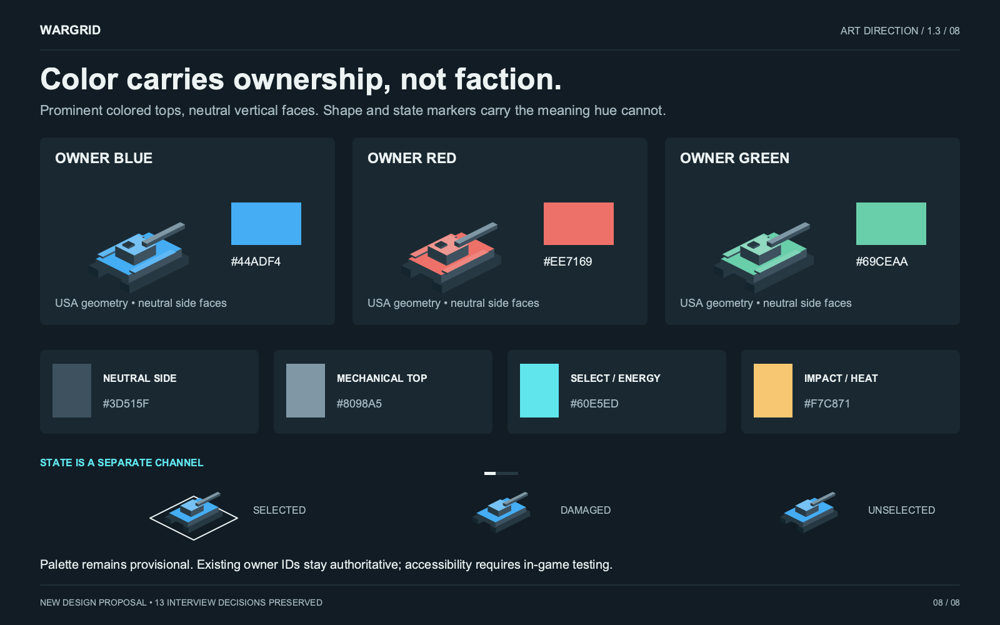
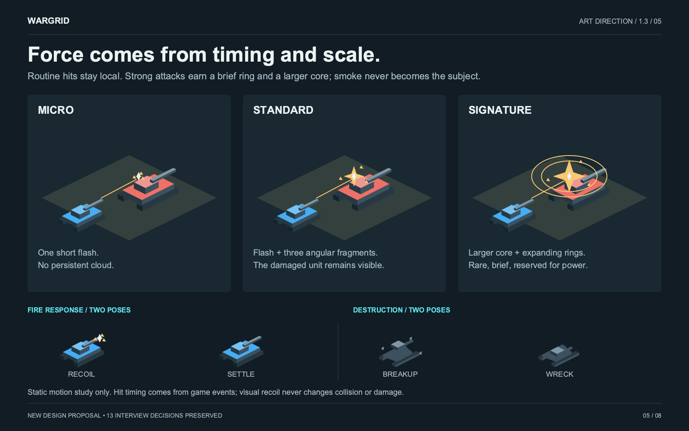
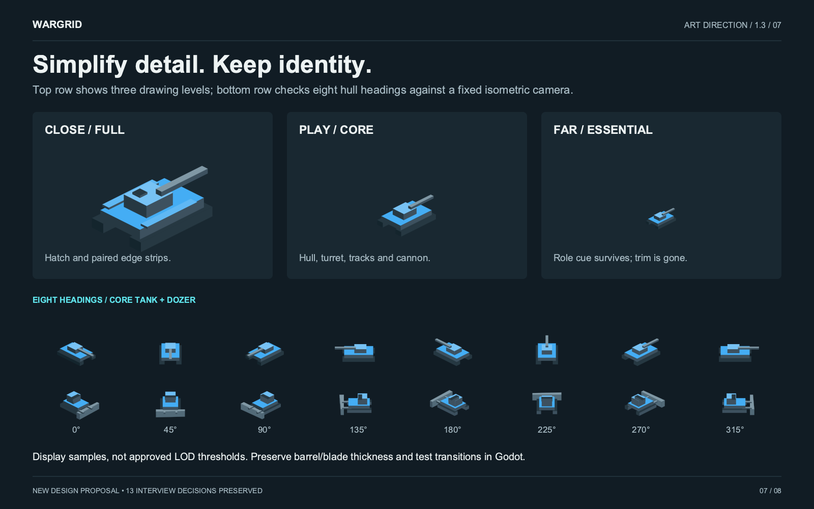

# Wargrid — art bible

**Version 1.3 · 2026-11-09 · written by GPT from the user's interview; proposals, not rules.** The user replaced pixel art with this direction (2026-11-09, [blueprint §2](../blueprint.md#2-visual-direction-geometric-25d)). The 13 interview answers are the starting point and may be revisited; silhouettes, proportions, colour values and timings below are GPT's proposals. Open questions: [scope](../questions/next-m75-art-scope.md), [look](../questions/next-m75-art-look.md), [world](../questions/next-m75-art-world.md). GPT's QA images, validation and handoff notes are outside the repository at `~/projects/wargrid-art-archive/`.

> Recognizable machines from a few deliberate shapes. Bright ownership surfaces over quiet terrain. Physical depth without surface clutter. Force through timing, not permanent spectacle.

## 1. Authority and the thirteen decisions

The complete questions, alternatives, answer quotes and illustrations remain in the [interview archive](interview/INTERVIEW_ARCHIVE.md) (images in `~/projects/wargrid-art-archive/interview/`). The [JSON archive](interview/interview.json) retains all 13 verbatim answer fields. Q1 explicitly rejected the initial pixel-art-like concepts; liking option C's contrast did not approve its detailed rendering. Unillustrated hybrid options have not been given invented historical images.

| Q | Preserved decision | What it requires here |
|---|---|---|
| 1 | High-contrast abstract geometry; reject pixel-art / detailed low-poly concepts | Rectangles, circles, triangles and flat polygons; no textured surface imitation |
| 2 | B — Functional icons from simple primitives | Tank, bulldozer and factory recognizable by construction |
| 3 | C — Filled shapes with selective outlines and accents | Mass from fills; an edge only when it clarifies form or state |
| 4 | B — Responsive and punchy animations | Short recoil, decisive impact, quick settle; no cartoon bounce |
| 5 | B — Minimalist 2.5D top and side faces | Existing fixed isometric camera; modest extrusion |
| 6 | C — Muted biomes with bright units and effects | Distinct terrain character without competing saturation |
| 7 | D — Geometric destruction normally, spectacle for powerful attacks | Small fragments and readable wrecks; large rings reserved for rare power |
| 8 | B — Shared functions, faction-specific styling | Role, faction and owner remain separate visual channels |
| 9 | D — Functional building silhouettes with selective mechanical animations | Buildings read when motion and glow are off |
| 10 | D — Matte shaded objects with selective luminous components/effects | Quiet permanent surfaces; brightness signals an event or state |
| 11 | B — Progressive simplification | Remove small detail, retain barrel, blade, wings and role mass |
| 12 | B — Balanced player-colored surfaces with neutral sides | Large readable colored tops; neutral mechanics and vertical faces |
| 13 | B — Refined geometric minimalism | Consistent proportions, spacing, grounding and timing before extra detail |

**Order of authority:** user decisions → current art bible → current reference SVGs → GPT's handoff (now in `~/projects/wargrid-art-archive/`). Historical proposals are not an additional authority. Current repository rules still govern any future implementation; this document does not silently rewrite them.

## 2. What changed across the whole pack

The issue was not confined to the faction sheet. The previous pack mixed two editorial systems, small isolated objects, weakly distinguished construction families, competing palettes, and captions repaired separately from their generator. Its eight-sheet guide and six-sheet manifest disagreed.

This revision uses one composition system: 1600 × 1000 canvases, fixed header/footer zones, dedicated caption areas, and geometry that fills its allotted space. The battlefield now has a quiet base area and a clear combat focus. Units have separate tracks, role attachments and grounded mass. Building openings are actual negative space. Terrain follows the same 2:1 ground projection as the objects. Effects demonstrate both impact tiers and readable destruction. Zoom includes eight tank and bulldozer headings. Palette examples separate owner hue from state.

These changes improve the references; they are not measured proof that players can identify every object in a crowded match. GPT's QA evidence is in `~/projects/wargrid-art-archive/VISUAL_QA.md`.

## 3. Construction and camera

Keep the existing 2D simulation plane. The inspected worktree projects ground coordinates as `screen_x = 32 × (x − y)` and `screen_y = 16 × (x + y)`. A raised visual vertex subtracts visual height from screen Y. Rotate hull geometry in the ground plane before projecting; do not rotate an already projected drawing as a flat sticker.

Use a ground anchor distinct from roof and turret height. Tracks, foundations and short shadows must touch that anchor. A barrel emerges from a turret; a blade connects to a chassis; a factory ramp meets its opening. An attractive isolated diamond is insufficient if those relationships break at another heading.

Use a bright owner top, a medium neutral vertical face and a darker neutral vertical face. Keep face values consistent in screen space; do not attach a moving light source to each rotating hull. The references use flat fills, without textured surfaces, metallic gradients or global bloom. The few pale roof edges separate large forms; they are not luminous decoration.

The SVGs encode final projected shapes. They are editable reference artwork, not a reusable runtime renderer or validated geometry pipeline. Their proportions use drawing units, not game collision dimensions.

## 4. Unit vocabulary

| Role | Essential construction | Remove first at distance |
|---|---|---|
| Tank | Two track masses, low hull, raised turret, one projecting cannon | Hatch and narrow top strips |
| Bulldozer | Compact chassis, elevated cab, blade wider than chassis | Window inset and blade supports |
| Infantry | Head above upright body, small directional weapon | Limb separation below useful screen size |
| Artillery archetype | Long chassis and conspicuous launcher rails | Cab highlight and fine rail separation |
| Aircraft archetype | Wings, nose, small central body, displaced ground shadow | Secondary tail geometry |

These are shape studies, not unit additions or exact faction rosters. A role needs a different primary feature, not a tiny accessory on the same generic box. Avoid miniature realistic vehicles: tread wheels, panel lines, rivets and vents are not the target.

## 5. Buildings communicate activity

Power plant: two generator drums above a low platform. War factory: dominant vehicle opening and usable ramp. Barracks: low repeated rooms with small entrances. Supply depot: open loading structure and cargo stacks. Keep all four distinct in a still frame with no labels, lights or motion.

Animation reinforces a real state: factory bay opens around production; plant pulses only when relevant; cargo moves during supply activity. No animation delays a spawn or changes economy. Do not assign these generic examples to a faction that lacks the corresponding building or power system.

## 6. Faction identity without color dependence

| Faction | Large-scale construction | Vehicle and building expression |
|---|---|---|
| USA | Precise symmetry and narrow balanced modules | Central rectangular turret, separated parallel tracks; clean factory roof and aligned bay |
| China | Broad mass and large reinforced planes | Wide chamfered hull, broader turret; heavy roof spans and thick supporting blocks |
| FRC | Purposeful asymmetry, staggered modules, structural gaps | Offset turret, exposed side rail, external utility block; mixed-height factory additions |

These grammars elaborate Q8; they are new design proposals, not additional verbatim user choices. Keep the common role recognizable: every shown tank retains tracks, turret and one cannon. Faction style must not imply a second weapon, armor statistic, production capacity or new game mechanic.

The sheet tests all three factions in blue, each silhouette without color, one factory family, and three owners per faction. Judge at small display size as well as hero size. If FRC's offset or USA's narrower form disappears in actual play, change the primary outline; adding more tiny decorations is not a fix.

## 7. Terrain, ownership and state

Desert uses slate brown; ash uses charcoal; forest uses green gray; snow uses muted blue gray. Geographic identity comes from broad planes, roads, obstacles and sparse landmarks. Use the real map's navigation and resource data; do not invent map rules from this illustration. Avoid random texture noise, uniform black ground and a permanent bright full-map grid.

The [palette file](palette-proposal.json) contains the exact current sample values. They are proposals, not replacements for the existing owner-ID mapping. Blue, red and green can belong to any faction. Owner tint occupies large top surfaces; vertical faces and mechanisms remain neutral. Selection uses an anchored outline; damage uses explicit health/state feedback. Neither relies only on switching owner hue.

Selection, immediate threats and important impacts have the strongest temporary contrast. Ownership is the persistent main read. Neutral machinery follows; terrain remains quietest. Resource clusters and impact fragments may share amber in the examples because their shapes and temporal behavior differ; never identify a resource solely by amber color.

Grayscale inspection tests form, not color accessibility. Before adopting the palette, test actual owner combinations, color-vision deficiencies, fog, damaged units and selection together. A marker or existing UI fallback must carry allegiance when hues are ambiguous. This pack does not claim that test has passed.

## 8. Motion, effects and destruction

Small-arms feedback is a compact flash. A normal shell hit adds a few angular fragments. Powerful attacks may use a larger core and short expanding rings. Persistent smoke, screen shake and glowing hull outlines are not the baseline. Under load, remove decorative debris first; preserve shot/hit confirmation, selection and destruction state.

Barrel recoil is a short backward translation followed by a solid return. Hull response stays slight. The dozer blade moves with work; factory machinery signals activity. No squash-and-stretch chassis motion. Wrecks settle into a small, readable neutral footprint, with a few recognizable pieces rather than an obscuring cloud.

Illustrative timing from v1.2 remains a tuning proposal: muzzle flash 40–90 ms; cannon recoil 80–160 ms; ordinary hit 60–140 ms; brief ring 150–300 ms; heavy explosion 220–500 ms. Nothing in this pack proves those timings against gameplay. Damage, death, shot origin and production events come from the game's actual state. Cosmetic fragments must never consume simulation randomness or reveal hidden units through fog.

## 9. Zoom and heading discipline

Use projected entity size to decide detail. Close view may retain a hatch and top strips. Play view keeps the major masses and functional attachment. Far view preserves the same identity with fewer accents; it must not switch to an unrelated tactical icon. Preserve practical barrel/blade thickness rather than allowing essential cues to become subpixel lines.

The sheet's drawn sizes are display samples, not approved gameplay thresholds. Earlier 70 px and 28 px boundaries were examples only. Choose thresholds and hysteresis after measuring real viewport, zoom and unit footprints. Static headings do not prove smooth rotation, interpolated targeting or flicker-free LOD transitions.

## 10. Repository integration, when separately authorized

The [Godot integration review](../reference/art-godot-integration.md) records inspected code, event and input boundaries, actual zooms, roster constraints, performance gates and the existing `spike-avoidance` research. GPT's handoff (`~/projects/wargrid-art-archive/IMPLEMENTATION_HANDOFF.md`) proposed a lab scope; M7.5's scope is decided in the questions above. The renderer already uses centralized 2D drawing plus a cached structure layer and terrain layer. Reuse those boundaries first. No new generic geometry framework, per-unit scene graph or 3D migration is justified by these reference sheets alone.

One concrete integration risk: structures currently draw behind the unit parent, so taller art cannot assume correct unit/building interleaving. Another: static structure redraw caching does not automatically support animated generator and factory parts. Resolve those in a small art lab, with measurements, rather than changing simulation or redrawing every building every frame by default.

README, AGENTS and the blueprint were reconciled with this direction on 2026-11-09. Keep all existing benchmark budgets, deterministic traces and platform obligations unless the user changes them explicitly.

## 11. Acceptance gates

| Gate | Evidence required before progressing |
|---|---|
| Reference pack | Eight paired sheets; full and 25% visual inspection; current links and palette; 13 decisions and archive hashes preserved |
| Art laboratory | Tank, dozer, plant, factory and infantry at real footprint sizes; three owners; eight vehicle headings; selection and near/play/far views |
| Human recognition | Unlabeled role quartet; same-color faction comparison; frozen building roles; owner changes that leave faction clear |
| Motion and combat | Recoil and machinery align with actual events; normal and signature effects; local hit feedback; legible wrecks and dense combat |
| Integration | Correct ground anchors, picking and overlap behind/in front of buildings; intact fog and HUD behavior; no trace or gameplay change |
| Performance and rollout | Existing native/Web requirements and benchmark ledger; unchanged gates; failures explicitly reported; user approval for integration and Git actions |

Only GPT's static artifact checks (archive: `VALIDATION.md`, `VISUAL_QA.md`) have been performed. Human recognition, animation, in-engine accessibility and performance gates remain open. No fabricated percentage recognition score or inferred benchmark pass.

For future comparisons record commit, scene/map/seed, viewport, camera/zoom, visible counts, effect state, platform, baseline and revised images, frame/tick measurements, and reviewer decision. Keep scene composition fixed for renderer comparisons; this revision's before/after sheets are editorial comparisons, not controlled game benchmarks.

## 12. Provenance and rights

Read `~/projects/wargrid-art-archive/PROVENANCE.md` before reusing interview images. “Original” in an inherited path is not proof of authenticity. We verify preservation from the supplied ZIP; independent access to the original Q1–Q12 conversation and generation outputs is unavailable. New sheet geometry is newly authored for this revision, with no EA artwork imported or traced. The historical package remains intact. Shipping license/credits for new art remain a separate project decision.
