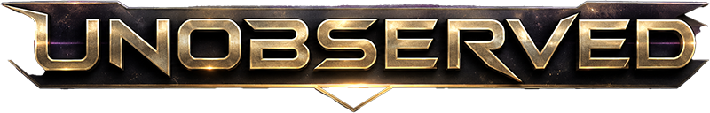

# Unobserved



Unobserved is an experimental space action and conquest game built with Godot. Pilot a lone ship through a hidden galaxy, survive escalating enemy waves, collect upgrades and artifacts, and colonize every planet to claim victory.

> **Status:** Early prototype (`v0.0.1`). Gameplay, balance, networking, and project structure are still evolving.

## Gameplay

- Explore a large galaxy obscured by fog of war.
- Fight enemy waves and destroy asteroids for experience.
- Level up and assemble a build from weapons, drones, shields, mobility, radar, and pickup upgrades.
- Collect active artifacts such as Wormhole Dash, Vortex, Nuke, and Explorer Beacon.
- Deploy Colony Beacons to invade nearby planets.
- Conquer every world before your ship is destroyed.

The project supports offline play and experimental server-authoritative multiplayer over ENet.

## Controls

| Input | Action |
| --- | --- |
| Right-click or hold right mouse | Move the ship |
| Left-drag | Pan the camera |
| `WASD` or arrow keys | Pan the camera |
| Mouse wheel or trackpad gesture | Zoom |
| Left-click the ship | Follow the ship |
| `Space` | Center the camera on the ship |
| `1`–`9` | Activate an artifact from the artifact bar |
| `Esc` | Open options or cancel artifact placement |
| Left-click while placing | Confirm artifact placement |
| Right-click while placing | Cancel artifact placement |

## Requirements

- [Godot Engine 4.7](https://godotengine.org/download/) with GDScript support
- A desktop platform supported by Godot
- [Bun](https://bun.sh/) only if serving a local web export

The project uses Godot's Mobile renderer and Jolt Physics.

## Getting Started

Clone the repository:

```sh
git clone https://github.com/sortegam/unobserved.git
cd unobserved
```

Open the project in Godot and run it:

```sh
godot --editor --path .
```

Press `F6` in the editor to run the current scene, or `F5` to launch the game from `scenes/main_menu.tscn`.

You can also start the game directly:

```sh
godot --path .
```

## Multiplayer

Start a headless server on the default UDP port:

```sh
godot --headless --path . -- --server --port 2456 --max-players 100
```

Connect a client:

```sh
godot --path . -- --join 127.0.0.1 --port 2456 --name Player1
```

The repository also includes a local two-client launch helper:

```sh
make test-network
```

Set `GODOT=/path/to/godot` when the executable is not available at the Makefile's default path. Multiplayer is experimental and intended for development testing.

## Development

Run the headless type check:

```sh
make typecheck
```

Key project directories:

```text
scenes/             Game, UI, item, and artifact scenes
scripts/            Gameplay, UI, networking, and wave logic
resources/waves/    Data-driven enemy wave timelines
galaxy_entities/    Procedural planets and other space entities
shaders/            Gameplay and procedural visual effects
textures/           Ships, items, artifacts, planets, and UI art
sfx/                Music, sound effects, and audio bus layout
addons/             Editor tooling, including the wave builder
```

The main menu is `res://scenes/main_menu.tscn`; the primary gameplay scene is `res://scenes/galaxy.tscn`.

### Web Export

Export the configured `Web` preset:

```sh
godot --headless --path . --export-release Web build/web/index.html
```

Serve the build with the included Bun server, which provides the cross-origin isolation headers required by the threaded web export:

```sh
bun run serve.ts
```

Then open `http://localhost:3000`.

## Credits

- Designed and programmed by [Sergi.io](https://sergi.io/)
- Built with [Godot Engine](https://godotengine.org/)
- Planet sprites based on [Pixel Planet Generator by Deep-Fold](https://deep-fold.itch.io/pixel-planet-generator)

Additional attribution is available from the in-game main menu.

## License

Unobserved is free software released under the [GNU General Public License v3.0](LICENSE) (`GPL-3.0-only`).

Third-party assets and dependencies remain subject to their respective licenses.
