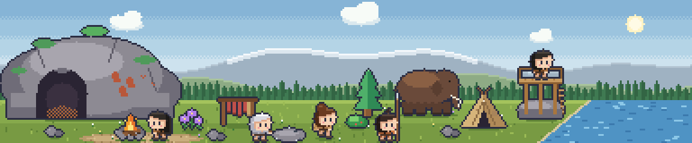

# Ages (eras)

Status: **direction agreed; the sim supports eras and the slice is re-themed.** This extends the MVP concept's progression (Camp → Hamlet → Village, the Knowledge axes and the Wild ↔ Developed axis) with a long-term arc: the game starts in the Cave Age and the settlement progresses through later ages gradually. Art for the Cave Age is not drawn yet; the on-screen art is still the earlier cottage-era placeholder set.

## Decisions

| # | Decision | Why |
|---|---|---|
| G1 | The game **starts in the Cave Age** (hunter-gatherers living in caves) | Player's vision for the game. |
| G2 | **Ages are linear, but the player's choices decide how they get there and what the age looks like.** Not branching into different ages per player | The MVP's "knowledge" axes (Agriculture / Craft / Exploration) drive the transition, so one player's Settled Age is farmland, another's is herding or craft. Linear ages keep the art and content scope bounded. |
| G3 | **Sequencing: decide the structure now, draw art one age at a time.** Age 1 art first; later ages are content packs | Art cost multiplies per age; the sim and content only need the era *structure* up front. |
| G4 | **Change is gradual and cumulative**: new buildings and props appear and older ones stay (the cave remains as storage), so the world accumulates history instead of being replaced | Matches "the player's desktop physically becomes more populated"; also cheaper than swapping whole scenes. |
| G5 | An **age** is a content/art pack and tech level; a **chapter** is settlement size within it (the MVP's Camp → Hamlet → Village milestones) | Keeps two different ideas apart. |
| G6 | **Every age is about as long as the Cave Age**: five or six hidden milestones spread over about five real days, with small decisions and quiet lines between them | The pace should feel the same from age to age; a short age feels like a skipped chapter. |
| G7 | **The game is open-ended.** The newest age has no end, no final milestone and no credits: its milestones are the *gate* of an age that does not exist yet. A later age is added as data (an `EraDef` whose `required_achievements` are the previous age's milestones, plus content and art), with no change to the engine | Room for future updates; nothing is ever "finished". |

## Settled Age: the milestones

Agreed. Like the Cave Age's, these are hidden achievements (G6, G7) staged over the age, each with
more than one route; the choice made at the turn (`path_agriculture` by the field, `path_herding`
where the herds winter) decides which routes a group is offered, and one late route is open to
every group. Days are **days into the Settled Age** (`SimCondition.ERA_DAYS_AT_LEAST`, one table:
`SETTLED_DAY` in `tools/build_sim_content.gd`), so the pace is the same however long the Cave Age
took. 72 days is a real day.

| # | Milestone | Real-world turning point | Ways it can happen | From day | On screen |
|---|---|---|---|---|---|
| 1 | **A Roof of Your Own** | Permanent houses | Build the Hut; or thatch the roofs with reed, or lay turf over the poles (both earn it) | 18 | Huts, thatch |
| 2 | **The First Harvest** | Farming and herding yield | Build the Field (either path); or, when herding, the first calves are penned or sent to graze (both earn it) | 18 (Field), 54 (calves) | Fields, a pen and herd |
| 3 | **Fired Clay** | Pottery | A basket's clay hardens by the fire: fire a pot in the embers, or bake a dish on hot stones; or bake bowls in the ashes or in a pit under the cook fire | 108 | Pots by the door |
| 4 | **Woven Cloth** | Weaving | Farmers find flax (spin it or beat it and weave); herders gather wool (spin or felt it); any group may plait reeds (teach it, or plait finer; from day 198) | 162 | Looms, cloth |
| 5 | **A Village** | Community | Two families on the road are made room for, or offered the ground by the river (needs milestone 1); or a long harvest table (10 food), or a dish from every family at the old fire (a little later) (needs milestone 2) | 216 | More villagers |
| 6 | **Word from the Hills** | Metal ore, trade | A curious villager brings back a green-streaked stone and follows the stream to its source, or shows the bead to the elders (a little later); or a traveller trades a pouch of it for 8 food, or is asked back with more (needs milestone 2). Sets the flag `green_stone` | 252 | A path into the hills (later) |

- **Why these six.** They are what the next age stands on, and the next age is the **Bronze Age** (metal, trade, walls, first towns; see "Bronze Age: design proposal"). A surplus (2), kilns (3), craft goods to trade (4) and a settlement big enough to need walls (1, 5) are its preconditions. Milestone 6 is the Settled Age's outward look, as the scout and the seed were the Cave Age's: copper ore, and the first contact with people who trade. The Bronze Age's turn event would read `green_stone` and ask *how* to start working it, as the Settled turn asks how to settle.

- There is no gate out of the Settled Age yet (G7): once the six are earned the age simply keeps
  going. The Hut and the Field are offered together by the "Building a settlement" decision from
  day 18 of the age: a real fork, so the one not chosen stays unbuilt (each milestone has other routes).
- The Cave Age's design rules carry over (P13): every answer does something, and a test (`test_sim_settled.gd`) plays
  from the turn on both paths, accepting everything and taking the last answer twice first, and
  proves all six are earned, never before their day (the Field's harvest may come with the roof).
- **Still to do for the Settled Age**: nothing planned. Its milestones, fill, skin, world art and clothes are in (V8, V10); the next age is the Bronze Age (proposed, awaiting confirmation; it also adds two late forks to this age).

## Settled Age: between the milestones

Same rules as the Cave Age's fill (two answers that each do something, a journal line each, a flag a later line remembers, nothing fails), paced by one table (`SETTLED_STORY_DAY`, days into the age). A bot answering at once is asked something every 2-5 real hours across the age (five forks were added in the longest stretches: mud at the door, the longest day, small hands, three days of fog, the long evenings). Costs are bigger than the Cave Age's (4-25) because the stores are fuller; they are what the stores are for.

| From day | Decision | What the answers do |
|---|---|---|
| 2 | **What the cave is for** | Make it the winter store, or keep it for sleeping and old stories |
| 8 | **Whose ground** | Boundary stones (4 wood), or leave the ground open |
| 14 | **The digging sticks** (farmers) / **Into the sown ground** (herders) | A forked branch pulled together, or digging by hand; a hurdle gate (6 wood), or a watcher |
| 38 | **Rain through the thatch** (needs a roof) | Patch it (6 wood), or wait |
| 46 | **A place to fetch water** | Dig a well (8 wood), or keep carrying |
| 58 | **Birds in the field** (farmers) / **A dog at the fold** (herders) | A scarecrow, or turns chasing; feed the dog (2 food), or leave it |
| 70 | **Damp grain** (needs a harvest) | A clay-lined pit (6 wood), or hang the baskets |
| 82 | **Over the fence** (a social villager) | Sit them down together, or let it cool |
| 92 | **More than enough** (needs a harvest) | A festival (20 food), or lay it by |
| 100 | **Before the huts** (a social villager) | Tell the whole story of the cave, or a short one |
| 118 | **A pit for the pots** (needs fired clay) | Build a kiln (15 wood), or keep baking in ashes |
| 130 | **Nine days of rain** | Dig a ditch (8 wood), or wait |
| 142 | **Small brown birds** | Scatter grain (3 food) for hens, or let them be |
| 172 | **A colour for the cloth** (needs cloth) | Dye it (6 food), or keep it plain |
| 184 | **Two posts and some thread** (an industrious villager, needs cloth) | Build a loom (8 wood), or stay with the spindle |
| 196 | **The river is rising** | Raise a bank (20 wood), or move what you can |
| 208 | **Smoke beyond the ridge** | A gift of grain (12 food), or watch and wait |
| 226 | **Salt** (needs fired clay) | Trade pots for salt (+6 food), or keep the pots |
| 238 | **Before winter** | Lay in firewood (15 wood), or trust the stores |
| 262 | **What the stone does** (a curious villager, needs the green stone) | Shape beads for everyone, or put more in the fire (sets `copper_tried`) |
| 286 | **How far the village goes** | A low wall (25 wood), or leave it open |
| 312 | **Up at the cave** (a nature-loving villager) | Light the cave once a year, or let it be |

- **Looking outward and forward.** The last few answers set flags a Bronze Age can read: `green_stone`, `copper_tried`, `low_wall`, `open_village`, `good_neighbours`, `salt`, `kiln`.
- **Ambient lines**: 23 one-line moments, each rarer than a Cave Age line (`SETTLED_AMBIENT_CHANCE`) because the Cave Age lines keep happening too. Some only after a milestone (swallows in the eaves; bread; a pot's ring; a spindle), some only for farmers or herders, five about a trait (never told while the villager sleeps), and eight remember an answer (the well water, the scarecrow's hat, the festival tune, the kiln night, the red tunic, the low wall, the beads).

## Bronze Age

Status: **built (issue #6): the sim, the milestones, the forks, the roles, the world art and the clothes; the UI skin and medals too.** It follows the Settled Age's shape (G6, G7, P13) and stands on what #7 (population and food), #8 (seasons and weather), #17 (the coast) and #9 (river life) already built. What is new is **metal, trade, walls and the first towns**. Days are *days into the Bronze Age* (`ERA_DAYS_AT_LEAST`; 72 days is a real day). What is not drawn or built yet is listed under "Still to do".

### Decisions

| # | Decision | Why |
|---|---|---|
| B1 | **The gate out of the Settled Age** is all six Settled milestones (`first_roof`, `first_harvest`, `fired_clay`, `woven_cloth`, `a_village`, `green_stone`) and **8640 ticks (5 real days)**, as the Cave Age's was (G6). The turn event, **The metal's road**, reads the stone the group already holds and asks *how*, not whether (see "The turn"). | Same pace from age to age; the hidden gate stays hidden (P8). |
| B2 | **Two forks are added to the Settled Age's last stretch** (days 330 and 346; see "Ending the quiet stretch"). | Its last decision is on day 322 and the gate opens on day 360: 38 days (about 13 real hours), the longest silence in the game. |
| B3 | **No new resource and no new gauge.** Metal and trade goods are things the group *has* (flags, props, journal lines), not a third number; trade moves the existing food and wood in and out through forks. Costs are 6-30 wood or food. | P2 and P12: the strip shows two gauges and nothing to manage. A metal gauge would turn the age into bookkeeping. |
| B4 | **Roles start to matter, lightly.** Professions stop being only labels (#7 left this for Bronze): a *Smith* and a *Trader* are chosen by forks (`SET_PROFESSION`, as the Forager is), and a profession only **tilts the villager's day** like a trait does (`VillagerSystem` weights), never assigns work (P1). | The one system #7 explicitly deferred to this age; the engine already has the effect. |
| B5 | **Two new buildings, one real fork**: the **Smithy** (craft, beside the knapping spot) and the **Trading Post** (trade, where the road comes in from the west) are offered together from day 18, as the Hut and the Field were, and the one not picked stays unbuilt; each milestone has other roads. The Hut's slot is redrawn in mud-brick in place (V10); the walls give room by flag (`town_wall` +4, `palisade` +3, `dug_in` +2). A **Quay** is its own fork on day 204 (*Where the boats tie up*: raise a timber pier, a building, or drive mooring posts into the bank). | G4 and V10: the world accumulates and slots upgrade in place. |
| B6 | **The open sea is for boats and the age's outward look.** The Settled boat answers carry over and are redrawn in place: the dugout becomes a planked boat, the reed raft a reed ship under a square sail. The last milestone sets `far_shore`, which puts a trading ship on the east page's sea (`east_sail`); a built Quay has the boats tie up there and clears the trap and flax from the shallows. | #17 made the coast with no boats on it; this is what it was for. |
| B7 | **The Bronze Age has no gate out** (G7): its six milestones are the gate of an Iron Age that does not exist yet, and the last one sets `far_shore`, which a later age reads as `green_stone` is read here. | Open-ended, nothing is ever "finished". |
| B8 | **Every age has its own clothes**, in two steps: an **age outfit** the moment the age turns, and a **finer outfit** at one of the age's own milestones (see "Clothes, one look per age"). This also moves the Settled Age's clothes: villagers no longer wear furs until Woven Cloth. | The player should see the age turn on the people, not only on the buildings (G4 keeps the old buildings, but people are what the eye follows). |
| B9 | **The age after Bronze is the Iron Age** (direction only, not designed, G7), and Bronze prepares for it with flags and one story thread (see "Looking ahead: the Iron Age"). | Real history, and it reads as a story: bronze needs tin from far away, so a stone that is common at home is the way out. |
| B10 | **The world gets tidied as ages change**: a prop can be *replaced* (merged into one tidier piece), *retired* or wait for an age, props sit in named **places** tied to something real (a house's yard, the river bank), and a test checks the layout in every age (see "Keeping the world tidy"). **Built**, and the Settled Age's props were moved into their places. | Props were only ever added: 28 of them, 17 on the camp page alone, and nothing removed one. |

### The turn: *The metal's road*

Opens when the gate is met. The group holds a green stone and perhaps a dribble of metal (`copper_tried`) or a bead for everyone (`green_beads`), and asks what to do with it. Both answers advance the age (the way "how to settle" did) and set the age's **path**, which decides which road to the first milestone comes first (the mould at the kiln for the smithing path, the traveller from the coast for the trading path; the other path's road comes a month later, and beating the stone flat is open to everyone):

- **Work it here** (`path_smithing`): a hearth is built by the old kiln. The craft road: moulds, a smith, a Smithy.
- **Follow it to the source** (`path_trading`): someone goes up the stream, and what is carried back opens a road. The trade road: tin, travellers, a Trading Post.

Two quiet lines later remember `copper_tried` (the dribble was a beginning) and `green_beads` (the beads were a promise).

### Milestones

Six hidden achievements staged over the age (G6), each with more than one road and one road open to every group, so no earlier answer (the low wall, the open village, no kiln, no neighbours, no boat) can block one. One table, `BRONZE_DAY`, in `tools/build_sim_content.gd`.

| # | Milestone | Real-world turning point | Ways it can happen | From day | On screen |
|---|---|---|---|---|---|
| 1 | **The First Casting** | Smelting and casting copper | Build the Smithy; or pour the green stone into a mould at the kiln (smithing path from day 18, trading path from 48); or a smith from over the ridge shows how (`good_neighbours`) or a traveller from the coast (trading path, day 30); or, for every group from day 54, beat the stone thin as a leaf | 18 | A smithy beside the knapping spot, bronze outfits |
| 2 | **Bronze** | Alloying with tin, which must come from far away (needs 1) | The Trading Post's first load; or a curious villager finds the tin where the grey sand is; or the neighbours' gift (`good_neighbours`) or the coast trader's return (`salt`); or, from day 90 for every group, panning the stream | 54 | A trading post by the cave |
| 3 | **Mud-brick Walls** | The first walls and fortified settlements | Heighten the `low_wall` in mud-brick (12 wood) or top it with stakes (8); or, for a village with no low wall (`open_village` or none), raise a mud-brick wall (24 wood) or a palisade (14); or, from day 144 for every group, a ditch and a bank (free). Every house is mud-brick in this age | 108 | A town wall with a gate tower, mud-brick houses |
| 4 | **The Wheel and the Road** | Wheels, carts, pack animals | Build a cart (solid wheels, or spokes for 6 wood); or train or borrow donkeys (`path_herding`); or lay a stone road (10 wood) or beat a gravel track; or, from day 198 for every group, rollers and rope | 162 | A cart, donkeys and a road in front of the trading post, a plank bridge over the river, the Lookout rebuilt as a gate tower |
| 5 | **A Town** | First towns, markets, records | A market day by the gate or the crossing (needs 4); or a council of elders or of every household (needs 3); or, from day 246 for every group, a tally: marks in a clay slab or knots in a cord | 216 | Market stalls, a council ring or a tally post at the west edge of the village (whichever road was taken) |
| 6 | **Beyond the Water** | Seafaring and long trade (the outlook; sets `far_shore`) | A planked boat from the dugout (`dugout_canoe`, 8 wood) or paddling the coast; a reed ship (`reed_raft`) or a keeled raft; a sail from over the sea puts in (needs 4); or, from day 288 for every group, watching the water from the dune or lighting a fire on the spit | 252 | Planked boat and reed ship, a trading ship on the sea |

- **P13 holds.** Each milestone decision is a fork whose answers both get there (one sooner, one slower or differently told), no pass answer, and a building is never the only road. Milestones are earned for *anyone* at home, with a trait only making someone likelier (`trait_weights`). `test_sim_bronze.gd` fires every answer on every road, and plays the age on both paths, accepting everything and passing on each question twice first, with none of the Settled answers to lean on.
- **Why these six.** They are the Bronze Age's own turning points (metal, alloy, walls, roads, towns, the sea), in an order that reads as a story: a metal, a better metal, a place to keep it, a way to carry it, somewhere to meet and a sea beyond. 3 and 4 do not need each other, so a craft group and a trade group tell different ages (G2).
- **A new twist, one per milestone**: 2 needs *outside* things for the first time (trade is how an age gets what it cannot make), 3 reads `low_wall` and `open_village`, 4 reads the herding or farming path, 5 reads both 3 and 4, and 6 reads the boats.

### Which Settled systems continue and which get a twist

| System | In the Bronze Age |
|---|---|
| Population and food (#7) | **Continues**, with more room: `EraDef.housing` 10, the walls by flag (`town_wall` +4, `palisade` +3, `dug_in` +2), `SimConfig.max_villagers` raised from 14 to 22 (a town needs it). Everyone still eats the same. |
| Roles | **Twist** (B4), built: `VillagerSystem.PROFESSION_BIAS` tilts a Forager toward foraging, a Smith toward cutting wood and a Trader toward walking and talking; the Smith and the Trader are chosen by forks (*Who tends the hearth*, *Who walks the road*). The planner shows a Smith hammering beside the Smithy, facing it, and a Trader walking between the Trading Post and the market on alternate days (they stand just outside the buildings: a base on the bottom row leaves no room in front, and foragers now gather east of the lone pine so nobody is sent behind the Smithy) (`VillagerPlanner`), and the roles have their own thoughts. |
| Seasons and weather (#8) | **Continues** unchanged. The Smithy and the Trading Post are `exposed`, so a storm or a tornado can break them like any building (the same half-output-then-self-repair fork); *Rain on the new bricks* waits for autumn. |
| The tide (#9) | **Continues**; Bronze adds no tide fork. |
| River life (#9) | **Continues**; the redrawn boats share the river with the fish and the deer. |
| Buildings' output | The Smithy gives a little wood (0.5 a day), the Trading Post a little of *both* stores (0.4 each), and neither adds to a full store (`comfortable_stock`). The walls give room, not stock. |
| Costs | 4-24 wood or food; the stores held (a bot ends the age with about 45 wood and 39 food), so `comfortable_stock` stays 40. |

### Clothes, one look per age

Decided with the project owner and built: clothes differ by age, an outfit appears at the turn and a finer one at a milestone. There are five looks (furs, field clothes, the woven tunic, town clothes, bronze fittings), a pair per age after the first. Same 11-cell sheet layout and the same three looks (hair and palette), so every pose and the portraits work.

| Step | When | Look |
|---|---|---|
| Cave | From the start | Fur tunics with ragged hems, a bone necklace, bare legs |
| Settled, at the turn | `era_order` 1 | **Field clothes**: an undyed hemp tunic with a rope belt (its end hanging), a rolled sleeve, a leather scrap sewn on, bare feet |
| Settled, finer | `woven_cloth` earned (in the Settled Age or later) | The **woven tunic** with a coloured border and collar, trousers and shoes |
| Bronze, at the turn | `era_order` 2 | **Town clothes**: a long belted tunic flared to a red hem, a hooded wool cloak (a colour for each look), boots. The red trim is drawn for everyone, dyed cloth or not |
| Bronze, finer | `first_casting` earned (in the Bronze Age) | **Bronze fittings**: the town clothes with a bronze cloak pin, belt buckle and arm rings |

- **One pure function, no new state.** `VillagerOutfit.for_world(world)` (`game/scripts/view/villager_outfit.gd`, pure, tested) returns the finest outfit the world has earned (`FUR`, `FIELD`, `WOVEN`, `TOWN`, `BRONZE`); an achievement counts only in its own age or later. `WorldLayout.villager_sheet_path(look, outfit)` replaces its `cloth: bool` and falls back to the next simpler outfit, then to Mira's sheet, if art is missing; the view (`_outfit`), the villager panel and the villager list all ask it, so the sheets swap live without losing the animation and a newcomer arrives dressed. It is derived from the world, so old saves need nothing.
- **Art.** One folder per outfit: `cave/villagers/` (furs), `settled/villagers/field/`, `settled/villagers/` (woven, its old path), `bronze/villagers/town/` and `bronze/villagers/fittings/`. Drawn by `tools/art/settled_villagers.js` (woven and field) and `tools/art/bronze_villagers.js` (town and fittings), both through the `outfit` option of `vil()` in `lib.js`, and regenerated with `bundle.py`. A test fails if an outfit has no sheet for a look.
- **Roles are overlays** (A4) on whatever the villager wears: the Smith's leather apron and the Trader's pack, so they cost no extra outfits (B4).
- **The "A bright thing" answers** (bracelet for everyone, or a blade first) change the journal and a flag only; the arm rings of the bronze fittings are on everybody, so there is no per-flag clothing to draw.
- **Nothing is hinted.** The clothes only follow what has been earned, so the age gate stays hidden (P8), and an outfit change is a quiet one: no journal line, no sound or flash (P12).

### Looking ahead: the Iron Age

Direction only (G7; nothing of it is built or drawn, and it can change). **The design proposal is now "Iron Age" below (issue #35), and it wins where the two differ.** **Iron** is the natural next age: its real-world turning points are a metal that is common where bronze's tin is rare, working it at a higher heat, tools and farming that feed bigger towns, walled hill-forts, writing and coin. It is *not* a new game: it uses the same engine, an `EraDef` whose `required_achievements` are the Bronze six, a turn event, content and art.

How Bronze prepares for it, without building any of it:

- **A gate that is already in place.** The Iron Age's gate is the six Bronze milestones plus 8640 ticks, and the last one sets `far_shore`, so the Iron turn can read it.
- **A stone that rings** (the last story fork, day 312, a curious villager, needs milestone 6): *hang it as a bell* (`dark_stone_bell`) or *put it in the fire* (`dark_stone_tried`), exactly as `green_beads` set up Bronze. The Iron turn reads these and asks *how* to work it (at home, or from the source), mirroring *The metal's road*.
- **A reason to want it.** Bronze depends on tin that comes by road and sea, so a lean trade year, a storm that keeps the boats in, or a toll (all in the fill) show the dependence in the journal, never as a penalty (P13, P14). Iron is the answer to that, not a rescue.
- **Flags Iron reads**: `far_shore`, `dark_stone_*`, `path_smithing` / `path_trading`, the wall (`town_wall`, the gate's direction), the tally (`clay_tablets` / `knot_cords`: writing's seed), the road and the toll (`toll` / `open_road`).
- **Art that survives.** The tidy-up rules below mean Bronze's props and slots are already upgrade-in-place, so Iron redraws only what changes.

### Keeping the world tidy

**The problem.** A prop (`SceneProps`) is a full-width sprite whose position is baked into the art; it showed when a flag, an achievement or a building held, and then stayed for ever. A later age could redraw *the same prop* (`WorldLayout.piece_path` finds the newest folder that has it, which is how the Hut and the Field are upgraded in place) and nothing else: nothing could retire a prop, merge several into one or stop two sharing a spot, and nothing checked the layout. A render with every Settled prop unlocked showed 28 props, 17 of them on the camp page, with no relation to each other: the cloth line in front of the low wall, a loom and a clay heap loose by the field, the green stones alone at the cave's foot, the village roofs among the pines with no yard, the scarecrow, well and kiln lined up beside the plot, and flax, a trap and reeds floating at the river's edge and under the Lookout.

**What is built** (pure data and tests; `SceneProps`, `WorldLayout.PLACES`, `test_scene_props.gd`):

1. **Places, not coordinates.** Every prop names a **place** tied to something real, and its art must sit inside that place's rectangle (`WorldLayout.PLACES`, in camp pixels, mirrored in the art scripts): `west_village` (the village at the west forest's edge), `cave_mouth` (in front of the cave, where the pots stand), `cave_yard` (the rest of the yard, beside the knapping spot), `river_bank` and `east_shore`. A prop with no place, or drawn outside it, fails the test.
2. **Alternatives, overlays, backdrops.** `alt_of` (two answers that are never both shown may share ground), `overlays` (the red cloth over the cloth line, the scarecrow in the plot) and `behind` (a wall that stands behind the rest) say what may overlap on purpose. Everything else may not cover more than a quarter of another prop or building (a hen in front of a doorstep is fine).
3. **Replace, retire, wait.** `replaced_by` (hidden while that prop is shown), `until_era` (hidden from that age on) and `from_era` (shown only from that age on), all read from the world, so nothing is saved and old saves tidy themselves.
4. **The test plays every age.** `test_scene_props.gd` builds a world with everything unlocked in each age and checks containment, overlaps, buildings and a per-page budget (alternatives and overlays count once), and that Bronze folds the Settled pieces away.
5. **The Settled layout was fixed with it.** The domestic crafts moved to the west village, in front of the two roofs (the loom, cloth line and beaten flax at the left; the well, pots and kiln, the plot with its scarecrow and the pen at the right), and the low wall now stands behind the village; the camp page keeps only the cave yard (green stones, clay pits) and the river; the river's props were spread out along the water and the reeds moved off the hut (`tools/art/settled_camp.js`, `cave_river.js`).
6. **Three lanes** (issue #6, after a render showed everything standing on the bottom row, and a tree in front of a house it was behind). The ground has a **back lane** whose foot row is the cave's base (`WorldLayout.BACK_LANE`, 67), where every building stands (the hut, rack, smithy, trading post, the village roofs, the kiln, the farmsteads, the weaver's row); a **mid lane** (foot rows 72-76) for what is smaller than a building (the well, loom, pots, hens, cart, donkeys, knapping spot, green stones, the field); and a **front lane** (75-79) where the villagers walk and work, so a building never hides a villager and nobody stands inside a house. Art was drawn on the bottom rows, so a piece is *lifted* into its lane: `BUILDINGS[id]["at"]` and `SceneProps` `at_y` move the sprite (and the click region and hover follow), while `cx`, `foot` and `z` say where it ends up. `test_view_logic.gd` checks the buildings' feet.
7. **No tree in front of a house.** The west page's pines used to stand on any row, so a house or the cloth line beside one was drawn over a tree whose trunk stood lower (it looked as if it floated). Now every pine of the west page stands behind the village, on the back rows (`tools/art/cave_pages.js`); only stumps, bushes, rocks and the fallen log are on the front rows.
8. **The wall connects two things**: the low wall (and the Bronze town wall, with its gate tower) runs behind the village from the forest's edge to the cave's flank, with a gate in the middle, instead of floating over the roofs.
9. **The east spit has work on it**: salt pans (`salt`), a shell heap (`shellfish_gathered`), a driftwood stack (`driftwood_gathered`) and tide baskets (`tide_baskets`), each by the flag that says it was done; and the clay pots stand in front of the cave mouth (`cave_mouth` place), not in the village.
10. **One signature building per age, not a cave that keeps up.** The cave's whole landmark (the rock included) is replaced at each turn by that age's own building in the same footprint (longhouse, gatehouse, hill-fort hall, civic hall: see "Classical Age", "One signature building per age"), drawn into each age's own `static_back` and `fire_pit_*` pieces rather than added as props. The old cave-mouth doors and cliff standards are retired; the Cave Age's pennant is the only dressing left and goes with the cliff (`until_era` 1). It shows because the age turned, never for anything the group did (P8, P12). Art: `tools/art/signature_landmarks.js`.

**What Bronze tidies** (built; art `tools/art/bronze_camp.js`):

| Settled or Cave pieces | Become |
|---|---|
| `pots`, `west_kiln`, `clay_pits` | One **potter's yard** (`potters_yard`) |
| `cloth_line`, `cloth_dyed`, `loom`, `flax_beaten` | One **weaver's row** (`weavers_row`, with `weavers_row_dyed` over it) |
| `west_plot_farm`, `west_scarecrow`, `hens` | One **farmstead** (`farmstead_farm`, for the farmers) |
| `west_plot_patch`, `west_pen` | One **sheepfold** (`farmstead_herd`, for the herders) |
| `low_wall` | The **town wall** (`town_wall`, once a wall answer sets the flag) |
| `crossing_stones` / `crossing_log` (camp and east pieces) | A **plank bridge** once a road is laid (`road_laid`; a laid road also opens the crossing for villagers) |
| `boat_dugout`, `boat_raft`, `river_trap`, `flax_thread` | The **boats at the quay** (`quay_boats`) once a Quay is built |
| `lookout` | Redrawn in place as a **gate tower** |
| `green_stones` | Gone in the Bronze Age (`until_era`): the ore has gone to the smithy |
| `building_hut`, `west_roof_a`, `west_roof_b`, `boat_dugout`, `boat_raft`, `building_lookout` | Redrawn in place: mud-brick houses, a planked boat, a reed ship under a sail, a gate tower |
| `drying_rack`, `knapping_spot`, `fire_pit` | Stay: they are the Cave Age's memory (G4) |

On top of that the Bronze Age adds the Smithy, the Trading Post, the Quay, the trading ship on the sea, the walls, and what the roads put on the ground: a market (`market_stalls`, flag `market_day`) or a council ring (`council`) or a tally post (`tally`), a cart (`cart`), donkeys (`donkeys`) and a hard road (`road_camp`, flag `road_laid`). The market and its two alternatives, the cart and the donkeys stand in their own place at the west edge of the village (`west_market`); only one road to a town is ever taken, so the three town pieces share one spot, and both answers on each road set the same flag, so a road reads the same whichever way it was taken.
### Ending the quiet stretch

The Settled Age's last story decision used to be on day 322 and the gate opens on day 360, a silence of about 13 real hours. Two forks were added as the overture: **Heavy loads** (day 330: a sledge or baskets on the back, `sledge` / `pack_baskets`) and **Whose pot is whose** (day 346: a mark scratched on each pot or none, `pot_marks` / `pots_plain`, read by *A name on the pot*). Both expire with the age (they are not asked in Bronze), and the turn itself follows on day 360, so the longest gap at the end of the Settled Age is 16 game days (about 5 real hours), like the rest of it. A full bot run of the game (`tools/sim_timeline.gd -- 1 1100`) asks *Heavy loads* on day 691, *Whose pot is whose* on 708 and *The metal's road* on 721.

### Between the milestones

Twenty-three forks (two answers that each do something, a journal line each, a flag a later line remembers), paced by `BRONZE_STORY_DAY`, plus 27 ambient lines (`BRONZE_AMBIENT_CHANCE`; some after a milestone, four about a trait, and 19 that remember an answer) and the Settled Age's two. In `tools/build_sim_content.gd`: `_bronze_stories`, `_bronze_ambient_lines`.

| From day | Decision | What the answers do |
|---|---|---|
| 2 | **How to get it hot** | A hide bellows, or a tall clay chimney |
| 8 | **Charcoal** | Burn a covered pit (8 wood), or send the children for dead wood (+4 wood) |
| 14 | **Who tends the hearth** (an industrious villager) | Make them the *Smith*, or every household learns a little |
| 24 | **Moulds** (needs the First Casting) | Carve them in stone, or bake them in clay |
| 32 | **A bright thing** (needs the First Casting) | A bracelet for everyone, or a blade first |
| 40 | **The hammering at night** (a social villager) | Move the hearth to the edge (6 wood), or hang hides |
| 66 | **A blade for what** (needs Bronze) | An axe for the forest (+6 wood), or a sickle for the field (+6 food) |
| 78 | **A cracked mould** (needs the First Casting) | Patch it with clay, or break it and make a better one |
| 90 | **Rain on the new bricks** (autumn, needs Mud-brick Walls) | Roof them with reeds, or turn them as they dry |
| 98 | **Salt again** (needs `salt`) | Buy salt for the winter meat (+4 food), or smoke the meat |
| 112 | **Which way the gate faces** (needs Mud-brick Walls) | Toward the river, or toward the road |
| 120 | **A name for the place** (a social villager) | After the river, or after the cave |
| 130 | **Water against the new wall** (needs Mud-brick Walls) | Open a channel (12 wood), or let it find its way |
| 140 | **Stones for weights** (needs Bronze) | Weigh by the stone, or by the handful |
| 150 | **A smith who wants to stay** (needs room) | Take them in (a new villager), or send them on with food (4) |
| 170 | **Who owns the road** (needs the Wheel and the Road) | Ask a toll (+3 food), or let everyone pass |
| 174 | **Who walks the road** (a social villager) | Make them the *Trader*, or everyone takes a turn |
| 186 | **A stranger's goods** (needs the Wheel and the Road) | Take beads and cloth (+3 food), or tools |
| 198 | **Ruts in the lane** (needs the Wheel and the Road) | Lay planks (6 wood), or let the cart find a new line |
| 228 | **A name on the pot** (needs `pot_marks`) | Press the mark in the clay, or tie a cord |
| 262 | **Looking at the sea** (a curious villager, needs `far_shore`) | Climb the dune, or follow the coast |
| 286 | **A different light on the water** (needs `far_shore`) | Fish by torchlight (+5 food), or a lamp at the river mouth (4 wood) |
| 312 | **A stone that rings** (a curious villager, needs `far_shore`) | Hang it as a bell (`dark_stone_bell`), or put it in the fire (`dark_stone_tried`) |

### What is built

- **Sim** (`tools/build_sim_content.gd`, then re-run it to regenerate `resources/sim/`): the Bronze `EraDef` (housing 10, gate and turn event as B1), the turn *The metal's road*, the building fork *Building a town*, the milestone roads (`_first_casting_roads`, `_bronze_alloy_roads`, `_mud_brick_wall_roads`, `_wheel_and_road_roads`, `_town_roads`, `_beyond_the_water_roads`), the forks and lines above, and the Smithy and Trading Post. `SimConfig.max_villagers` 14 → 22 and `VillagerSystem.PROFESSION_BIAS` are the only engine changes.
- **Tests**: `test_sim_bronze.gd` (the gate, the turn, every answer on every road, the late roads open to everyone, the buildings, the roles, a whole age on both paths), `test_scene_props.gd`, `test_villager_outfit.gd`, and view and UI tests for the Bronze pieces and skin.
- **World art** (`tools/art/bronze_camp.js` → `game/assets/world/bronze/`): the Smithy, Trading Post and Quay with their sites, mud-brick Hut and village roofs, the gate tower, the planked boat and reed ship, the potter's yard, the weaver's row, the town wall, the plank bridge, the boats at the quay, the market stalls, council ring, tally post, cart, donkeys, camp road, the two farmsteads and the trading ship.
- **People and panels**: the town and bronze outfits (`bronze_villagers.js`); role overlays for the Smith (apron, hammer, headband), Trader (pack and rolled blanket), Forager (basket) and Scout (scarf and pack) (`role_overlays.js` → `game/assets/world/roles/<profession>.png`, drawn over any villager in any outfit by `VillagerActor.set_role`, and over the portraits in the villager panel and list); the roles' own thoughts and a few Bronze ones in `VillagerPresenter`; the Bronze panel skin (`ui_skin_bronze.js`) and six achievement medals. `--role=smith,trader,forager` gives the first villagers those professions, to look at them.

**Still to do**: the Iron Age itself (see "Iron Age" below, proposed). Everything the Bronze Age designed is built.

### Open questions

None left for the Bronze Age.

## Iron Age

Status: **built (issue #35): the sim, the milestones, the forks, the world art, the clothes, the UI skin and the medals.** The open questions below are settled as recommended, and the Classical Age is chosen as the age after it ("Looking ahead: the Classical Age"; direction only). It follows the Settled and Bronze Ages' shape (G6, G7, P13) and stands on what the Bronze Age left (B9, "Looking ahead: the Iron Age"). What is new is **a harder metal, farming that feeds a bigger town, a fort, coin, writing and a name beyond the sea**. Days are *days into the Iron Age* (`ERA_DAYS_AT_LEAST`; 72 days is a real day). Where this section and "Looking ahead" differ, this one is newer.

The age as a story, one line per milestone: *a harder fire, a better edge, a stronger wall, a measured silver, a written word, a name abroad.*

### Decisions

| # | Decision | Why |
|---|---|---|
| I1 | **The gate out of the Bronze Age** is all six Bronze milestones (`first_casting`, `bronze_alloy`, `mud_brick_walls`, `wheel_and_road`, `a_town`, `beyond_the_water`) and **8640 ticks (5 real days)**, as every gate before it (G6). The turn event, **A harder fire**, asks *how* to work the dark stone (see "The turn"). It must read well when neither `dark_stone_*` flag is set: *A stone that rings* needs a curious villager, so a group may never have been asked. | Same pace from age to age; the hidden gate stays hidden (P8). Only `far_shore` is certain (every road to the last Bronze milestone sets it). |
| I2 | **Two overture forks are added to the Bronze Age's last stretch** (days 330 and 346: *Red water*, *Fuel for the long burn*; see "Ending the quiet stretch"). Both expire with the age. | Its last decision is on day 312 and the gate opens on day 360, the same 48-day silence (about 16 real hours) B2 fixed for the Settled Age. Measured with `sim_timeline.gd -- 1 1250`: *A stone that rings* on day 1033, *Red water* 1052, *Fuel for the long burn* 1068, *A harder fire* 1081, so no gap is longer than 19 game days. |
| I3 | **No new resource and no new gauge.** Iron and coin are things the group *has* (flags, props, journal lines), as bronze was (B3); iron moves the existing food and wood through forks. Costs are 6-30 wood or food, and `comfortable_stock` stays 40. | P2 and P12: the strip shows two gauges and nothing to manage. |
| I4 | **No new profession.** The Smith and the Trader keep tilting a day (B4); the Smith's apron and hammer already say "iron". A *Scribe* is left as an open question. | The one engine system B4 added is enough; a new role is an overlay, a thought and a bias for little story. |
| I5 | **Two new buildings, one real fork** (as B5): the **Bloomery** (craft, a tall clay furnace on the back lane) and the **Granary** (harvest, a raised timber store) are offered together from day 18 and the one not picked stays unbuilt; each milestone has other roads. The Bloomery earns the First Bloom when it stands; the Granary is one road to A Fuller Harvest (a full-granary decision that needs it, as the Trading Post's first load needed the Post). **The Beacon is a prop, not a building**: the fork *A fire the sea can see* (day 286) sets `beacon_lit` and a fire shows on the east headland. | G4 and V10: the world accumulates and slots upgrade in place. A building on the east page would need a new kind of slot for one optional piece. |
| I6 | **The wall becomes the fort; the town does not move.** The Bronze town wall (or palisade, or ditch) and its gate tower are upgraded *in place* into a timber-laced rampart with an iron-bound gate, and the milestone reads the Bronze answer (`town_wall`, `palisade`, `dug_in`, none) as *The Wheel and the Road* read the herding or farming path. The hill-fort is a milestone, a flag (`hill_fort`) and a prop, not a new building. | A new hill is a new page of art and a new walk for villagers; an upgrade in place is the cheap, tidy answer (V10, B10) and it makes the Bronze wall matter. |
| I7 | **The sea brings people, not goods.** The far shore (`far_shore`) is where the age's outward look goes: a ship comes up the river and asks the town's name, and the last milestone is *being known* (`known_abroad`). Nothing is lost for not having a Quay or a Beacon; a built Quay or Beacon only changes the picture. | #17 made the coast, Bronze put a ship on it; the next thing an open sea can do is bring someone. It also reads as the seed of the age after Iron without designing it. |
| I8 | **Room for a bigger town**: `EraDef.housing` 12 (Bronze 10), the Bronze wall flags count as before, `hill_fort` adds +4, and `SimConfig.max_villagers` goes from 22 to **28**. Everyone still eats the same. | The age is about farming that feeds more mouths (milestone 2). A cap is only a ceiling; the group still grows by forks, never by a timer. |
| I9 | **Clothes, one pair per age** (B8): **checked wool** at the turn and **iron fittings** when the First Bloom is earned (see "Clothes"). | The age should turn on the people first. |
| I10 | **The Iron Age has no gate out in the build** (G7), but it is *designed toward one*: its six milestones are the gate of the **Classical Age**, which is added later as data. Every milestone and several forks hand something to it, and the last milestone sets `known_abroad`, which the Classical turn reads as `far_shore` is read here (see "Looking ahead: the Classical Age"). | Open-ended; nothing is ever "finished", and the transition does not have to be invented later. |
| I11 | **Catch-up stays exact.** `advance_real_time(now)` must still equal ticking the same amount (tested), so no coarser offline step is proposed. Measure first (see "Catch-up cost"); optimise only if Iron is over budget. | The guarantee is what keeps saves and offline play honest. |

### The turn: *A harder fire*

Opens when the gate is met. The group has a stone that is *dark*, not green: heavy, it will not melt in the bronze fire, and it rings if struck (`dark_stone_bell` if they hung it; `dark_stone_tried` if they put it in the fire and it only glowed and blackened). It asks what to do with it. Both answers advance the age and set the age's **path**, which decides which road to the first milestone comes first (the other path's road comes a month later, and beating a lump flat is open to everyone):

- **Work it here** (`path_bloomery`): the group digs bog iron from the red mud of the river flats and builds a hotter furnace (taller, fed with more charcoal and a pair of bellows). The home road: furnace, smith, Bloomery.
- **Follow it to the source** (`path_ore`): a few people walk up to the dark hills the stone came from, and what they carry back opens a road. The source road: ore, travellers, the Granary's trade in iron tools.

The text mentions `dark_stone_bell` or `dark_stone_tried` only through two quiet lines afterwards (the bell was the first sound of iron; the blackened lump was a question), as Bronze did with `copper_tried` and `green_beads`.

### Milestones

Six hidden achievements staged over the age (G6), each with more than one road and one road open to every group, so no earlier answer (no wall, no kiln, no neighbours, no boat, no tally) can block one. One table, `IRON_DAY`, in `tools/build_sim_content.gd`, the same spacing as `BRONZE_DAY`.

| # | Milestone | Real-world turning point | Ways it can happen | From day | On screen |
|---|---|---|---|---|---|
| 1 | **The First Bloom** | Smelting iron in a bloomery | Build the Bloomery; or pack the furnace with ore and charcoal and burn it a night (`path_bloomery` from day 18, `path_ore` from 48); or a smith from over the ridge (`good_neighbours`) or a traveller by the road (`path_ore`, from day 30) shows how; or, for every group from day 54, take a black lump from the slag and hammer it until it rings | 18 | A bloomery by the Smithy, a slag heap, iron fittings on everyone |
| 2 | **A Fuller Harvest** | Iron tools, deeper ploughing, bigger stores (needs 1) | A full granary (needs the Granary: fill it to the roof, or leave a third empty); or tip the digging stick with an iron share or fit a plough (`path_agriculture`); or iron shears, or a knife and patience (`path_herding`); or, from day 90 for every group, an iron axe clears a new field at the pine edge | 54 | A plough team or shearing at the village, a raised granary |
| 3 | **The Hill-fort** | Fortified hill-forts | Heighten the brick wall (`town_wall`: lace it with oak, 14 wood, or bank earth behind it, 8); replace the stakes (`palisade`: oak posts and nails, 10 wood, or nail the old ones together); deepen the ditch (`dug_in`: dig it out, 8 wood, or throw up a bank); a bank and ditch or a stockade on the ridge above the town (12 or 10 wood, open to every group); or, from day 144 for every group, bind the gate in iron (free). Sets `hill_fort` | 108 | The wall redrawn as a rampart, an iron-bound gate tower |
| 4 | **Silver by Weight** | Coinage (needs 2) | Cut a lump of silver to the town's weight stones (`stone_weights`) or handfuls (`handful_weights`); or copy a stranger's coin (needs the Trading Post); or, from day 198 for every group, press a mark in a lump or keep a standard lump by the gate. Sets `coin_struck` | 162 | A stamping anvil and a coin tray beside the market |
| 5 | **The Written Word** | Alphabetic writing (needs 4) | Signs for sounds pressed in clay (`clay_tablets`) or cut in a stick (`knot_cords`); or a name over the gate (needs 3); or, from day 246 for every group, a trader's tablet is copied sign by sign or learned by heart. Sets `letters` | 216 | A writing post in place of the tally |
| 6 | **A Name Abroad** | The town is known to people it has never met (the outlook; sets `known_abroad`; needs 4) | A boat of goods to the far shore (`dugout_canoe` or `reed_raft`, one road each); or a ship from the far shore comes up the river and asks the name; or a rider arrives by the hard road (`road_laid`); or, from day 288 for every group, cut the name in a rock by the crossing or hang a painted board | 252 | A deep-keeled ship on the sea |

- **P13 holds.** Each milestone decision is a fork whose answers both get there (one sooner, one slower or differently told), no pass answer, and a building is never the only road. Milestones are earned for *anyone* at home, with a trait only making someone likelier (`trait_weights`). `test_sim_iron.gd` fires every answer on every road, then plays the age on both paths, accepting everything and passing on each question twice first, with none of the Bronze answers to lean on.
- **Why these six.** They are the Iron Age's own turning points, in an order that reads as a story. 3 and 4 do not need each other, so a group that built walls and a group that built a market tell different ages (G2). 5 needs 4 (a thing to count), 4 needs 2 (goods worth weighing) and 6 needs 4 (strangers who want to pay).
- **A new twist, one per milestone**: 1 is the first *forged* (not cast) thing and the first iron on a person (the fittings), 2 reads the farming or herding path again and is where the Granary and farming meet, 3 reads the Bronze wall answers, 4 reads the Bronze weights answers and the toll, 5 reads the tally the Bronze Age left (`clay_tablets`, `knot_cords`) and 6 reads the boats.

### Which Bronze systems continue and which get a twist

| System | In the Iron Age |
|---|---|
| Population and food (#7) | **Continues**, with more room (I8): `housing` 12, `hill_fort` +4, `max_villagers` 28. The Bronze flags still count. |
| Roles | **Continue** unchanged (I4). The Smith tilts a day toward the forge; a Trader walks between the Trading Post, the market and the gate. |
| Seasons and weather (#8) | **Continue**. The Bloomery is `exposed`, so a storm can break it like any building (half output, then self-repair); the Granary is not. *Frost in the furnace* waits for winter. |
| The tide (#9) | **Continues**; Iron adds no tide fork. |
| River life (#9) | **Continues**; the new ship shares the sea with the fish and the egrets. |
| Buildings' output | The Bloomery gives a little wood (0.5 a day, charcoal burned for it), the Granary a little food (0.5); neither adds to a full store (`comfortable_stock`). |
| Costs | 3-14 wood or food. A bot ends Bronze with about 45 wood and 39 food, and the stock stays at 40-55 wood and 39 food through the Iron Age (`sim_timeline.gd -- 1 1250`). |

### Clothes

An outfit at the turn and a finer one at a milestone, as Bronze (B8). Two new looks, appended to `VillagerOutfit` (`CHECKED`, `IRON`), the same 11-cell sheet layout and the same three looks. `VillagerOutfit.for_world` returns the finest outfit earned; an achievement counts only in its own age or later.

| Step | When | Look |
|---|---|---|
| Iron, at the turn | `era_order` 3 | **Checked wool**: a long checked tunic over trousers, a cloak pinned at the shoulder with a plain brooch, laced shoes |
| Iron, finer | `first_bloom` earned (in the Iron Age or later) | **Iron fittings**: the checked wool with a dark iron brooch, belt buckle and boot studs |

Art folders `iron/villagers/checked/` and `iron/villagers/fittings/`, drawn by `tools/art/iron_villagers.js` through the `outfit` option of `vil()` in `lib.js`. Roles stay overlays. A test fails if an outfit has no sheet for a look. Nothing is hinted and an outfit change is quiet (P8, P12).

### What Iron tidies

Same rules as B10: a prop is replaced, retired or waits for an age, and sits in a named place. `test_scene_props.gd` plays the Iron Age too.

| Bronze pieces | Become |
|---|---|
| `town_wall`, `building_lookout` (gate tower) | Redrawn in place as the **rampart** and an iron-bound gate (`hill_fort`) |
| `building_hut`, `west_roof_a`, `west_roof_b`, `building_lookout` | Redrawn in place: timber-and-daub houses with a deep thatch, and an iron-bound gate tower |
| `east_sail` (trading ship) | A deep-keeled **ship** (`east_deep_ship`) once `known_abroad` is set |
| `tally_post` | A **writing post** (`writing_post`) once `letters` is set |
| `tally`, `council` | A **writing post** (`letters`); the council ring stays for the council road |
| `east_sail` (trading ship) | A deep-keeled **ship** once `known_abroad` is set |
| `smithy`, `trading_post`, `quay`, `quay_boats`, `market_stalls`, `cart`, `donkeys`, `road_camp`, plank bridge, `potters_yard`, `weavers_row`, `farmstead_farm`, `farmstead_herd` | Stay (G4) |

New pieces, each by a flag, achievement or building and each with a `place` and a `name` (a test enforces both): the Bloomery and Granary (back lane) and their sites; a **slag heap** (`first_bloom`) in `cave_yard`; a **plough team** (`iron_share`) and **shearing pen** (`iron_shears`) at the farmstead in `west_village`; a **coin tray and stamping anvil** (`coin_struck`) in `west_village`; a **standing stone** (`standing_stone`) at the crossing in `river_bank`; and a **beacon** (`beacon_lit`) on the east spit's headland in `east_shore`. The coin tray is a small trestle in the gap between the market and the weavers' row (the stalls, the council ring and the tally post are alternatives that all end at x 55, so it lies on none of them; `west_village` starts at the market's edge), and the writing post a narrow tablet at the market's left edge, since the market place has no free ground. The beacon also has a night light, `east_beacon_glow` (not a prop: drawn additively by `WorldView` and faded in with the dark while `beacon_lit`, camp fire or not), because the night's tint would otherwise leave the flame dark; its flame has four frames (`east_beacon`, `east_beacon_1..3`) swapped on the camp fire's clock while it is lit and in view. Art: `tools/art/iron_camp.js` and `iron_villagers.js` into `game/assets/world/iron/`, regenerated with `bundle.py`. A prop's `replaced_by` may be a list (`SceneProps.replacements_of`), so the Bronze low wall stays hidden under the rampart.

### Between the milestones

Twenty-seven forks (two answers that each do something, a journal line each, a flag a later line remembers), paced by `IRON_STORY_DAY`, the last three leading into the Classical turn, 30 ambient lines (`IRON_AMBIENT_CHANCE`; nine after a milestone, four about a trait, and 17 remembering an answer) and the Bronze Age's own. The two Bronze overture forks come first. In `tools/build_sim_content.gd`: `_iron_stories`, `_iron_ambient_lines`.

| Where | Decision | What the answers do |
|---|---|---|
| Bronze, 330 | **Red water** | Skim the red scum off the marsh pools into a pot, or dig where the mud is thickest (4 wood) |
| Bronze, 346 | **Fuel for the long burn** | Stack a second charcoal pit (8 wood), or wait for a day with wind |
| 2 | **A hotter hearth** | A tall clay furnace (8 wood), or dig it into the bank |
| 8 | **Downwind** (a social villager) | Move the furnace out of the smoke (6 wood), or ask everyone to keep clear |
| 14 | **Who learns the slow work** (an industrious villager) | Take an apprentice, or every household learns a little |
| 24 | **Slag** (needs the First Bloom) | Pave the lane with it, or heap it behind the furnace |
| 32 | **The first iron** (needs the First Bloom) | A knife for everyone, or one good axe-head (+6 wood) |
| 40 | **Nails over the door** (a social villager) | One over every door against trouble, or keep the nails for timbers (+3 wood) |
| 66 | **A pot that does not break** (needs the First Bloom) | Hang an iron cauldron over the fire (5 wood), or keep to the clay pots |
| 78 | **Rust** (needs the First Bloom) | Grease the tools (3 food), or keep them dry in the cave |
| 90 | **Frost in the furnace** (winter, needs the First Bloom) | Keep it lit all winter (10 wood), or bank it and wait for spring |
| 98 | **The tin trader** (needs the First Bloom) | Offer iron in place of tin (+4 wood), or keep buying bronze for the fine work (4 food) |
| 112 | **Timber for the rampart** (needs the Hill-fort) | Oak from the far wood (12 wood), or the old gate's timbers |
| 120 | **A name for the fort** (a social villager) | After the hill, or after the first family |
| 130 | **Water in the ditch** (needs the Hill-fort) | Cut a channel (12 wood), or let it fill |
| 140 | **Beans on the bank** (farmers) / **Sheep on the bank** (herders) | Plant it (+3 food), or leave it to the grass |
| 150 | **Hands for the field** (needs A Fuller Harvest and room) | Take a family in (a new villager), or send them on with grain (4 food) |
| 170 | **What goes on the coin** (needs Silver by Weight) | A tree, or a face |
| 174 | **Who counts** (a social villager) | Someone keeps the count, or everyone counts aloud |
| 186 | **Bad silver** (needs Silver by Weight) | Test it on a touchstone (3 food), or trust the trader |
| 198 | **Who pays at the gate** (needs Silver by Weight) | Take a coin from every cart (+3 food), or waive it for neighbours |
| 228 | **A name over the door** (needs the Written Word) | Cut it in the lintel, or press it in a clay plaque |
| 240 | **Stone from the hill** (needs the Hill-fort) | Wedge a few blocks out of the ridge with iron and set them at the gate's foot (10 wood, `cut_stone`), or keep to timber and earth (`timber_town`) |
| 262 | **Strangers' words** (a curious villager, needs `known_abroad`) | Learn theirs (`learned_words`), or teach them ours (`taught_words`) |
| 286 | **A fire the sea can see** (needs `known_abroad`) | Light the headland (4 wood, `beacon_lit`), or trust the stars |
| 312 | **A stone with a name** (a curious villager, needs `known_abroad`) | Stand it at the crossing (`standing_stone`), or cut it over the gate (`gate_name`) |
| 330 | **A rider with a sash** (overture; needs `known_abroad`) | Send a guide to meet them on the road (`envoy_guided`), or wait for them at the gate (`envoy_waited`) |
| 346 | **A table for strangers** (overture; needs `known_abroad`) | Lay a long table for the guests (10 food, `long_table`), or keep a watch at the gate by night (`night_watch`) |

- The last answers set flags the Classical Age reads: `known_abroad`, `hill_fort`, `cut_stone` / `timber_town`, `coin_struck` (and the coin's tree or face), `letters`, `learned_words` / `taught_words`, `standing_stone` / `gate_name`, `envoy_guided` / `envoy_waited`.
- The two overture forks fill the stretch between the last story fork (312) and the Classical gate (360), as B2 did. They expire with the age, and the Classical turn never depends on what they answered.
- Until the Classical Age is built, the Iron Age simply keeps going (G7).

### Looking ahead: the Classical Age

Built: see "Classical Age" below. The Iron Age's six milestones are its gate (C1), and each handed it something: iron for the chisel and the wedge (`cut_stone`), a surplus that feeds a bigger town, the hill-fort as the upper town, coin and a seal, writing as written law, and `known_abroad` as the outward look.

### Catch-up cost

Launch catch-up is `advance_real_time(now)`: exact, capped at `max_catch_up_ticks` (8760, one game year), and each tick scans every event, the cheap checks first (`EventDef.may_be_open`, then `_passes_history`, then `SimCondition.all_met`). The cost grows with the number of events (about 450 now, and every age adds a few dozen) and with villagers. Measured (`advance_ticks(480)`, 20 game days, headless, one seed, ms):

| Age | 3 villagers | 20 villagers |
|---|---|---|
| Cave | 350 | 582 |
| Settled | 505 | 817 |
| Bronze | 556 | 848 |
| Iron | 625 | 937 |
| Classical | 740-790 | 970-1090 |

Iron costs about 12% more than Bronze, so a full year of catch-up (the cap, 8760 ticks) is about 11 s on a small world and was about 10 s in Bronze. It is exact and nothing was changed to save time. Every Iron event sets `ERA_AT_LEAST` and `ERA_DAYS_AT_LEAST`, so `EventDef.may_be_open` drops it without touching the world. If a later age goes over budget, the exact options are an *upper* era gate in `may_be_open` for events that expire with their age (built with the Classical Age: a negated `ERA_AT_LEAST` now skips an event once its age has passed), and skipping `_roll_new_event` while no decision slot is free and no ambient event can fire. The Classical Age's row is a small step on Iron's, within run-to-run noise of about 15%. A coarser step would break the "catch-up equals ticking" guarantee (I11) and is not proposed.

### What is built

- **Sim** (`tools/build_sim_content.gd`, then re-run it to regenerate `resources/sim/`): the Iron `EraDef` (order 3, housing 12, gate and turn as I1), the turn *A harder fire*, the building fork *Building in iron*, the milestone roads (`_first_bloom_roads`, `_fuller_harvest_roads`, `_hill_fort_roads`, `_silver_by_weight_roads`, `_written_word_roads`, `_name_abroad_roads`; 27 decisions), the 27 forks and 30 lines above, the Bloomery and Granary, and the two Bronze overture forks. Engine changes: `SimConfig.max_villagers` 22 → 28 and nothing else (`hill_fort` is one more entry in `flag_housing`).
- **Tests**: `test_sim_iron.gd` (the gate, the turn, every answer on every road, the late roads open to every group, the buildings, a whole age on both paths and with passes), `test_scene_props.gd`, `test_villager_outfit.gd`, `test_achievements.gd` and the panel tests for the Iron pieces, outfits, medals and skin.
- **People and panels**: the checked wool and iron fittings (`iron_villagers.js`), the Iron panel skin (`ui_skin_iron.js`: a dark iron frame with rust trim round a pale limewashed wall) and six medals (`ui_achievements.js`).
- **World art**: `tools/art/iron_camp.js` → `game/assets/world/iron/` (see "What Iron tidies").

**Still to do**: nothing planned. Everything the Iron Age designed is built, and the Classical Age ("Classical Age") is built on it; the Iron Age itself still has no gate-out of its own beyond the Classical six, as G7 says.

### Open questions

Settled with the project owner as recommended, and built:

1. **Rampart in place** rather than a new hill-fort (I6).
2. **A Beacon**: built as a prop shown by `beacon_lit`, not as a building (I5).
3. **28 villagers** (catch-up measured above).
4. **No Scribe profession** for now (I4).

Still open: the working names (*A harder fire*, `path_bloomery` / `path_ore`).

## Classical Age

Status: **built (issue #40): the sim, the milestones, the forks, the signature buildings, the world art, the clothes, the UI skin and the medals.** It follows the earlier ages' shape (G6, G7, P13) and stands on what the Iron Age left (I10). What is new is **streets, water brought in, written law, a square, learning and a stage, and a wider world of other cities**. Days are *days into the Classical Age* (`ERA_DAYS_AT_LEAST`; 72 days is a real day). The age is open-ended (G7): it has no gate out, and what comes after it is only a direction ("Medieval: the direction").

### Decisions

| # | Decision | Why |
|---|---|---|
| C1 | **The gate** is the six Iron milestones (`first_bloom`, `fuller_harvest`, `the_hill_fort`, `silver_by_weight`, `written_word`, `name_abroad`) and **8640 ticks (5 real days)**. The turn, **A seat at the table** (`a_seat_at_the_table`), asks *how* the town takes its place among cities, not whether: *keep our own ways* (`path_assembly`) or *take a place among theirs* (`path_league`). Both advance the age; neither is a penalty or a conquest. | Same pace from age to age; the hidden gate stays hidden (P8). The turn reads nothing a group may lack. |
| C2 | **No new building.** The age adds no standalone building slot; its milestones put *pieces* on the world, and each piece folds older ones into a tidier whole (`replaced_by`: the market stalls, the council ring, the writing post and the coin tray become one **market arcade**; the well becomes a **water court**; the camp's road is **paved**; the deep-keeled ship gives way to a **harbour**). Two more pieces are new places: a **theatre** and an inscribed **law pillar** that the arcade later takes in. | A world that only ever adds things gets crowded and unreadable. The town gets denser in what it *is*, and the building a milestone earns still counts for its sim benefits and history (nothing saved changes). |
| C3 | **One signature building per age** (see "One signature building per age"): the whole cave landmark, rock included, is replaced at each turn by that age's own building in the same footprint. | The landmark is what the eye reads first; an age should be recognisable from it alone. |
| C4 | **Representative villagers, not a census**, with a profile per age (see "How many people the strip shows"). | Crowding hurts both feel and cost; an empty strip is boring. Balance is per age, not one rule. |
| C5 | **Medieval is the direction, not a build** ("Medieval: the direction"). The sixth milestone's roads all set `towns_connected`, which a later age reads as `known_abroad` is read here. | Open-ended; nothing is ever "finished", and the next age is not invented later. |

### The turn: *A seat at the table*

Opens when the gate is met. The strangers who asked the town's name (`known_abroad`, which every Iron road to the last milestone sets) send word that the town is big enough to be a city. The group answers how; either answer sets `path_assembly` or `path_league`, which decides which road to each milestone is offered first (the other path's road is simply not asked; every milestone also has a road for every group). The three Iron overture forks (*A stone with a name*, *A rider with a sash*, *A table for strangers*) stop being asked once the age turns.

### Milestones

Six hidden achievements staged over the age (G6), one table, `CLASSICAL_DAY`, in `tools/build_sim_content.gd`. Each has more than one road; a later road is open to every group (it asks for the age, its day and an earlier milestone, nothing a group may lack); every answer on every road earns it and sets its own flag.

| # | Milestone | Real-world turning point | Roads (a road is a fork; both answers earn it) | From day | On screen |
|---|---|---|---|---|---|
| 1 | **Paved Streets** (`paved_streets`) | A laid-out town | Dressed stone for a town that cut its own (`cut_stone`): broad slabs (10 wood) or small setts; stone meeting timber (`timber_town`): edge the lane (8 wood) or pave the courtyards; every group, from day 54: pave every doorstep or lay a common walk | 18 | The street is paved from the west edge to the bridge, in five flat pieces, one per place it crosses (`paved_street_market`, `_west`, `_hall`, the yard's `paved_street`, `_bank`; `ground`, so a page's budget does not count them) |
| 2 | **Water from Afar** (`water_from_afar`) | Aqueducts, cisterns, baths | The old well grown (`well_dug`): a vaulted cistern (10 wood) or a channel from it; water by the carriers (`well_carriers`): arches from the spring (12 wood) or a low covered channel; every group, from day 90: roofs feeding a basin or a lined ditch | 54 | A water court in place of the well |
| 3 | **The Law** (`written_law`, needs 1) | Written law and courts | Assembly: agreements cut in stone or kept by rotating readers; league: a neighbour's code adapted or a charter of what the towns owe; every group, from day 144: promises recorded in stone or kept on tablets | 108 | A law pillar at the market's edge |
| 4 | **The Square** (`the_square`, needs 3) | The agora or forum | The market grown (`market_day`): awnings and a paved floor (8 wood) or a shared meal day; the council seated (`council`): open meetings or hearings by turns; every group, from day 198: a colonnade or an open paved court | 162 | A market arcade takes in the stalls, the ring, the post and the tray; the finer outfit |
| 5 | **The Lamp and the Stage** (`lamp_and_stage`, needs 4) | Learning, theatre, a festival of the whole town | Their words kept (`learned_words`): a library (8 wood) or a school; ours taught (`taught_words`): a primer or a teaching court; the festival grown (`festival`): a stage (8 wood) or storytelling in the court; every group, from day 246: a reading bench or an open teaching table | 216 | A theatre on the far bank |
| 6 | **The Wider World** (`wider_world`, needs 4 and 2; sets `towns_connected`) | Long roads and a harbour of many ships | Assembly: host visiting towns or exchange delegates; league: link the harbour towns or keep the shared roads; every group, from day 288: craftspeople on the road or the circuit of markets | 252 | A harbour with a lighthouse in place of the ship |

- **P13 holds.** Each road is a fork, no pass answer, and a cost sits on one answer only where the other is not simply better. `test_sim_classical.gd` fires every answer on every road, and plays the age on both paths accepting everything and passing on each question twice first, with none of the Iron answers to lean on.
- **Why these six.** Law needs streets to be read in; the square needs law; learning needs a place to meet; and the wider world needs a square to receive in and water to feed the town's guests. Water stands alone, so a group that goes straight to water, or to the square, tells a different age (G2).

### Between the milestones

Twenty-one forks (`_classical_stories`, paced by `CLASSICAL_STORY_DAY`, each with a flag a later line remembers) and 34 ambient lines (`CLASSICAL_AMBIENT_CHANCE`; twelve after a milestone, four about a trait, and eighteen remembering an answer). The last three look toward what a later age could inherit and promise nothing: *Who keeps the water running* (a steward for each neighbourhood, or a craft of the water), *A book for the journey* (a copying room, or teachers who carry their lessons) and *When the market returns* (a rota written into a charter the towns share, or a meal at each).

### One signature building per age

The camp's landmark is the same footprint every age (a 100x54 piece with its foot on row 66, x 0..99, an entrance near x 34); the age turning swaps the whole building, rock and all (`static_back` in each age's art folder, drawn by `tools/art/signature_landmarks.js`, with its own `fire_pit_*` frames because the Cave Age's has firelight inside the cave's mouth).

| Age | Signature building | Reads as |
|---|---|---|
| Cave | The cave (a cliff with a mouth, handprints, ivy) | Sheltered by the landscape |
| Settled | Longhouse | A long thatched hall of posts and daub: people have chosen to stay |
| Bronze | Gatehouse | Mud-brick towers round a bronze-capped arch: the settlement becomes a town |
| Iron | Hill-fort hall | A slate footing, timber and limewash, an iron-bound door between palisade ends |
| Classical | Civic hall | A limestone porch of columns under a terracotta pediment, a tiled hall beside it |

It shows because the age turned, never because of a flag, an achievement or a hint (P8). The Cave Age's pennant goes with the cliff; the later ages' doors and standards are retired (the signature has its own entrance and banner: the Bronze gatehouse's bronze disc, the Iron hall's slate banner, the Classical hall's red banner on its pediment; the longhouse has none). **The Bloomery stands against its flank** (x 73 to 97), so the Iron hall and the Classical hall end before x 73 and the Bronze gatehouse before x 91 (a test checks it); **the mammoth is the Cave Age's alone** (a later age draws only the lone pine); and the **Classical fire is a bronze brazier** on the camp fire's spot (the glow, the flicker and the gathering place are the same). **The lighthouse replaces the beacon** (the harbour hides `east_beacon` and its night light is `east_beacon_glow` in the Classical folder, which takes the beacon's by name), and **the arcade takes in the cart and the donkeys**. **Farming is the Field's alone**: the farmers' sown plot, scarecrow, farmstead and plough team are gone (they drew the same thing as the Field, on another page and row), the Field stands on the back lane with the other buildings, in the west village against the hall's flank where the plot and farmstead were (`WorldLayout.BUILDINGS`, its camp art moved 269 px west), and `path_agriculture` shows nothing of its own; herders keep their pen, sheepfold and shearing pen (moved 70 px west to make room) and lose the garden patch, which was a second farming piece. The hens leave the village when the Bronze Age turns. The Granary takes the Drying Rack's ground (`WorldLayout.BUILDING_FOLDED_INTO`: the view hides the rack while a granary stands or goes up, the sim keeps both), so a field and a store never stand on each other. Hover names it for its age (`WorldLandmarks.SIGNATURE_NAMES`). Medieval can repurpose it as a guild or stewardship hall, and a modern age as a civic building in a dense block: those are directions, not assets.

### How many people the strip shows

A villager **stands for** the settlement's people; it does not count them. Each age has a profile on its `EraDef` (`max_villagers`, `food_need_scale`, `food_yield_scale`, `wood_yield_scale`), applied by `Simulation`: a later age's villager eats more and brings in more, so the balance, not the head count, is what an age tunes. These are tuning profiles for five ages, not a rule for every future one.

| Age | Base housing | Ceiling | Eats | Forages and hunts | Cuts wood |
|---|---|---|---|---|---|
| Cave | 4 | 6 | x1.0 | x1.0 | x1.0 |
| Settled | 6 | 8 | x1.15 | x1.15 | x1.1 |
| Bronze | 8 | 10 | x1.3 | x1.3 | x1.2 |
| Iron | 10 | 12 | x1.5 | x1.5 | x1.35 |
| Classical | 14 | 14 | x1.7 | x1.7 | x1.5 |

- **The ceiling gates arrivals only** (`WorldState.room()` is the age's housing held to it): nobody already in the group is removed, an older save with more people keeps them all, and `SimConfig.max_villagers` (14) stays the global safety net for `add_villager`. A new world still starts with three.
- **Base housing sits under the ceiling** so a hut, a lean-to, a wall or the hill-fort still make room, up to the ceiling.
- **Foraging keeps pace with eating** (a test checks it), so no age is starved or flooded; the buildings' own output is not scaled. Measured with `tools/sim_timeline.gd -- 1 1900` (a bot answering at once): stock hovers at about 40 of each across the first four ages and ends the Classical Age at 140 wood and 25 to 40 food.
- **Density is per age, not a count rule.** Early ages are sparse (a few separate places far apart), later ages join up (a market under one roof, a paved street, a harbour). The page budget in `test_scene_props.gd` is a baseline, and the Classical east shore holds one more piece (a theatre and a harbour in place of a ship).

### Medieval: the direction

Not built (G7). It inherits **stewardship, guilds, preserved learning and travelling markets**: the water court and the arcade become a guild's and a charter's places; the library and school become scriptoria and apprenticeships; the harbour and the market circuit become travelling fairs. Its gate would be the Classical six plus `towns_connected` for the outlook, and the three overture forks' flags (`water_stewards` / `water_craft`, `copying_room` / `travelling_teachers`, `market_charter` / `market_hospitality`) are what its turn would remember. Nothing collapses and nothing is conquered.

### What is built

- **Sim** (`tools/build_sim_content.gd`, then re-run it to regenerate `resources/sim/`): the Classical `EraDef` (order 4, housing 14, gate and turn as C1), the turn, 19 milestone roads, 21 forks, 34 lines, the profiles above, and the three Iron lead-in forks no longer asked once the age turns. Engine changes: the per-age profile fields on `EraDef`, `WorldState.villager_limit` and a clamped `room()`, `FoodSystem.ration_per_tick(…, need_scale)`, the scales in `VillagerSystem`, `ContentLibrary.validate()` checks, and `EventDef.may_be_open` also skipping an event whose negated `ERA_AT_LEAST` (it ended with its age) can no longer be met.
- **Tests**: `test_sim_classical.gd`, and the per-age cases in `test_sim_population.gd`, `test_scene_props.gd`, `test_villager_outfit.gd`, `test_hover.gd`, `test_achievements.gd` and `test_ui.gd`.
- **People and panels**: linen and a banded civic mantle (`classical_villagers.js`; the first from the turn, the second once the Square is earned), the Classical panel skin (`ui_skin_classical.js`: limestone beams, fluted columns, a Greek key, terracotta tiles) and six medals (`ui_achievements.js`).
- **World art**: `tools/art/classical_camp.js` and `signature_landmarks.js` → `game/assets/world/classical/` and each earlier age's folder (`static_back`, `fire_pit_*`).
- **Catch-up**: about 740-790 ms per 20 game days on a 3-villager world and 970-1090 ms on 14 (Iron: 640-690 and 950). Run to run noise is around 15%, so this is a small step on the earlier ones (the Iron Age was 625 ms). A full year of catch-up (the cap) is about 14 s on a small world. The upper era gate is in; a coarser step would break "catch-up equals ticking" and is not proposed.

### Open questions

- The working names (*A seat at the table*, `path_assembly` / `path_league`) are in; none is final.
- Whether the Classical Age needs a gate out before a Medieval one is designed (G7 says no).
- Whether the ceilings (6, 8, 10, 12, 14) feel right on screen is for a person to judge: look at a developed world in each age (`--era=`, `--earn=`, `--flag=`, `--shot=`), sparse and busy, day and night.

## Candidate ages (for reference)

| Age | Life | Visible change |
|---|---|---|
| 1. Cave | Hunter-gatherers, fire, hides, flint tools | Caves, fire pits, lean-tos, furs, big game |
| 2. Settled | Farming, herding, pottery, weaving | Huts, fields, pens, storage (reuses much of the current farm/tent art) |
| 3. Bronze | Metal, trade, walls, first towns (proposed: "Bronze Age: design proposal") | Mud-brick, workshops, roads, boats |
| 4. Iron | A harder metal, farming for bigger towns, a fort, coin, writing, a name abroad (proposed: "Iron Age") | Forts, granaries, bloomeries, ships |
| 5. Classical | Streets, water brought in, written law, a square, learning and a stage, a wider world (built: "Classical Age") | Paved streets, an arcade, a water court, a theatre, a harbour |
| 6+ | Medieval and later | Out of scope for now |

Recommended MVP scope: Age 1 in full, Age 2 as the first transition, Age 3 as a horizon only. Not yet confirmed.

## How the first slice fits

The slice's chain (a curious villager scouts, brings back a wild seed, the player plants it, it flowers) is the **origin of farming**, and it is the last milestone before the Cave Age can turn into the Settled Age (see the gate below). When the whole gate is met, the group is asked *how* to settle (by the field, or where the herds winter); both answers advance the age.

## Cave → Settled: the gate

Agreed. The player is never shown this list or the minimum time (see `gameplay.md` P8). All six
milestones must be earned, and the minimum time must have passed. Milestones are achievements.

| # | Milestone | Real-world turning point | Ways it can happen | On screen | Unlocks |
|---|---|---|---|---|---|
| 1 | **Fire** | Controlled fire | A curious villager finds a tree burning after a storm, or sparks fly while knapping | Fire pit lit, warm night glow, villagers gather at it | Everything below |
| 2 | **Stone tools** | Knapping | An industrious villager works at a flint spot, or a tool is found while cracking nuts | Knapping spot, tools in hands | Hunting, building |
| 3 | **Reliable food** | Organised hunting or foraging | *Hunt*: spears and a shared hunt. *Gather*: baskets and drying | Spears or baskets, drying rack, hides | Furs, growth |
| 4 | **Shared stories** | Language, art, ritual | Social villagers talk by the fire, or someone paints the cave wall | Ochre handprints on the cave wall | Trait events |
| 5 | **A bigger group** | Bands joining | Wanderers arrive once the camp is secure (at least 2 newcomers) | More villagers | Settling |
| 6 | **Seeds of a new life** | Origin of farming | A scout brings back a seed, someone plants it, it flowers (the existing chain) | The strange flower by the cave | The Settled Age |

- **Order**: Fire first; the rest are **staged over the age** so it is not finished in an afternoon: Stone Tools from game day 18 (about 6 real hours), Enough to Eat from 54 (18 h), Shared Stories from 108 (1.5 days), A Bigger Group from 162 (2.25 days) and the seed chain from 216 (3 days). Stone tools come before hunting. The numbers are one table in `tools/build_sim_content.gd`.
- **Minimum time**: about 5 real days (to tune). Time while the game is closed counts.
- **Choices that shape it**: milestone 3 can be met by hunting or gathering (different look); whether the flower is planted is the player's call; the age-turn beat can be a *how* choice (how to settle), not a *whether*.
- **Safeguards**: if a milestone is still missing after the minimum time, a fallback chain makes it eligible; declined decisions come back; a test proves every milestone is reachable, including for a player who keeps declining.

## Cave Age: between the milestones

The milestones are far apart (hours to days), so each stretch has its own small decisions and a stream of one-line journal moments. None of it is required, nothing fails, and every answer does something small: it shows up in the journal and sets a flag that a later line remembers. There is no "pass" answer (P13). Which game day each opens is one table (`STORY_DAY` in `tools/build_sim_content.gd`); 72 game days is a real day. The first building decision is not asked until day 18 (about 6 real hours), because it needs two buildings to choose between; the Lookout is the only one open before then.

| From day | Decision (two answers each) | What the answers do |
|---|---|---|
| 4 | **A wolf at the edge** | Leave scraps (2 food) or drive it off; the wolf is remembered in later lines |
| 6 | **Hungry mornings** (only when food is low) | Forage together or set snares; food and a flag |
| 24 | **What the edge is for** (needs Stone Tools) | Hand axes (wood) or hide scrapers |
| 32 | **The first hard frost** | Keep the fire high all night (8 wood) or huddle close |
| 42 | **Strange prints** (a curious villager) | Follow them (away 18 ticks, comes back with pine nuts) or read them together at dawn |
| 60 | **More than enough** (needs Enough to Eat and a full store) | Hold a feast (12 food) or dry the rest |
| 72 | **The warm spot** | A second small fire (6 wood) or take turns |
| 88 | **The neighbour** (the mammoth at the camp's edge) | Offer greens (3 food) or keep a distance |
| 115 | **A rhythm to work to** (needs Shared Stories) | Let everyone join in or ask for quiet |
| 126 | **The crowded wall** (cave art route) or **The long story** (storytelling route) | Paint the herd or the sky; or fix the story or let it change |
| 140 | **Smoke on the ridge** (needs the Lookout; before the strangers) | Send a scout (finds a cold fire ring) or keep watching from the lookout |
| 172 | **Room for the newcomers** (needs A Bigger Group) | A shelter (8 wood) or share the cave |
| 192 | **The river is rising** | Carry the stores up (6 wood) or trust the bank |
| 232 | **Heavy grass** | Gather every seed head (10 food) or half, leaving the rest to scatter |
| 252 | **A limping deer** | Tend it (3 food) or let nature take its course |
| 272 | **A traveller with dark stone** | Trade food (8) for the stone or share a meal |
| 294 | **Counting stars** (a curious villager) | Name the shapes together or let them keep the sky |
| 316 | **Smoke in the cave** | Open a gap in the roof (8 wood) or live with it |
| 342 | **The pile by the cave** (an industrious villager) | Sort the good stone or bury it |

- **Ambient lines**: about 25 one-line moments (mist, a heron, geese, thunder; a curious villager watching ants; a social one humming; an industrious one stacking wood; a nature-loving one bringing back crocuses; plus lines that remember an earlier answer). Each repeats at most every 5 real hours (360 ticks). A line about a villager is never told while they are asleep (`SUBJECT_AWAKE`).
- **Pace** (bot answering at once, `tools/sim_timeline.gd`): about 44 questions across the 5 days including the buildings and milestones, never more than about 5 real hours apart (it was 8-9 before 13 more small forks were added in the longest stretches, so a workday is never without one), and a journal line roughly every 20 real minutes. Added forks: the cold floor (11), the missing flint (80), scratching in the night (98), the hard crossing (152), a bright feather (182), bats in the back (204), the bee tree (227), the run of fish (246), a hollow log (265), the first snow (285), the cave answers (307), a stone from the sky (331) and the warm pool (350). Move a day in `STORY_DAY` if a stretch feels long.
- **Resources stay context** (P2): a choice shows what it needs and only waits for it. Villagers stop gathering a resource once the store reaches `comfortable_stock` (40), and buildings stop adding to a full store, so stock hovers around that instead of piling up; building costs are 8-14 wood.

## What is built in the sim

- `EraDef` (id, name, `order`, intro text, and the hidden gate: `required_achievements`, `min_ticks_in_previous_era`, `turn_event`) in `ContentLibrary.eras`; the world stores the current `era`, `era_order` and `era_started_tick`.
- `EraSystem` opens the next age when its gate is met: it fires the turn event (or advances at once). `SimCondition.ERA_AT_LEAST` gates events and choices; `SimEffect.ADVANCE_ERA` moves forward only and writes the era's intro to the journal. Buildings can grant a milestone on completion (`BuildingDef.completion_achievement`).
- Built: all six milestones. Under P13 every answer to a milestone decision does something and still gets there, so no answer is a pass: the other answer reaches the same milestone by a different, slower or differently flavoured road, and a building is never the only way. Fire (carry a burning branch home, or wait and take the embers; the embers come about 2 to 3 days later). Stone Tools (the Knapping Spot, a kept split stone, or keep cracking nuts with it until it breaks). Enough to Eat (the hunt, foraging until the baskets prove their worth, or the Drying Rack). Shared Stories (tell it or sing it; mark the wall or paint faces). A Bigger Group (welcome the strangers, or leave food and they come in on their own). Unexpected Garden (the seed chain: scout alone or walk out together; plant in sun or shade). The **Lookout is optional**: with it the strangers and the scout come at their staged day; without it the same events come a month later (`NO_LOOKOUT_DELAY`) with text that does not mention a tower. `test_decision_rules.gd` plays every order of building picks, and a player who ignores the building question for good, to the Settled Age.
- Milestone events let *anyone* at home be the subject; a matching trait only makes someone likelier (`EventDef.trait_weights`), so no random group can be locked out.
- Newcomers get a random unused name and traits (`Simulation.add_villager`), and reuse the three villager looks until more art exists.
- **Population and food** (issue #7). *Eating*: `FoodSystem` takes `food_per_villager_per_day` (0.35) per villager each tick: everyone eats the same, whatever the size of the group. Production is not per head: only villagers who are foraging or hunting make food, and they share the ground, so each of several out at once brings back less (`forage_crowding` 0.6: two bring back 1/1.6 of a lone forager's catch each, three 1/2.2; `VillagerSystem.shared_ground`). Villagers building or cutting wood are not affected, and nor are the Field and the Drying Rack. So a bigger group needs a bigger share of its days on food, at the cost of wood and building (a cave of eight sits below the cap; eleven goes hungry; the Settled Age's Field feeds far more than that, so a Settled village does not). Roles that tilt what each villager does arrived with the Bronze Age (#6: a Forager forages more, a Smith cuts wood, a Trader walks and talks; a tilt, never an assignment). The stock never goes below zero and nothing happens to anyone: while food is below the strip gauge's *low* line (`VillagerSystem.is_hungry`) villagers forage and hunt three times as often and gather wood and build half as often, so a shortage costs only what does not get done. Eating runs in offline catch-up exactly as ticking does. New worlds start with 12 food so the first days are not already hungry. *Room*: the camp holds `EraDef.housing` (Cave 6, Settled 8) plus each completed building's `BuildingDef.housing` (the Hut +3) plus `ContentLibrary.flag_housing` (the answer flags `lean_to` +2 and `extra_roofs` +3); `SimCondition.HAS_ROOM` (negate for crowded) gates arrivals, and `SimConfig.max_villagers` (14) is a safety net `add_villager` refuses beyond. *Decisions* (all P13 forks; `tools/build_sim_content.gd`, `_growth_decisions`): **A traveller at dusk** (one more joins, or they are fed and sent on; needs room and food), **Too many for the cave** and **Too many for the village** (raise a lean-to or another roof, or a family goes to make their own camp: `REMOVE_VILLAGER` takes the newest villagers who are at home, writes "Name left the group to live elsewhere." for each (as arrivals write "joined the group") and drops whatever waited on them, a leaving and never a death), **Who leads the foraging** (one becomes a *Forager*, the first profession after the scout, or the work is shared; only while food is under 30), **Another family at the door** (take them in, or help raise them a roof by the river) and **A lean spring** (only while food is under 24). Nothing in the milestone routes needs a particular villager, so a group that always lets a family go still reaches the village (tested over a full play).
- Cave and Settled ages exist, with era-gated buildings (Field, Hut), cave-only flavour events and the Settled Age's six milestones (see "Settled Age: the milestones").

## Open questions

- How many ages does the MVP actually cover?
- Which choices shape an age (Agriculture vs Craft vs Exploration?) and how visibly?
- Real-time length of an age at 20 minutes per game day (Cave: about 5 real days minimum, to tune).
- What does the cave look like in the strip (a rock face along the back layer?), and do later ages hide or keep it?

## Cave Age art sketch

`art/reference/cave_strip.png` (layers in `art/reference/layers/cave_*.png`, generated by `tools/art/cave_strip.js`) is a first look at Age 1 in the strip, in the same style and layer structure as the day strip.

- **Cave**: a rock outcrop with a rough dark cave mouth under an overhang and warm firelight inside, ochre handprints on the wall, and a fire pit in the trampled earth in front. The outcrop is a stepped, uneven ridge of tilted strata with lit and shaded faces, cracks, moss and ivy on the ledges and boulders at its foot (redrawn from an earlier smooth boulder shape). It is a big landmark at the left of the strip (about 54 px tall) and stays in every age (V10).
- **Slice buildings**: Lookout (rock outcrop with a platform and ladder, a scout standing on top), Drying Rack (hanging meat and a hide), Knapping Spot (flat stone with flint chips), a hide shelter (a stitched hide cone over pole tips; it stands in for the later Hut), and the strange flower (violet blossoms) by the cave mouth.
- **People**: fur tunics with ragged hems, a bone necklace and bare legs; stone-headed tools; a gatherer with a basket and a hunter with a spear. Same 16 px villager, so all existing poses and hair work.
- **World**: colder sky, a snowy far range, conifer tree line, a woolly mammoth in the back lane, drier grass.

Still rough: the far mountains look like a pale band rather than peaks, fur is hinted at rather than textured, and only some tool poses exist (hammer, spear, axe). Nothing here is final.

## What this changes (still to do)

- **Art**: finish Age 1 (animation, more props, more tool poses); building and prop art keyed by era so later ages can add to the scene.
- **On-screen view**: built (milestone 1) with the Cave Age art split into pieces: backdrop layers, static props, and per-building art with a construction-site stage each. Later ages add their own pieces; `WorldLayout` is where an age's slots live.

## On-screen view decisions

- **V1** Bigger panels (decisions, journal, "while you were away") expand the strip **upward temporarily** while open, then shrink back. The strip itself stays 80 px tall. The click region grows with the panel. **Built** (see V7).
- **V2** Villagers act out their simulated activity (chop near the pine, hammer at the building site, gather at the fire) and are hidden while asleep or away.
- **V3** The scene is tinted by the hour of the day; buildings appear as built, with a site stage while under construction.
- **V4** The game autosaves every 60 seconds and on quit; launching after time away runs the offline catch-up.
- **V5** The world is three pages wide (engine-and-art A8). The strip shows one page, starting on the camp, and the player pans with an arrow on each edge (shown only when there is more that way), click-drag, the wheel, or A/D / arrow keys; Home returns to camp. No automatic camera moves. Small dots show which page is in view.
- **V6** The side pages (art: `tools/art/cave_pages.js`). **West**: a pine forest rising to a snowy ridge, the hunting grounds; it is walkable, and newcomers and returning scouts arrive along the forest path from beyond its west end. **East**: the camp's river, a far bank of reeds that villagers cannot reach, then a spit of grass with pines and a bush that thins into a wide sandy beach (a dithered grass-and-sand band, dune grass, dry sand, a wet edge and foam) with a few palms, and the open sea running off the right edge (issue #17). The river is 30 px narrower on this page than first drawn, so a crossing is believable and the spit has room for river life (#9); the sea is darker and bluer than the river, with surf and long low swells in the ground layer (so strip mode shows them) and three phases (`east_sea_0..2`) that `WorldView` swaps every 0.8 s only while some sea is on screen and the view is drawn. There are no boats, ports or sails yet. The coast is there from the start; the groups of the Cave Age still live by fresh water. The camp's river already crosses the whole ground at the camp's east edge, so the east is water, not a ford; the ridge is in the west. Villagers wander west into the forest (to x = −150) and stop at the camp's river (x ≈ 290) until the group lays a crossing (V13).
- **V6b** Before fire the camp is cold and dark (P6): there is **no fire pit**, no firelight in the cave mouth and no glow (the `fire_pit` piece appears when `fire_found` is set), the group sits in the cave mouth, and **nights are darker** (`DayNight.tint(hour, lit)`; days are unchanged). Once there is fire, a dithered warm **glow** (`fire_glow`, drawn additively over the world, villagers included) fades in with the dark round the pit and in the cave mouth. The fire **flickers**: four flame frames (`fire_pit_0..3`) swap every 0.2 s and the glow dips and brightens with them; the clock only runs while there is fire and some of its light is on screen. **Wood is cut at the stump at the west forest's edge** (x = −66), not at the camp. Scouts go to **the western forest** (the east is water), and the lookout watches the ridge beyond it.
- **V6c** **Hunting.** If the group chose to hunt at "The herds are close" (flag `path_hunting`), villagers sometimes go hunting (activity `hunt`, a bit likelier for a curious one, rarer while the larder is comfortable, and a hunt brings back twice a forage's food). Hunters walk to the **far end of the west forest** (x ≈ −340..−290, beyond where anyone wanders) and stand watch with a **spear** (the 11th cell of each villager sheet), facing further west. A foraging group never hunts. Journal lines remember the choice (the hunters back at dusk; baskets heavy with roots). `--flag=path_hunting` shows it without playing to day 54.
- **V6d** **The sky.** The sun and the moon cross the sky with the hour and the stars come out with the dark (`DayNight.sun_position`, `moon_position`, `star_alpha`; art `cave_celestial.js`, `cave_stars.js`). The sun goes from 6:00 to 19:30 and the moon from 19:30 to 6:00, each rising from and setting behind the far hills (so a taller ridge to the west can hide it a little longer, and the cave's cliff hides it in the early morning); the sun takes the dawn and dusk tint so it reddens, the moon is a pale crescent, and the stars fade in through the dusk. They stay fixed in the viewport as you pan (like real sky) and exist only in the opaque window, where the sky is drawn; on the desktop they cost nothing. Before fire the camp is still dark at night but the sky is not. The old baked-in sun is gone from the sky art. Cheap: a few property sets a frame, on whole pixels.
- **Next for the world**: nothing queued here; the Settled Age brings its own art. (An off-screen indicator for events was dropped: the bulb already floats over the scroll, so a decision cannot be missed.)
- **V12** **Seasons and weather in the world** (gameplay.md P14; sim in simulation.md; issue #8). It is not an age's art: it works in every age and over everything the ages draw. **Season**: one shader on the scrolling world (`assets/world/season_palette.gdshader`, fed by `SeasonLook`) shifts the green of the existing art (fresh in spring, none in summer, russet in autumn, pale in winter; the tree line also goes bare-grey in winter), a light cast tints the scene, and `SeasonOverlay` adds a few pieces from the backdrop's own edges: blossom on the trees and flowers in the grass in spring, russet leaves and litter in autumn, snow on the hills, tree line and ground in winter. They are rebuilt only when the season turns. **Rain and snow** are the only weather that is animated, and a storm and a flood reuse the rain (a storm a little darker) (`WeatherLayer`, `WeatherLook`; art `tools/art/weather.js` → `assets/world/weather.png`, two loops of three 80 px rows): streaks and flakes over the screen on a slow clock, a little darker light, nothing at all under a clear sky (the layer does not even process), no flashes. **The east sea** (issue #19's overlay) has three sea states, each its own three phases (`east_sea_*`, `east_sea_choppy_*`, `east_sea_rough_*`, all painting the same water): calm, choppy in rain and a flood (a few small white caps, wider surf), rough in a storm (many caps, heavy surf), chosen by `WeatherLook.sea_state`; a storm also darkens the sea and turns the swell a little sooner (`swell_scale`, `sea_tint`), and winter cools it (`SeasonLook.sea_tint`; the palette shader leaves blue alone). Tides are in V13 (the river-life work). In strip and corner mode there is no sky, so the streaks fall from the top of the viewport; because Windows only draws inside the click region, the whole viewport is added to the click region (`WorldView.covers_sky`, applied by `Game`) while they last, so the desktop under the strip cannot be clicked then. **Every other weather** (drought, tornado, wreckage) is drawn as nothing: it is journal lines and decisions only, and a damaged building is told in the journal. (A first pass drew storm clouds, flood water, cracked ground, heat shimmer, a funnel and wrecked buildings and was dropped as not good enough; art for them can come later.) **The strip glyph** (`StripIcons`, art `tools/art/ui_seasons.js` → `assets/ui/season_glyphs.png`): a small sprout, sun, leaf or snowflake for the season; picking it opens Stores, whose first line says "Late spring, rain" (`WeatherLook.describe`, which names only what falls: rain, a storm, a flood, snow). Villagers' thoughts mention the weather. Look at it with `--season=winter --weather=snow`, `--season=spring --weather=rain --mode=strip` and `--hour=15`.
- **V10** **The Settled Age in the world** (decision agreed: *cumulative, with slots upgraded in place*). The Cave world is kept: the cliff and cave, the hills, the river, the lookout, the drying rack, the knapping spot and the fire pit all stay, because the landscape and landmarks are permanent and the cave becomes the village's old place (`cave_store`, `cave_kept`, `cave_remembered`). What changes: a **slot is upgraded in place** when an age redraws it (Settled draws the Hut and the Field; a later age can draw them again), survival gear recedes as the age goes on (the hide-tent look is gone, and the villagers will swap fur for cloth when `woven_cloth` is earned), and the age **adds pieces that show what the group chose**. No backdrop re-skin. How it works: art lives in `assets/world/<age>/`, and a piece is the newest one the current age has (`WorldLayout.piece_path`, folders in `ERA_DIRS`; `WorldView` retextures buildings, sites and props when the age turns). `SceneProps` (pure, tested) lists the pieces that appear because a flag, an achievement or a building says so, with their draw order and where they sit. Art is drawn by `tools/art/settled_camp.js` (`bundle.py --run settled_camp`, then `--import`). **Built so far**: a thatched roundhouse (the Hut) and a field of ripe wheat (the Field), each with a construction site, at the old slots; and at the west meadow's edge the sown plot (`path_agriculture`: a plot of young shoots; `path_herding`: a small patch) and, for the herders, a fenced **pen with three goats** (`west_plot_farm`, `west_plot_patch`, `west_pen`). Look at them with `--era=settled --build=hut,field --flag=path_herding --cam=-384`. **Answers on the ground** (`SceneProps`, each a flag or an achievement): pots by the knapping spot (`fired_clay`), a kiln with a thread of smoke (`kiln`), cloth drying on a line behind the camp (`woven_cloth`) with a red piece once dyed (`dyed_cloth`), a loom (`loom`), a well (`well_dug`), a scarecrow in the farmers' plot (`scarecrow`), hens by the hut (`hens`), a heap of green stone at the cave's edge (`green_stone`), a low fieldstone wall across the back of the village with a gap for a gate (`low_wall`), and two more roofs at the forest's edge when the group becomes a village (`a_village`). A test checks every prop waits for something the game can actually give, and that a played age shows at least eight. `--flag=a,b` and `--earn=a_village,fired_clay` show them all. **Clothes**: once the group has woven cloth (`woven_cloth`) every villager changes from their field clothes into a woven tunic with a coloured border and collar, trousers and shoes (`tools/art/settled_villagers.js` → `assets/world/settled/villagers/<look>.png`, the same 11-cell layout; `WorldLayout.villager_sheet_path`). The view swaps the sheet live without losing the animation, a villager who arrives later is dressed already, and the popup portrait matches. `--era=settled --earn=woven_cloth` shows it. This is the Settled Age's finer outfit; the age's own outfit at the turn (field clothes) and the Bronze Age's two are in "Clothes, one look per age" (B8).
- **V13** **River life on the east page** (issue #9; the sim side is in `simulation.md`). The east page is no longer just scenery. **Crossing:** the river is about 150 px wide, so "The hard crossing" (`stepping_stones` or `log_bridge`) is drawn along the foot row over three gravel bars (`crossing_*` and `east_crossing_*`, two pieces because the span crosses the seam; `tools/art/cave_river.js`): a line of stones across the gaps, or trunks laid between the bars. Once either is laid (`WorldLayout.crossing_open`) unhurried villagers may wander to the spit (to x = 545, `WANDER_X_CROSSED`). **Foragers look like they fish, cut reeds and gather shellfish** (`VillagerPlanner._plan_forage`, view-only): after the run of fish (`fish_by_hand`, `fish_trap`) some stand on the near bank with the spear pose, past a crossing and with a reed flag (`path_foraging`, `reed_beds`, `reed_teachers`) some cut reeds on the far bank with the chop pose, and at low tide past a crossing some go out onto the flats. In the sim it is all `forage`, so food income is unchanged. **Life:** fish rising and two birds on the reed tops (`east_life_0..2`, a slow clock that sleeps unless the far side is on screen) and a doe drinking at dawn and dusk (`east_deer_*`, `RiverLife.deer_visible`), all from `tools/art/cave_pages.js`. **Tide:** the sea goes out twice a day (`SimConfig.tide_at`), and as it falls a wet-flats overlay widens over the sea's edge in three steps (`TideLook.flats_step`; `east_tide_flats_<step>_<frame>`, with pools and shells), and its foam laps in and out on the sea's own clock (three frames per step, calm sea only), so the new waterline moves like the sea. The tide has a job: low-tide forks and foragers on the flats (simulation.md). **Props** (`SceneProps`): the willow trap in the shallows (`fish_trap`), reed bundles on the near bank (`reed_beds`), clay pits (`fired_clay`), flax soaking in the shallows (`flax_thread`) or beaten out on the bank (`flax_beaten`), a raised bank along the near river edge (`river_bank`), a dugout or a reed raft on the water (`dugout_canoe`, `reed_raft`) and a stone weir on the flats (`tide_weir`), from `settled_camp.js`. Left out: smoke across the water (the ridge and its smoke are in the west), new villager poses and new sim activities. Look at it with `--cam=230` (the river), `--cam=384` (the spit and beach), `--flag=stepping_stones,fish_trap,reed_beds`, `--earn=fired_clay`, `--hour=6` and `--tide=low`.
- **V14** **Reserved spaces on each lane** (issue #50; supersedes the hand-tuned x of every building and prop, and revisits G4: the world accumulates only as far as its spaces go). Ground is cut into equal spaces on two lanes (`LaneSpaces`): the **building lane** (the back lane) and the **prop lane**, both in 28 px spaces with a 4 px gap between them (a pitch of 32, so two pieces that fill their spaces never touch) over the whole world from x −356, with the prop lane **offset by half a pitch** so each prop space is centred on the gap between two building spaces: props stand between buildings, and a prop space inside a building that spans it is refused (`LanePlacer`), so a prop never stands in front of a building's middle. A piece takes as many spaces as it needs (a house one or two, a hall three; its spans include the gaps between its spaces) and may be smaller than them; it goes in the free run **nearest the hall**, and **keeps its space** once placed (a tidier piece, a granary, takes the old one's). `LanePieces` is the view-only table: lane, spaces, what it may stand on and its **rank** (1 the age's headline piece, 2 a living need, 3 answer scenery, 4 flavour). Not in spaces: the signature building's footprint (x −8 to 104) and the lone pine (x 188 to 216), the continuous backdrop (walls, the street and the road, the crossing, the flood bank, the tide flats, the river's fish and deer), and **decor is a piece like any other**: the bushes, rocks, stumps and driftwood are their own art pieces (`SceneProps` with `"decor": true`, `decor_camp_<n>`, `west_decor_<n>`, `east_decor_<n>`, kind `ALWAYS`), always shown, in prop spaces at **rank 5, below every prop**, so a busy age hides decor first to make room (a calm one is dressed with it); the little still baked into the static layers (the hall's rocks, the pine's bush, the reeds) holds the prop spaces it stands in (`LaneSpaces.is_fixed`, read from the art). **All props on the ground and the shore stand on one row** (`WorldLayout.PROP_FOOT`, row 75, where the water court and the pots stood before the lanes: a little above the front lane where people walk, so props draw behind them), whatever row each was drawn on and lifted to before; the river's boats, trap and flax keep their rows because they stand in the water. **Restrictions** are by where a space lies (`LaneSpaces.ZONES`): the river's near-bank shallows take the Quay and the fish trap, only the middle of the river (clear of the sloping bank and the far bank) takes boats, the coast (from x 608, where the beach ends and the mole starts) the harbour, the open sea (x 692 on) ships, the east spit's land (to x 616) the salt pans, the baskets, the beacon and the spit's decor, and only the wet flats past it the weir; ground takes the rest, and a space half on one thing and half on another takes nothing. A test reads the ground art and checks nothing meant for dry land stands in the river or the sea. Ground past the river counts only once the crossing is laid (`WorldLayout.crossing_open`). **Spaces are the same in every age**: an earlier age just has fewer pieces unlocked, so each shows as soon as it is unlocked while there is room, nearest the hall first (the one exception is the building space the Cave Age's mammoth stands on, free once it is gone). **A building the age has outgrown is not drawn** (`WorldLayout.BUILDING_RETIRED_IN`: the knapping spot goes when the Bronze Age brings metal), as props are retired by `until_era` and `replaced_by`; the sim keeps them. **When every space is taken** and the group earns something new, the lowest-ranked piece already placed is hidden (the oldest within a rank); ranks 1 and 2 are never hidden (a test gives every age room for all of them in any order, `test_lane_spaces.gd`), nothing is refused, nothing fails, and the sim keeps what the view hides. **The road** (Bronze) runs from the west edge to the bridge in five flat pieces, like the Classical street that takes each in turn (`road_market`, `road_west`, `road_hall`, `road_camp`, `road_bank`), and **the east spit's pines and palms stand in a row behind everything** (`east_static_back`, z behind the buildings, like the west forest) instead of among what is built there. **Saved**: `WorldState.lane_spaces` (key to first space) and `lane_order` (the order pieces were first shown, which says which is newest), written only by `LanePlacer` and never read by the sim; a save without them is placed by the same rules, so it looks the same every time. The art does not move: a piece's sprite is slid so its drawn pixels sit in the middle of its spaces, so **hover, the click region, the sites and the villagers' spots** (`LaneLayout`: the smith's and the trader's spots, the builders, the market, the east shore's night light) all follow one projection. Look at it with `--build=...`, `--earn=...` and `--flag=...` in each age with `--cam=-384|0|384`.
- **V7** The play-loop UI (milestone 2). The strip itself shows only the bulb, the book and a small gear; the menu the gear (or a right click) opens (journal, stores, settings, quit) and the text overlay's fate are P12 in `gameplay.md`. A **bulb** floats at the top right of the viewport while a decision waits (a count when several do), a **journal book** is always there, and a **gear** (a quiet grey cog, right of the book, brightening under the mouse) is always there too; the bulb comes and goes at the left end, so the book and gear never move. All stay put while the world scrolls and stay clickable in strip mode. Clicking the bulb opens the decision in a **panel above the strip** (the window grows upward by the panel's height; the art does not move; the click region takes in the panel). Each choice shows what it needs ("needs 6 wood") and is greyed out with "(have 2)" while unaffordable (P2); choices still locked by a hidden stage are not listed, so nothing hidden is hinted at. Several waiting decisions page with Next. A decision the world has moved past (the fire was lit another way) is withdrawn by the sim. The journal is newest first. On launch, if the player was away at least 5 minutes and something happened, a "While you were away" panel lists the latest events and what is waiting. Esc closes the panel. The font is Pixelify Sans (OFL, in `game/assets/fonts/` with its licence).
- **V9** **Clicking a villager** (gameplay.md P11) opens the same panel with their picture, name, traits, any role (Scout) and a one-line thought. A click is a press and release within 3 px (a longer drag pans the world); the villager in front wins when two overlap; villagers who are asleep or away are hidden and cannot be clicked, but "Next >" walks through the whole group ("1 of 3") including them ("Fast asleep.", "Out in the western forest, far from the camp."). Clicking the same villager again, or Esc, closes it. The thought is picked from short authored lines by what they are doing, their traits, whether there is fire yet ("It is cold in the cave, and dark.") and whether the food is low ("The food pile is getting small."), so scarcity is told as a thought, not a number (P2). It changes every few game hours and holds still in between. Nothing here changes the simulation. The panel for a villager is **shorter than the others** (112 px against 160, `PanelHost.HEIGHTS`): its thought is a few short lines, so a full panel was mostly empty. A short panel keeps the top of the art and the bottom rail and drops the plain middle (`PanelSkin.panel_texture`), traits and role share one line (`VillagerPresenter.byline`) so a two-line thought still fits, and the window grows by the panel's current height, following it if the panel changes kind while open. **The villager list** (the menu's *Villagers*, PanelHost.show_villagers, full height) shows the whole group at once, hidden or not: a flat row per villager, exactly one portrait tall (28x30, the idle cell of their sheet, in the woven tunic once woven_cloth is earned) with the name over a muted line of traits and profession (VillagerPresenter.group), so three rows fit and more scroll. Picking a row reports illager:<id> and the game opens that villager's panel above; the Stores panel no longer lists the group. Professions are shown as plain text, so new ones need no UI work. Look at it with `--panel=villagers`.
- **V11** **The achievements panel** (the menu's *Achievements*, `PanelHost.show_achievements`, full height) lists everything the group has earned, oldest first, two to a row: a round medal icon and the title. Only earned ones: no empty slots, no count, no progress, because the age gate stays hidden (P2, P12); with none yet it says "Nothing here yet." Earning one stays quiet, as before: the journal line ("Achievement: Fire") is the moment, with no sound or flash. It shows every achievement the game grants (the age milestones, and the one-offs "The First Field" / "A Place to Stay" and "A Rare Visitor"). The title shown is the one the group earned it under, so it is saved in `WorldState.achievement_titles` (an achievement can be titled differently by route: "The First Harvest" or "The First Calves"); a save from before that falls back to the content's title, then the key spelled out. Icons are 16 medals in `assets/ui/achievements.png` (`tools/art/ui_achievements.js`, cell order in `AchievementPresenter.ICON_ORDER`; a test fails if the game can grant an achievement that has no icon). Look at it with `--panel=achievements --earn=stone_tools,first_roof`.
- **V12** **The wood and food gauges** (gameplay.md P2) sit at the top right, left of the bulb, always on screen, small and a little muted: an icon (a log pile, a haunch), three pips under it and, only while the stock is clearly moving, a small arrow beside it. No numbers, ever. Pips: one lit is *low* (below 25% of `SimConfig.comfortable_stock`, so under 10), two *fine*, three *plenty* (75% or more, so 30 and up); the fractions are `SimConfig.low_stock_fraction` and `plenty_stock_fraction`. The arrow (`StockGauge`, pure and tested) compares the stock with how it was over the last 48 ticks (two game days, about forty real minutes: stock grows only a unit every few ticks, so a shorter look would almost never see a rise), shows once it has moved by 2 or more and stays until the change is under 1, so it does not flicker; a test plays the real sim to make sure a rise is seen. It needs at least 6 ticks of history, is kept in the view only (never saved, no effect on the sim) and starts blank after a launch or a long absence. Clicking a gauge opens the stores panel, where the numbers are (clicking again closes it), and the gauges are part of the strip's click region. Look at them with `--give=wood:6,food:40`.
- **V8** **Panel skins, one per age.** The panels are dressed by a `PanelSkin` (material, colours, font, where each piece sits in the age's atlas), so the UI itself shows progress: the Cave Age skin is a **stretched hide** with torn sides, a **bone rail** top and bottom lashed with sinew, an ochre handprint, stitched-leather buttons, a bone close button and a brown scrollbar. Later ages get their own (clay, papyrus...); an age with no skin yet uses the Cave one. Costs are drawn as resource icons (a log, a haunch of meat) with the amount, and "(have N)" in muted ink while short. The panel unrolls upward in 6 steps when it opens and rolls up when it closes. Text is Pixelify Sans at 12 px with tight line spacing. **The Settled Age skin** (`tools/art/ui_skin_clay.js` → `skin_clay.png`, `PanelSkin.clay()`) is a **timber frame** (pegged beams top and bottom, a post each side) round a **plastered clay wall** flecked with straw, with fired-clay tile buttons, a wooden-peg close button, planks and a loaf for the cost icons, a woven zig-zag under the title and an ear of wheat in place of the handprint. It has the same atlas layout as the hide, so the panel code does not change; `Game` swaps it when `era_advanced` fires, and `--era=settled` shows it without playing to day 360. Look at it with `--era=settled --panel=journal|villager`.
