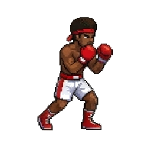

# Immortal Combat

Immortal Combat is a focused libGDX desktop demo for a fighting-game character controller. It
shows one animated fighter, tracks exactly one action at a time, and provides responsive keyboard
and mouse controls for movement, defense, jumping, and attacks.

<p align="center">
  
</p>

This repository contains the first playable slice of the project: the player character and its
animation state machine. Opponents, health, and full combat rules are intentionally outside this
demo's scope.

## Features

- Eight animated actions: idle, forward, backward, crouch, block, jump, punch, and kick
- Deterministic action priority with non-interruptible jump and attack animations
- Attack audio feedback for punches and kicks
- A pure-Java controller that can be tested without starting a graphics context
- A self-contained desktop JAR with its assets and native libraries included

## Controls

| Input | Action |
|---|---|
| `A` | Move backward while held |
| `D` | Move forward while held |
| `S` | Crouch while held |
| `Space` | Block while held |
| `W` | Jump once |
| Left mouse button | Punch once |
| Right mouse button | Kick once |
| `Esc` | Exit |

## Requirements

- JDK 17 or JDK 21 to run the Gradle build (JDK 21 is recommended and used in CI)
- Windows, macOS, or Linux with desktop OpenGL support

The source and generated bytecode target Java 8 for compatibility with the original game
requirements.

## Run locally

On Windows:

```powershell
.\gradlew.bat lwjgl3:run
```

On macOS or Linux:

```bash
./gradlew lwjgl3:run
```

The game opens in a fixed 1280x720 window. Gradle downloads libGDX and the desktop backend on the
first run.

## Build and test

```bash
./gradlew clean build
```

The build runs controller and asset validation tests, creates the application distribution, and
packages a runnable fat JAR at:

```text
lwjgl3/build/libs/ImmortalCombat.jar
```

Run the packaged game with:

```bash
java -jar lwjgl3/build/libs/ImmortalCombat.jar
```

## Project structure

```text
assets/       Animation frames and attack audio
core/         Game screen, rendering, input, and testable player state machine
lwjgl3/       Desktop launcher and packaging configuration
.github/      Continuous integration workflow
```

`PlayerController` owns action timing and state transitions without depending on libGDX.
`GameScreen` translates real input into controller events and handles rendering, audio, and resource
lifecycle. Keeping those responsibilities separate makes the gameplay rules fast to test and the
desktop layer easy to replace or extend.

## Contributing

See [CONTRIBUTING.md](CONTRIBUTING.md) for the local verification steps and pull-request checklist.

## License

This project is available under the [MIT License](LICENSE).
