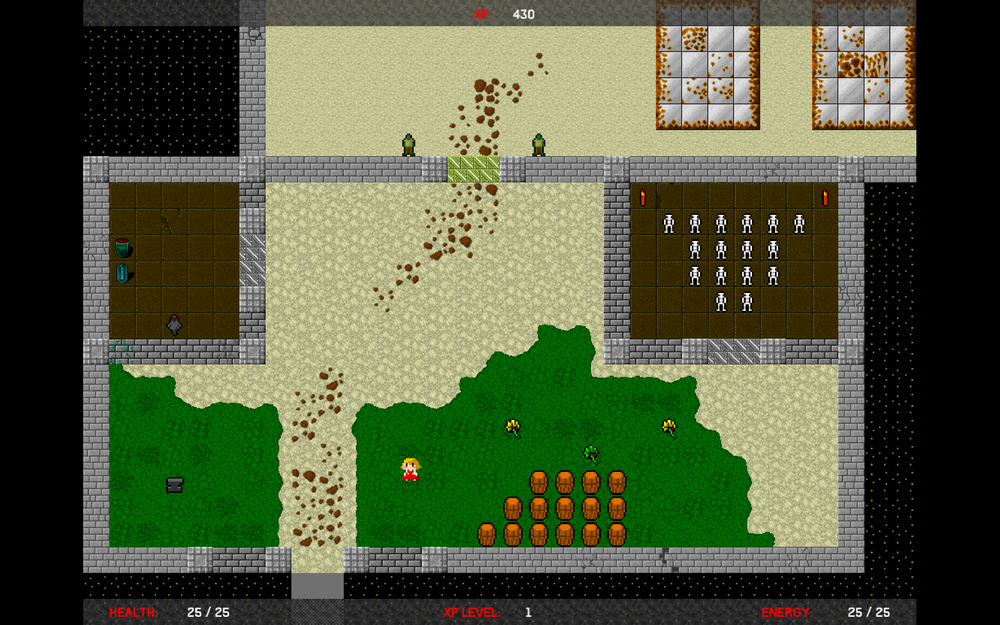

# Mildred

Top-down 2D action game made with Java and libGDX. 🕹️

 

I developed this over six months while learning Java. It's a fully complete game with multiple levels, enemies, UI, music, save/load functionality, and even a custom level loader.

You play as Mildred, a girl who can shoot ever increasingly powerful balls of energy. The goal is to escape the facility she's been kept in and gain her freedom.

The game was weirdly greenlit on Steam back when that was a thing but needed loads more refinement before even thinking of a retail release. While the core gameplay is intact, it could really benefit from some balancing tweaks, particularly in enemy difficulty and item placement.

 

 

**Preview:** https://www.youtube.com/watch?v=BhGF0GFfGDI

**Download:** https://github.com/hexensemble/mildred/releases

 

Runs on Mac, Linux, and Windows.
