# 개발 일지 — 게임 및 혼합현실 중간 프로젝트

레포트·발표 자료용 기록. 결정한 것, 그 이유, 확인한 방법을 날짜순으로 남긴다.
계획과 일정은 [PLAN.md](../PLAN.md), 실행 방법과 에셋 출처는 [README.md](../README.md).

- 과제: LibGDX 2D 플랫포머 (레벨 3개 15%, 카메라 10%, 독창 요소 3개 40%, 일시정지 5%, 구현 수준 20%, 게임 디자인 10%)
- 제출: 11/9 LMS (발표자료, 깃허브 링크, 레포트, 유튜브 시연영상) / 발표·데모: 11/10

---

## 1. 게임 개요

**장르:** 2D 런앤건 플랫포머 (메탈슬러그 계열)
**스토리:** 달 연구기지에서 연구하던 주인공이 갑자기 들이닥친 괴물을 피해, 지구로 돌아갈 탈출포드까지 가는 여정.

| 스테이지 | 장소 | 중력 | 설정상 이유 |
|---|---|---|---|
| 1 | 연구동 | 1.0G | 기지 인공중력 정상 작동 |
| 2 | 붕괴 구역 | 0.58G = (1G + 달)/2 | 인공중력 고장 중 |
| 3 | 달 표면 → 탈출포드 | 0.16G | 기지 밖, 달 중력 그대로 |

### 독창 요소 3개 (코드 구현)
1. **중력 연동 반동 무기** — 권총(반동 작음, 데미지 약함) / 샷건(반동 큼, 펠릿 5발). 반동은 조준 반대 방향의 고정 충격량이라, 같은 샷건이라도 중력이 약할수록 높이 뜬다 (높이 = v²/2g). 앉으면 반동 50%.
2. **산소 = 체력 + 누출** — 피격 시 산소 감소 + 우주복 누출 단계 증가, 누출은 진공에서만 산소를 뺌. 산소 스테이션에서 충전·수리.
3. **감압 창문** — 창문 내구도를 맞은 탄 수만큼 깎음. 권총(1발)으로는 잘 안 깨지고 샷건(5발)은 2발에 깨짐 → 깨지면 흡입력 발생.

### 조작 (서든어택 방식)
A/D 이동 · W·Space 점프 · S 앉기 · 마우스 조준 · 좌클릭 사격 · R 재장전 · 1/2/Q 무기 전환 · ESC 일시정지 · Enter 재시작 · F12 스크린샷 · F1·N 다음 스테이지로 건너뛰기(테스트용)

---

## 2. 기획 과정 (왜 이 게임인가)

### 2-1. 첫 컨셉: REWIND (시간 조작) → 폐기
- 처음에는 되감기·고스트 리플레이·시간 구역을 독창 요소로 하는 퍼즐 플랫포머를 기획했다.
- 하고 싶은 게임이 **총 쏘는 2D 게임(메탈슬러그류)**이라서 방향을 바꿨다.

### 2-2. 런앤건 컨셉 검토 (냉정한 평가)
- 강의 로직(중력, `Rectangle` 충돌, 재시작)으로 이동·총알·적·재시작을 모두 만들 수 있어 **구현 가능성은 높음**. 강의에 없는 것은 스프라이트 애니메이션(`Animation<TextureRegion>`)과 마우스 좌표 변환(`viewport.unproject`) 정도.
- 처음 아이디어(스테이지마다 중력 상수만 다름, 산소 게이지)는 **독창 요소로 약함**: 상수 하나 바꾸는 것은 "레벨 차이"로 보일 위험, 산소 게이지는 흔한 장치. → 중력이 **전투(반동)**에 영향을 주도록, 산소를 **체력 겸 자원**으로, 세 번째 요소로 **감압 창문**을 추가.
- 세 요소가 모두 "무기 선택"으로 이어지도록 정리: 샷건은 이동기(반동 점프)이자 창문을 깨는 위험 요소.

### 2-3. 비슷한 게임 조사 (레포트 "참고한 게임" 절)
| 요소 | 비슷한 게임 | 우리 게임의 차이 |
|---|---|---|
| 샷건 반동 이동 | Out Recoiled, Shotbun, Recoil Mania, Kickback, Sacre Bleu, Shotgun Cop Man | 같은 반동이 **스테이지 중력에 따라** 다른 결과, 앉으면 반동 감소 |
| 달 기지 탈출 + 산소 | MoonLess, Lunar Escape(itch.io) | 산소가 체력 겸용, 피격 시 누출, 진공에서만 소모 / 중력이 단계적으로 약해지는 설정 |
| 감압 | Evacuation (2009 플래시 퍼즐) | 2D 슈팅에서 **무기(펠릿 수)에 따라 창문 파괴 속도**가 달라짐 |
| 세 요소의 조합 | 찾지 못함 | 무기 하나의 선택이 이동·전투·환경 위험에 모두 영향 |

---

## 3. 강의 로직 사용처 (배점 "요구사항 충족"의 근거)

| 강의 내용 | 우리 코드 | 바꾼 점 |
|---|---|---|
| 12장 `moveX` → `moveY` 분리 충돌, 착지·머리 충돌, `grounded` 매 프레임 재계산 | `Body.moveX()`, `Body.moveY()` | 플레이어·적이 같은 `Body`를 공유하도록 클래스로 분리 |
| 12장 중력 `velocityY = max(velocityY - GRAVITY*dt, -900)` | `Body.applyGravity(gravity, dt)` | `GRAVITY` 상수 → 스테이지별 중력 값 (1G = 강의 값 1700) |
| 12장 `dt = min(delta, 1/30)` | `Main.render()` | 그대로 |
| 12장 키 입력 → 속도, `isKeyJustPressed` 점프 | `World.update()` | 키를 서든어택식(WASD)으로, 이동 속도 260 → 200 (플레이테스트) |
| 12장 `overlaps(flag)` 목표 판정 | `World.update()` 5단계 | 깃발 → 출구 |
| 과제2 낙사 복귀·Enter 재시작 | `World.reset()`, `Main.input()` | 위치뿐 아니라 탄약·총알·상태 전체 초기화 |
| 과제2 카메라 X축 추적 + `clamp` | `CameraManager.update()` | Y축 추적 추가, 순간이동 대신 부드럽게 따라감 |
| 10장 `CameraManager` 흔들림(감쇠 + 랜덤 오프셋) | `CameraManager.startShake()` | 연사 시 더 센 흔들림이 이기도록 변경. 샷건·권총 발사, 클리어 시 사용 |
| 10장 `GameState` + `endingCheck()` | `Main.endingCheck()` | PLAYING / PAUSED / CLEARED, ESC 일시정지 |
| 10장 "World는 로직, CameraManager는 연출, delta는 Main" | `Main` / `World` / `CameraManager` 분리 | 그대로 따름 |

### 강의에 없는 구현 (배점 "구현 수준 20%")
- 마우스 360° 조준: `viewport.unproject()`로 화면 좌표 → 월드 좌표
- 반동 물리: 위로 미는 반동은 `max(vy, kick)`로 처리해 연사로 무한 상승하지 않고, 도달 높이가 항상 v²/2g
- 반동 수평 성분은 별도 속도(`kickX`)로 두고 마찰로 감쇠 (땅 10/s, 공중 1.5/s) — 강의 방식(매 프레임 `velocityX`를 입력으로 덮어씀)과 공존시키기 위함
- 앉기: 히트박스 축소 + 머리 위가 막히면 못 일어남 (`overlaps()` 재사용)
- 스프라이트 애니메이션, 패럴랙스 배경, 타일 잘라 그리기, 별 무작위 배치
- `Art` 클래스: 모든 그림 설정을 한 파일로 모음 (프레임 수 자동 인식)

---

## 4. 검증

### 4-1. 반동 높이 (`core/src/test/java/io/jbnu/game/RecoilHeightCheck.java`)
실제 `Body` 이동 코드로 1/60초 스텝 시뮬레이션. 기대값 v²/2g와 8% 이내면 통과 → **통과**.

| 반동 높이 (월드 단위) | 1.0G | 0.58G | 0.16G |
|---|---|---|---|
| 샷건 (v=500) | 69.4 | 122.6 | 455.4 |
| 권총 (v=80) | 1.3 | — | 11.1 |

이론값보다 3~5 낮은 이유: 강의에서 설명한 대로 점프 첫 프레임에도 중력이 먼저 적용되기 때문.

### 4-2. 맵 설계 수치 (1스테이지)
- ④ 벽 높이 160: 1G 점프(약 119)로는 못 넘고, 점프 + 샷건 반동(약 69 → 합 약 188)으로 넘는다.
- ⑤ 낮은 통로 틈 52: 서 있으면(높이 60) 막히고, 앉으면(44) 통과.
- ③ 구덩이 112: 1G 점프 체공 약 0.76초 × 이동 200 = 약 153까지 건널 수 있음.

### 4-3. 화면 확인
`-Dautoshot`으로 세 분위기를 자동 캡처해 확인. 처음 캡처에서 발견해 고친 문제:
- 깃발이 검은색이라 어두운 배경에 묻힘 → 흰 실루엣으로 바꾼 뒤 색 입힘 (`Art.whiteSilhouette`)
- 달 배경: 별 타일 반복 무늬 → 무작위 배치 / 크레이터 레이어가 산을 가림 → 먼 레이어를 위로 / 별 타일의 불투명 바탕 → 하늘색을 타일 바탕색과 일치

| 1 연구동 | 2 붕괴 구역 | 3 달 표면 |
|---|---|---|
|  |  |  |

---

## 4-4. 버전별 변화 (레포트용 스크린샷)

git 태그로 각 단계를 남겼다. **v0.1과 v0.2는 git 저장소를 만들기 전 단계라, 이 일지를 바탕으로 나중에 재현한 버전이다** (`snapshot/*` 브랜치). 스크린샷은 `docs/images/history/`.

| 태그 | 단계 | 주요 내용 | 스크린샷 |
|---|---|---|---|
| `v0.1-prototype` | 강의 로직 이식 + 무기 프로토타입 | 강의 Project2 이미지·블록 배치, 반동 테스트 탑(발판 220/360/1060), 마우스 방향 회전 막대 총, 이동 260 | 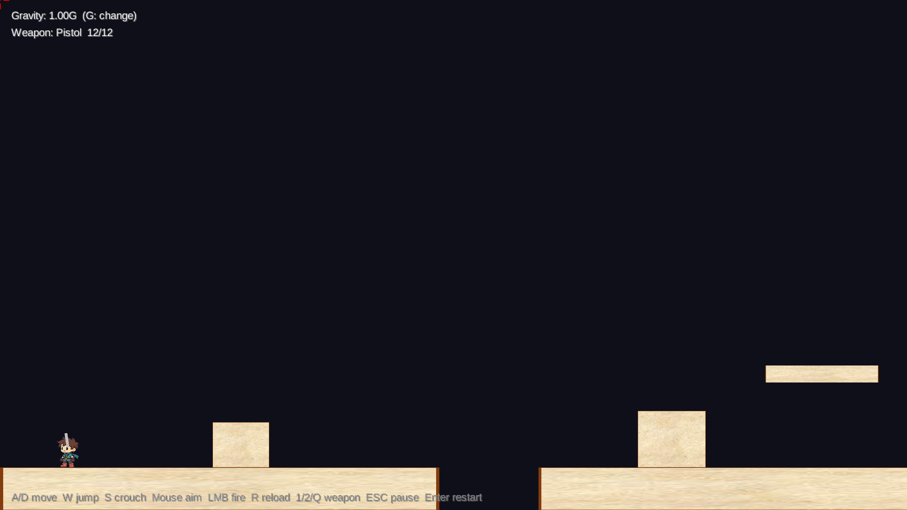  |
| `v0.2-sprites` | 첫 CC0 스프라이트 | drakzlin 병사 애니메이션, Eris 타일, 도시 배경, 이동 200 / 문제: 깃발이 검어 안 보임, 도시 배경이 설정과 안 맞음 |  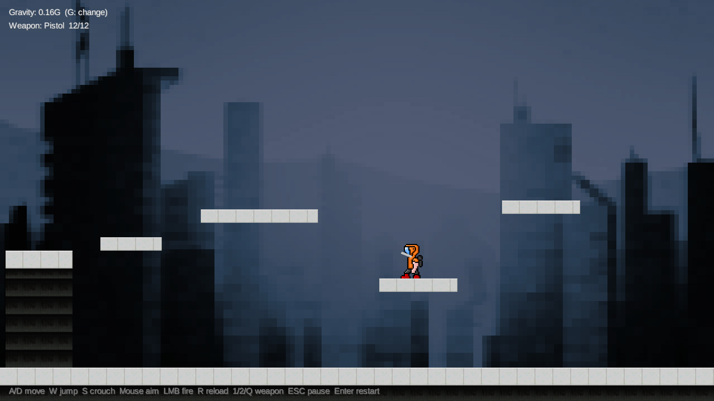 |
| `v0.3-first-commit` | 1스테이지 맵 + 스테이지별 분위기 | 튜토리얼식 연구동 맵, Foozle 타일 + ansimuz 배경 + Lunar 달 표면, 깃발 수정, F12 스크린샷 | 4-3의 세 장 |
| (작업 중) `feat/crawler-enemy` | 적·피격 | 스페이스 마린(총 든 모션), 크롤러 외계인, 피격·피 효과, 산소 게이지 |  |

### 예전 버전 실행하기
지금 작업 폴더를 건드리지 않고, 옆 폴더에 예전 버전을 꺼내서 실행한다.

```bash
git worktree add ../v0.1 v0.1-prototype
```

```bash
cd ../v0.1 && ./gradlew lwjgl3:run
```

다 보면 지운다 (브랜치와 태그는 남는다).

```bash
git worktree remove ../v0.1
```

---

## 5. 에셋 선정 (모두 CC0 — 깃허브 공개·포트폴리오 사용 가능)

교수님 안내: "과제에서는 다른 게임 스프라이트를 써도 되지만, 깃이나 포트폴리오에 올릴 땐 조심할 것" → 제출에 깃허브 링크가 포함되므로 **처음부터 재배포 가능한 CC0 에셋만** 사용.

| 용도 | 에셋 | 고른 이유 / 뺀 후보 |
|---|---|---|
| 주인공(초기) | Space soldier 32x32 (drakzlin) | 앉기 포함 애니메이션 / 유료 Pixxiland 병사는 재배포 금지라 제외 |
| 주인공(현재) | ansimuz 스페이스 마린 | 주황 우주복 + **소총을 든 채** 대기·달리기·점프·사격(총구 화염)·사망. 달 탈출 우주인 설정과 맞음 |
| 크롤러 | ansimuz 걷는 외계인 | 같은 작가라 마린과 그림체 일치, 걷기·대기 애니메이션 |
| 지형 | Foozle Sci-fi Lab Tileset | 연구소 분위기 32px 타일 |
| 실내 배경 | ansimuz Sideview Sci-Fi Collection | 실내 장면 여러 개 → 1·2스테이지를 다르게 |
| 달 표면 | Lunar Battle Pack (Matt Walkden) | CC0 중 유일한 횡스크롤 달 지평선 레이어 / drakzlin moon background는 탑뷰라 제외 |
| 제외 | Space Station Pixel Art Backgrounds | 유료, 라이선스 미표기 |
| 제외 | Spaceship Interior, Server Room | 사진·3D 렌더 풍이라 픽셀아트와 안 맞음 |

"구멍 난 기지" 이미지는 CC0에서 찾지 못함 → 감압 창문 구현 시 실내 배경 위에 별 배경을 합성해서 표현할 계획.

---

## 6. 날짜별 진행

### 10/20 (화)
- 과제 PPT·강의자료(10장 Camera Dynamics, 12장 Platformer Final, Project2 코드) 분석
- 컨셉 결정: REWIND → 런앤건, 독창 요소 3개 확정, 조작 방식 확정, 비슷한 게임 조사
- 프로젝트 생성 (강의 Project2의 Gradle 구성 재사용, 패키지 `io.jbnu.game`)
- 강의 로직 이식 + 구조 분리 (`Main` / `World` / `Body` / `CameraManager` / `Weapon`)
- 마우스 조준, 권총·샷건, 반동, 재장전, 앉기, 일시정지, 재시작, 카메라 흔들림
- 반동 높이 검증 코드 작성·통과
- 플레이테스트 피드백: 조작감 괜찮음, 이동이 빠름 → 260 → 200
- 1스테이지 맵 재설계 (튜토리얼식: 점프 → 계단 → 구덩이 → 샷건 벽 → 앉기 통로 → 출구)
- CC0 에셋 적용, 스테이지별 배경·지형 3종, F12 스크린샷

### 10/20 (화) — 이어서
- git 저장소 생성, 첫 커밋 (main), 이후 작업은 `feat/crawler-enemy` 브랜치
- **크롤러 적**: 순찰(벽·발판 끝에서 돌아섬) → 같은 높이 앞쪽 320 이내에 플레이어가 보이면 돌진(속도 60 → 190). 돌진 중에는 멈추지 않아 구덩이에 빠질 수 있음. 체력 3, 맞으면 빨갛게 번쩍이며 밀려남. 플레이어와 같은 `Body`(강의 충돌 로직)를 써서 중력·낙사도 똑같이 적용.
- **피격**: 적과 닿으면 산소 −20, 적 반대쪽으로 튕겨남, 1초 무적(깜빡임), 카메라 흔들림. 산소 0 → 사망 모션 1.5초 → 재시작. HUD에 산소 게이지(30% 미만 빨강).
- **피 효과**: 맞을 때마다 피 방울 파티클(플레이어 빨강, 외계인 녹황색). 방울도 **스테이지 중력**을 받아 달에서는 천천히 흩날리고, 블록에 닿으면 그 자리에 자국으로 남았다가 사라짐.
- **총 든 모션**: 처음 쓰던 병사 스프라이트는 소총 든 프레임이 정면 고정이라 360° 조준과 맞지 않았음 → 같은 CC0 팩의 **스페이스 마린**으로 교체. 항상 소총을 든 모습이고, 쏠 때 총구 화염 모션이 나옴. 회전하는 막대 총은 제거.
- 검증: `EnemyCheck` 4항목 통과 (발판 끝에서 돌아섬 / 돌진 / 돌진 중 구덩이 낙하 / 3발에 사망). 처음엔 ③이 실패했는데, 코드가 아니라 테스트 조건 문제(플레이어를 구덩이 앞에 둬서 적이 지나치는 순간 돌진이 풀림)였고 플레이어를 건너편에 두도록 고침.

### 10/20 (화) — 2주차 작업 앞당김 (`feat/oxygen-decompression`)
- **산소 소모 규칙** (`World.oxygenDrain`)

  | 위치 | 초당 소모 |
  |---|---|
  | 기지 안 (1G·0.58G, 창문 멀쩡) | 0 (누출이 있어도 안 줄어듦) |
  | 달 표면 (0.16G) | 2 + 누출 단계 × 3 |
  | 창문이 깨진 방 | 8 + 누출 단계 × 3 |

- **누출**: 적과 닿을 때마다 누출 단계 +1 (최대 3). HUD에 `SUIT LEAK x단계`.
- **산소 스테이션**: 서 있으면 초당 40 충전 + 누출 0으로 수리. 1스테이지에 2개 (샷건 벽 앞, 앉기 통로 뒤).
- **붉은 화면**: 산소 30% 미만에서 화면 가장자리가 맥박치듯 붉어짐. 산소가 적을수록 진함.
- **감압 창문** (`Window`): 내구도 10, 맞은 탄 1발당 1 감소 → 무기별 예외 처리 없이 펠릿 수만으로 "권총 10발 / 샷건 2발" 차이가 생김. 균열 3단계 표시. 깨지면:
  - 방 전체가 진공 → 산소 소모 시작
  - 창문 쪽으로 흡입 가속도 900 (앉으면 절반 → 앉기에 "버티기" 의미 추가)
  - 외계인은 버티지 못하고 끌려가 창문으로 빨려 나감
  - 깨진 창 안쪽에 달 표면 배경의 별 타일을 합성 → CC0에서 못 찾은 "구멍 난 기지" 그림을 코드로 해결
  - 유리 파편 파티클, 카메라 강한 흔들림
- **총알 관통 문제 수정**: 총알 이동을 한 번에 8px 이하로 나눠 충돌 검사 (한 프레임 최대 약 47px 이동 → 24px 발판·창문을 뚫던 문제)
- 검증: `OxygenWindowCheck` 통과 (소모량 4가지, 권총 10발/샷건 2발, 균열 단계). 기존 `EnemyCheck`, `RecoilHeightCheck`도 통과.
- 화면 확인: 자동 스크린샷에 창문 3단계·산소 부족 장면 추가. 처음 캡처에서 붉은 테두리가 거의 안 보여(투명도 최대 7%) 진하게 수정 (최대 45%).

| 창문 멀쩡 | 균열 | 깨짐 (별 합성, 외계인 흡입) | 산소 부족 |
|---|---|---|---|
|  | 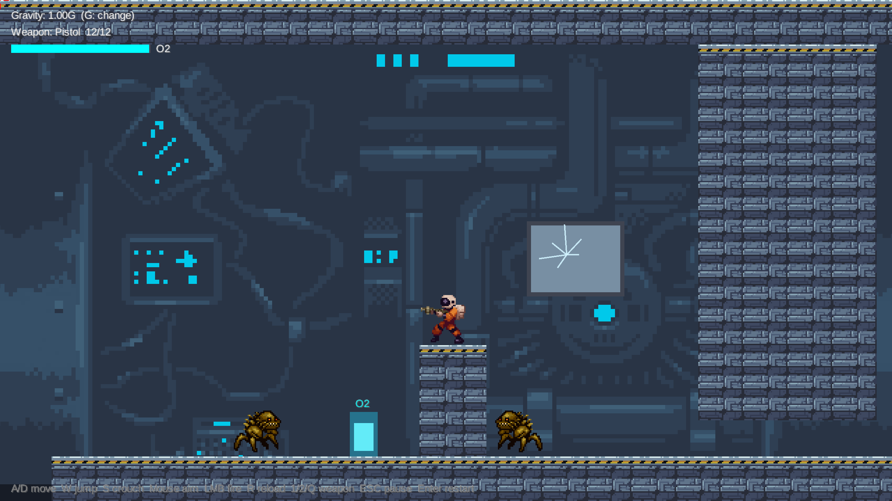 | 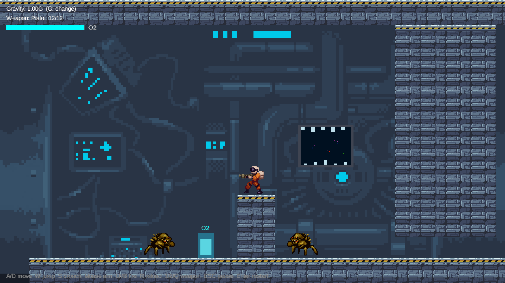 | 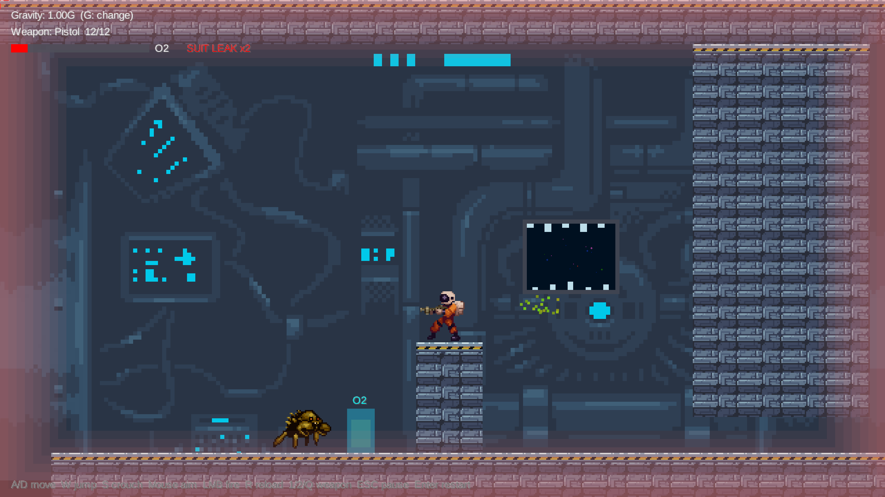 |

### 10/20 (화) — 플레이테스트 피드백 반영 (`feat/aim-arms-map`)
피드백: ① 창문이 하나뿐 ② 무기를 바꿔도 캐릭터 그림은 그대로 ③ 조준점은 움직이는데 팔은 가만히 있음 ④ 맵이 너무 단순함

- **②③ 팔·총 분리 회전**: 마린 스프라이트는 총이 몸에 그려져 있어서, 불러올 때 코드로 나눔
  - 대기 프레임을 픽셀 단위로 분석해 어깨 앞쪽 띠(8행: 팔뚝·장갑·소총)의 위치를 찾음
  - 대기·달리기·점프 프레임마다 헬멧 꼭대기 픽셀로 흔들림(위아래 0~2px)을 맞춰 그 띠를 지움 → 팔 없는 몸
  - 대기 프레임에서 띠를 오려 "팔+총" 조각을 만듦: 샷건 = 소총 전체(19px), 권총 = 총신을 자른 것(13px)
  - 어깨를 축으로 조준 각도만큼 회전해 그림. 왼쪽을 볼 땐 위아래를 뒤집어 총이 거꾸로 서지 않게 함
  - 총알도 같은 어깨·각도·총 길이에서 나감 → 그림과 총알 방향이 일치. 쏠 때 총구 화염
  - 원래 쓰던 "사격 모션"(소총이 그려진 프레임)은 회전 팔과 겹쳐서 제거
- **①④ 맵 재설계**: 4800 × 820, 창문 3개, 산소 스테이션 3개, 크롤러 7마리 (→ 피드백 2에서 720 높이, 16마리로 조정)
  - A 시작 연구실 → B 계단 실험실(창문) → 위층 통로(구덩이 위) / 아래 길(구덩이 점프) 갈림 → D 샷건 벽 → E 창문 방 → F 앉기 통로 → G 계단 → 위쪽 통로(안전) / 아래쪽 방(창문 + 적 2) 갈림 → H 출구
  - 처음 재설계 때 천장을 1016으로 높였더니 위쪽 절반이 비어 보여서 756으로 낮추고 위층 통로를 추가
- 검증: 기존 검사 3개 통과, 자동 스크린샷에 조준 고정 장면(권총 오른쪽 / 샷건 위 / 샷건 왼쪽 아래)과 맵 전체 장면 추가

| 권총, 오른쪽 | 샷건, 위 | 샷건, 왼쪽 아래 |
|---|---|---|
|  | 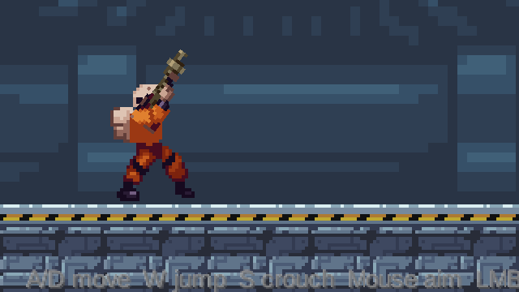 |  |

### 10/20 (화) — 플레이테스트 피드백 2
피드백: ① 팔을 위아래로 돌리면 원래 팔 아랫부분 픽셀이 몸에 남음 ② 맵 세로가 너무 넓음 ③ 적이 너무 적음 ④ 창문이 적과 떨어져 있어 의미가 약함

- **① 원인**: 몸 앞쪽 팔(주황 소매)은 어깨(x 8~9)에서 시작해 손까지 이어지는데, x 15부터만 잘라 소매 아랫부분이 몸에 남았음
  → 팔 조각을 어깨(x 8)부터 오리고, 회전축도 진짜 어깨(x 9, 위에서 21.5)로 옮김. 팔이 빠진 몸통 자리는 원래 윤곽 안쪽만 몸통 색으로 메워 구멍이 안 생기게 함
  → 달리기 프레임은 몸이 2px 낮아 팔이 떠 보일 수 있어, 프레임마다 기록한 어깨 위치에 팔을 붙임
- **② 맵 높이** 820 → 720 (천장 656). 화면 높이와 같아 카메라는 가로로만 움직임
- **③ 적** 7 → 16마리. 바닥뿐 아니라 선반·계단·위층 통로·위쪽 통로 위에도 배치
- **④ 창문 위치**: 3개 모두 적이 다니는 바닥 높이(y 80~176)로 내리고 적 무리 바로 뒤에 둠
  → 적을 향해 쏘다 빗나간 탄·샷건 펠릿이 창문을 깸. 샷건으로 쓸어버릴지, 권총으로 조심히 쏠지 고르게 됨
  → 깨지면 창문 앞 적이 바로 빨려 나감. 높은 창문용으로 넣었던 "적을 위로 띄우는" 처리는 필요 없어져 제거

| 팔 위 (자국 없음) | 팔 왼쪽 아래 | 창문 깨진 직후 (적 흡입) |
|---|---|---|
|  |  | 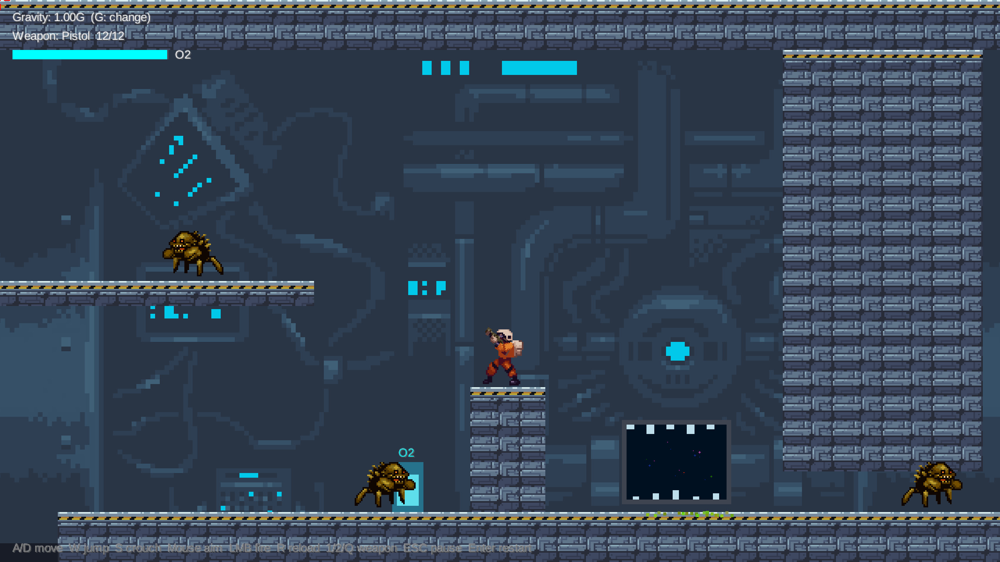 |

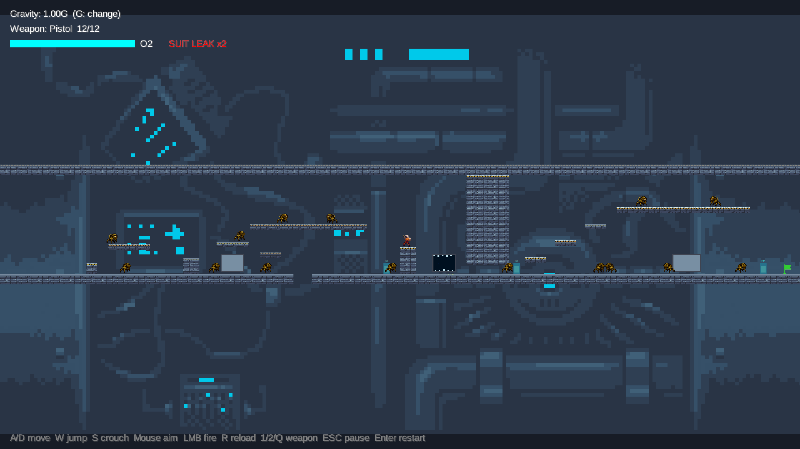

### 10/20 (화) — 스테이지 분리, 2·3스테이지, 전환·전체 클리어 (`feat/stages`)
- **구조**: 맵 데이터를 `Stage` 클래스로 분리 (크기, 중력, 배경, 진공 여부, 블록, 창문, 적, 스테이션, 시작점, 출구). `World`는 지금 스테이지를 읽어 만들고, 죽으면 같은 스테이지를 처음부터 다시 만든다. 카메라와 적은 맵 크기를 인자로 받는다.
- **스테이지 설계**: 높이·거리를 그 스테이지 중력의 점프 수치에 맞춤

  | | 1 연구동 | 2 붕괴 구역 | 3 달 표면 |
  |---|---|---|---|
  | 중력 | 1.0G | 0.58G | 0.16G |
  | 점프 / 점프+샷건 | 119 / 188 | 214 / 336 → 165 / 288 | 776 / 1230 → 257 / 712 (아래 피드백 3) |
  | 맵 | 4800 × 720 | 4800 × 720 | 4800 × 1600 (카메라 세로 추적) |
  | 산소 | 창문 깨진 방만 | 창문 깨진 방만 (처음부터 깨진 복도 있음) | 전체 진공, 스테이션 5개 |
  | 핵심 장애물 | 샷건 벽(160), 앉기 통로, 갈림길 | 구덩이, 감압 복도 끝 칸막이(→ 피드백 4에서 앉아서 기어 통과로), 수직 통로 | 크레이터, 고원(샷건 필요), 계단식 메사 |
  | 적 / 창문 | 16 / 3 | 12 / 2 | 9 / 0 |

  - 3스테이지 설계 중 고원 앞에 중간 발판을 넣었다가, 점프만으로 올라가져 "샷건으로 날아오르기"가 필요 없어지는 것을 발견해 제거
- **스테이지 전환**: 출구에 닿으면 STAGE CLEAR 화면(다음 스테이지 이름·중력) → Enter로 다음 스테이지. 마지막 탈출포드에 닿으면 MISSION COMPLETE(플레이 시간, 사망 횟수) → Enter로 1스테이지부터 다시 (과제 요구사항 "모든 레벨 클리어를 명확히 알 수 있고, 처음부터 재시작 가능")
- **시작 배너**: 스테이지 이름과 그 스테이지의 규칙 한 줄을 2.5초 표시
- **조작 변경**: 테스트용 G(중력 전환)를 없애고 N(이 스테이지 바로 클리어)으로 바꿈. Enter는 플레이 중 = 지금 스테이지 재시작
- 검증: 기존 검사 3개 통과, 자동 스크린샷에 스테이지별 시작·맵 전체·클리어 화면 추가

| 1 연구동 | 2 붕괴 구역 | 3 달 표면 |
|---|---|---|
| 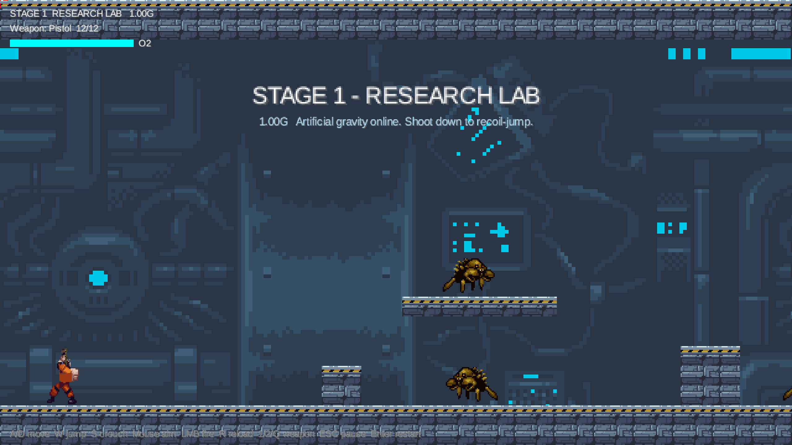 | 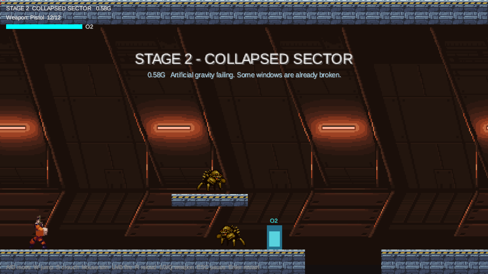 | 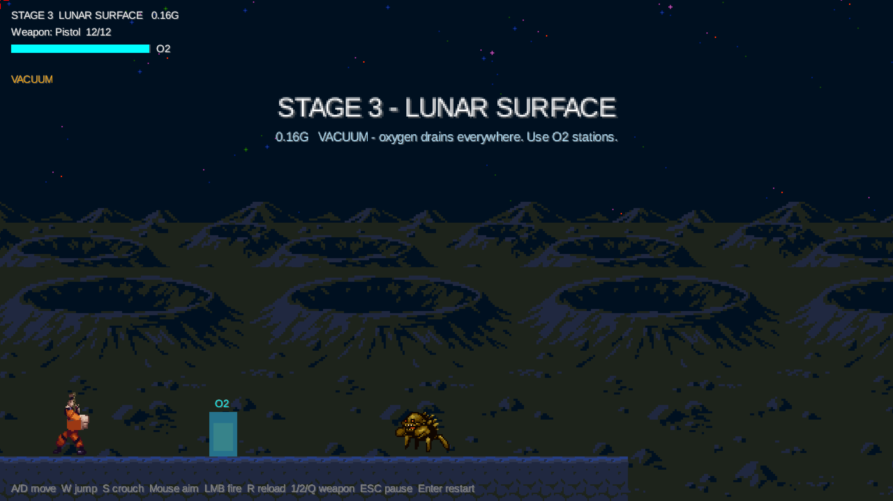 |
| 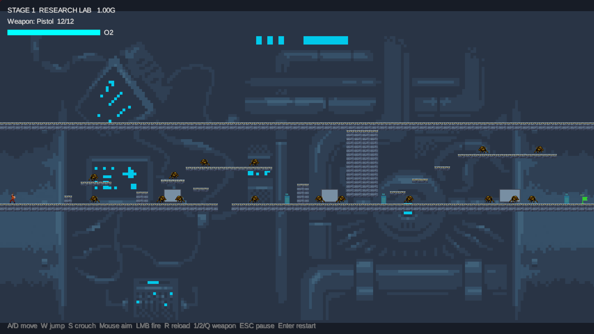 | 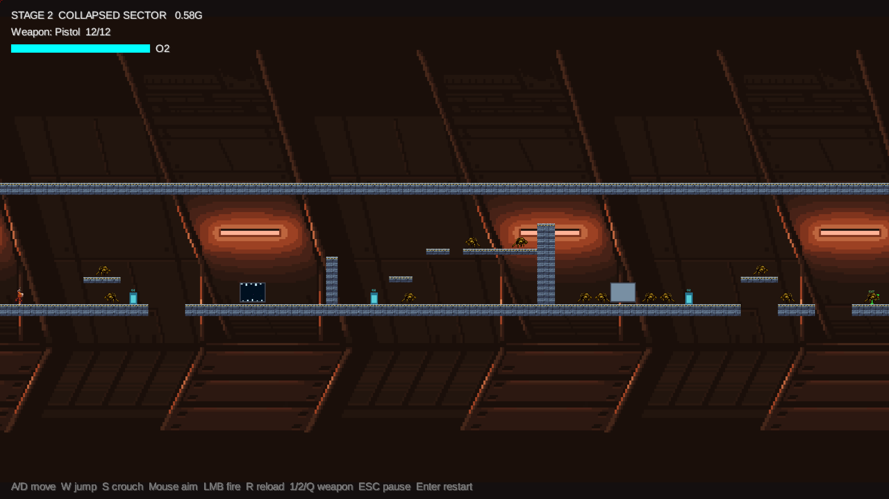 | 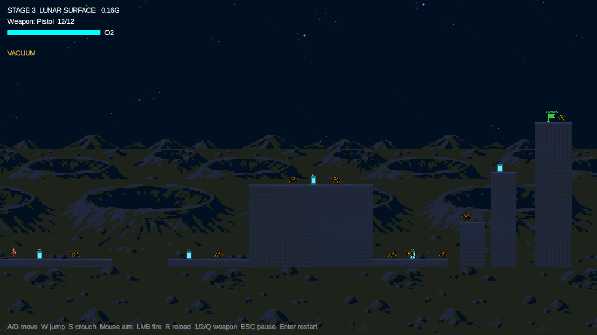 |

| 스테이지 클리어 | 전체 클리어 |
|---|---|
| 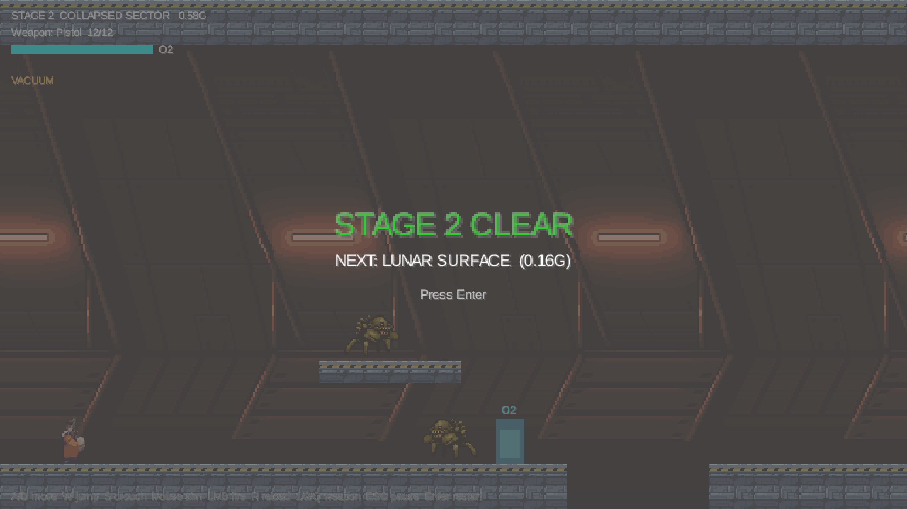 | 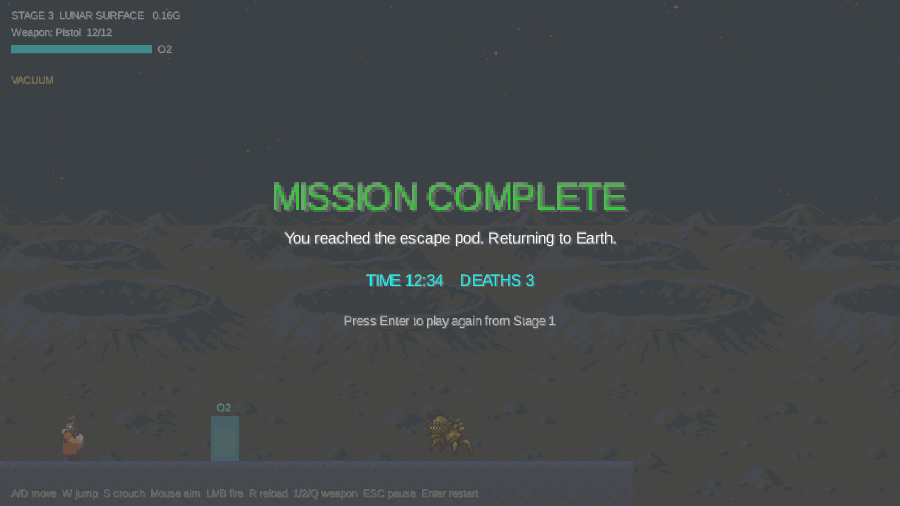 |

### 10/20 (화) — 플레이테스트 피드백 3
피드백: ① 달 표면에서 점프가 너무 높아 화면 위 끝까지 감 ② 시작하면 조작·사격 방법을 화면 가운데에 보여 줄 것 ③ 아무 키나 눌러 시작

- **① 원인**: 점프 속도(650)가 모든 스테이지에서 같아서 높이가 중력에 반비례 (h = v²/2g) → 0.16G에서 약 776
  → 스테이지마다 **점프 높이**를 정하고 속도를 역산 (v = √(2gh)): 1G 124(기존과 같음) / 0.58G 170 / 0.16G 260
  → 샷건 반동은 그대로 물리식이라, 중력이 약할수록 "반동 점프"의 비중이 커짐 (달: 점프 257, 점프+샷건 712)
  → 바뀐 점프에 맞춰 2·3스테이지 지형 재조정: 2스테이지 구덩이 240→200, 칸막이 300→256, 수직 통로 200→150씩 / 3스테이지 크레이터 500→450, 고원 높이 900→600
  → **`StageCheck` 추가**: 실제 `Body` 코드로 스테이지별 점프·점프+샷건 높이를 재서, 샷건이 필요한 장애물(1: 160 / 2: 256 / 3: 600·400·300)이 "점프로는 못 넘고 샷건으로는 넘는지" 확인 → 통과
- **②③ 시작 화면**: 제목, 줄거리 한 줄, 조작표, 사격 방법(마우스 조준, 반동 방향, 중력과 반동, 창문 주의)을 화면 가운데에 표시. 아무 키나 마우스 클릭으로 1스테이지 시작
  → 시작에 누른 키(W·클릭)가 그대로 점프·사격이 되지 않도록 시작 프레임은 게임 로직을 한 번 건너뜀

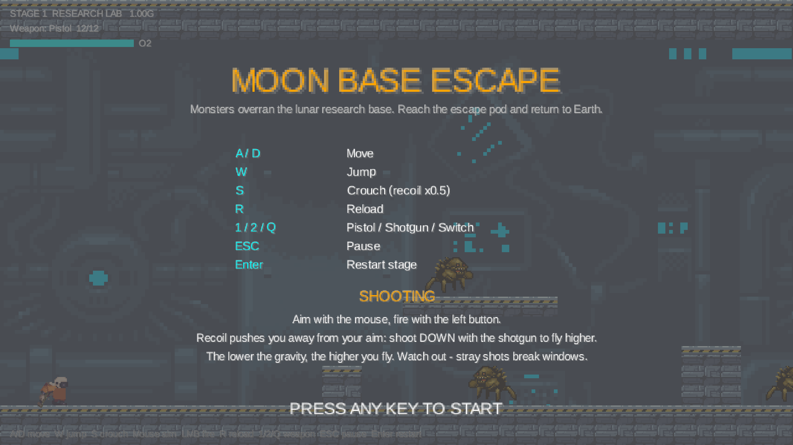

### 10/20 (화) — 한글화, 상태 표시 위치 (`feat/korean-hud`)
- **한글화**: LibGDX 기본 글꼴에는 한글이 없어 `gdx-freetype`(LibGDX 공식 확장)과 **갈무리11**(픽셀 한글 글꼴, SIL OFL 1.1) 추가. 글자는 처음 쓰일 때 만들어지므로(incremental) 문구를 바꿔도 따로 할 일이 없음
  - 갈무리11은 12px 기준이라 정확히 2배인 24px로 불러오고, 큰 글씨 배율도 1·1.5·2.5·3·3.5배로 맞춰 픽셀이 뭉개지지 않게 함
  - 시작 화면, 조작표, 스테이지 이름(연구동·붕괴 구역·달 표면), 배너, 클리어 화면, 일시정지, 상태 표시, 출구 표시를 모두 한글로
  - 한글 글꼴이 더 커서 큰 제목과 다음 줄이 겹치던 것을 줄 간격 조정으로 수정
- **상태 표시**: 산소 게이지·무기·누출·진공·충전 표시를 왼쪽 아래로 옮기고, 글자 길이만큼 반투명 바탕을 깔아 바닥 무늬 위에서도 읽히게 함. 스테이지 이름은 왼쪽 위에 그대로
  - 상태 표시와 캐릭터가 겹치지 않게 시작 위치를 x 80 → 400으로 옮김
- 하단 조작 안내 줄은 시작 화면과 겹쳐 제거하고, 대신 **일시정지(ESC) 화면에 조작표**를 보여 줌

| 시작 화면 | 3스테이지 시작 | 산소 부족 + 누출 |
|---|---|---|
| 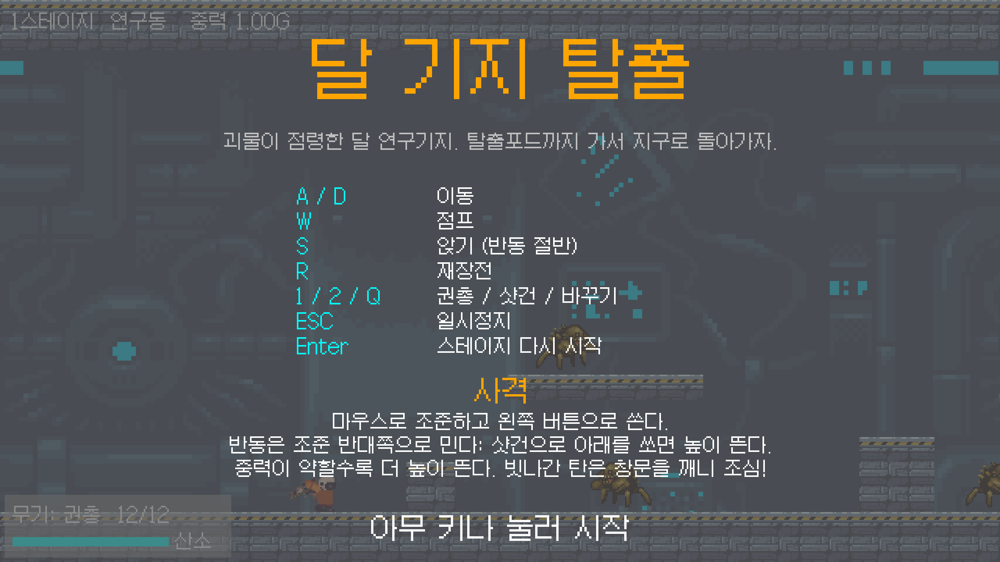 | 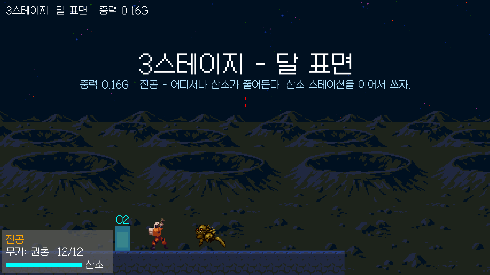 | 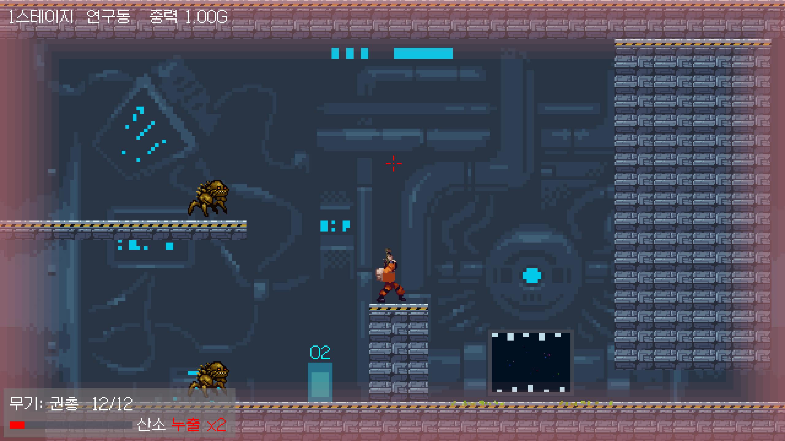 |

### 10/20 (화) — 드로퍼·스피터 (`feat/dropper-spitter`)
레벨마다 적 구성이 달라지도록 계획대로 단계적으로 등장: 1스테이지 크롤러 → 2스테이지 + 드로퍼 → 3스테이지 + 스피터

| 적 | 행동 | 중력과의 관계 | 그림 |
|---|---|---|---|
| 크롤러 | 순찰, 앞에 보이면 돌진, 체력 3 | 낙사 가능 | 걷는 외계인 |
| 드로퍼 | 천장에 거꾸로 매달려 있다가 플레이어가 바로 아래(수평 70 이내)로 오면 낙하 → 착지 후 크롤러처럼, 체력 2. 맞으면 바로 떨어짐. 매달린 동안은 감압 흡입에도 버팀 | 낙하 속도 = 스테이지 중력 | 걷는 외계인을 거꾸로 + 보라빛 |
| 스피터 | 공중에 떠서 위아래로 흔들리며, 사거리 650 안이면 2.2초마다 산성탄 발사, 체력 2 | **탄도를 스테이지 중력으로 계산** | 나는 외계인 (ansimuz) |

- **스피터 탄도** (`Enemy.lob`): 비행시간 T를 거리로 정하고 등가속도 운동 y = vy·T − ½gT² 를 vy에 대해 풀어 플레이어 위치에 떨어지게 쏨 → 같은 거리라도 달에서는 낮고 느린 큰 포물선
- **산성탄**: 중력을 받아 날아가고, 블록에 닿으면 튀며 사라지고, 플레이어에 닿으면 적과 닿은 것과 같은 피해(산소 −20, 누출 +1, 넉백)
- 배치: 2스테이지 천장 드로퍼 8 (감압 복도의 드로퍼는 떨어지면 깨진 창문으로 빨려 감), 3스테이지 스피터 6 (크레이터 위·고원 위·메사 근처)
- 검증: `EnemyCheck`에 ⑤ 드로퍼(매달림 → 낙하·착지), ⑥ 스피터 탄도(1G·0.58G·0.16G 모두 목표에서 6px 이내) 추가 → 통과
  - ⑤ 처음 실패 원인은 테스트의 기대값 오류(바닥 윗면 64인데 0으로 적음)
- 화면 확인: 자동 스크린샷에서 산성탄이 처음엔 안 보여 로그를 넣어 확인 → 산성탄은 정상 생성, 단지 찍는 시점보다 늦게 발사된 것. 기다리는 시간을 늘려 비행·명중 장면을 확인

| 드로퍼 (천장에 매달림) | 스피터 산성탄 비행 | 산성탄 명중 |
|---|---|---|
| 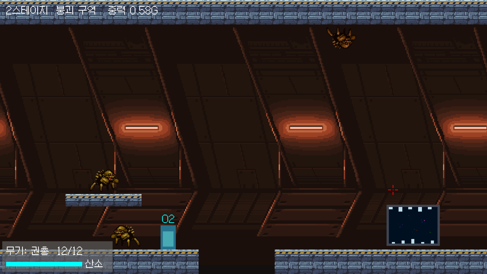 | 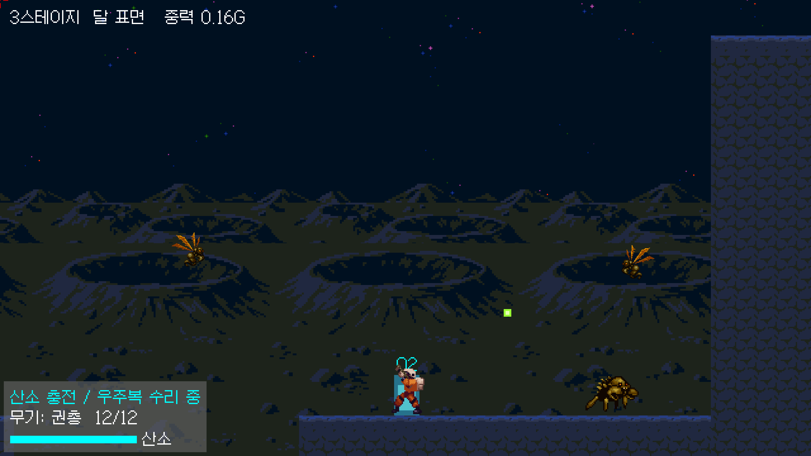 | 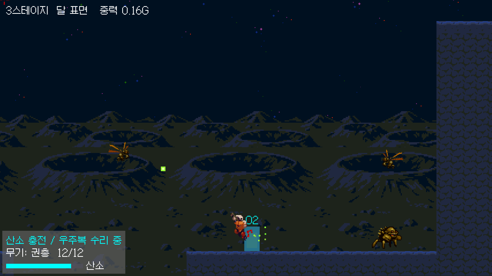 |

### 10/20 (화) — 플레이테스트 피드백 4: 2스테이지 감압 복도 (`fix/stage2-corridor`)
피드백: ① 처음부터 깨진 창문 복도가 어려움 ② 창문·드로퍼는 좋은데 그다음 칸막이를 못 넘음

- **원인**: 칸막이 높이(256)보다 **흡입력**이 문제. 흡입은 창문 쪽으로 계속 가속(900)하는데 공중에서는 감속(마찰 1.5/s)이 약해 끌려가는 속도가 최대 약 600까지 쌓임 → 칸막이 앞에서 점프·샷건을 쓰는 순간 창문 쪽으로 날아감
- **수정**
  - 칸막이를 **바닥과 52px 틈**이 있는 형태로 바꿈 → 앉아서(높이 44) 기어 나감. 앉으면 흡입도 절반이라 "앉아서 버티며 기어 나간다"는 연출이 됨
  - **흡입으로 끌려가는 속도에 상한** 120(앉으면 60). 걷기 200보다 낮아 흡입을 거슬러 나아갈 수 있음 (땅: 순 이동 약 110, 앉아서 약 55). 샷건 반동은 상한과 무관
  - 깨진 방 산소 소모 8 → 5/초 (복도를 지나는 약 8초 동안 64 → 40)
- 검증: `OxygenWindowCheck` 기대값 갱신(깨진 방 5, 누출 2단계 11), `StageCheck`에서 2스테이지 샷건 필수 장애물 제거 → 검사 4개 통과

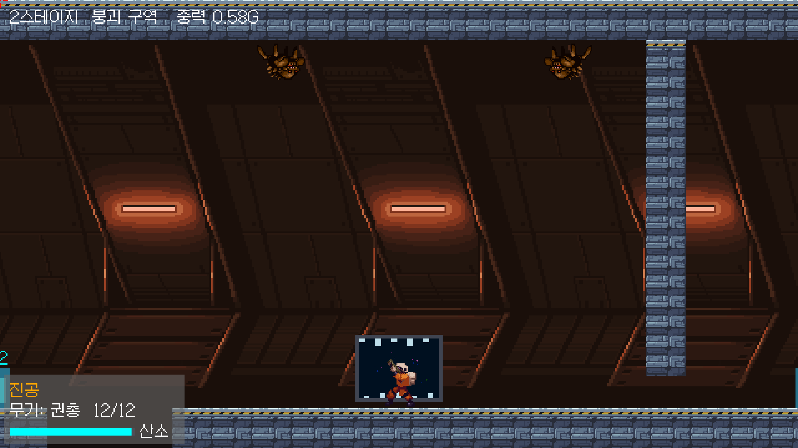

### 10/20 (화) — 출구 그림과 발사 연출 (`feat/exit-door-ship`)
- 출구 깃발(강의 예제 그림)을 교체: 1·2스테이지 = **엘리베이터**(다음 구역으로 이동), 3스테이지 = **탈출 우주선**. 둘 다 ansimuz 팩(CC0, 이미 보유)이라 주인공·외계인과 그림체가 같음. 후보로 OpenGameArt 열림 문(CC0), BeeMaxStudio 로켓 팩(CC0)도 검토
- **발사 연출** (`GameState.LAUNCH`): 우주선에 닿으면 탑승(플레이어 숨김) → 엔진 불꽃 애니메이션 + 덧그린 불꽃, 오른쪽 위로 등가속 상승(x = 60t + 140t², y = 250t²), 카메라가 우주선을 따라가며 진동, "발사!" 표시 → 3초 뒤 탈출 성공 화면
  - 원본 불꽃 프레임의 불꽃이 작아 사각형 3겹으로 덧그림. 처음엔 그림 왼쪽 여백 때문에 불꽃이 엔진과 떨어져 보여 위치를 맞춤
- 강의 예제 깃발 그림과 흰 실루엣 변환 코드 제거 → **강의 예제 에셋은 이제 하나도 안 씀**

| 엘리베이터 출구 | 탈출 우주선 | 발사 |
|---|---|---|
| 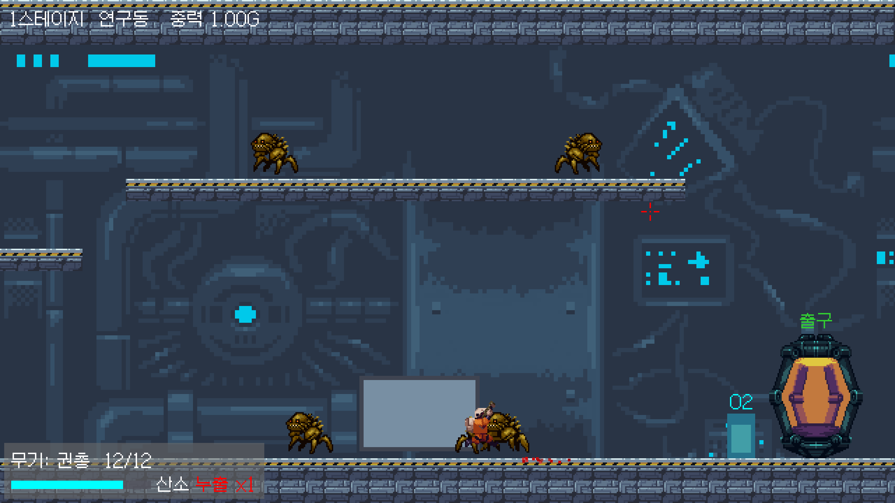 | 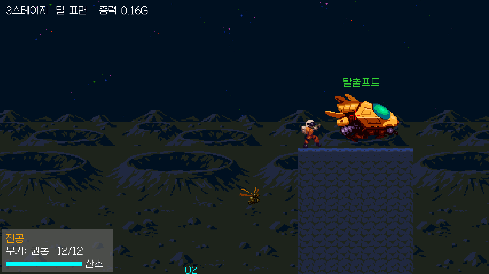 | 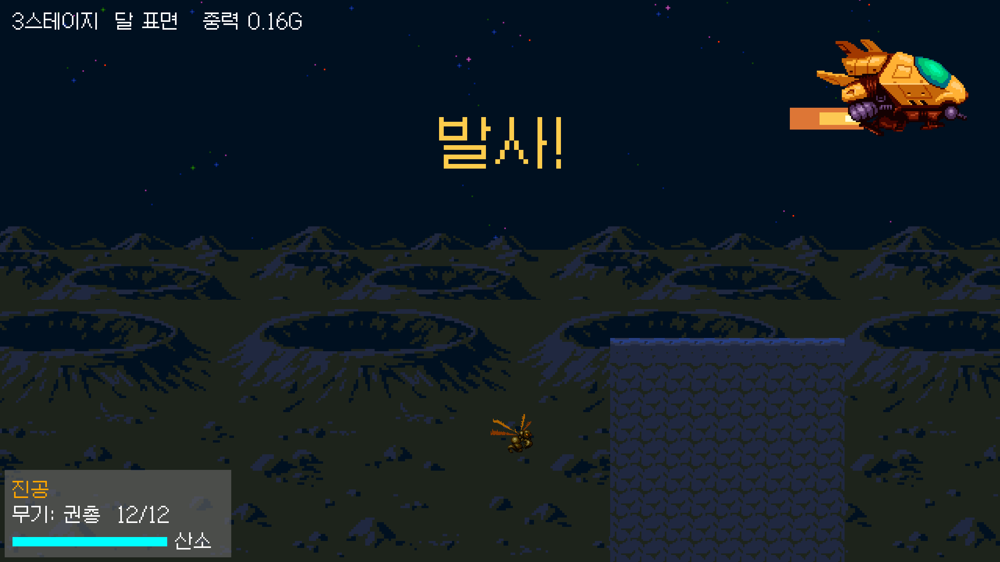 |

### 10/20 (화) — 테스트 키 F1, 플레이테스트 배포 (`feat/f1-playtest-release`)
- **F1**: 다음 스테이지로 바로 이동 (3스테이지에서 누르면 1스테이지). 검증·시연용. 기존 N(지금 스테이지 클리어)은 제거
- 친구 배포 파이프라인 (`.github/workflows/playtest-release.yml`)
  - `v*` 태그 push → 검증 코드 4개 → jar + 자바 포함 실행 파일(윈도우·맥 M/인텔·리눅스, construo) 빌드 → GitHub Release(미리 보기)에 첨부
  - Release 본문 = `.github/PLAYTEST_RELEASE.md` (다운로드·실행·조작·피드백 방법)
  - 피드백: Issues의 "플레이테스트 피드백" 양식 (`.github/ISSUE_TEMPLATE/playtest.md`)
- jar 이름 `MidtermGame` → `MoonBaseEscape`, 창 제목 "Moon Base Escape - 달 기지 탈출"

### 10/20~21 — 배포판 피드백: 친구 컴퓨터에서 실행이 안 됨 (`fix/playtest-launch`)
처음 배포(`v0.5-playtest`) 후 받은 피드백 4건. 게임 코드가 아니라 **배포 포장(construo)** 문제였음. 내 컴퓨터에서 `./gradlew lwjgl3:run`으로는 재현이 안 되는 종류라, 친구 환경을 서버에서 흉내 내는 방식으로 원인을 찾음.

| 피드백 | 원인 | 고친 곳 | 배포 |
|---|---|---|---|
| ① 인텔 맥: "응용 프로그램을 열 수 없습니다" | zip의 실행 권한이 맥 기본 압축 해제에서 사라짐 | 배포 워크플로: zip 다시 묶기 | v0.5.1 |
| ② 맥 M칩: "손상되었기 때문에 열 수 없습니다" | 앱 전체 서명 없음 | 배포 워크플로: 앱 구조 정리 + 임시 서명 | v0.5.2 |
| ③ 윈도우: 창이 안 뜨고 메시지도 없음 | 실행기가 한글 경로를 처리 못 함 | 안내문(영어 경로에 풀기) + 오류 로그 | v0.5.2 |
| ④ 리눅스: "shared library 파일을 열 프로그램이 없음" | 파일 관리자가 실행 파일을 라이브러리로 분류 | 안내문(터미널에서 실행) | v0.5.2 안내문 |

#### ① 인텔 맥 — "열 수 없습니다"
- **진단**: 받은 앱의 실행 파일 권한이 `-rw-r--r--`(실행 불가). zip 안에는 실행 권한이 있었음(`zipinfo`) → zip을 푸는 쪽에서 버려짐
  - construo가 만든 zip은 권한을 비표준 형식(파일 종류 비트 없음, `?rwx`)으로 적음. 터미널 `unzip`은 읽어 주지만 Safari·Finder가 쓰는 압축 해제(`ditto`와 동일)는 무시
  - 처음 배포 때 `unzip`으로만 확인해서 놓침 → 이후로는 **친구와 같은 방식(`ditto`)으로 풀어서 확인**
- **수정**: 배포 워크플로에서 빌드 직후 zip을 풀고 표준 `zip`으로 다시 묶음
- **왜 여기**: 게임 코드·construo 설정에는 zip 형식을 바꾸는 옵션이 없음. 포장이 끝난 결과물을 고치는 게 가장 작은 수정
- 검증: 새 zip을 `ditto`로 풀어 권한 유지·실행 확인

#### ② 맥 M칩 — "손상되었기 때문에 열 수 없습니다"
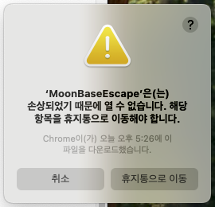
- **진단**: 실행 파일만 서명(링커 자동 서명)되고 앱 전체는 서명이 없음. 인터넷에서 받은 앱(격리 표시)은 맥이 서명을 검사하는데, M칩 맥은 서명이 깨진 앱을 "손상"으로 표시
- **처음 시도 → 실패**: `codesign --deep`으로 통째 서명 → construo가 자바 런타임과 jar를 **코드 전용 폴더 `Contents/MacOS`**에 넣어 둬서 `tzdb.dat` 같은 데이터 파일을 코드로 보고 서명 실패
- **수정**: 배포 워크플로에서 런타임·jar·설정을 `Contents/Resources`로 옮기고 원래 자리에 링크를 둔 뒤 앱 전체를 임시(ad-hoc) 서명. 서명은 맥에서만 되므로 빌드 서버를 `macos-latest`로 바꿈
- **왜 여기**: 실행기는 런타임을 "자기 옆 폴더"에서 찾으므로 링크를 두면 실행기를 건드리지 않고 맥의 앱 구조 규칙을 맞출 수 있음. 정식 해결은 애플 개발자 인증서(유료) 서명·공증인데, 친구 테스트용으로는 과함
- **한계**: 공증이 없어 "확인되지 않은 개발자" 경고는 남음 → 안내문에 우클릭 → 열기, "그래도 열기" 순서 추가
- 검증: 받은 M칩·인텔 앱 모두 `codesign --verify --deep --strict` 통과, 인텔 앱 실행 확인
- **결과**: 처음 "손상" 오류를 보낸 친구가 M칩 맥에서 v0.5.2를 Release 페이지 안내문만 보고 실행 성공 (다른 방법은 알려 주지 않음)

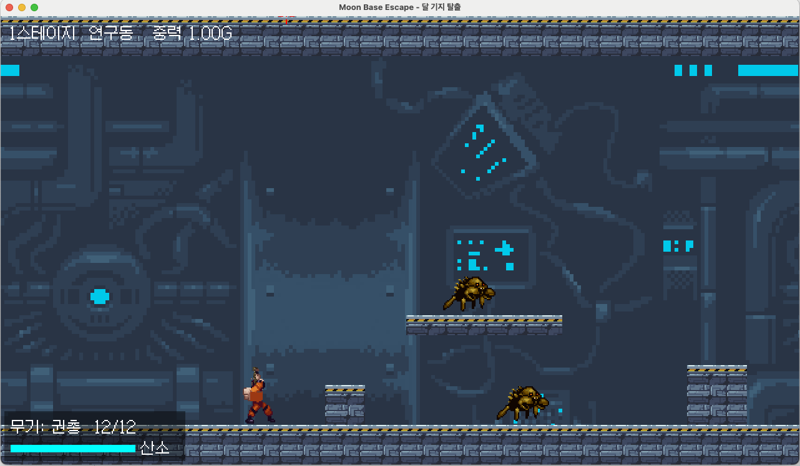

#### ③ 윈도우 — 아무 반응 없음
- **진단 준비**: 오류가 화면에도 파일에도 안 남아 원인을 알 수 없었음
  - 게임 시작 코드(`Lwjgl3Launcher`)에서 오류를 잡아 `C:\Users\(이름)\MoonBaseEscape-error.txt`로 남기게 함
  - GitHub 윈도우 서버에서 배포판을 영문 경로·한글 경로에 각각 풀어 실행하는 워크플로(`windows-smoke.yml`) 작성
- **결과**
  - 영문 경로: 자바·게임 코드까지 정상 진행 후 창 만들기에서 실패 (서버에 그래픽 카드가 없어서 생기는 정상적인 실패)
  - 한글 경로: 자바가 뜨기도 전에 종료, 오류 로그도 없음. 실행기(roast) 출력: `OptStringNotRepresentable { "-Djava.class.path=C:\t\한글 폴더\..." }`
  - → 실행기가 jar 경로를 윈도우 기본 문자 인코딩으로 바꾸다 한글을 표현 못 해 종료. 친구가 `C:\Users\(한글 이름)\Downloads`에 풀었다면 같은 상황
- **처음 시도 → 실패**: construo 1.7.1 → 2.2.2(실행기 roast v1.6.0)로 올려 다시 확인 → 같은 오류. 실행기 내부 문제라 설정으로는 못 고침
- **수정**: 안내문에 "영어로만 된 폴더(예: `C:\Games`)에 풀기"와 오류 로그 파일 위치 추가. construo는 2.2.2 유지
- **왜 여기**: 원인이 외부 도구 내부라 우리 쪽에서 바꿀 수 있는 건 "어디에 푸느냐"뿐. 오류 로그는 앞으로 다른 원인(그래픽 드라이버 등)도 친구에게서 받아 볼 수 있게 남겨 둠
- **한계**: 서버는 영어 윈도우라 한국어 윈도우에서도 똑같이 실패하는지는 미확인. 영어 경로에 풀면 어느 쪽이든 피함

#### ④ 리눅스 — "Could Not Display: no application installed for shared library files"
- **진단**: zip·실행 권한은 정상(`-rwxr-xr-x`). 실행기가 PIE 형식 실행 파일이라 우분투 파일 관리자가 "공유 라이브러리"로 분류해 더블클릭으로는 실행하지 않음 → 게임 오류가 아니라 실행 방법 문제
- **수정**: 안내문에 "폴더에서 우클릭 → 터미널에서 열기 → `./MoonBaseEscape`" 추가
- **왜 여기**: 더블클릭 실행은 파일 관리자마다 규칙이 달라(바로가기 파일도 "실행 허용"을 따로 눌러야 함) 확실한 방법이 터미널뿐

#### ⑤ 전체 점검 자동화 (`release-smoke.yml`)
- 문제가 OS마다 하나씩, 친구가 실행해 봐야 드러남 → **친구가 받는 Release 파일 그대로** 4종(윈도우·리눅스·맥 M칩·맥 인텔)을 GitHub 서버에서 받아 기본 방식으로 풀고 실행, 20초 뒤 살아 있는지·오류 로그·화면을 확인
- 서버엔 그래픽 카드가 없어 윈도우·리눅스는 소프트웨어 OpenGL(Mesa)을 깔아 실제 화면까지 확인. 맥 서버는 OpenGL 자체가 없어 "서명 검사 → 자바 → 게임 코드 → 창 만들기 직전"까지만 확인 (인텔 맥 화면은 내 컴퓨터에서 확인)
- 릴리스가 만들어지면 자동 실행, Actions 탭에서 태그를 골라 수동 실행도 가능
- 결과 (`v0.5.2-playtest`): 4종 모두 통과

| 리눅스 (서버, 소프트웨어 OpenGL) | 윈도우 (서버, 소프트웨어 OpenGL) |
|---|---|
| 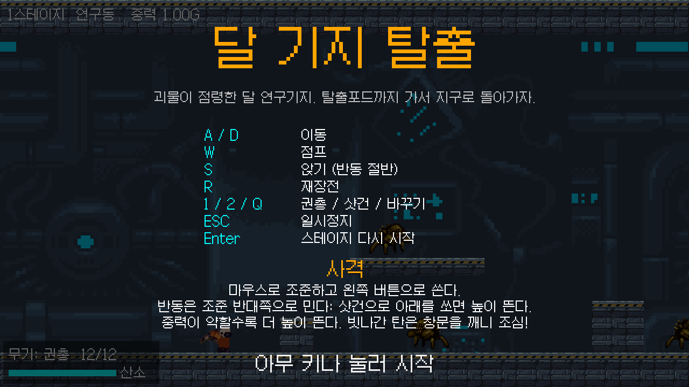 | 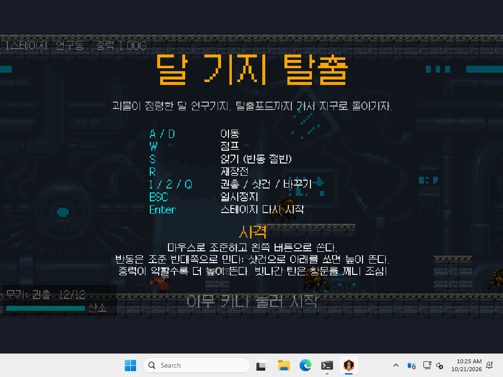 |

#### 정리
- 배포판 확인은 **친구가 하는 그대로**(브라우저로 받기 → 기본 압축 해제 → 더블클릭) 해야 함. 개발자 도구(`unzip`, 터미널 실행)는 문제를 가림
- 4개 OS를 한 번에 실제로 실행해 보는 점검을 만들어, 다음 배포부터는 친구보다 먼저 문제를 봄
- 실패해도 아무것도 안 남는 프로그램은 고칠 수 없음 → 오류 로그부터 남기고, 재현 환경(서버)을 만든 뒤 원인을 좁힘
- 쓸모없어진 `v0.5-playtest`, `v0.5.1-playtest` 릴리스는 삭제, 현재 배포판은 `v0.5.2-playtest`

### 10/21 (수) — 플레이테스트 피드백 5: 친구 플레이 (`fix/playtest-feedback-5`)
친구가 M칩 맥에서 배포판(v0.5.2)으로 플레이. "재밌네", "잘 만든다"와 함께 받은 의견:

| 피드백 | 원인 | 수정 |
|---|---|---|
| 마우스가 게임 창 밖으로 나가 다른 창을 누름 | 시스템 커서를 숨기기만 하고 창 안에 가두지 않음. 조준하다 창 가장자리를 넘으면 그대로 밖으로 나감 | 플레이 중엔 커서를 붙잡고(`setCursorCatched`) 움직인 양만 받아 가상 커서를 창 크기 안으로 자름. 일시정지(ESC)·클리어 화면에선 풀어서 일반 화살표 커서로 |
| F1(다음 스테이지)이 안 됨 | 맥은 위쪽 F키가 기본으로 밝기·음량 키라 fn을 같이 눌러야 F1. 안내문엔 적었지만 놓치기 쉬움 | fn 없이 되는 **N**도 같은 동작으로 받음 |
| 3스테이지에서 Enter를 눌렀더니 1스테이지로 감 | 버그 아님: 코드상 Enter가 1스테이지로 가는 곳은 탈출 성공 화면뿐(사망·Enter 재시작은 지금 스테이지 처음). 친구에게 물어 3스테이지를 깬 뒤의 화면이었음을 확인 → 탈출 성공 후 "1스테이지부터 다시"는 다시 플레이하고 싶을 때를 위한 것 | 같이 찾은 것: 발사 연출 중 Enter를 누르면 3스테이지 처음으로 되돌아가 엔딩이 끊김 → 발사 연출 중엔 Enter 무시 |
| 점프를 스페이스로 하면 쉬울 것 같음 | 서든어택식으로 W만 점프 | 두 명이 같은 의견 → W는 그대로 두고 **Space도 점프**로 받음 (조작표에 "W / Space") |
| 스테이지가 끝나면 이전 스테이지로 돌아가는 선택창을 만들어 달라 | — | **넣지 않음**: 무엇을 원하는지 분명하지 않고, 이전 스테이지로 돌아갈 필요도 없음. 3스테이지 탈출 뒤 "1스테이지부터 다시"만 유지 |
| 서 있으면 총이 크롤러보다 높아, 각도만 맞으면 앞 몬스터보다 뒤 몬스터가 먼저 죽음 | 어깨 높이에서 쏘는 탄이 키 작은 크롤러 위로 지나감 | **의도대로 유지**: 아래에서 위의 적을, 위에서 아래를 노리는 각도 찾기가 조준 시스템의 재미 |
| 죽어도 스테이지를 이어서 깰 수 있게 해 달라 (너무 어려움) | 사망·낙사 시 지금 스테이지 처음으로 돌아감 | **유지**: 산소 스테이션 체크포인트를 검토했지만 넣지 않음. 스테이지 처음부터 다시 시작하는 강의 재시작 방식을 그대로 둠 |

- **왜 가상 커서인가**: 운영체제 커서를 창 안에 가두는 기능(GLFW 3.4 `CURSOR_CAPTURED`)은 지금 libGDX 버전에서 바로 쓸 수 없고 OS마다 동작이 다름. 커서를 붙잡고 움직임 양을 직접 더하는 방식은 libGDX 기본 기능만으로 세 OS에서 같게 동작하고, 조준점은 원래 직접 그리고 있었으므로 화면 차이가 없음
- 검증: 검사 4개 통과, 실행 확인. 마우스 가두기는 직접 플레이로 확인 필요

---

## 7. 남은 일 / 알려진 문제
- [x] 크롤러 적 + 피격 + 피 효과
- [x] 산소 = 체력 + 누출, 산소 스테이션
- [x] 감압 창문 (내구도, 흡입, 별 배경 합성)
- [ ] 숨소리 효과음 (사운드 작업 때)
- [ ] 창문 3개가 지금 1스테이지 맵에 있음 → 스테이지 분리 시 2스테이지 위주로 재배치
- [x] 소총이 항상 수평이라 총알 방향과 그림이 다름 → 팔·총 분리 회전
- [ ] 팔 조각을 크게 돌리면(위·아래 끝) 어깨 쪽 이음새가 살짝 보임
- [x] 팔을 돌리면 원래 팔 아랫부분이 몸에 남던 문제 → 어깨부터 오리고 몸통 색으로 메움
- [ ] 마린 스프라이트에 앉기 모션이 없어 대기 모션을 세로로 75% 눌러 그림 (임시)
- [x] 드로퍼·스피터 적
- [x] 스테이지 2·3 맵, 스테이지 전환, 전체 클리어 화면
- [ ] 2·3스테이지는 자동 스크린샷과 수치로만 확인 → 직접 끝까지 플레이해서 난이도 확인 필요
- [x] 총알이 얇은 발판(24px)을 뚫던 문제 → 이동을 8px 단위로 나눠 검사
- [ ] 배경 픽셀 배율(3~6배)이 캐릭터·지형(2배)보다 커서 배경 픽셀이 더 굵어 보임 (거리감으로 수용 중)
- [x] 3스테이지에도 1스테이지 맵의 천장이 보이던 문제 → 스테이지 분리로 해결
- [x] 깃발 → 엘리베이터·탈출 우주선 그림 교체, 발사 연출
- [ ] 맥 앱은 공증이 없어 우클릭 → 열기 필요, 윈도우는 SmartScreen 경고 (배포 안내문에 적음)
- [ ] 윈도우: 한글이 든 경로에서는 실행 안 됨 (실행기 roast 문제, 영어 경로에 풀도록 안내)
- [x] M칩 맥에서 v0.5.2 실제 실행 확인 (친구, 안내문만 보고 성공)
- [ ] 한국어 윈도우에서 v0.5.2 실제 실행 확인
