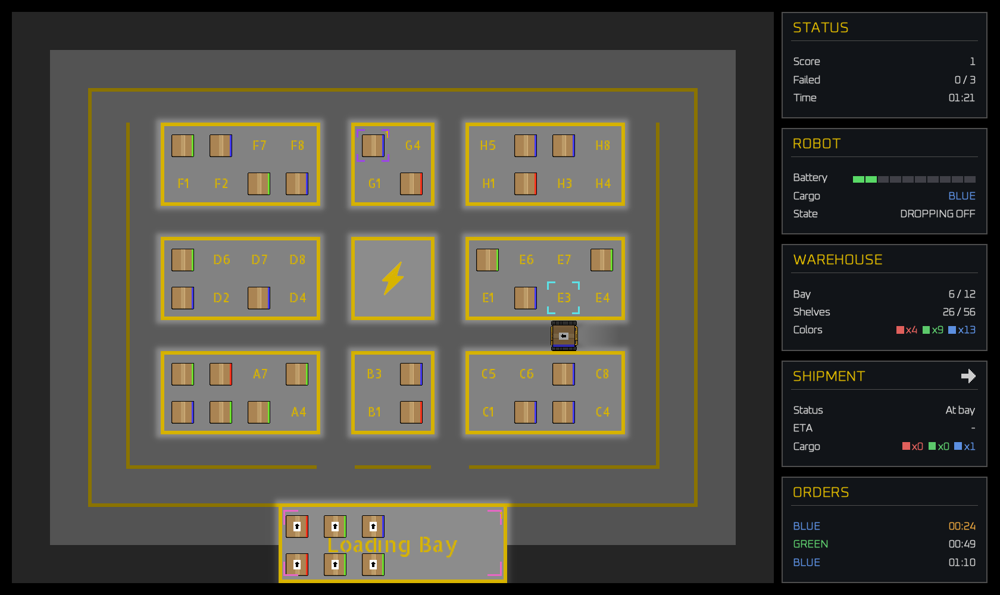

# Boxbot

[](https://github.com/meowpow-png/boxbot/actions/workflows/ci.yml)
[](https://github.com/meowpow-png/boxbot/actions/workflows/ci.yml)
[](https://openjdk.org/)
[](https://libgdx.com/)

You run a single warehouse with a robot at your command, 
keeping packages moving in and out before orders expire.
Every action costs time and battery, and the workload only grows.

You're scored on how many orders you ship before the warehouse fails.



## Gameplay

### Packages

Click a package on a shelf or in the loading bay to pick it up, then click
a shelf or the loading bay to send the robot there. That's how you put
incoming packages away and retrieve them again once an order needs them.

> [!NOTE]
> Busy robot? Queue up more moves anyway by clicking on a package, 
> then its destination. It will run once the current job wraps up. 
> Click a pending selection again to cancel it.

Packages come in different colors; red, green, or blue. Orders ask for a 
specific color, and the robot always grabs the nearest package of that color,
so where you shelve a color affects how fast it can come back out later.

### Battery

Moving the robot costs battery. When it's getting low, click the charging
station to send the robot to recharge. This takes time and can't be
canceled until it's full, so choose carefully when to do it.

> [!NOTE]
> The robot can be ordered to recharge while it is carrying a package.

If the battery hits zero before the robot reaches the station, it stops dead
wherever it is and can't move again. Don't wait until the last second.

### Shipments

A truck visits the loading bay on its own schedule to drop off new packages
and pick up ones you've shipped out. It works through its load one package
at a time, then leaves once it drops off and picks up all packages.

In the Shipment HUD panel, click the arrow icon to send the truck off early instead
of waiting for it to finish. This is crucial to controlling how many packages
enter and leave the warehouse, especially once more orders start coming in.

> [!NOTE]
> Sending the truck off early means it leaves without picking up any packages
> still waiting for it. Only do this when the bay is full, and you need the space.

### Orders

Orders are requests for a package of a specific color, and each one comes
with a delivery timer. Get a matching package to the loading bay and shipped
before the timer runs out, or it counts as a failed delivery.

### Difficulty

Work arrives faster the longer a run goes on, so decisions that were safe
early on get riskier later. There's no fixed ending to reach. The goal
is just to hold out as long as you can against the climbing pace.

### Pausing

Press `Esc` to pause and bring up the menu.

### Game over

The run ends once you've missed too many delivery timers.

## Development

### Running

Before getting started you need Java 21 or later.

To launch the game:

```
just dev
```

Without `just`, the equivalent is:

```
./gradlew :lwjgl3:run
```

Behavior can be tweaked with flags or environment variables:

| Environment variable     | `-D` property           | Effect                                                 |
|--------------------------|-------------------------|--------------------------------------------------------|
| `BOXBOT_DEV`             | `boxbot.dev`            | Enables development mode                               |
| `BOXBOT_TRUE_FULLSCREEN` | `boxbot.trueFullscreen` | Uses real OS fullscreen instead of a borderless window |

Example:

```
./gradlew :lwjgl3:run -Dboxbot.dev=true
```

### Tests

Run the full suite:

```
./gradlew check
```

See [TESTING.md](docs/TESTING.md) for more information.

### Configuration

Gameplay and presentation values live in one file:

```
assets/config/boxbot.json
```

In development mode, edit it and press F5 to reload without restarting.

See [ASSETS.md](docs/ASSETS.md) for more information.

## Learn More

- [Battery](docs/BATTERY.md)
- [Difficulty](docs/DIFFICULTY.md)
- [Failure](docs/FAILURE.md)
- [Jobs](docs/JOBS.md)
- [Movement](docs/MOVEMENT.md)
- [Package](docs/PACKAGE.md)
- [Shipping](docs/SHIPPING.md)
- [System](docs/SYSTEM.md)
- [Time](docs/TIME.md)

## License

Licensed under MIT. See [LICENSE](LICENSE).

> [!NOTE]
> Bundled font has its own license, see [OFL.txt](assets/fonts/OFL.txt).
