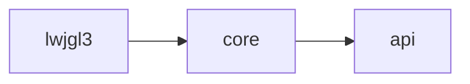
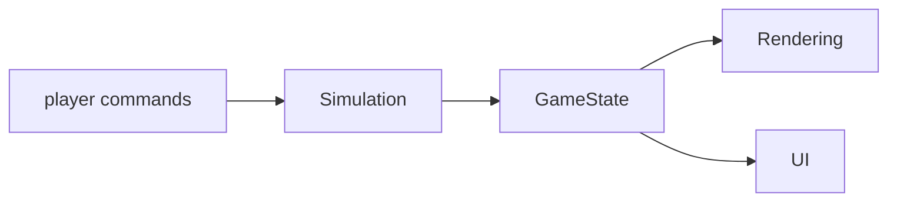

# Architecture

BoxBot is built as a simulation with a libGDX application around it.
The simulation owns the warehouse state and the rules that govern it.
The application layer is responsible for rendering and input. 

The player directs the robot by choosing what it should do next,
such as which job to take or when to charge, rather than driving
it manually. The robot itself carries out movement and pathfinding.

## Modules

The project has the following modules:

The api module is plain Java with no libGDX dependency. It defines shared 
identifiers and value types, along with the observation and action contract
used by the robot's decision policy. It stays free of the libGDX dependency 
by design: both the simulation engine and the renderer need these types, 
and neither depends on the other's internals to use them.

Core depends on api and on libGDX directly. It contains:

- the simulation engine
- rendering and UI
- screens
- configuration loading
- asset loading

Lwjgl3 depends on core and provides the desktop launcher, 
covering window setup, key bindings, and display control.
It contains no game logic of its own.

## Simulation and presentation

The simulation engine has no dependency on rendering or UI. It owns the 
warehouse state, applies changes to it, and advances one tick at a time.

This keeps the simulation deterministic and testable without running the 
graphical application. Rendering and UI read simulation state. The player 
also reads it, to see what actions are currently available. None of 
these write to simulation state directly, other than through an action 
the player has chosen.

## Robot decisions

At each decision point, the player picks one
of a small set of actions for the robot to carry out next:

- take a pending job
- retrieve or store a package
- charge the robot
- reserve a loading bay
- idle

The robot director then validates the chosen action against the current
world state and carries it out as movement, a pickup, a drop-off, or charging.

This contract, the state exposed to the player and the action they choose,
is defined in the api module. It carries no libGDX types and no engine internals, 
so it stays a plain mapping from state to action, independent of how that
action was chosen. The robot only ever does what it was last told to do.

The full decision and execution flow is documented in [SYSTEM.md](SYSTEM.md).

## Hot-path constraints

Code that participates in the runtime tick loop is marked as hot path. 

Hot-path code cannot use:

- ordinary Java collections or maps
- iterators or streams
- Optional
- functional interfaces

This restriction is enforced automatically at build time. Hot-path code 
uses libGDX's own collections instead, exposed through read-only view 
types defined by the project so state can be shared without copying it.

## Tick rate and frame rate

Rendering executes once per frame. The simulation does not follow frame rate; 
it advances on a fixed schedule instead. Elapsed frame time accumulates into two
separate tick counters, one for movement and one for actions. Each one is configured
with its own duration. Accumulated ticks run before each frame is rendered.

This separation keeps simulation behavior independent of frame rate.

The exact tick ordering is documented in [SYSTEM.md](SYSTEM.md).

## Player controls

Player input drives the robot's decisions,
alongside display and development functionality:

- choose the robot's next job, retrieval, or store target
- send the robot to charge

The robot never acts on its own initiative. It moves, picks up,
drops off, or charges only because the player chose that action for it.

## Screens

A single screen owns the active run. When a run fails, the 
simulation stops advancing, but the screen continues rendering 
the final state rather than transitioning to another screen. 

Restarting a run is currently only possible through a development-mode level reload.

## Configuration

Tunable values are stored in a configuration file rather than code. 
Adjusting game balance does not require changing Java source.

The simulation and the application layer read the same 
loaded configuration, and each uses only the values relevant to it. 

See [ASSETS.md](ASSETS.md) for more information.
