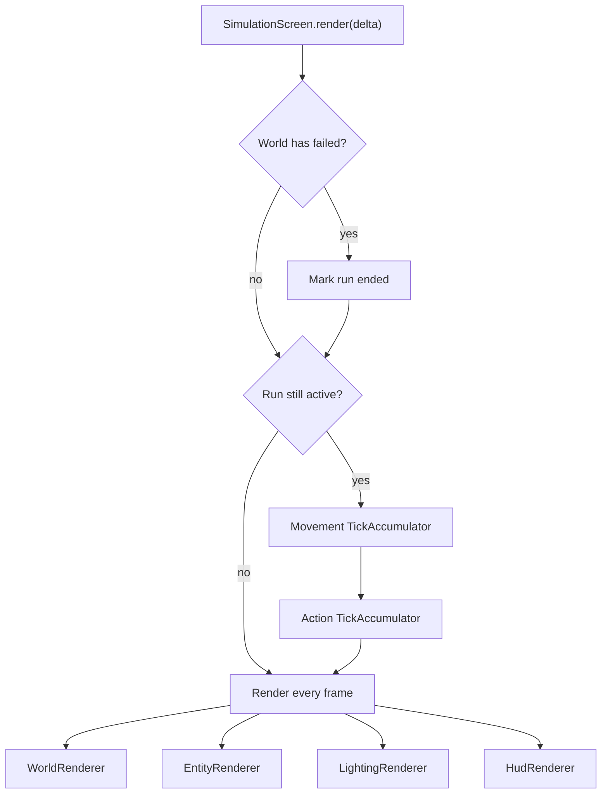
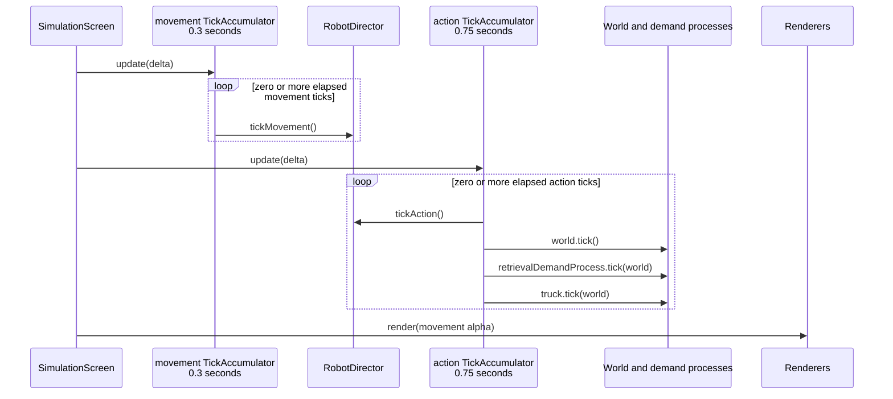
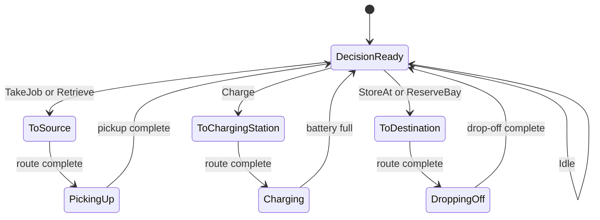
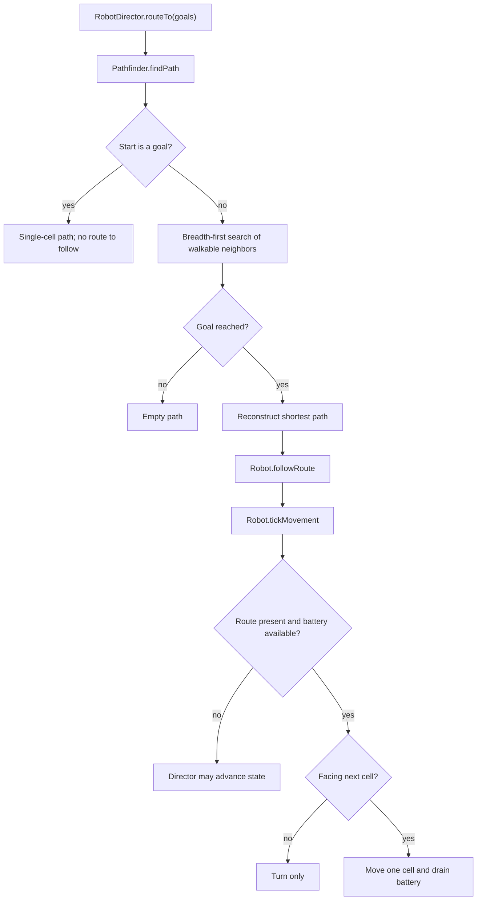
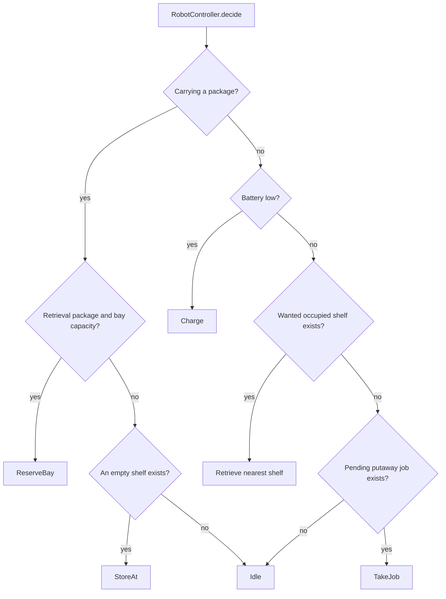
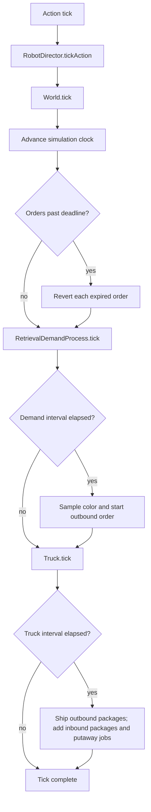
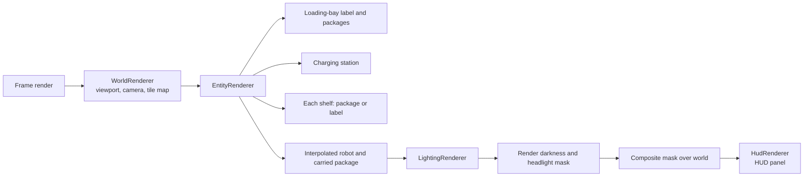

# System

## Hot Path

The game enters the runtime path through `SimulationScreen.render(float delta)`.
Simulation advances at fixed intervals while rendering runs on every frame.

`TickAccumulator` converts frame delta into zero or more fixed ticks. Its movement alpha is then shared by entity and lighting rendering for interpolation.

## Robot Director

The director advances the robot's lifecycle. When the robot is neither moving nor busy, it either begins the next phase or asks the controller for an action.

Travel begins only when the director commits to an action that requires a destination. A route is consumed one turn or one cell at a time on movement ticks.

## Robot Controller

`AiRobotController` provides policy; `RobotDirector` validates and carries out the resulting action.

## Simulation

Action ticks also advance the world and its periodic processes, in a fixed order.

## Rendering

Rendering remains active after the run ends. It reads world state but does not advance simulation state.

