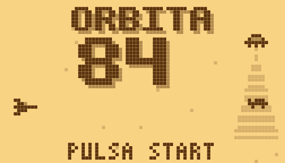
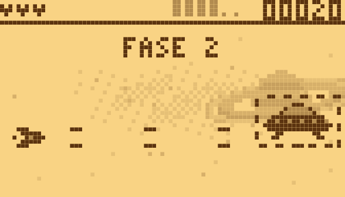

# Órbita 84

[](https://github.com/D4rk3r-03/orbita-84/actions/workflows/tests.yml)

*English: [README.md](README.md)*

Shooter de naves al estilo de los celulares de antes: pantalla de 84×48, dos tonos y pitidos. Diez niveles basados en casos OVNI famosos («expedientes»), cada uno con su jefe y unidos por una historia que se arma pieza a pieza, un nivel en tierra manejando un tanque, dos en el mar (en la superficie y bajo el agua), un lago helado, dos naves a elegir y tabla de récords con iniciales. Hecho con [LÖVE](https://love2d.org) para consolas con PortMaster (R36S y clones) y para el navegador.

 

## Requisitos

- LÖVE 11.x para jugar en PC.
- LuaJIT para las pruebas de lógica.
- Node.js (solo para la versión web) e ImageMagick (solo para regenerar capturas).

## Jugar

```sh
git clone https://github.com/D4rk3r-03/orbita-84.git
cd orbita-84
love juego
```

## Controles

| Acción | Teclado | Consola |
|---|---|---|
| Mover | Flechas / WASD | Cruceta o stick |
| Disparar (mantener; en tierra lanza también cohetes) | Z / Espacio | A |
| Especial (rayo / pulso) | X | B |
| Saltar (nivel en tierra) | Arriba | Arriba |
| Usar el poder de cápsula guardado | C | Y / X |
| Empezar / pausa | Enter | Start |
| Colores (portada) / salir (pausa) | Tab | Select |
| Cerrar el juego | Esc (en la portada) | Select + Start |
| Pantalla completa | F11 | — |

En la portada, Start (o A) abre el menú: JUGAR, NAVE (eliges entre las dos naves y ves sus armas), RECORDS (los 10 mejores con la nave y hasta dónde llegó cada partida) y OPCIONES (sonido, color de la pantalla e idioma). Te mueves con la cruceta, eliges con A y vuelves con B; Start juega directo. Después del último nivel el juego pregunta si jugar otra ronda más difícil o terminar y guardar el puntaje.

Naves:

- **Cabina**: disparo simple + rayo.
- **Interceptor**: disparo doble + pulso.

Las cápsulas de escudo, tiempo perdido, sonda (la nave compañera) o abducción (un haz que se traga las balas de adelante y al acabarse las devuelve) se guardan (una a la vez; la nueva reemplaza a la anterior) y se ven en la ranura de la Y del marcador hasta que las usas. Cada expediente trae su poder dos veces para aprenderlo, y la primera vez que recoges uno el juego te dice el botón. El disparo triple, el especial extra y la vida actúan apenas las recoges.

En tierra la nave se vuelve oruga y las dos comparten armas extra: al disparar salen también cohetes que suben y giran hacia el blanco más cercano; si mantienes A, al soltarlo sale un obús cargado (cuanto más lo cargas, más daño hace; con la carga llena sale más grande, borra las balas enemigas y corta los anillos de la pirámide), y con Derecha apretada el rayo sale hacia adelante en vez de hacia arriba.

## Niveles

| # | Caso | Escenario |
|---|---|---|
| 1 | Roswell 1947 | Espacio |
| 2 | Bélgica 1990 | Montes |
| 3 | Phoenix 1997 | Ruinas, en tierra |
| 4 | Los Hill 1961 | Cueva de roca |
| 5 | Lubbock 1951 | Asteroides |
| 6 | Hangar 18 | Tuberías de la base |
| 7 | Shag Harbour 1967 | Mar de noche; el agua frena y esconde lo sumergido |
| 8 | Bermudas 1945 | Bajo el agua, en batiscafo con torpedos |
| 9 | Lago Baikal 1982 | Lago helado: la oruga resbala, salta agujeros y el hielo se raja |

### Jefes

Cada jefe pelea en tres fases según la vida que le queda. Sus ataques son fijos, así que se pueden aprender, y antes de cada uno aparece un aviso en tono medio. Al cambiar de fase se borran las balas. Vencerlo antes de un minuto da puntos extra.

### Modo de prueba

1. En la portada, pulsa B tres veces.
2. Arriba/Abajo eligen la fila e Izquierda/Derecha la cambian: nivel, nave, vuelta (dificultad), daño (NO = invulnerable), choques (muestra qué golpea y dónde recibe daño el jefe) y lento (a 1/2 o 1/4 de velocidad).
3. Pulsa Select para saltar al jefe.
4. Pulsa B para salir.

## Desarrollo

```sh
luajit herramientas/probar_logica.lua   # pruebas de lógica
bash herramientas/empaquetar.sh         # pruebas + port/orbita84/orbita84.love
bash herramientas/web.sh                # versión web en web/
bash herramientas/capturas.sh           # rehace capturas/
bash herramientas/android.sh            # app de Android en publicar/android/ (el juego dentro de LÖVE 11.5)
bash flatpak/probar.sh                  # arma e instala el Flatpak en este equipo
```

Para instalar en la consola:

1. Ejecuta `empaquetar.sh`.
2. Copia `port/Orbita 84.sh` y `port/orbita84/` a la carpeta `ports/` de la SD.

## Estructura

```
juego/         juego: main.lua (dibujo, entrada, sonido), logica.lua (reglas en Lua puro),
               datos.lua (sprites, niveles, enemigos), fondos.lua, portada.lua
herramientas/  pruebas y scripts de armado
port/          lanzador de PortMaster, controles y portada
web/           página para navegador (love.js)
flatpak/       receta de Flathub, acceso directo y ficha de la tienda
estetica/      muestras de dirección de arte
capturas/      capturas de pantalla
```

## Créditos

D4rk3r-03 · Claudio

## Licencia

[MIT](LICENSE)
