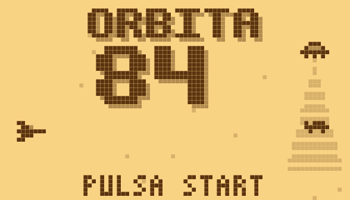
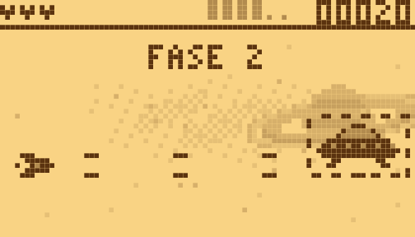

# Órbita 84

[](https://github.com/D4rk3r-03/orbita-84/actions/workflows/tests.yml)

*Español: [README.es.md](README.es.md)*

A side-scrolling shooter in the style of old monochrome phone games: an 84×48 screen, two tones and beeps. Ten levels based on famous UFO cases ("expedientes"), each with its own boss and tied together by a story pieced together boss by boss, a ground level driving a tank, two sea levels (on the surface and underwater), a frozen lake, two selectable ships and a high-score table with initials. Built with [LÖVE](https://love2d.org) for PortMaster handhelds (R36S and clones) and the browser.

 

## Requirements

- LÖVE 11.x to play on PC.
- LuaJIT to run the logic tests.
- Node.js (only to build the web version) and ImageMagick (only to regenerate screenshots).

## Play

```sh
git clone https://github.com/D4rk3r-03/orbita-84.git
cd orbita-84
love juego
```

## Controls

| Action | Keyboard | Handheld |
|---|---|---|
| Move | Arrows / WASD | D-pad or stick |
| Shoot (hold; on the ground it also fires rockets) | Z / Space | A |
| Special (beam / pulse) | X | B |
| Jump (ground level) | Up | Up |
| Use the stored capsule power | C | Y / X |
| Start / pause | Enter | Start |
| Palette (title) / quit (pause) | Tab | Select |
| Close game | Esc (on title) | Select + Start |
| Fullscreen | F11 | — |

On the title screen, Start (or A) opens the menu: PLAY, SHIP (choose between the two ships and see their weapons), SCORES (the top 10 with ship and how far each run got) and OPTIONS (sound, screen color and language). Move with the D-pad, choose with A, go back with B; Start plays right away. After the last level the game asks whether to play another, harder round or finish and save your score.

Ships:

- **Cabina**: single shot + beam.
- **Interceptor**: double shot + pulse.

Capsules with shield, lost time, probe (the companion ship) or abduction (a beam that swallows bullets ahead and fires them back when it ends) are stored (one at a time; a new one replaces it) and shown in the Y slot at the top until you use them. Each case file brings its own power twice so you can learn it, and the first time you pick one up the game tells you the button. Triple shot, extra special and extra life work as soon as you pick them up.

On the ground the ship becomes a tank and both share extra weapons: shooting also fires rockets that climb and then turn toward the nearest target; holding A and releasing it fires a charged shell (the longer the charge, the more damage; fully charged it is bigger, wipes out enemy bullets and cuts through the pyramid's rings), and holding Right makes the beam fire forward instead of upward.

## Levels

| # | Case | Scenery |
|---|---|---|
| 1 | Roswell 1947 | Space |
| 2 | Belgium 1990 | Mountains |
| 3 | Phoenix 1997 | Ruins, on the ground |
| 4 | Hill 1961 | Rock cave |
| 5 | Lubbock 1951 | Asteroids |
| 6 | Hangar 18 | Base pipes |
| 7 | Shag Harbour 1967 | Night sea; the water slows you and hides what lies below |
| 8 | Bermuda 1945 | Underwater, as a bathyscaphe that fires torpedoes |
| 9 | Lake Baikal 1982 | Frozen lake: the tank slides, jumps holes and the ice cracks |

### Bosses

Every boss fights in three phases depending on its remaining health. Its attacks are fixed, so they can be learned, and each one is announced by a mid-tone warning. Changing phase clears the bullets. Beating a boss in under a minute gives bonus points.

### Test mode

1. Press B three times on the title screen.
2. Up/Down picks a row and Left/Right changes it: level, ship, loop (difficulty), damage (NO = invulnerable), hitboxes (shows what hurts and where the boss takes damage) and slow motion (1/2 or 1/4 speed).
3. Press Select to jump to the boss.
4. Press B to leave.

## Development

```sh
luajit herramientas/probar_logica.lua   # logic tests
bash herramientas/empaquetar.sh         # tests + port/orbita84/orbita84.love
bash herramientas/web.sh                # browser build in web/
bash herramientas/capturas.sh           # refresh capturas/
bash herramientas/android.sh            # Android app in publicar/android/ (embeds the game in LÖVE 11.5)
bash flatpak/probar.sh                  # build and install the Flatpak locally
```

To install on a handheld:

1. Run `empaquetar.sh`.
2. Copy `port/Orbita 84.sh` and `port/orbita84/` to the `ports/` folder of the SD card.

## Structure

```
juego/         game: main.lua (drawing, input, sound), logica.lua (pure-Lua rules),
               datos.lua (sprites, levels, enemies), fondos.lua, portada.lua
herramientas/  tests and build scripts
port/          PortMaster launcher, controls and cover
web/           browser page (love.js)
flatpak/       Flathub manifest, desktop file and store listing
estetica/      art-direction samples
capturas/      screenshots
```

## Credits

D4rk3r-03 · Claudio

## License

[MIT](LICENSE)
