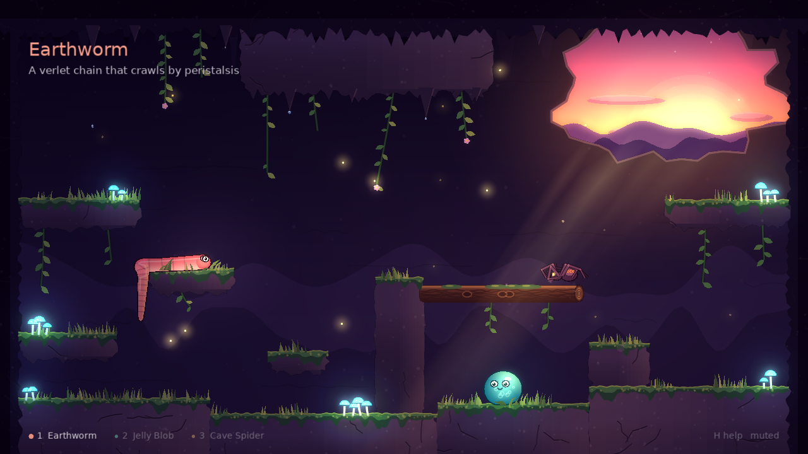

# Character: The Dusk Cave

Procedural creature animation in the spirit of Rain World, built with [LÖVE](https://love2d.org).

Three creatures share one overgrown cave at dusk. You guide one with clicks, and the other two wander on their own. None of them is keyframed. Each is a small physics system riding an exact navigation anchor, so they always know where they're going and their bodies stay loose.



| Creature | How it moves |
|----------|--------------|
| **Earthworm** | A verlet chain that crawls by peristalsis. It has bending stiffness, ground grip, and a tapered mesh. |
| **Jelly Blob** | A position-based pressure soft body. It rolls, squats into jumps, and squashes when it lands. |
| **Cave Spider** | Eight FABRIK legs that step to raycast footholds in alternating groups. It walks on floors, walls and ceilings. |

Press **X** to see the creatures as the simulation sees them: points, constraints and bones over the navigation graph.

## Running

Install [LÖVE 11.x](https://love2d.org), then:

```bash
git clone https://github.com/chrischaps/Character.git
cd Character
love .
```

## Controls

| Key | Action |
|-----|--------|
| Left click | Guide the selected creature. The spider can also go to walls and ceilings. |
| 1 / 2 / 3, Tab | Select a creature |
| H | Help card |
| N | Navigation graph |
| X | X-ray view |
| D | Debug view |
| W | Toggle wandering |
| P / M / R / F | Pause, mute, reset, fullscreen |
| F1–F4 | PostFX: bypass, distortion, bloom, colour grade |
| Esc | Quit |

## How it works

- **Anchor plus soft body.** Every creature rides a kinematic anchor that uses closed-form gravity. The verlet, PBD and IK bodies hang off it.
- **One jump model.** The navigation graph creates a jump edge only if `core/ballistics.lua` finds a velocity within the creature's limits and the arc clears the geometry. The controller launches with the same solver, so every jump the graph promises can actually be made.
- **Per-creature graphs.** Each graph is built from the creature's own size and jump limits. The spider's covers every exposed surface, corners included.
- **Fixed 120 Hz step** with render interpolation. The simulation is deterministic: it gives the same result at 30, 60 and 240 fps.
- **Light and sound.** A multiplied light map, god rays through the cave mouth, glowing mushrooms, fireflies, echoing drips, and fully procedural audio.

## Dev modes

```bash
lovec . --selftest     # graph integrity, reachability, trips, determinism, audio
lovec . --snap spider 5 out.png --zoom 640 360 2
lovec . --bench 10     # frame timing at 1080p
```

`CLAUDE.md` describes the architecture and the lessons learned in more detail.

## Credits

The `libs/LoveLibs` directory is a subtree of [LoveLibs](https://github.com/chrischaps/LoveLibs), which provides scaling, post-processing, music, a debug overlay and verlet vines.

## License

MIT. See [LICENSE](LICENSE).
