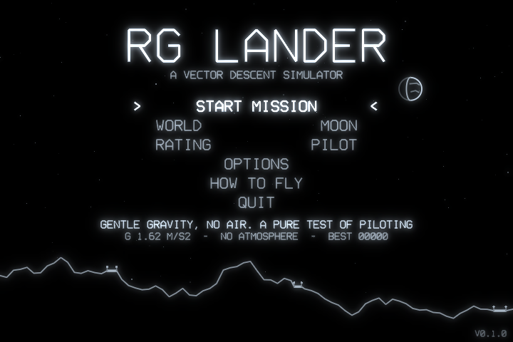
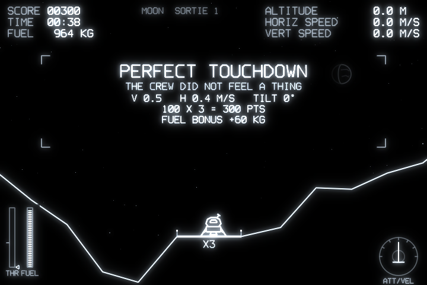
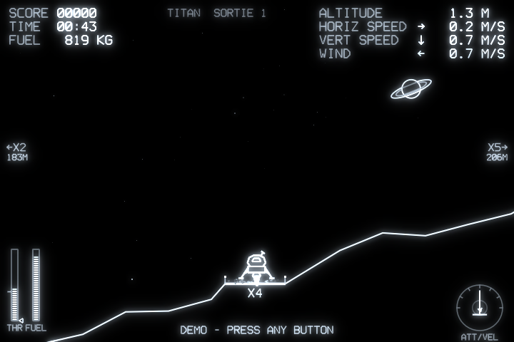
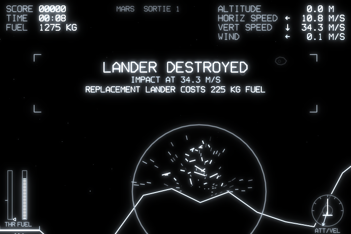
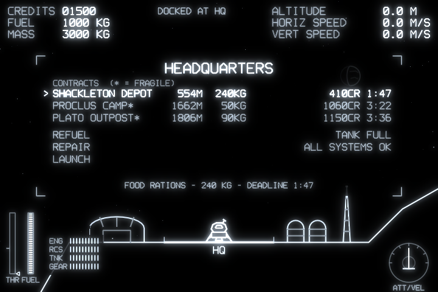
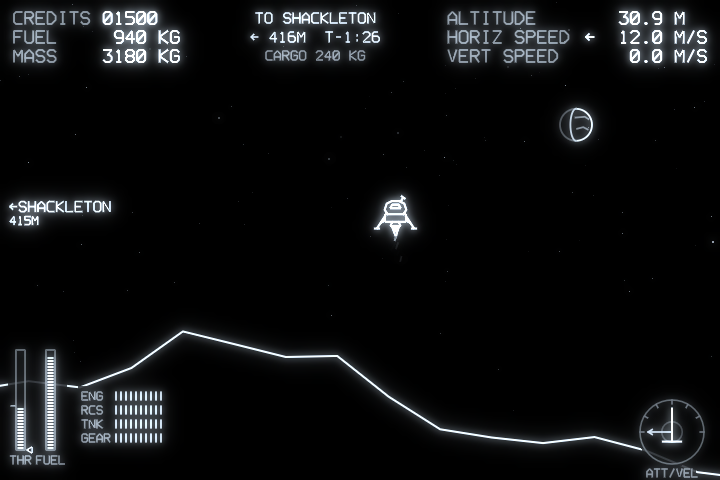
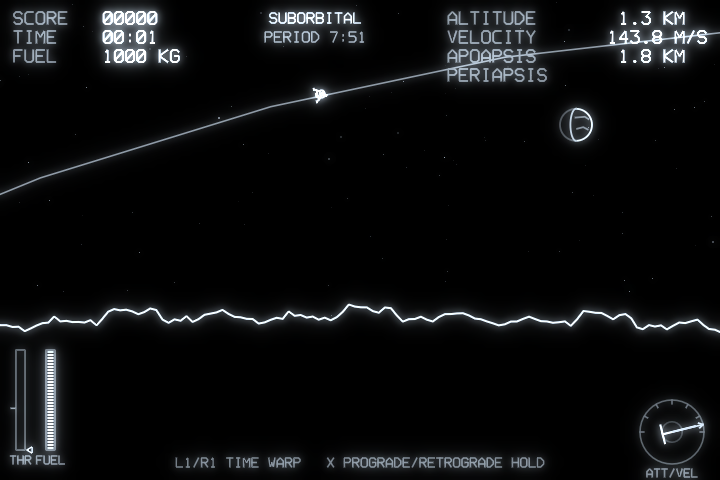
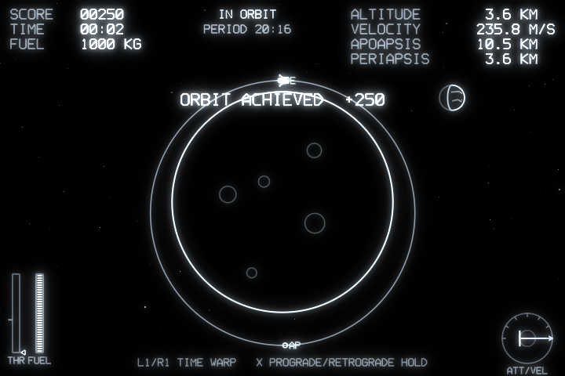

# RG Lander

A vector-graphics landing game for LÖVE 11, made for the **Anbernic RG34XXSP**
(720×480, Allwinner H700), packaged for both muOS and PortMaster. It is an original game in the classic
lunar-lander genre: monochrome phosphor lines on black, jagged procedural
terrain, narrow pads that pay more, and fuel as your only life. A second
mode, **Missions**, turns it into a cargo-hauling career with damage, refuelling
and procedural contracts.

| | |
|---|---|
|  |  |
|  |  |
|  |  |
|  |  |

*Screenshots are rendered by the game itself at native 720×480 (`--shot`). The
green phosphor option is shown in [mars_green.png](screenshots/mars_green.png).*

## Install

Download a package from [Releases](https://github.com/ctanas/rglander/releases),
or build them all with `./build.sh` (output in `dist/`).

### muOS (MustardOS)

1. Copy `RGLander_vX.Y.Z.muxapp` to `/mnt/mmc/MUOS/ARCHIVE/` on the SD card.
2. On the device, open **Applications → Archive Manager** and install it.
3. Launch **RG Lander** from Applications.

The muxapp is self-contained: it bundles an aarch64 LÖVE 11.5 runtime, since
muOS doesn't include LÖVE. Settings and high scores are stored in
`MUOS/application/RGLander/.game/save/`. If the game doesn't start, check
`MUOS/application/RGLander/.game/rglander.log`.

### PortMaster (Knulli, ROCKNIX, stock OS, ...)

Unzip `rglander_vX.Y.Z_portmaster.zip` into the SD card's `ports/` folder. You
should get `RG Lander.sh` and `rglander/`. Refresh the game list, then launch
**RG Lander** from Ports.

The launcher uses PortMaster's `love_11.5` runtime. If you have never installed
a LÖVE-based port, install that runtime from PortMaster first, or the launcher
will show a message and exit. Logs go to `ports/rglander/log.txt`, and
settings and high scores to `ports/rglander/conf/`.

### PC

`./build.sh run`, or `love .` from this folder (LÖVE 11.4/11.5). The packaged
game alone is `rglander.love`: `love rglander.love`.

## Controls

| Input | Action |
|---|---|
| D-pad ←/→ or L1/R1 | Rotate (RCS jets) |
| D-pad ↑/↓ | Set the throttle lever (it stays where you leave it) |
| A (hold) | Full thrust |
| B | Cut the lever to zero |
| X | Set the lever to hover thrust for your current mass |
| Left stick | Rotate (X) and analog thrust (push up) |
| R2 / right stick up | Analog thrust |
| L1/R1 (orbit view) | Time warp down/up |
| X (orbit view) | Attitude hold: prograde → retrograde → off |
| Start / Select | Pause |
| Select + Start | Quit |
| Y | Toggle FPS counter |

Keyboard (desktop): arrows, Z = A, X = B, C = X, Q/E = L1/R1, Enter = Start, Esc = Select.

## Game modes

### Arcade

A run of landings on fresh terrain until the fuel runs out. Narrow pads pay up to
×5, crashes cost fuel, and good landings refund some.

### Orbit (in arcade)

Climb past 700 m and the camera zooms smoothly out to the whole world. The
terrain you were flying over curves into a planet, and your predicted path is
drawn around it, with apoapsis (AP) and periapsis (PE) marked. Fly sideways fast
enough and you fall around the body instead of into it: that's an orbit.
Burn prograde to raise the far side of the orbit and retrograde to lower it. Brake
until the path meets the ground, fall back below 600 m, and you're in the
landing view again, as fast as you came in.

- **L1/R1:** time warp ×1 / ×4 / ×16 / ×64, with the engine off. Thrusting or
  steering drops back to ×1, as does descending below 2.5 km. Warp is limited in thick air.
- **X:** cycles attitude hold: prograde → retrograde → off.
- **Rewards:** +250 for a stable orbit above the terrain and the air. Landing after
  an orbit pays double.
- **Escape:** reach escape velocity and the lander is lost in space.

It's the same physics as the landing view, not a separate simulator. The flight
model uses the exact polar equations of motion: gravity falls off as (R/r)², plus
the centripetal and Coriolis terms. At landing speeds these terms vanish; at
√(gR) sideways they make you weightless. Air thins exponentially with height.

The bodies are **scaled down**, as in Kerbal Space Program, because real low lunar
orbit takes about 1.7 km/s and the lander carries about 0.8 km/s. Surface gravity
stays real:

| World | Radius in game (real) | Orbital speed | Notes |
|---|---|---|---|
| Moon | 35 km (1,737 km) | 238 m/s | |
| Mars | 25 km (3,390 km) | 305 m/s | air thins over a 1 km scale height; the hardest round trip |
| Titan | 45 km (2,575 km) | 246 m/s | 400 m scale height: costly to climb out, nearly free to aerobrake back |
| Ceres | 100 km (470 km) | 167 m/s | |

A headless test flies an efficient ascent and powered descent on each world. With
the standard PILOT tank, a near-perfect round trip to orbit lands with 16% (Moon),
4% (Mars), 20% (Titan) or 14% (Ceres) of the fuel left. CADET has more margin;
COMMANDER makes it an expert feat. Fuel carries over between sorties, so an orbit
attempt is a gamble with the rest of your game.

### Missions

A persistent career on one large world per body (3.84 km, wrapping) with an HQ
and six outposts named after real places there: Tycho, Jezero, Kraken, Occator and others.

- **Contracts.** Each time you dock at HQ you get three procedural offers. Each one
  lists the cargo, its mass, the destination outpost, the reward and a deadline.
  Fragile cargo (`*`) pays more.
- **Mass.** Cargo is added to the lander's mass, so a 900 kg reactor core
  makes it noticeably sluggish. The lander gets lighter as fuel burns, and again when
  the cargo is delivered. The HUD shows total mass live.
- **HQ services.** Refuel (0.6 CR/kg) and repair (6 CR per percentage point).
  Press B while landed at HQ to reopen the panel.
- **Damage.** A hard landing always hurts the landing gear, plus one random system:
  - **Engine:** less thrust, and it sputters below 70%.
  - **RCS:** weaker jets, and a stuck thruster below 60% makes the lander drift.
  - **Tank:** leaks propellant (you can see it venting).
  - **Gear:** the touchdown limits tighten, down to 55%.
- **Pay.** A late delivery pays half. A hard landing ruins fragile cargo (30% pay)
  and shaves 15% off the rest. A perfect landing earns a 10% bonus.
- **Failure.** If you run out of fuel at an outpost, or are too heavy for a damaged
  engine, a rescue tows you home for 400 CR. A crash costs a 1500 CR replacement
  lander, and the cargo is lost. If you can't pay, the career ends.
- **Saving.** The career is saved every time you dock at HQ. *Missions* on the title
  screen offers *Continue career* or *New career*, one save per world.

The buildings at HQ and the outposts are solid: flying into one counts as a crash.

## Physics

Everything is in SI units, integrated at a fixed 120 Hz (semi-implicit Euler).

- **Rocket with changing mass.** Mass is 2000 kg dry plus propellant. Thrust
  burns `F / ve` kg/s with `ve` = 2000 m/s, so the rocket equation emerges
  on its own: as fuel burns, the lander gets lighter, accelerates harder and
  rotates faster. The HUD's hover marker (X button) follows this.
- **Engine** sized to a thrust-to-weight ratio of 2.4 at full mass for each world
  (with a minimum of 2 m/s², so low gravity is still flyable). It has a 0.12 s spool lag.
- **Attitude** comes from RCS torque against a moment of inertia `I = m·k²`. *Assisted*
  mode treats input as a rotation-rate command and stops the spin when you let go.
  *Manual* mode is raw torque, so rotation keeps going until you counter it.
- **Atmosphere** adds quadratic drag `½ρ·CdA·|v−wind|·(v−wind)`, gusty
  wind that weakens near the ground, and aerodynamic damping of rotation.
- **Particles** follow the same physics. In vacuum, dust kicked up by the exhaust
  flies in clean ballistic arcs. On Titan it slows down quickly and drifts with the wind.
- **Touchdown** is judged on vertical speed, horizontal speed and tilt (PILOT limits:
  2.0 m/s, 1.0 m/s, 5°; up to 3.5 m/s counts as a hard landing). Both feet must be on
  a pad or on level ground. A hull or strut touching terrain destroys the lander.

| World | g (m/s²) | Air (kg/m³) | Character |
|---|---|---|---|
| Moon | 1.62 | none | The baseline |
| Mars | 3.71 | 0.020 | Heavy and fast; the thin air barely helps |
| Titan | 1.35 | 5.3 | Drag caps your fall around 10 m/s, and the wind pushes you |
| Ceres | 0.28 | none | Floaty; landing takes fine throttle control |

## Built for the handheld

- **Screen.** Drawn natively at 720×480 into a canvas, then shown 1:1. Text is a
  vector stroke font, 12 px tall in the HUD (about 1.2 mm on the 3.4" panel).
  Warnings blink instead of changing colour, as on a monochrome vector monitor.
- **4:3 option.** Some reviewers say the RG34XXSP panel is physically 4:3 with
  non-square pixels. If the planet in the sky looks oval, set *Options → Screen → 4:3*.
  The game then renders at 640×480 and stretches it to fill the panel. The first
  time it runs on a 640×480 handheld (such as the RG35XX family), it picks 4:3 itself.
- **Camera.** It keeps the lander and the ground beneath it in frame, and zooms
  smoothly from 1.5 to 6 px/m as you descend. The lander art never drops below
  2.6 px/m on screen, so it stays readable at high altitude. Edge markers point
  to off-screen pads.
- **Performance.** The bloom is two small separable blurs (1/2 and 1/4 resolution)
  in GLSL ES 1.0. *Options → Glow* lowers or disables it. Particles use pooled arrays
  so the garbage collector stays quiet. Audio is synthesised at start-up, so
  there are no asset files.
- **Input.** SDL gamepad first. On the device, if a gamepad is detected, keyboard
  events from gptokeyb are ignored so no button is read twice.

## Development

```sh
./build.sh                # all packages: dist/rglander.love, *_portmaster.zip, *.muxapp
./build.sh muos           # just the muxapp (also: portmaster, love)
./build.sh test 40        # headless self-test: autopilot flies 40 sorties per world
./build.sh run            # play on this PC
```

The version comes from `VERSION` in `src/core.lua`. The game's developer flags:

```sh
love . --autotest 40                      # same as ./build.sh test 40
love . --autotest-missions 6              # autopilot flies 6 round-trip contracts per world
love . --shot NAME --mode game --world 3 --time 20 --turbo 4 --seed 9
                                          # saves NAME.png to the LÖVE save dir
                                          # modes: title options howto game crash pause gameover
                                          #        hq mission damaged (missions)
                                          #        orbit climb suborbit (orbital view)
love . --shot x --mode title --opt phosphor=2 --opt aspect=2   # test-only setting overrides
```

Test runs never write to the settings file.

```
main.lua        window, render pipeline (scene → bloom → screen), test harness
conf.lua        LÖVE config
src/game.lua    arcade mode: sorties, camera, contact/touchdown, scoring, debris, autopilot
src/mission.lua missions mode (extends game.lua): contracts, HQ, damage, economy, saves
src/orbit.lua   orbital view: Kepler elements, zooming camera, planet and orbit drawing
src/lander.lua  geometry, flight physics, drawing
src/terrain.lua periodic midpoint-displacement terrain, craters, pads
src/hud.lua     instruments, attitude/velocity gauge, messages
src/title.lua   menus, options, how-to, attract mode
src/worlds.lua  world data and schematic sky objects
src/scene.lua   stars, terrain and pad drawing
src/particles.lua, glow.lua, audio.lua, vfont.lua, input.lua, settings.lua, core.lua
muos/           muOS launcher (mux_launch.sh), app name and help text, glyph icon
port/           PortMaster launcher
build.sh        build, test and run commands
```

### The LÖVE runtime in the muxapp

As in rgTrek, `build.sh` takes an aarch64 LÖVE 11.5 build (`bin/love` and
`bin/libs.aarch64/`) from [2048 Plus](https://github.com/saitamasahil/2048plus)
(MIT licensed) at a pinned tag, because that runtime is known to work on muOS H700
devices. It is cached in `~/.cache/rglander/`. To use a different runtime, set
`LOVE_RUNTIME=/path/to/dir` containing `love` and `libs.aarch64/`.

## Credits and licenses

- Game code: MIT (see `LICENSE`)
- All graphics, the stroke font and all sounds are generated by the code; there are no third-party assets
- LÖVE: zlib license
- muOS launcher structure and aarch64 runtime: 2048 Plus by saitamasahil (MIT),
  by way of rgTrek
- PortMaster launcher: the standard PortMaster LÖVE port template
