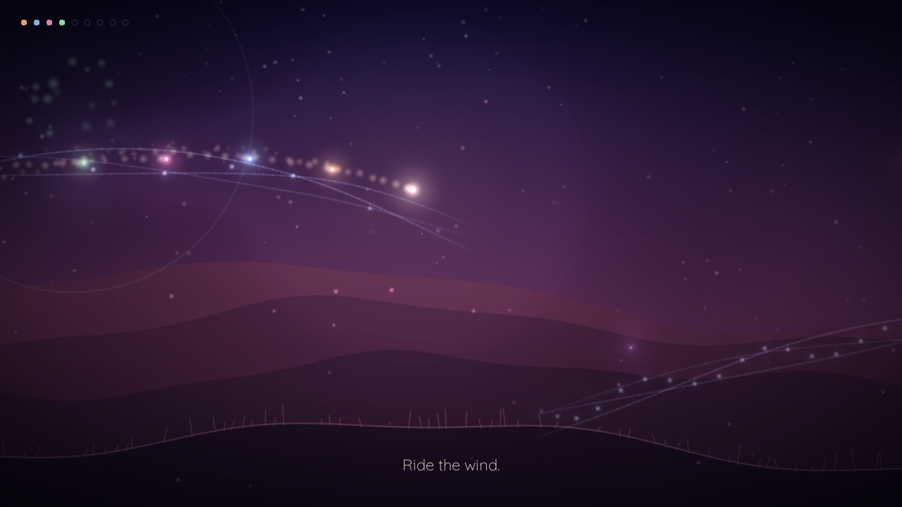

# Kindred Lights

*Sing into the dark. Someone will answer.*

A short, gentle game made by **Rida Kalam** for [thatgamejam #02](https://itch.io/jam/thatgamejam02).
You are a small light alone in a dark land. When you sing, sleeping lights answer. They follow you,
add their voices to yours, and together your light parts the dark. The game is built in
[LÖVE 11.5](https://love2d.org). It takes about 6–9 minutes, has no enemies, and you can't fail.



## The theme, and how the game answers it
The jam's theme is a 60-second track by Jason Grace. `tools/analyze.py` analyses it with librosa:
- about 117 BPM
- F minor, rocking toward D♭ major
- a quiet tonal opening, then a swell
- a rhythm that enters at 21 s, a sustained peak, and a fade at 55 s

The game's four chapters (**Hush, Swell, Pulse, Glow**) follow that arc. The in-game music is
synthesized live (`game/audio.lua`) in the track's key, harmonic rhythm and tempo. It gains one
voice for each friend you wake. In the finale, the original track plays in full and unmodified.
Visual events are timed to its sections, its beats and its loudness (`game/trackdata.lua`). See
[DESIGN_NOTE.md](DESIGN_NOTE.md).

## Controls
| Action | Mouse | Keyboard |
|---|---|---|
| Drift | hold left button | WASD / arrows |
| Sing | right button | Space / J / E / Z |
| Pause | n/a | Esc (Q returns to the title) |
| Fullscreen | n/a | F11 / Alt+Enter |

## Running from source
```
love game
```
The theme track isn't in this repository because it isn't ours to relicense. To hear the real
finale, download the track from the jam page and save it as `game/assets/theme.wav`. Without it,
the finale plays the game's own synthesized music instead.

Test helpers (used for headless testing):
- `--autoplay`: a bot plays the whole game
- `--fast=N`: run N simulation steps per frame
- `--shots`: save screenshots at key moments
- `--skipdraw`: render only the frames that become screenshots
- `--uitest`: scripted menu, pause and credits navigation
- `--start=ch2|ch3|ch4`: start at a later chapter

## Building
`build.sh` builds `dist/KindredLights.love`, a Windows build (`love.exe` fused with the `.love`,
plus the DLLs) and a macOS build (`love.app` with the `.love` in `Contents/Resources`). It expects
`dist_src/love-11.5-win64.zip` and `dist_src/love-11.5-macos.zip` from the
[LÖVE 11.5 release](https://github.com/love2d/love/releases/tag/11.5).

## Credits
- Design and development: Rida Kalam
- Theme music: Jason Grace (thatgamejam #02 theme), used unmodified in the jam builds
- Fonts: Cormorant Garamond, Quicksand (SIL OFL 1.1)
- Engine: LÖVE 11.5

## AI disclosure
This game contains AI-generated content. The source code (gameplay, rendering, the procedural
synthesizer and sequencer, the build and analysis scripts) was written with an AI coding assistant.
There are no AI-generated images or music. All visuals are drawn in code, and all in-game music
other than the theme track is synthesized in code.

## License
The code is under the MIT license (see [LICENSE](LICENSE)). The fonts and the theme track keep
their own licenses (see [NOTICE.md](NOTICE.md)).
