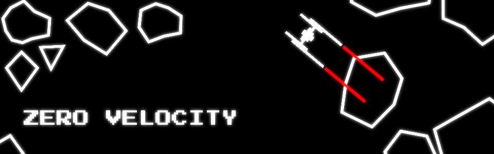

# Zero Velocity

You are being sucked into a black hole and you ran out of fuel for the
hyperdrive! All you have is your spaceship, 2 short-range mining lasers, and...
a bunch of hyperfuel-rich asteroids heading towards you!

Defend your ship, mine enough asteroids to fuel your hyperdrive and make a
desperate jump before too many asteroids get drawn to you by the gravity!

The hotter the lasers are, the more damage they deal. But be careful to avoid
overheating! And keep in mind that your lasers need fuel too.

## Controls

\<D\>, \<Right Arrow\>, \<L\>, \<;\> or \<Left Joystick\> - rotate clockwise.

\<A\>, \<Left Arrow\>, \<H\>, \<J\> or \<Left Joystick\> - rotate counterclockwise.

\<Space\> or \<Button 1\> - fire.

\<M\> - mute music.

\<Escape\> or \<Q\> - exit the game at any time. Keep in mind that your progress won't be saved!

## Credits

See [`CREDITS.md`](./CREDITS.md).

## Copyright

See [`copyright`](./copyright).
