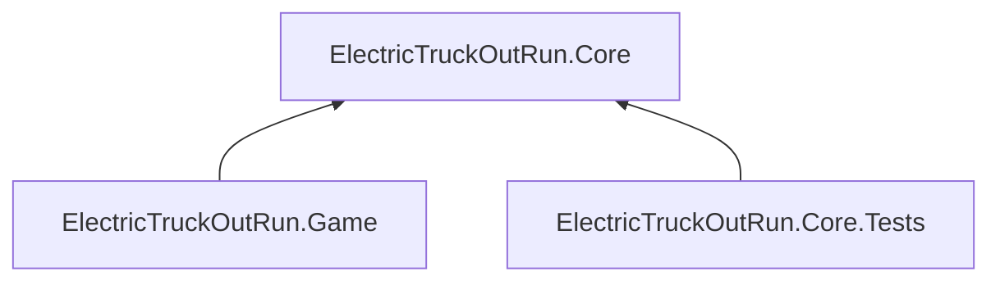
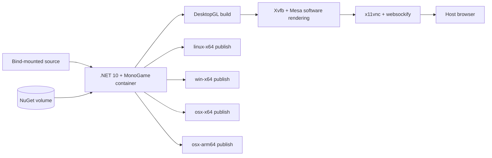

# Electric Truck OutRun

Electric Truck OutRun is a simple OutRun-style game built with MonoGame DesktopGL, C#, and .NET 10. The repository is configured for Docker-first development: the host only needs Docker and GNU Make, while the SDK, MonoGame templates and tools, Linux graphics libraries, content pipeline, Wine shader compiler, and virtual display all live in the development image.

Development runs as a Linux DesktopGL game inside Docker. The game window is exposed through noVNC, so it can be viewed and controlled from a normal host browser. The same project can publish self-contained builds for Linux, Windows, Intel macOS, and Apple Silicon macOS.

## Stack

- .NET SDK 10.0.302
- MonoGame DesktopGL 3.8.4.1
- MonoGame Content Builder 3.8.4.1
- Ubuntu 24.04 (`linux/amd64`) development container
- SDL2, OpenAL, and Mesa software rendering
- Xvfb virtual X server
- x11vnc, websockify, and noVNC browser display
- Wine 9 plus MonoGame's official MGFXC Wine environment
- Docker Compose
- GNU Make

## Development Environment

`docker compose` defines one development service named `dev`. It provides:

- The complete .NET 10 CLI
- The official MonoGame C# templates
- Restored project-local MonoGame tools
- Native libraries needed by DesktopGL
- A software-rendered Linux display
- A browser-accessible game window on `http://localhost:6080`
- A persistent NuGet package cache
- Cross-publishing for Linux, Windows, and macOS

The container deliberately uses `linux/amd64`, even on Apple Silicon. MonoGame's documented shader compiler setup requires x64 Wine and downloads the Windows x64 .NET SDK. Docker Desktop emulates the x64 container on Apple Silicon. Compilation is consequently slower than a native ARM container, but effect compilation remains available and the environment behaves consistently across macOS and Linux hosts.

The Compose entrypoint restores the pinned project-local MonoGame tools whenever a disposable development container starts. This is necessary because `bin` and `obj` persist in the source mount while a previous container's .NET CLI tool registration does not.

## Solution Architecture

Gameplay and simulation code belongs in the platform-independent Core project. The
MonoGame application and the test project may both depend on Core, but Core never
depends on either consumer:



- `ElectricTruckOutRun.Game` owns the MonoGame lifecycle, rendering, input, audio,
  and content pipeline.
- `ElectricTruckOutRun.Core` targets plain `net10.0` and must not reference
  MonoGame or platform APIs.
- `ElectricTruckOutRun.Core.Tests` is the xUnit test assembly for Core behavior.

The container runtime is separate from those compile-time dependencies:



## Project Structure

```text
MonoGame-ElectricTruckOutRun/
├── .config/
│   └── dotnet-tools.json             # Pinned solution-wide MGCB tools
├── .vscode/
│   └── launch.json                   # Solution-wide VS Code debug configuration
├── docs/
│   └── vnc-development.md            # VNC architecture and Docker trade-offs
├── src/
│   ├── ElectricTruckOutRun.Game/
│   │   ├── Content/
│   │   │   └── Content.mgcb          # MonoGame content pipeline definition
│   │   ├── ElectricTruckOutRun.Game.csproj
│   │   ├── Game1.cs                  # Game initialization, update, and draw loop
│   │   └── Program.cs                # Application entry point
│   └── ElectricTruckOutRun.Core/
│       └── ElectricTruckOutRun.Core.csproj
├── tests/
│   └── ElectricTruckOutRun.Core.Tests/
│       └── ElectricTruckOutRun.Core.Tests.csproj
├── scripts/
│   ├── dev-entrypoint.sh             # Restores solution-wide tools
│   └── run-game.sh                   # Xvfb/noVNC development launcher
├── artifacts/
│   └── publish/                      # Generated self-contained releases; ignored by Git
├── Dockerfile                        # Reproducible .NET/MonoGame development image
├── docker-compose.yml                # Source mount, NuGet cache, user, and port wiring
├── Makefile                          # Complete development command surface
├── global.json                       # Pinned .NET SDK
└── ElectricTruckOutRun.sln
```

## Documentation

- [VNC Development Environment](docs/vnc-development.md) — what VNC is, why this project uses it, how the Docker display stack works, and the trade-offs compared with conventional native game development.

## Setup

### 1. Install the host prerequisites

Only these host tools are required:

- Docker Desktop on macOS
- Docker Engine with the Compose plugin on Linux
- GNU Make

.NET, MonoGame, Wine, Node.js, and other language or game-development dependencies are not required on the host.

On Apple Silicon, Docker Desktop must have x86/amd64 emulation enabled. Current Docker Desktop releases normally configure this automatically.

### 2. Clone the repository

```bash
git clone <repository-url>
cd MonoGame-ElectricTruckOutRun
```

### 3. Optionally configure the display port

The default configuration works without an environment file. To change the noVNC host port:

```bash
cp .env.example .env
```

Then edit:

```env
NOVNC_PORT=6080
```

### 4. Build the game

```bash
make docker-game-build
```

The first invocation builds a relatively large development image because it includes the SDK, graphics stack, virtual display, Wine, and the official MonoGame effect-compiler environment. Docker caches those image layers, and NuGet packages persist in a named volume, so later builds are substantially faster.

## Usage

### Run the game

```bash
make docker-run
```

When the command prints the display URL, open:

```text
http://localhost:6080/vnc.html?autoconnect=1&resize=scale
```

The default template displays the MonoGame cornflower-blue game window. Click inside the noVNC canvas before using the keyboard. Press `Esc` in the game or `Ctrl+C` in the terminal to stop it.

The noVNC port binds only to `127.0.0.1`; it is not exposed to other machines on the network. The development display has no password because it is local-only.

### Watch source files

```bash
make docker-watch
```

`dotnet watch` rebuilds and restarts the game after supported source changes. A game window cannot preserve its runtime state across a process restart.

### Open a development shell

```bash
make docker-shell
```

Normal CLI workflows are available inside the container:

```bash
dotnet --info
dotnet new list MonoGame
dotnet restore
dotnet build
dotnet run --project src/ElectricTruckOutRun.Game/ElectricTruckOutRun.Game.csproj
dotnet workload list
dotnet workload install <workload>
dotnet tool install <tool>
dotnet publish
```

The repository is bind-mounted at `/workspace`, so source changes made inside or outside the shell are immediately visible on both sides.

Running `dotnet run` directly requires an active display. Use `make docker-run` for the prepared virtual display, or run the launcher from the shell:

```bash
./scripts/run-game.sh
```

## Make Commands

```text
make docker-game-build                 Build the Debug configuration
make docker-run                        Run Linux DesktopGL through noVNC
make docker-watch                      Rebuild and restart on source changes
make docker-restore                    Restore NuGet packages and local tools
make docker-test                       Run all test projects in the solution
make docker-format                     Apply dotnet format
make docker-format-check               Verify formatting without modifying files
make docker-publish-game               Publish every supported desktop RID
make docker-publish-game-linux         Publish linux-x64
make docker-publish-game-windows       Publish win-x64
make docker-publish-game-macos         Publish osx-arm64 and osx-x64
make docker-publish-game-macos-arm64   Publish Apple Silicon macOS
make docker-publish-game-macos-x64     Publish Intel macOS
make docker-shell                      Open Bash in the development container
make docker-clean                      Remove project and publish output
make docker-build                      Build only the development image
```

Every operational target runs in Docker. `make docker-game-build` and the other targets pass the host UID and GID into Compose so bind-mounted files are not left owned by root on Linux.

## Testing

Run:

```bash
make docker-test
```

This builds and executes `ElectricTruckOutRun.Core.Tests` through `dotnet test`. The
test project is intentionally empty at this architecture stage because writing unit
tests is outside the scope of this refactor. Add Core tests there without taking a
dependency on the Game project.

The browser display validates the Linux execution path. It does not replace final native testing on each release platform.

## Debugging

For the containerized development build:

```bash
make docker-run
```

Build output, exceptions, and application logs remain visible in the terminal. `make docker-watch` provides a quick edit/rebuild/restart cycle.

The supplied official MonoGame documentation describes source-level debugging through Visual Studio Code and C# Dev Kit. This repository does not install a graphical IDE or debugger on the host, because Docker and Make are the only required host dependencies. Breakpoint debugging therefore requires an optional host editor/debugger integration and is outside the Docker-only baseline.

The virtual display uses Mesa software rendering. This makes it portable but does not reproduce a native GPU driver exactly. Also, `SDL_AUDIODRIVER=dummy` disables audio output in the noVNC development session because VNC does not transport game audio. Test graphics-driver behavior, audio, controllers, fullscreen transitions, and platform-specific input on native release builds.

## Publishing

### Publish every target

```bash
make docker-publish-game
```

Outputs are written to:

```text
artifacts/publish/
├── linux-x64/
├── win-x64/
├── osx-arm64/
└── osx-x64/
```

Every build is self-contained, so the destination machine does not need .NET or MonoGame installed.

### Publish and test on Apple Silicon

```bash
make docker-publish-game-macos-arm64
./artifacts/publish/osx-arm64/ElectricTruckOutRun.Game
```

### Publish and test on an Intel Mac

```bash
make docker-publish-game-macos-x64
./artifacts/publish/osx-x64/ElectricTruckOutRun.Game
```

If the executable bit is lost while copying the output:

```bash
chmod +x artifacts/publish/osx-arm64/ElectricTruckOutRun.Game
```

The publish output is an unsigned directory containing a native Mach-O executable and its dependencies. It is suitable for local development testing, but it is not a signed `.app` bundle or installer. Public macOS distribution requires separate application bundling, code signing, entitlements where applicable, and Apple notarization. Those packaging steps are not defined by the supplied MonoGame getting-started documentation and are intentionally not invented here.

macOS may block an unsigned binary copied from another machine. Use Finder's **Open** action or approve the application in **System Settings → Privacy & Security**. Do not disable Gatekeeper globally.

## Creating a New MonoGame Desktop Project

The current project was generated from MonoGame's official cross-platform desktop template. To repeat that process from inside the container:

```bash
make docker-shell
dotnet new install MonoGame.Templates.CSharp@3.8.4.1
dotnet new mgdesktopgl -n MyGame -o src/MyGame
dotnet new sln -n MyGame --format sln
dotnet sln MyGame.sln add src/MyGame/MyGame.csproj
```

The template is already installed in this development image, so the install command is normally unnecessary. The explicit version is shown for reproducibility.

MonoGame 3.8.4.1's template generates a .NET 9 project and floating `3.8.*` framework references. For this repository's .NET 10 policy, update the generated project to:

```xml
<TargetFramework>net10.0</TargetFramework>
```

and pin:

```xml
<PackageReference Include="MonoGame.Framework.DesktopGL" Version="3.8.4.1" />
<PackageReference Include="MonoGame.Content.Builder.Task" Version="3.8.4.1" />
```

Also retain the generated `.config/dotnet-tools.json`, which pins the MGCB command-line tools used by the build. In this repository that manifest lives at the solution root rather than under the individual project, so tool restore covers Game, Core, and the test project alike.

## Configuration

### User-configurable environment

| Variable | Default | Purpose |
| --- | --- | --- |
| `NOVNC_PORT` | `6080` | Host port for the browser development display |

No secrets or mandatory environment variables are required.

### Container-managed environment

| Variable | Value | Purpose |
| --- | --- | --- |
| `DISPLAY` | `:99` | Virtual X display used by MonoGame |
| `DOTNET_CLI_HOME` | `/opt/dotnet-cli` | Writable shared .NET CLI/template state |
| `NUGET_PACKAGES` | `/nuget/packages` | Persistent NuGet package location |
| `MGFXC_WINE_PATH` | `/opt/winemonogame` | Official MonoGame Wine effect-compiler prefix |
| `LIBGL_ALWAYS_SOFTWARE` | `1` | Portable Mesa rendering inside Docker |
| `SDL_AUDIODRIVER` | `dummy` | Prevents audio-device failures in headless Docker |
| `XDG_CACHE_HOME` | `/tmp/monogame-cache` | Writable Mesa/application cache |
| `LOCAL_UID` / `LOCAL_GID` | Set by Make | Matches container writes to the host user |

## Volume Mappings

| Source | Container path | Purpose |
| --- | --- | --- |
| Repository bind mount | `/workspace` | Immediate access to source and generated artifacts |
| `nuget-cache` named volume | `/nuget/packages` | Reuses NuGet packages across disposable containers |

Build containers are disposable. Source, `bin`, `obj`, and publish artifacts live in the bind-mounted repository, while downloaded NuGet packages survive in the named volume.

## Design Decisions

### DesktopGL instead of a browser target

Official MonoGame currently has no public browser/WebAssembly project template or supported browser runtime. DesktopGL is the documented cross-platform desktop template and supports shared game code across Windows, Linux, and macOS. noVNC exposes the Linux game window in a browser but does not turn the game into WebAssembly.

### Docker Compose is included

Compose provides meaningful value here: it declares the source bind mount, persistent NuGet cache, local-only noVNC port, runtime environment, x64 platform requirement, and host-user mapping in one place. Repeating those settings in every `docker run` command would be error-prone.

### One development image

A single SDK image keeps shell, build, content processing, run, and publish behavior consistent. A smaller runtime image would not help the local workflow because the game runs through the development container and native releases are emitted as ordinary artifacts.

### Separate Game, Core, and test projects

The DesktopGL application is an infrastructure shell around the game rules. Keeping
simulation, race systems, AI, physics, road generation, and reusable utilities in
Core makes that code testable without starting graphics or audio. The one-way
project references enforce the boundary: Game and Core.Tests reference Core, while
Core has no package or project reference to MonoGame or Game.

### Exact SDK and MonoGame versions

`global.json`, the base image tag, project packages, template package, and local tools are pinned. This prevents an unreviewed package update from changing the build. The official MGFXC setup script is protected by a SHA-256 checksum; when MonoGame intentionally changes that script, review it before updating the checksum.

### x64 Linux on Apple Silicon

The official MonoGame Wine setup uses Windows x64 components. Selecting `linux/amd64` ensures those components work on both Intel machines and Apple Silicon through Docker's emulation. This trades build speed for compatibility and reproducibility.

### Software rendering and noVNC

Directly forwarding Linux X11 or GPU devices from Docker is host-specific and particularly awkward on macOS. Xvfb, Mesa, and noVNC provide a predictable environment requiring only a browser. Native release testing remains necessary for performance, audio, controller, and driver validation.

### Self-contained release builds

Publishing with `--self-contained true` makes each output independent of a host .NET installation. The tradeoff is a larger release directory—roughly 80–90 MB before game content for the initial project.

## Troubleshooting

### The first image build is slow

Wine and the official effect-compiler environment add substantial size. Let the initial build finish; Docker caches the expensive layers. On Apple Silicon, x64 emulation also makes compilation slower.

### Port 6080 is already in use

Create `.env` and choose another port:

```env
NOVNC_PORT=6081
```

Then open the same noVNC path on the new port.

### The game is blank or noVNC does not connect

Keep `make docker-run` running in the terminal and wait for:

```text
MonoGame display: http://localhost:6080/vnc.html?autoconnect=1&resize=scale
```

Then refresh the browser. If the process exited, inspect the terminal output for a build or runtime exception.

Virtual-display diagnostics are written inside the running container to:

```text
/tmp/monogame-xvfb.log
/tmp/monogame-x11vnc.log
/tmp/monogame-openbox.log
```

### The game has no sound in Docker

This is expected. noVNC carries video and input, not application audio, and the container deliberately uses SDL's dummy audio driver. Test sound using a native macOS, Windows, or Linux release.

### A macOS build will not open

Confirm that the runtime identifier matches the machine:

- Apple Silicon: `osx-arm64`
- Intel: `osx-x64`

Restore the executable bit if necessary, then use Finder's **Open** action or approve it under macOS Privacy & Security. The generated development artifact is unsigned.

### Rebuild from a clean project state

```bash
make docker-clean
make docker-game-build
```

`make docker-clean` removes project and publish outputs but deliberately preserves the Docker image and NuGet cache.

## Official Documentation Boundary

This setup follows the supplied MonoGame getting-started documentation for:

- .NET 10 SDK support
- `MonoGame.Templates.CSharp`
- The cross-platform desktop template
- Project-local MonoGame content tools
- Wine-based effect compilation on Linux

Docker, Compose, Xvfb, noVNC, cross-RID publishing, and macOS packaging are not specified by that chapter. They are infrastructure around the documented DesktopGL project rather than new MonoGame commands. Where the documentation is incomplete—most notably native macOS application bundling, signing, notarization, and Docker breakpoint debugging—this README identifies the gap instead of presenting an unsupported MonoGame workflow.
