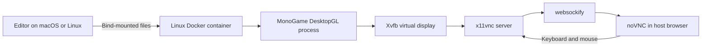

# VNC Development Environment

This document explains how and why Electric Truck OutRun displays its Dockerized MonoGame window in a browser. VNC is not part of MonoGame and does not convert the game into a web application. It is infrastructure that lets a graphical Linux application running inside Docker be viewed and controlled from the host.

## 1. What Is VNC?

VNC stands for **Virtual Network Computing**. It is a remote-display system built on the Remote Framebuffer (RFB) protocol.

A VNC server captures the graphical output of another computer or virtual display. A VNC client shows that output and sends keyboard and mouse input back to the server:

```text
Remote display → VNC server → network → VNC client
Remote display ← keyboard and mouse input ← VNC client
```

Because VNC operates on the rendered framebuffer, the client does not need to understand MonoGame, SDL, OpenGL, or the application drawing the window. It receives screen updates as pixels and returns user input.

In this project, the browser is the VNC client. The Linux Docker container is the remote computer, even though it is running locally on the same Mac or Linux host.

The relevant technologies are:

- **RFB**: the remote framebuffer protocol used by VNC.
- **Xvfb**: an X server that creates a virtual Linux monitor without physical display hardware.
- **Openbox**: a small window manager responsible for the game window's frame and placement.
- **x11vnc**: a VNC server that shares the virtual X display.
- **websockify**: translates the VNC TCP connection into WebSockets that a browser can use.
- **noVNC**: an HTML5 VNC client that displays and controls the virtual desktop in a browser.

Further reading:

- [RFC 6143: The Remote Framebuffer Protocol](https://www.rfc-editor.org/info/rfc6143/)
- [noVNC official repository](https://github.com/novnc/noVNC)
- [noVNC advanced usage](https://github.com/novnc/noVNC/wiki/Advanced-usage)
- [TigerVNC official repository](https://github.com/TigerVNC/tigervnc)

## 2. Why We Are Using VNC

Docker Desktop on macOS runs Linux containers inside a Linux virtual machine. A MonoGame DesktopGL process started inside that container is therefore a Linux application. It cannot create a native macOS window directly.

The game still needs a graphical display for development and interactive testing. VNC bridges that gap:



This approach provides several benefits:

- The host does not need .NET, MonoGame, SDL, OpenAL, Mesa, Wine, or MGCB installed.
- macOS and Linux developers use the same Linux development environment.
- The environment is reproducible from the Dockerfile.
- The source remains on the host and is immediately available inside the container through a bind mount.
- The game can be interacted with through a browser already available on the host.
- Linux development and testing remain isolated from host library versions.

The browser page is only a remote display. The game has not been compiled to WebAssembly and is not running in the browser's JavaScript or WebAssembly runtime.

## 3. How We Set It Up

The setup is divided by responsibility. Image-build operations belong in the Dockerfile, runtime operations belong in scripts, and container wiring belongs in Docker Compose.

### Docker image

The [`Dockerfile`](../Dockerfile) installs:

- Xvfb
- Openbox
- x11vnc
- noVNC
- websockify
- Mesa software-rendering libraries
- SDL2 and OpenAL
- Wine and MonoGame's official effect-compiler environment
- .NET 10 and the pinned MonoGame templates

The Dockerfile does not start these services. A Dockerfile `RUN` instruction executes while building an image and must finish before that image can be used. Long-running services such as VNC and the game must start when a container is created.

### Compose configuration

The [`docker-compose.yml`](../docker-compose.yml) file:

- Mounts the repository at `/workspace`.
- Persists NuGet packages in `/nuget/packages`.
- Sets the virtual display to `:99`.
- Exposes container port `6080` only on host address `127.0.0.1`.
- Configures Mesa software rendering.
- Configures SDL's dummy audio driver.
- Uses `linux/amd64` for compatibility with MonoGame's x64 Wine shader compiler.
- Runs the local-tool entrypoint before each container command.

The port mapping is:

```yaml
ports:
  - "127.0.0.1:${NOVNC_PORT:-6080}:6080"
```

Binding to `127.0.0.1` is important. This development VNC session has no password or TLS, so it must not be exposed to the local network or internet.

### MonoGame tool restoration

The [`scripts/dev-entrypoint.sh`](../scripts/dev-entrypoint.sh) script restores the pinned project-local MGCB tools every time a disposable development container starts. This keeps `dotnet run`, `dotnet build`, and commands entered through `make shell` consistent even when bind-mounted `bin` and `obj` directories already exist.

### Virtual display and VNC server

The [`scripts/run-game.sh`](../scripts/run-game.sh) script starts the runtime components in this order:

1. **Xvfb** creates virtual display `:99` at `1280x720`.
2. The script waits until that display responds.
3. **Openbox** starts as the window manager.
4. **x11vnc** shares display `:99` on internal port `5900`.
5. **websockify** serves noVNC and proxies browser WebSockets on port `6080` to VNC port `5900`.
6. `dotnet run` starts the MonoGame DesktopGL game on virtual display `:99`.
7. The browser connects to noVNC and shows the Linux game window.

The complete command path is:

```text
make run
  → docker compose run
    → dev-entrypoint.sh
      → restore local MonoGame tools
      → run-game.sh
        → Xvfb
        → Openbox
        → x11vnc
        → websockify + noVNC
        → dotnet run
```

Run it with:

```bash
make run
```

Then open:

```text
http://localhost:6080/vnc.html?autoconnect=1&resize=scale
```

For an edit/rebuild/restart loop:

```bash
make watch
```

Source code is edited in a normal host editor. noVNC is used only to view and interact with the running game.

## 4. Takeaways and Trade-offs

A conventional MonoGame developer normally installs the .NET SDK, MonoGame templates and tools, graphics libraries, editor extensions, and platform dependencies directly on the development computer. The developer then runs the game as a native host process, which opens a normal macOS, Windows, or Linux window.

This project deliberately chooses a different workflow because its central requirement is:

> Docker and GNU Make should be the only development dependencies installed on the host.

That decision creates the need for a virtual display. Docker gives the project dependency isolation and reproducibility, but a Linux container on macOS cannot draw directly into the native macOS desktop. Xvfb and VNC provide the missing display boundary.

The practical workflow is:

```text
Write code with a host editor
        ↓
Build and run everything in Docker
        ↓
Test the Linux game through noVNC
        ↓
Publish a self-contained macOS build
        ↓
Test the native macOS executable locally
```

### Benefits

- No language runtime or game-development dependency is installed on the host.
- New developers receive the same toolchain after cloning the repository.
- Dependency versions are pinned and isolated.
- Linux behavior can be tested consistently on macOS and Linux hosts.
- Self-contained native artifacts can still be produced for macOS and Windows.

### Trade-offs

- Software rendering is slower and does not represent native GPU performance.
- VNC adds display latency and is not ideal for evaluating frame pacing.
- noVNC does not transport the game's audio; container development uses a dummy audio driver.
- Controller support, fullscreen transitions, platform-specific input, and native graphics behavior require testing on the target operating system.
- The x64 development container is slower on Apple Silicon because Docker must emulate it.
- Integrated breakpoint debugging needs optional editor/debugger integration beyond the Docker-and-Make baseline.

VNC therefore complements native testing; it does not replace it. It provides a practical daily-development display while preserving the Docker-only dependency policy. Before releasing the game, test every target using its native self-contained build.
